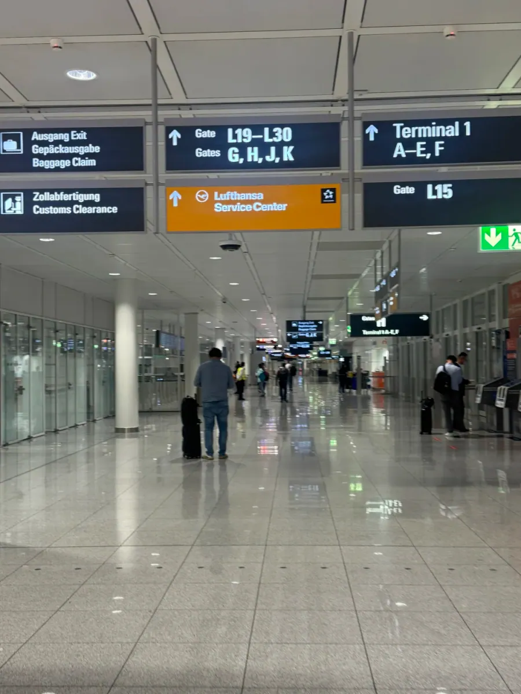

Aeroportul München (MUC) se află pe Erdinger Moos, la aproximativ 28 km nord-est de oraș. Este al doilea aeroport ca mărime din Germania și unul dintre principalele huburi europene ale Lufthansa și Star Alliance. Terminalul 1 deservește porțile A–E și F pentru majoritatea companiilor din afara grupului Lufthansa; Terminalul 2 deservește porțile G, H, J, K și L pentru Lufthansa și partenerii săi, cu o parte a zonei de porți în clădirea satelit, accesibilă cu un scurt tren fără conductor.

Pentru oricine sosește din China cu o legătură Schengen, aeroportul este simplu într-un sens și incomod în altul. Distanțele sunt scurte și semnalizarea clară, dar o escală aici nu este doar o chestiune de a urma mulțimea afară din clădire. Pe același tronson de coridor treceți de securitate, vă înregistrați datele în sistemul de intrare/ieșire al UE și sunteți admis în Schengen — iar ordinea este inversă față de ce se așteaptă mulți călători.

Parcursul de mai jos provine de la o escală de dimineață devreme din septembrie 2026: aproximativ 20 de minute de la ușa aeronavei până la trecerea controlului pașapoartelor. Se aplică unui singur caz — sosirea din afara Schengen și conectarea la o destinație Schengen, ceea ce înseamnă admiterea la München. Dacă zborul următor pleacă din spațiul Schengen, pasul de admitere dispare, dar securitatea și mersul până la poartă sunt identice.

## 1. Singura precondiție: bagajele înregistrate până la destinație

Dacă o escală merge fără probleme se decide în mare măsură când cumpărați biletul. Cu un bilet unic, bagajele sunt etichetate până la destinația finală și duceți prin ruta de transfer doar bagajul de cabină. Cu bilete separate, trebuie să fiți admis, să vă ridicați valiza și să o înregistrați din nou. Parcursul de 20 de minute există doar dacă bagajele sunt înregistrate până la destinație.

Uitați-vă la eticheta bagajului de pe spatele cărții de îmbarcare: câmpul destinației ar trebui să arate codul din trei litere al orașului final, nu MUC. Întrebați la check-in — „este înregistrat până la X?" — și agentul vă va spune. Biletele separate înseamnă de obicei o nouă carte de îmbarcare de la un birou de transfer, care trebuie luată în calcul în timpul de conectare.

**Bagajele înregistrate până la destinație sunt precondiția pentru întreaga rută.** Fără ele, urmați Baggage Claim: fiți admis, ridicați valiza, urcați din nou la plecări și faceți check-in din nou. Acest ocol costă mult timp, așa că prevedeți trei ore sau mai mult.

## 2. Urmați semnele „Connecting flights"

Când se deschide ușa pasarelei, primul lucru nu este să vă găsiți poarta, ci să alegeți direcția corectă. Urmați fluxul la etaj, unde semnele bleumarin de deasupra împart traficul: Ausgang/Exit și Gepäckausgabe/Baggage Claim pe o parte, porțile A–E și F ale Terminalului 1 plus porțile G, H, J și K ale Terminalului 2 pe cealaltă. Semnele gri Connecting flights atârnă imediat după această bifurcație.

Greșeala clasică este să vedeți Exit și să mergeți după el. Odată trecut de acea ușă, sunteți în holul public, iar întoarcerea în zona aeroportuară înseamnă din nou securitate — escala s-a încheiat efectiv. Cu bagajele înregistrate până la destinație, o escală înseamnă fără ridicare de bagaje și fără ieșire; urmați Connecting flights și sunteți în regulă.

Dacă zborul următor este către un alt oraș din UE, poarta se află de obicei în **G sau K**. Aceste litere sunt semnalizate separat de A–E și F ale Terminalului 1, așa că citiți litera înainte de a porni; acolo unde ruta necesită trenul, semnele adaugă o săgeată și simbolul liftului.

## 3. Preînregistrarea EES și securitatea

Munchen pune securitatea înainte de imigrare, invers față de multe aeroporturi: mai întâi securitatea, apoi scara rulantă în jos spre controlul pașapoartelor. În fața culoarelor stau mai multe chioșcuri portocalii etichetate Non-EU Passports Pre-Registration — terminalele de autoservire pentru sistemul de intrare/ieșire al UE, care se implementează în etape din octombrie 2025. La prima intrare înregistrează o imagine facială și patru amprente; la vizitele ulterioare în termen de trei ani le poate compara în schimb.

Când cozile sunt lungi, înregistrați-vă mai întâi și intrați la rând după aceea. Puneți pașaportul pe cititorul din stânga și interfața trece singură pe chineză; faceți o fotografie facială conform indicațiilor, îndepărtând pălăria, masca și ochelarii; apoi apăsați cele patru degete ale mâinii drepte, fără degetul mare, pe scanner. Ecranul vă spune apoi să folosiți culoarul manual (preînregistrare). Înregistrarea doar stochează datele în avans; nu este admitere.

Panoul de anunțuri de lângă aparate adaugă detalii care merită știute: preînregistrarea este doar pentru pasagerii **cu vârsta de 12 ani și peste**; dacă acest rând este aglomerat, există un alt set de chioșcuri la 60 m înainte; banda roșie de pe podea marchează distanța de 1,5 metri.

La zborul matinal al autorului, securitatea era liniștită și culoarul manual era închis, așa că intrarea direct la coada de securitate a fost mai rapidă. Verificați care rând este cel mai scurt în ziua respectivă. Securitatea funcționează cam ca acasă, cu două lucruri pe care oamenii le uită: goliți cheile, monedele și telefonul într-o tavă și scoateți din geantă orice ați cumpărat dintr-un magazin duty-free — lichidele merg în punga transparentă, nu în fundul valizei.

## 4. Trei întrebări la controlul pașapoartelor

După securitate, scara rulantă în jos vă lasă în holul pașapoartelor. Culoarele sunt împărțite după pașaport: UE, SEE și Elveția pe o parte, restul pe cealaltă. În acea dimineață erau deschise multe ghișee și fiecare coadă avea două-trei persoane, așa că luați rândul cel mai scurt — lungimea cozii contează mai mult decât tipul de culoar.

Ofițerul a pus trei întrebări: unde mergeți, cât stați și ce faceți. Toate trei indică același lucru — dacă călătoria are sens. În ce zonă este poarta următoare, câte nopți plănuiți și în ce calitate intrați; dacă răspunsurile se potrivesc cu actele, totul se termină în mai puțin de un minut.

Autorul avea un dosar cu documente, dar itinerariul, biletul de întoarcere, rezervarea la hotel și polița de asigurare nu au fost niciodată cerute — ofițerul nici măcar nu s-a uitat la ele. Asta nu înseamnă să le lăsați acasă: ofițerii de frontieră pot cere un bilet de întoarcere și dovada cazării, așa că țineți-le în bagajul de cabină. Răspunsurile trebuie să fie scurte și consecvente cu datele din acte.

De la ușa aeronavei până la trecerea controlului pașapoartelor au durat aproximativ **20 de minute**. Cifra este valabilă doar pentru un zbor matinal; același aeroport la amiază este o altă poveste. Prevedeți mai mult decât timpul minim de conectare al companiei aeriene, în loc să tratați cele 20 de minute ca pe o regulă.

## 5. Poarta și trenul automat

Nu alergați spre poartă imediat ce ați trecut. Cel mai trecut cu vederea punct de oprire este toaleta, care se află un nivel mai jos sau la capătul zonei porților.

Un nivel mai jos se află peronul trenului. Sistemul de transport fără conductor al Münchenului leagă ambele terminale de clădirea satelit; peronul are uși de ecran din sticlă cu rame galben strălucitor. Afișajul de deasupra ușilor arată unde merge următorul tren: porțile G și H ale Terminalului 2, porțile A–E și F ale Terminalului 1 și Gepäckausgabe pentru ridicarea bagajelor, cu o numărătoare inversă care indica Abfahrt in 2 min.

Călătoria este scurtă, iar ușile se deschid direct în zona porților G și K. Zona de așteptare este un singur culoar lung, cu platforma aeronavelor în spatele ferestrelor de la podea la tavan; panouri galbene atârnă deasupra porților de îmbarcare, iar podeaua era aproape goală.

Mai rămâne un ultim lucru de făcut: verificați din nou poarta. Poarta autorului s-a schimbat de la **G23 la G12**, cu o distanță considerabilă între ele, și fără o a doua privire la ecrane ar fi fost ușor să așteptați în locul greșit până la ultimul apel. Verificați la aterizare, din nou după controlul pașapoartelor și încă o dată înainte de a vă așeza; aplicația aeroportului și ecranele cu informații de zbor sunt sincronizate, iar oricare dintre ele este mai bună decât poarta tipărită pe bilet.

Dacă timpul este scurt, confirmați noua poartă înainte de a face cumpărături: magazinele se adună în jurul zonelor G și H și este ușor să pierdeți noțiunea timpului.

De la un capăt la altul, o escală de dimineață la München este de fapt o schimbare de transport: securitate, înregistrare, admitere, tren, poartă. Ce merge prost este să o tratați ca pe o ieșire din aeroport — urmând Exit din obișnuință sau așteptând la o bandă o valiză care nu venea niciodată. Rutele și orele de deschidere a culoarelor se schimbă cu traficul, așa că verificați site-ul Aeroportului München și semnalizarea în ziua respectivă.

## Legături utile

- **Pe acest site**: [Aeroportul München (MUC)](/airport/MUC), [Germania (DE)](/country/DE)
- **Wikipedia**: [Aeroportul München](https://en.wikipedia.org/wiki/Munich_Airport)
- **Baidu Baike**: [Aeroportul München](https://baike.baidu.com/item/%E6%85%95%E5%B0%BC%E9%BB%91%E6%9C%BA%E5%9C%BA)
