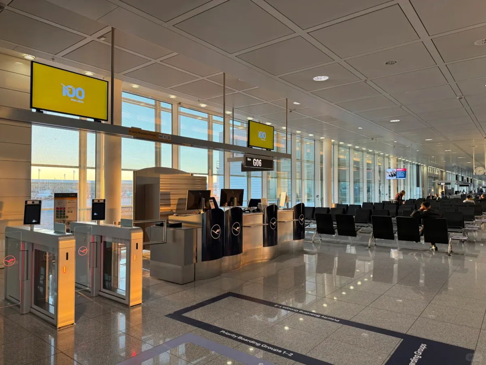

Münchens flygplats (MUC) ligger på Erdinger Moos omkring 28 km nordost om staden. Den är Tysklands näst största flygplats och en av Lufthansas och Star Alliances viktigaste europeiska nav. Terminal 1 hanterar gates A–E och F för de flesta flygbolag utanför Lufthansagruppen; terminal 2 hanterar gates G, H, J, K och L för Lufthansa och dess partner, där en del av gateområdet ligger i satellitbyggnaden som nås med ett kort förarlöst tåg.

För den som anländer från Kina med en Schengenanslutning är flygplatsen lätt i ett avseende och besvärlig i ett annat. Avstånden är korta och skyltningen tydlig, men ett byte här handlar inte bara om att följa strömmen ut ur byggnaden. På samma korridorsträcka passerar du säkerhetskontrollen, registrerar dina uppgifter i EU:s in- och utresesystem och släpps in i Schengen — och ordningen är den omvända mot vad många resenärer förväntar sig.

Genomgången nedan kommer från ett tidigt morgonbyte i september 2026: ungefär 20 minuter från flygplansdörren till avklarad passkontroll. Den gäller endast ett fall — landning från ett land utanför Schengen och anslutning till en destination inom Schengen, vilket innebär att du släpps in i München. Om ditt vidare flyg lämnar Schengenområdet försvinner inresesteget, men säkerhetskontrollen och promenaden till gaten är desamma.

## 1. Den enda förutsättningen: bagage incheckat hela vägen

Om ett byte går smidigt avgörs till stor del redan när du köper biljetten. Med en genomgående biljett märks väskorna upp till slutdestinationen och du bär bara med dig handbagaget genom transfervägen. Med separata biljetter måste du släppas in, hämta resväskan och checka in den igen. Promenaden på 20 minuter fungerar bara om bagaget är incheckat hela vägen.

Titta på bagagetaggen bakom boardingkortet: fältet för destination ska visa trebokstavskoden för din slutliga stad, inte MUC. Fråga vid incheckningen — "är det här incheckat hela vägen till X?" — så berättar personalen det. Separata biljetter innebär vanligtvis ett nytt boardingkort från en transferdisk, vilket måste räknas in i bytestiden.

**Bagage incheckat hela vägen är förutsättningen för hela den här rutten.** Utan det följer du i stället skylten Baggage Claim: du släpps in, hämtar resväskan, går upp till avgångshallen igen och checkar in på nytt. Den omvägen tar mycket tid, så räkna med tre timmar eller mer.

## 2. Följ skyltarna "Connecting flights"

När dörren från ombordstigningsbryggan öppnas är det första inte att hitta din gate utan att välja rätt riktning. Följ flödet uppåt, där de mörkblå skyltarna ovanför delar upp trafiken: Ausgang/Exit och Gepäckausgabe/Baggage Claim på ena sidan, terminal 1 gates A–E och F samt terminal 2 gates G, H, J och K på den andra. De grå skyltarna Connecting flights hänger strax bortom delningen.

Det klassiska misstaget är att se Exit och följa med. När du väl har gått genom den dörren är du i den allmänna hallen, och för att komma tillbaka till flygsidan krävs en ny säkerhetskontroll — bytet är i praktiken över. Med bagage incheckat hela vägen innebär ett byte ingen bagageutlämning och ingen utgång; följ Connecting flights och du är på rätt väg.

Om ditt vidare flyg går till en annan EU-stad ligger gaten vanligtvis i **G eller K**. De bokstäverna skyltas separat från terminal 1:s A–E och F, så läs bokstaven innan du går; där vägen kräver tåget kompletteras skyltarna med en pil och en hisssymbol.

## 3. Förregistrering i EES och säkerhetskontroll

München har säkerhetskontrollen före passkontrollen, tvärtemot många flygplatser: först säkerhet, sedan rulltrappan ned till passkontrollen. Framför säkerhetsbanorna står flera orange automater märkta Non-EU Passports Pre-Registration — självbetjäningsterminalerna för EU:s in- och utresesystem, som har införts etappvis sedan oktober 2025. Vid första inresan registreras en ansiktsbild och fyra fingeravtryck; vid senare besök inom tre år kan de i stället matchas.

När köerna är långa registrerar du dig först och ställer dig i kön efteråt. Lägg passet på läsaren till vänster så växlar gränssnittet automatiskt till kinesiska; ta ett ansiktsfoto enligt anvisningarna och ta av hatt, mask och glasögon; tryck sedan de fyra fingrarna på höger hand, utom tummen, mot skannern. Skärmen uppmanar dig sedan att använda den manuella kanalen (förregistrering). Registreringen lagrar bara uppgifterna i förväg; den innebär inte att du släpps in.

Anslagstavlan bredvid automaterna ger ytterligare detaljer värda att känna till: förregistrering är endast för passagerare **från 12 år**; om den här kön är lång finns ytterligare en uppsättning automater 60 m längre fram; röd tejp på golvet markerar avståndet på 1,5 meter.

På författarens tidiga flyg var det lugnt i säkerhetskontrollen och den manuella kanalen stängd, så det gick snabbare att ställa sig direkt i säkerhetskön. Kontrollera vilken kö som är kortast samma dag. Säkerhetskontrollen fungerar ungefär som hemma, med två saker som folk glömmer: töm fickorna och lägg nycklar, mynt och telefon i en bricka, och ta upp allt som köpts i en taxfreebutik ur väskan — vätskor ska ligga i den genomskinliga påsen, inte i botten av väskan.

## 4. Tre frågor i passkontrollen

Efter säkerhetskontrollen tar rulltrappan ned dig till passhallen. Kanalerna är uppdelade efter pass: EU, Europeiska ekonomiska samarbetsområdet och Schweiz på ena sidan, alla andra på den andra. Många diskar var öppna den morgonen och varje kö hade två eller tre personer, så välj den kortaste kön — kölängden spelar större roll än typen av kanal.

Tjänstemannen ställde tre frågor: vart är du på väg, hur länge stannar du och vad arbetar du med. Alla tre pekar på samma sak — om resan är trovärdig. Frågorna handlar om vilken zon din anslutande gate ligger i, hur många nätter du planerar och i vilken egenskap du reser in; om svaren stämmer med dokumenten är det över på under en minut.

Författaren höll i en mapp med dokument, men reseplanen, returbiljetten, hotellbokningen och försäkringsbeviset efterfrågades aldrig — tjänstemannen tittade inte ens på dem. Det betyder inte att du ska lämna dem hemma: gränspolisen kan begära returbiljett och bevis på boende, så ha dem i handbagaget. Svaren ska vara korta och stämma med datumen på papperet.

Från flygplansdörren till avklarad passkontroll tog det omkring **20 minuter**. Den siffran gäller bara för ett tidigt flyg; samma flygplats mitt på dagen är en annan historia. Räkna med mer än flygbolagets minsta bytestid i stället för att behandla 20 minuter som en regel.

## 5. Gaten och persontransporten

Spring inte till gaten direkt när du har kommit igenom. Det mest förbisedda stoppet är toaletten, som ligger en våning ned eller längst bort i gateområdet.

En våning längre ned ligger tågplattformen. Münchens förarlösa persontransportsystem förbinder båda terminalerna med satellitbyggnaden; plattformen har glasskärmdörrar med ljust gula ramar. Displayen ovanför dörrarna visar vart nästa tåg går: terminal 2 gates G och H, terminal 1 gates A–E och F samt Gepäckausgabe för bagageutlämning, med en nedräkning där det står Abfahrt in 2 min.

Färden är kort och dörrarna öppnas direkt in i gateområdet för G och K. Väntområdet är en lång hall med uppställningsplattan bakom fönster från golv till tak; gula skärmar hänger ovanför ombordstigningsgaterna och det var nästan folktomt.

Det finns en sista sak att göra: kontrollera gaten igen. Författarens gate ändrades från **G23 till G12**, en bra bit att gå, och utan en andra titt på skärmarna hade det varit lätt att vänta på fel ställe till sista utropet. Kontrollera vid landningen, igen efter passkontrollen och en gång till innan du sätter dig; flygplatsens app och flyginformationsskärmarna är synkroniserade, och båda är bättre än gaten som står tryckt på biljetten.

Om tiden är knapp bekräftar du den nya gaten innan du shoppar: butikerna ligger samlade kring G och H, och det är lätt att tappa tidsuppfattningen.

Från början till slut är ett tidigt morgonbyte i München egentligen ett transportbyte: säkerhet, registrering, insläpp, tåg, gate. Det som går fel är att behandla det som att lämna flygplatsen — att följa Exit av vana eller vänta vid ett band på en resväska som aldrig skulle komma. Rutter och kanalernas öppettider ändras med trafiken, så kontrollera webbplatsen för Münchens flygplats och skyltarna samma dag.

## Relaterade länkar

- **På den här webbplatsen**: [Münchens flygplats (MUC)](/airport/MUC), [Tyskland (DE)](/country/DE)
- **Wikipedia**: [Münchens flygplats](https://en.wikipedia.org/wiki/Munich_Airport)
- **Baidu Baike**: [Münchens flygplats](https://baike.baidu.com/item/%E6%85%95%E5%B0%BC%E9%BB%91%E6%9C%BA%E5%9C%BA)
