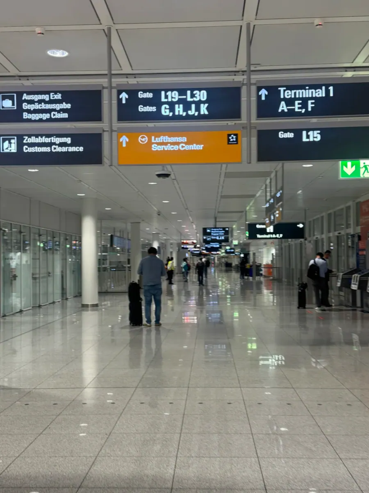
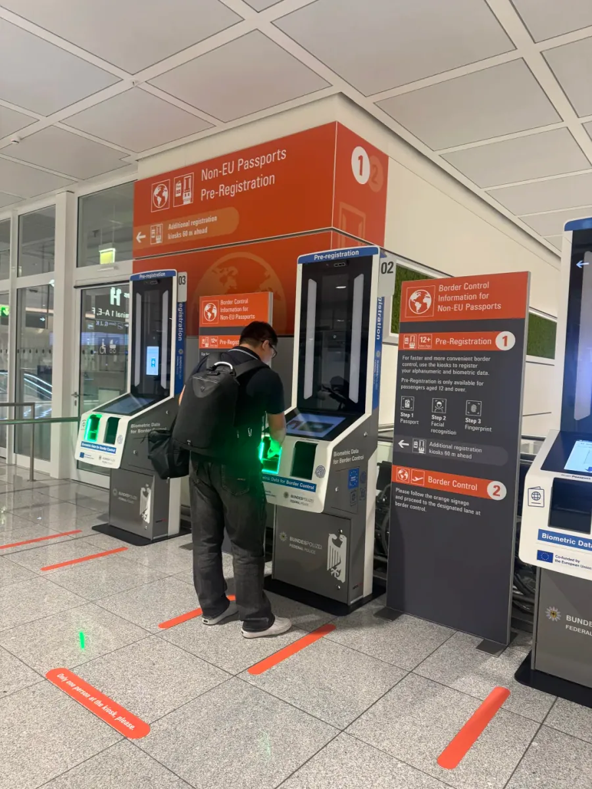
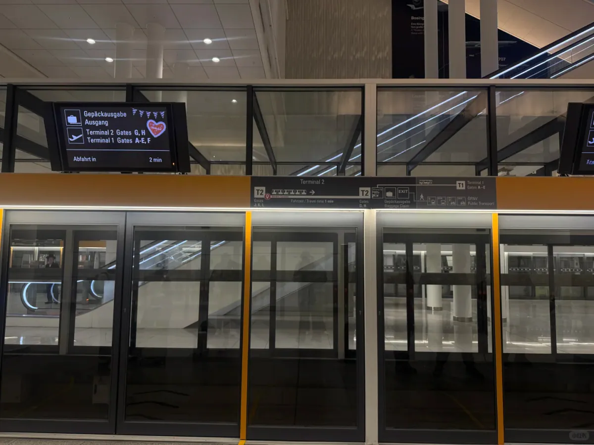
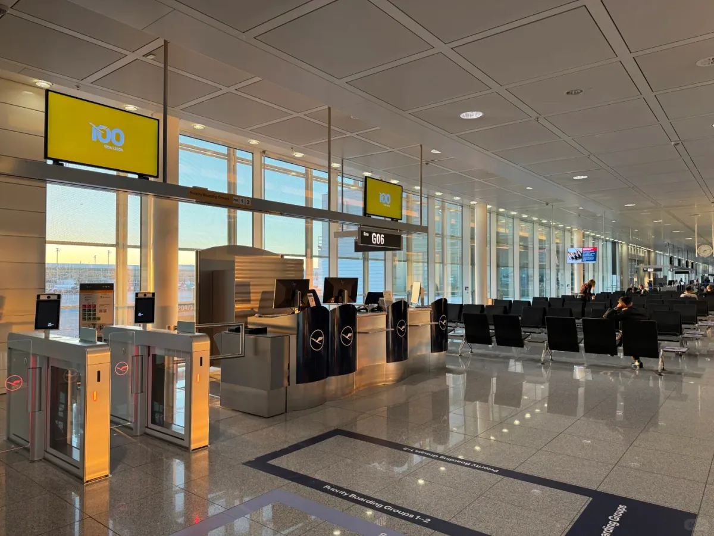

慕尼黑機場（Munich Airport，MUC）在市區東北約 28 公里的埃爾丁沼澤上，是德國第二大機場，也是漢莎航空與星空聯盟在歐洲的主要樞紐。機場分兩座航廈：1 號航廈走 A–E 與 F 閘口，漢莎系以外的航司多用這裡；2 號航廈走 G、H、J、K、L 閘口，漢莎和星空聯盟成員在這裡運營，其中一部分登機區在衛星廳，要坐一段無人駕駛的小火車才到。

對從國內飛來、下一程落在申根區內的旅客來說，慕尼黑的好處是距離短、標識清楚，麻煩的地方在於轉機並不等於「跟著人流走出去」。同一段路上，你要先後完成安檢、EES 資訊登記和申根入境三道手續，而且順序和不少機場相反：先安檢，再護照檢查。第一次來的人常常在安檢口前猶豫，或者在指示牌前面臨兩個方向時選錯一邊。

下面這條動線來自 2026 年 9 月的一次早班機實測：從下飛機到過完護照檢查，前後 20 分鐘左右。它只適用於一種情況——從非申根國家落地、下一程在申根區內，也就是必須在慕尼黑辦入境的那種。如果你的下一程飛往非申根國家，中間不需要入境，流程會短一些，但安檢和去閘口這兩段仍然一樣。

## 一、轉機的前提：行李直掛

轉機順不順，很大程度上在買票和值機的時候就已經定了。聯程機票的行李會直掛到最終目的地，你在慕尼黑只需要帶著隨身行李走轉機通道；非聯程機票則必須先入境、到轉盤把箱子取出來，再重新辦一次值機和託運。後面這套 20 分鐘的動線，只有行李直掛才成立。

怎麼確認？看登機牌後面那張行李小票，目的地一欄印的應該是最終城市的三字碼，而不是 MUC。值機時可以順口問一句「直掛到某某嗎」，地勤會當場告訴你；如果兩段票是分開買的，往往還要在中轉櫃檯或出發層重新打一次登機牌，這一步也要算進轉機時間裡。

**行李直掛是這條動線的前提**，沒有它，後面的每一步都要重來。萬一沒有直掛，別硬跟著 Connecting flights 走：跟 Baggage Claim 的牌子去取行李、入境，再回到出發層重新值機。這一段會多花不少時間，轉機時間最好留到三小時以上；如果只有一小時出頭，基本只能指望改簽。

還有一件小事值得提前做：把隨身行李減到最少，護照、登機牌、下一程行程單放在同一個袋子裡。轉機路上要上下幾段電梯，安檢時要脫外套、把電腦單獨拿出來，箱子越輕，你走得越快。

轉機時間留多久，取決於兩件事：落地的時間點，以及你是否需要入境。早班機從落地到過完護照檢查只要 20 分鐘，但同一座機場，中午前後五六架寬體機同時到達，這段時間可能翻倍。穩妥的估法是：需要入境時，在航司給出的最短轉機時間上再加一小時；只是過安檢、不需要入境的轉機，按最短時間走即可。

## 二、跟著 Connecting flights 走

廊橋開啟之後，第一件事不是找閘口，而是找對方向。下飛機跟著人流上樓，頭頂的深藍色指示牌會把兩個方向分開：一邊是 Ausgang／Exit 和 Gepäckausgabe／Baggage Claim，另一邊是 1 號航廈的 A–E、F 和 2 號航廈的 G、H、J、K 閘口。灰色的 Connecting flights 標識就掛在這條分岔口後面，跟著它走，人就不會出到公共區。

這裡最容易犯的錯，是看到 Exit 就跟著走。出了那道門就是公共區，再想回隔離區要重新安檢，轉機時間直接作廢。記住一句話：箱子直掛的情況下，轉機不取行李、不出關，人跟著 Connecting flights 走就對了。

如果你的下一程是飛往歐盟城市，閘口一般落在 **G 區或 K 區**。這兩個字母在指示牌上和 1 號航廈的 A–E、F 是分開標的，先看清字母再走；需要坐小火車的時候，牌子會用箭頭和電梯圖示提示，別到了站臺才發現要回頭。

## 三、EES 預登記與安檢

慕尼黑把安檢放在了入境之前，這一點和不少機場相反：先過安檢，再下樓過護照檢查。安檢口前面立著幾臺橙色的機器，頂部寫著 Non-EU Passports Pre-Registration，這就是歐盟出入境資訊系統（EES）的自助登記機。這套系統自 2025 年 10 月起分階段啟用，第一次入境時採集面部影像和四指指紋，之後三年內再入境可以直接比對。

人多的時候，先用它把資料錄進去，再去排隊，能省掉人工櫃檯前的一段等待。操作順序不復雜，但每一步都要按螢幕來：先把護照放在機器左側的讀取區，介面會自動切成中文；再按提示拍一張面部照片，帽子、口罩、眼鏡都要摘掉；最後把右手除大拇指以外的四個手指按在指紋區上。錄完螢幕會提示你走人工通道（pre-registration lane）——這一步只是把資料提前存好，並不等於完成入境。

機器旁的說明牌還寫了幾個細節：預登記只對 **12 歲及以上**的旅客開放；如果這邊排隊，前方 60 米還有一排同樣的機器；地上的紅色膠帶標著 1.5 米間距，排隊時別貼太近。趕時間的時候未必顧得上看這些，但知道前面還有機器，至少不會在一臺機器後面乾等。

錄完資料去人工通道。作者當天的航班是早班機，安檢本身人不多，這條 pre-registration 通道沒有開，直接排隊安檢反而更快。所以到了現場先看哪條隊短，不要預設人工通道一定開著；通道開不開，取決於當天的客流和櫃檯排班。

安檢的規矩和國內差不多，但有兩點容易忘：口袋裡的鑰匙、硬幣、手機全部掏出來放進托盤；在免稅店或市區買的東西要單獨拿出來，液體裝進透明袋，別壓在箱子最底下。腰帶、手錶、外套也要過機，穿一雙好脫的鞋會輕鬆很多。

## 四、護照檢查的三個問題

過了安檢，乘下行電梯，就到護照檢查大廳。這裡的通道按護照分：歐盟、歐洲經濟區與瑞士護照走一邊，其他護照走另一邊。早上開的櫃檯不少，每條隊只有兩三個人，挑最短的那條排就行，不用特意去找某一種通道——隊伍長短比通道類型更影響時間。

輪到時只問了三個問題：去哪裡（Where do you go）、待多久（How long do you stay）、做什麼（What do you do）。三個問題都指向同一件事——你的行程是否自洽：下一程的閘口在哪個區、打算待幾天、以什麼身份入境。答案和行程單對得上，通常就結束了。

作者手裡拿著一個材料袋，但行程單、回程機票、酒店預訂和保險單都沒有被要求出示，邊檢甚至沒有看一眼。這不代表下一趟不用帶：邊檢有權要求出示返程票和住宿證明，材料放在隨身包裡，問到時能立刻拿出來，比當場翻箱子體面得多。回答也儘量簡短、具體，和紙面上的日期一致，不要臨場改口。

從下飛機到過完護照檢查，全程 **20 分鐘**左右。這個數字只對早班機有效——同一座機場，中午和傍晚的轉機客流完全是另一回事，轉機時間還是按航司建議的下限往上留，別把 20 分鐘當成通用標準。

## 五、閘口與小火車

過關之後先別急著衝向閘口。轉機路上最容易忽略的是洗手間：護照檢查之後這一段，洗手間要麼在下一層，要麼在登機區盡頭，拖著箱子來回走一趟並不划算。作者的做法是先解決這件事，再下電梯去坐車。

再往下一層就是小火車的站臺。慕尼黑機場的這套無人駕駛旅客運輸系統把兩座航廈和衛星廳連在一起，站臺裝了玻璃遮蔽門，門框鑲著醒目的黃色邊條。門楣上的顯示屏會寫清下一班車的方向：Terminal 2 的 G、H 閘口，Terminal 1 的 A–E、F，以及 Gepäckausgabe 行李提取；右下角的 Abfahrt in 2 min 是發車倒計時。

車程不長，車門一開就是 G、K 登機區。這裡的候機區是一整條長廊，落地窗外就是停機坪；黃色顯示屏掛在登機閘機上方，下面是一排黑色皮質座椅和自助登機閘機，清晨的光線打在地面上，幾乎沒有人。

到了這一步，還有最後一件事要做：再看一次閘口。作者的閘口從 **G23 變成了 G12**，兩個口隔著一段路，如果不是在候機區又看了一次屏，很可能在錯誤的地方等到廣播。穩妥的做法是落地看一次、過完護照檢檢視一次、坐下之前再看一次；機場 App 和航班資訊屏是同步的，哪一次都比機票上的舊資訊可靠。

時間緊的時候，先確認新閘口，再決定要不要逛店。慕尼黑機場的免稅店和餐飲集中在 G、H 一帶，逛起來容易忘了時間，尤其是在你已經走完三道手續、覺得「反正都辦完了」的時候。

萬一方向走反了——比如已經跟著 Exit 出了公共區，或者坐小火車坐過了站——先別慌，找最近的問訊處或轉機服務櫃檯，報出航班號和剩餘時間，工作人員會告訴你最快的走法。慕尼黑的旅客運輸系統只在隔離區裡執行，一旦出了隔離區，就得重新過一次安檢，時間成本比走錯方向本身更大。所以比起事後補救，出發前把「不取行李、不出關」這句話記住更划算。

整段走下來，早班機的慕尼黑轉機更像一次換乘：安檢、登記、入境、坐車、候機，五步而已。真正容易出錯的，是把它當成「出機場」來走——看到 Exit 就跟著走，或者在行李轉盤前等一個根本不會來的箱子。以上動線、通道開放情況與機器位置會隨客流和機場調整，出行前以慕尼黑機場官網與現場指示為準。

## 相關連結

- **本站頁面**：[慕尼黑機場（MUC）](/tw/airport/MUC)、[德國（DE）](/tw/country/DE)
- **維基百科**：[慕尼黑機場](https://zh.wikipedia.org/wiki/%E6%85%95%E5%B0%BC%E9%BB%91%E6%9C%BA%E5%9C%BA)
