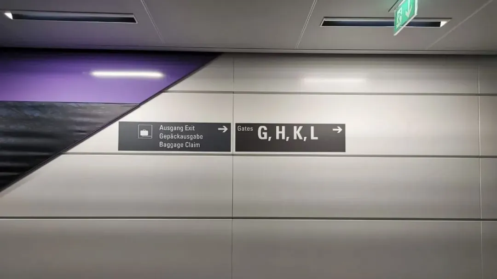
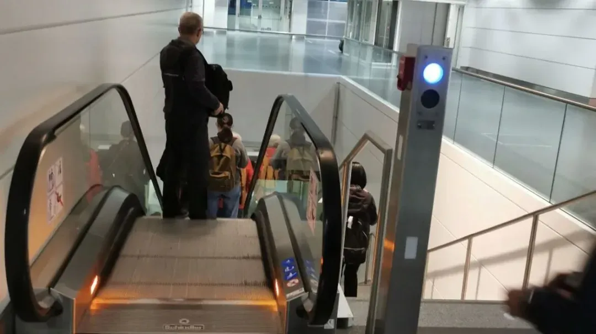
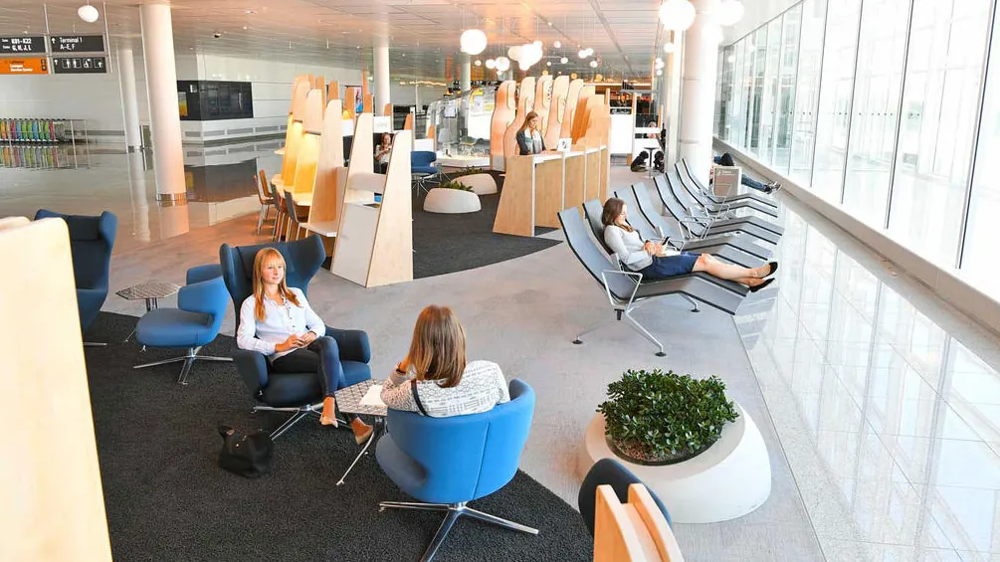

এই গাইডে **মিউনিখ বিমানবন্দর (MUC)** নিয়ে আলোচনা করা হয়েছে — সবার আগে ট্রান্সফার, তারপর বিমানবন্দরের সুবিধা ও ফ্লাইট পরিচালনা। এখানে কানেক্টিং সংক্রান্ত সবকিছু — কত সময় লাগবে ও কোন কোন নথি লাগবে থেকে শুরু করে ধাপে ধাপে প্রক্রিয়া — এই একটি লেখাতেই রয়েছে।

## ট্রান্সফার

### কত সময় হাতে রাখবেন

মিউনিখ বিমানবন্দর শেনজেন ও নন-শেনজেন এলাকায় বিভক্ত, ফলে চার ধরনের ট্রান্সফার হয় — **শেনজেন থেকে নন-শেনজেন**, **নন-শেনজেন থেকে শেনজেন**, **নন-শেনজেন থেকে নন-শেনজেন** এবং **শেনজেন থেকে শেনজেন**। আপনার ভ্রমণসূচি অনুযায়ী 1.5–3 ঘণ্টা হাতে রাখুন।

### চারটি সমন্বয়

| সমন্বয় | কী কী জড়িত |
| --- | --- |
| **শেনজেন থেকে শেনজেন** | শুধু নিরাপত্তা স্ক্রিনিং। আলাদা করে বুক করা টিকিটে আপনাকে আপনার লাগেজ সংগ্রহ করে আবার চেক-ইন করতে হবে। |
| **শেনজেন থেকে নন-শেনজেন** | শুধু নিরাপত্তা স্ক্রিনিং; পরবর্তী আন্তর্জাতিক ফ্লাইটের জন্য প্রবেশ ভিসা লাগে না। যদি আপনার চেক-ইন করা ব্যাগে এমন পণ্য থাকে যার ট্যাক্স ফেরত চান, প্রথমে শুল্ক বিভাগে সেগুলোতে স্ট্যাম্প করিয়ে নিন, তারপর চেক-ইন করুন, নিরাপত্তা পার হন, প্রস্থান নিয়ন্ত্রণে পাসপোর্টে স্ট্যাম্প নিন এবং গেটে যাওয়ার আগে রিফান্ড ডেস্কে টাকা বুঝে নিন। থ্রু-টিকিটে থাকলে শেনজেনের ভেতরের আপনার প্রস্থান বিমানবন্দরেই ট্যাক্স রিফান্ড সম্পন্ন করা যায়। |
| **নন-শেনজেন থেকে শেনজেন** | থ্রু-টিকিট থাকুক বা না থাকুক, মিউনিখেই আপনাকে ইমিগ্রেশন পার হতে হবে এবং শেনজেন ভিসা লাগবে। থ্রু-টিকিটের লাগেজ চেক-ইন অবস্থায়ই থাকতে পারে; অন্যথায় দেশে প্রবেশ করুন, ব্যাগ সংগ্রহ করুন, শেনজেনের ভেতরের ফ্লাইটের জন্য আবার চেক-ইন করুন, তারপর নিরাপত্তা পার হয়ে গেটে যান। |
| **নন-শেনজেন থেকে নন-শেনজেন** | থ্রু-টিকিটে লাগেজ সংগ্রহ করতে হয় না, তবে নন-শেনজেন গন্তব্যের জন্য ভিসা লাগবে। ট্রান্সফার চ্যানেল অনুসরণ করুন; আপনাকে জার্মানিতে প্রবেশ করতে হবে না এবং শেনজেন ভিসাও লাগবে না। |

### ধাপে ধাপে

মিউনিখে কানেক্ট করা দ্রুত ও সহজ — সাইনবোর্ডই আপনাকে সোজা গেটে পৌঁছে দেবে। উদাহরণ হিসেবে ধরুন **সাংহাই → মিউনিখ (ট্রানজিট) → নেপলস (LH727)**। পুরো ক্রমটি হলো:

**মিউনিখে পৌঁছান → আপনার গেট নিশ্চিত করুন → ট্রান্সফার নিরাপত্তা → শাটল ট্রেন নিন → শুল্ক বিভাগ পার হন → গেটে অপেক্ষা করুন**

1. অবতরণের পর সাইনবোর্ড আপনাকে প্রস্থানের দিকে পথ দেখাবে।

2. কিছুদূর এগোলেই একটি বড় ফ্লাইট-তথ্য স্ক্রিন পাবেন। **আপনার প্রকৃত গেট আবার যাচাই করুন** — এটি টিকিটে লেখা গেটের চেয়ে আলাদা হতে পারে। যেমন, টিকিটে লেখা থাকতে পারে K (শুল্ক বিভাগের জন্য ব্যবহৃত), অথচ স্ক্রিনে দেখাবে G35, যেটিই আপনার আসল গেট।

3. স্ক্রিনের পাশেই একটি নামার এস্কেলেটর ট্রান্সফার নিরাপত্তা চেকের দিকে নিয়ে যায়। লাইন প্রায়ই দীর্ঘ হয়, তাই যথেষ্ট সময় হাতে রাখুন।

4. নিরাপত্তা পার হওয়ার পর সাইনবোর্ড অনুসরণ করে শাটল ট্রেনে যান, যা আপনাকে প্রবেশ স্ট্যাম্পের জন্য K এলাকায় নিয়ে যাবে। তারপর G সাইন অনুসরণ করে আপনার গেটে পৌঁছান।

> **লক্ষ করুন:** গন্তব্য পর্যন্ত লাগেজ চেক-ইন করা থ্রু-টিকিটে ট্রান্সফারের সময় আপনাকে লাগেজ সংগ্রহ করতে হবে না। যদি চেক-থ্রু না থাকে, ট্রান্সফার নিরাপত্তা চেকের পাশের শুল্ক চ্যানেল দিয়ে গিয়ে ব্যাগ সংগ্রহ করুন এবং আবার চেক-ইন করুন।

### ট্রান্সফারের ব্যবহারিক টিপস

- **থ্রু-টিকিট আছে কি নেই, তা-ই পথ নির্ধারণ করে।** থ্রু-টিকিটে আপনার ব্যাগ চেক-থ্রু থাকে এবং আপনাকে ট্রান্সফার চ্যানেলে পাঠায়; আলাদা টিকিট মানে দেশে প্রবেশ, ব্যাগ সংগ্রহ ও আবার চেক-ইন — এর ওপর অন্তত এক ঘণ্টা যোগ করুন।
- **নথিপত্র সঙ্গে রাখুন।** পাসপোর্ট (অন্তত ছয় মাসের বৈধতা রাখার পরামর্শ), শেনজেন ভিসা, পরবর্তী বোর্ডিং পাস, ভ্রমণসূচি ও হোটেল বুকিং — সীমান্ত কর্মকর্তা এগুলোর যেকোনোটি চাইতে পারেন।
- **ভুল জোনের জন্য সময় রাখুন।** টার্মিনাল 2-এর কিছু গেট এলাকায় শাটল ট্রেনে যেতে হয় (যেমন K এলাকা)। প্রথমে স্ক্রিন পড়ুন, তারপর পুরোনো বোর্ডিং পাসে ছাপা গেট নয়, বরং G / H / K / L অক্ষরগুলো অনুসরণ করুন।

## বিমানবন্দরের মৌলিক তথ্য

- **নাম:** মিউনিখ বিমানবন্দর
- **কোড:** MUC (IATA) / EDDM (ICAO)
- **অবস্থান:** এরডিং মোস, মিউনিখের 28 কিমি উত্তর-পূর্বে
- **প্রধান এয়ারলাইনস:** লুফথানসা, আউগসবুর্গ এয়ারওয়েজ, এয়ার ডলোমিটি
- **চালু:** 1992

## এটি যেভাবে নির্মিত হয়

- **স্থান নির্বাচন:** এরডিং মোস প্রথম পছন্দ ছিল না — এটির পক্ষে বলার মতো বিশেষ কিছু ছিল না — যতদিন না জার্মান ফেডারেল প্রতিরক্ষা মন্ত্রণালয় এরডিং বিমানঘাঁটি বন্ধ করার সিদ্ধান্ত নেয়, যা সেখানে একটি বড় বিমানবন্দর গড়ার পথ খুলে দেয়। 1969 সালের জুলাইয়ে নতুন বিমানবন্দরের জন্য আনুষ্ঠানিকভাবে এরডিং মোসকে নির্বাচিত করা হয়, এই যুক্তিতে যে এটি আঞ্চলিক ও জাতীয় পরিকল্পনার সঙ্গে খাপ খায়।
- **চ্যালেঞ্জ:** দক্ষিণে চতুর্থ রানওয়ের পরিকল্পনা প্রত্যাখ্যাত হয় — ঘণ্টায় 120টি উড্ডয়ন ও অবতরণকে অত্যধিক ঘন ঘন বলে মনে করা হয়, এবং এর বিরুদ্ধে 5,724টি আপত্তি দাখিল হয়। পরবর্তী আপিলগুলোও খারিজ হয়, ফলে নির্মাণকাজের কিছু অংশ থেমে যায়।
- **নকশা:** জবাবে মিউনিখ এয়ারপোর্ট জিএমবিএইচ 1981 সালে একটি সংশোধিত পরিকল্পনা জমা দেয়, যাতে ছিল দ্বৈত রানওয়ে ব্যবস্থা, রাতের ফ্লাইটের নিয়ম ও উচ্চতর যাত্রী-পূর্বাভাস; এটি 1984 সালের জুনে অনুমোদিত হয়।
- **উদ্বোধন:** 1992 সালের 11 মে মিউনিখ বিমানবন্দর যাত্রা শুরু করে। 16–17 মে রাতে এয়ারলাইনগুলো মিউনিখ-রিম থেকে সরে আসে, এবং মধ্যরাতের ঠিক আগে রিমের শেষ লুফথানসা বোয়িং 737 উড্ডয়ন করলে পুরোনো বিমানবন্দরের ইতিহাসের সমাপ্তি ঘটে।

## সুবিধা ও সেবা

### লাউঞ্জ

**বিনামূল্যে বিশ্রাম এলাকা**

- **① বায়ার্ন লাউঞ্জ:** টার্মিনাল 2, গেট G ও H, লেভেল 03 (নিরাপত্তার আগে); 24 ঘণ্টা; বিনামূল্যে।

- **② বিশ্রাম এলাকা:** টার্মিনাল 2, লেভেল 04 গেট G ও K, লেভেল 05 গেট H ও L (নিরাপত্তার পরে); 24 ঘণ্টা; যাত্রীদের জন্য বিনামূল্যে।

**টাকা দিয়ে প্রবেশের লাউঞ্জ**

- **① এয়ারপোর্ট লাউঞ্জ ইউরোপ:** টার্মিনাল 1, মডিউল B, লেভেল 05 (নিরাপত্তার পরে); প্রতিদিন 06:00–21:00; জনপ্রতি €43 থেকে।

- **② এয়ারপোর্ট লাউঞ্জ ওয়ার্ল্ড:** টার্মিনাল 1, মডিউল B, লেভেল 06 (নিরাপত্তার পরে); প্রতিদিন 05:15–21:45; জনপ্রতি €48 থেকে।

**এয়ারলাইনসের লাউঞ্জ**

- **① লুফথানসা লাউঞ্জ** (শুধু লুফথানসা ও স্টার অ্যালায়েন্সের সদস্যদের জন্য): টার্মিনাল 2, লেভেল 04 গেট G–L, এবং লেভেল 05-এর নন-পাবলিক এলাকা।

- **② এমিরেটস লাউঞ্জ** (এমিরেটসের ফার্স্ট ও বিজনেস ক্লাস, গোল্ড ও প্ল্যাটিনাম সদস্য, এবং কাতার এয়ারওয়েজের গোল্ড ও প্ল্যাটিনাম সদস্য): টার্মিনাল 1, মডিউল C, লেভেল 05; প্রতিদিন তিনটি সময়সীমায় খোলা — 07:30–10:15, 12:00–15:30 ও 18:30–22:15।

**NapCabs ঘুমানোর পড**

NapCabs হলো মিউনিখ বিমানবন্দরের রাত কাটানোর ঘুমানোর পড, রাতযাপন বা দীর্ঘ ট্রান্সফার থাকলে বিবেচনায় নিতে পারেন। এগুলোতে আছে আরামদায়ক ও বেশ ব্যক্তিগত পরিসরের ঘুমানোর জায়গা, বিনামূল্যে ইথারনেট ও পাওয়ার সকেট, এবং বিনোদনসহ একটি স্ক্রিন।

- **কোথায়:** T2 লেভেল 04, গেট G06; T2 লেভেল 05, গেট H32; T2 লেভেল 03, সার্ভিস সেন্টার; T2 SAT লেভেল 05, গেট L04
- **দাম:** 06:00–22:00 ঘণ্টায় €15; 22:00–06:00 ঘণ্টায় €10 (সর্বনিম্ন দুই ঘণ্টা)

### খাবার

মিউনিখ বিমানবন্দরে 60টিরও বেশি রেস্তোরাঁ ও ট্যাভার্ন আছে, যেখানে স্থানীয় বিশেষ খাবার, পরিচিত এশীয় খাবার এবং পৃথিবীর নানা প্রান্তের পদ পাওয়া যায়। বিমানবন্দরের নিজস্ব ক্রাফট বিয়ার বিখ্যাত — দশ ইউরোর কিছু বেশি খরচে আপনি মধ্যরাত পর্যন্ত পান করতে পারেন, বাভারিয়ান খাবার ও রাতের আবহে মোড়া হয়ে।

- **Bamee**

- **Seafood Sylt**

- **Airbräu**

- **4 URBS**

### ডিউটি-ফ্রি

মিউনিখ বিমানবন্দরে অনেক ডিউটি-ফ্রি দোকান আছে, যেখানে আন্তর্জাতিক ব্র্যান্ডের পণ্য — পারফিউম, কসমেটিকস, অ্যাকসেসরিজসহ আরও অনেক কিছু — ডিউটি-ফ্রি দামে কেনা যায়।

| ধরন | ব্র্যান্ড |
| --- | --- |
| বিলাসবহুল | Gucci, Armani, Zegna, Ferragamo, Bulgari প্রভৃতি |
| পারফিউম ও কসমেটিকস | Dior, La Mer, Chanel, Sisley, Shiseido, MAC, Estée Lauder, Lancôme প্রভৃতি |
| চামড়াজাত পণ্য ও ব্যাগ | Hermès, Longchamp, Furla, Mandarina Duck, Liebeskind প্রভৃতি |
| অ্যাকসেসরিজ | Swarovski, Misaki, Fossil, Esprit প্রভৃতি |

> শেনজেনের ভেতরে কানেক্ট করছেন? ডিউটি-ফ্রিতে কেনা পণ্য রসিদসহ সিল করা অবস্থায় রাখুন, এবং ট্যাক্স রিফান্ড দরকার হলে লাইনে দাঁড়ানোর সময় রেখে দিন (রিফান্ডের পথ উপরের "চারটি সমন্বয়" অংশে বর্ণনা করা হয়েছে)।

### বিমানবন্দরের হোটেল

ট্রান্সফার যাত্রীদের জন্য বিমানবন্দরের ঠিক পাশেই দুটি হোটেল আছে।

**হিল্টন মিউনিখ এয়ারপোর্ট**

- T1 ও T2-এর মাঝে
- টেলি: +49 89 97820
- US$160 থেকে

**নোভোটেল মিউনিখ এয়ারপোর্ট**

- ফ্লুগহাফেন বেজুচারপার্ক স্টেশন থেকে 700 মিটার
- টেলি: +49 89 9705130
- US$100 থেকে

### ধূমপান এলাকা

মিউনিখ বিমানবন্দরের ধূমপান এলাকা টার্মিনাল 1 (জোন A, B, C, D ও F) এবং টার্মিনাল 2 (জোন G, H, K ও L)-এর এয়ারসাইড নন-পাবলিক অংশে অবস্থিত।

## ফ্লাইট পরিচালনা

মিউনিখ ইউরোপের অন্যতম বৃহত্তম বিমান চলাচল কেন্দ্র, যেখানে 101টি এয়ারলাইন 68টি দেশের 242টি গন্তব্যে ফ্লাইট চালায়। বিমানবন্দরটি দিনে 24 ঘণ্টা উচ্চ ফ্রিকোয়েন্সিতে চলে, এবং এর কঠোর ও দক্ষ ব্যবস্থাপনা সময়ানুবর্তিতা উচ্চ রাখে, ফলে যাত্রীরা সময়মতো পৌঁছান।

## এয়ারলাইনদের চিত্র

মিউনিখে অনেক এয়ারলাইন সেবা দেয়, যাদের নেতৃত্বে লুফথানসা ও স্টার অ্যালায়েন্সের সদস্যরা। আজ লুফথানসা অংশীদারিত্বের বাইরের প্রতিটি ফ্লাইট (এয়ার ফ্রান্স, ব্রিটিশ এয়ারওয়েজ ইত্যাদি) টার্মিনাল 1 ব্যবহার করে, আর টার্মিনাল 2 সংরক্ষিত লুফথানসা ও স্টার অ্যালায়েন্সের ক্যারিয়ারদের জন্য, যেমন কাতার এয়ারওয়েজ, প্রিভেটএয়্যার ও ইভিএ এয়ার। এই বৈচিত্র্য যাত্রীদের রুট নির্বাচনে বিস্তর সুযোগ দেয়। বিমানবন্দরটি শহরতলিতে হলেও যোগাযোগ ভালো, এর কার্গো ব্যবসা শক্তিশালী, এবং এর চারপাশে একটি বিমানশিল্প ক্লাস্টার গড়ে উঠেছে। যাত্রীদের আরও ভালো সেবা দিতে মিউনিখ বিমানবন্দর তার পরিবহন সংযোগ ক্রমাগত উন্নত করার এবং টার্মিনাল ও রানওয়ে সম্প্রসারণের পরিকল্পনা করেছে।

## যাত্রীরা যা বলেন

এই তিনটি পর্যালোচনা 2015 থেকে 2018 সালের মধ্যে লেখা পাবলিক প্ল্যাটফর্মের পোস্ট, নামার আগে জায়গাটি সম্পর্কে দ্রুত ধারণা পেতে কাজে লাগবে:

- **অবস্থান ও সংযোগ:** কেন্দ্র থেকে কিছুটা দূরে, তবে এস-বান সরাসরি চলে এবং ট্রান্সফারের পথ মসৃণ; জার্মানির দ্বিতীয় বৃহত্তম বিমানবন্দর এবং ইউরোপের অন্যতম প্রধান কেন্দ্র।
- **সুবিধা ও সেবা:** বিনামূল্যের কফি, চা ও ওয়াই-ফাই বারবার উল্লেখিত, কেনাকাটা অত্যন্ত ভালো, খাবারের প্রচুর বিকল্প, সীমান্ত কর্মীরা বন্ধুত্বপূর্ণ; লুফথানসার টার্মিনাল 2-এ নিজস্ব চেক-ইন ও ট্রান্সফার এলাকা আছে।
- **গাড়ি ভাড়া ও কেনাকাটা:** বিমানবন্দরের ভেতরেই গাড়ি ভাড়া করা যায়, নিজে চালিয়ে ভ্রমণের জন্য সুবিধাজনক; টার্মিনাল 2-এ শেনজেন আগমনের পর একটি ছোট প্লাজা আছে, যেখানে সুপারমার্কেট, রেস্তোরাঁ ও বায়ার্ন মিউনিখের দোকান; ডিউটি-ফ্রি ও ব্র্যান্ডের দোকানগুলোও ভালোভাবে মজুত।

## সম্পর্কিত লিংক

- **এই সাইটে**: [মিউনিখ বিমানবন্দর (MUC)](/airport/MUC), [জার্মানি (DE)](/country/DE)
- **উইকিপিডিয়া**: [মিউনিখ বিমানবন্দর](https://en.wikipedia.org/wiki/Munich_Airport)
- **বাইদু বাইকে**: [মিউনিখ বিমানবন্দর](https://baike.baidu.com/item/%E6%85%95%E5%B0%BC%E9%BB%91%E6%9C%BA%E5%9C%BA)
- **বিমানবন্দরের সাইট**: [মিউনিখ বিমানবন্দর](https://www.munich-airport.com/)
- **আরও লেখা**: [মিউনিখ বিমানবন্দরে আগমন ও শুল্ক গাইড](/blog/munich-airport-arrival-customs-guide), [মিউনিখ বিমানবন্দরের শাটল বাস ও শহরে যাতায়াত](/blog/munich-airport-shuttle-bus-guide)

ছবির সূত্র: মূল লেখার ছবিগুলো, "亦出旅行" উইচ্যাট অ্যাকাউন্ট থেকে। ভাড়া, খোলার সময়, গেট নম্বর ও সুবিধার অবস্থান গাইডটি সংকলনের সময় যা লিপিবদ্ধ হয়েছিল তাই; সেগুলো বদলাতে পারে — ভ্রমণের দিন মিউনিখ বিমানবন্দর ও সংশ্লিষ্ট পরিচালকের ওয়েবসাইটে যাচাই করে নিন।
