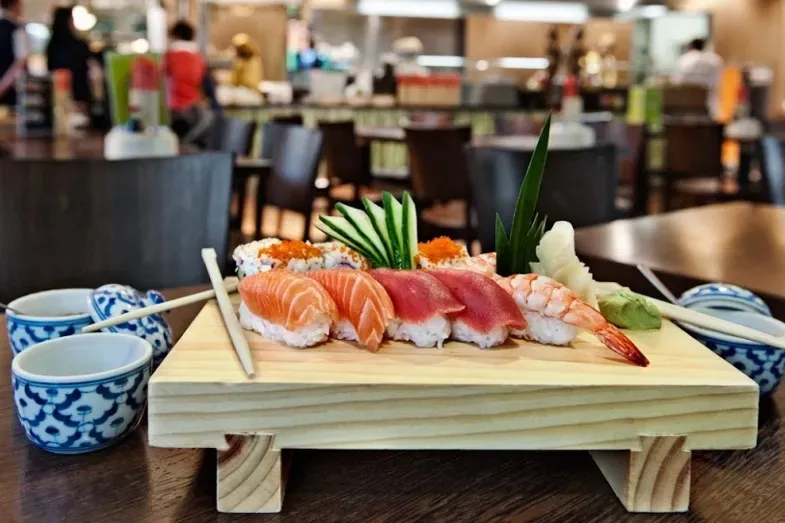
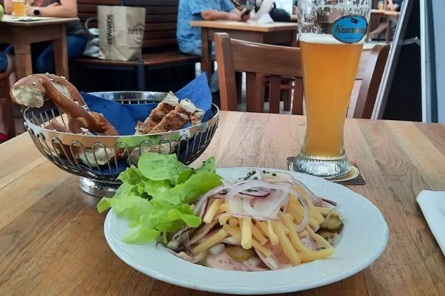
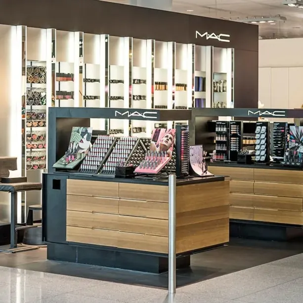
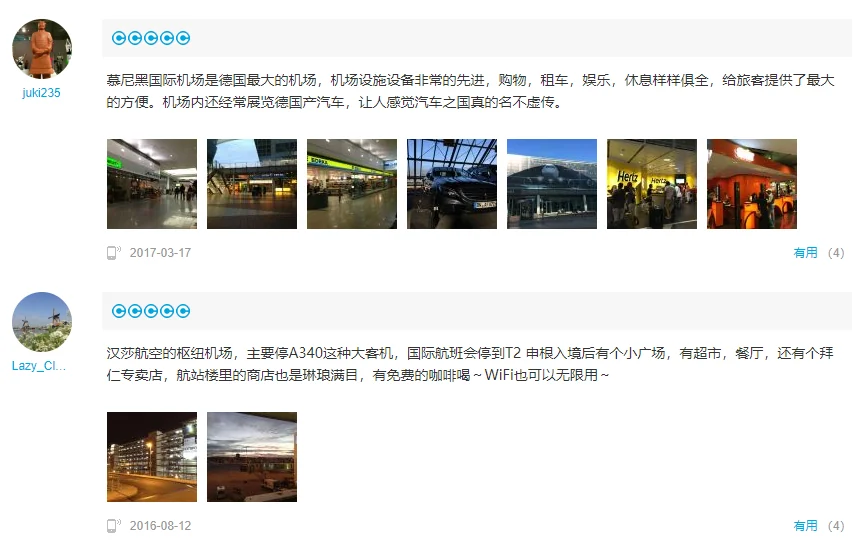

Esta guía cubre el **aeropuerto de Múnich (MUC)**: los transbordos ante todo, y después las instalaciones del aeropuerto y la operativa de vuelos. Todo sobre conectar aquí, desde el tiempo que necesitas y los documentos que intervienen hasta el proceso paso a paso, está en este único artículo.

## Transbordos

### Cuánto tiempo dejar

El aeropuerto de Múnich se divide en una zona Schengen y otra no Schengen, lo que da cuatro tipos de transbordo: **Schengen a no Schengen**, **no Schengen a Schengen**, **no Schengen a no Schengen** y **Schengen a Schengen**. Deja entre 1,5 y 3 horas según tu itinerario.

### Las cuatro combinaciones

| Combinación | Qué implica |
| --- | --- |
| **Schengen a Schengen** | Solo control de seguridad. Con billetes reservados por separado hay que recoger el equipaje y facturarlo de nuevo. |
| **Schengen a no Schengen** | Solo control de seguridad; no hace falta visado de entrada para el vuelo internacional de continuación. Si en el equipaje facturado llevas artículos cuya devolución quieres, hazlos sellar primero en aduanas, luego factura, pasa la seguridad, sella el pasaporte en el control de salida y cobra la devolución en el mostrador antes de ir a la puerta. Con un billete único, la devolución de impuestos puede tramitarse en tu aeropuerto de salida dentro de Schengen. |
| **No Schengen a Schengen** | Siempre pasas inmigración en Múnich, tanto con billete único como sin él, y necesitas un visado Schengen. El equipaje facturado con billete único puede seguir facturado hasta el destino; si no, entra en el país, recoge las maletas, factura de nuevo para el vuelo intra-Schengen y pasa la seguridad hasta tu puerta. |
| **No Schengen a no Schengen** | Sin recogida de equipaje con billete único, pero necesitas visado para el destino no Schengen. Sigue el canal de transbordos; no entras en Alemania y no necesitas visado Schengen. |

### Paso a paso

Conectar en Múnich es rápido y sencillo: los carteles te llevan directo a tu puerta. Tomemos como ejemplo **Shanghái → Múnich (tránsito) → Nápoles (LH727)**. Toda la secuencia es:

**Llegada a Múnich → confirma tu puerta → seguridad de transbordo → tren lanzadera → pasar aduanas → esperar en la puerta**

1. Tras aterrizar, las señales te guían hacia la salida.

2. Un poco más adelante llegas a una gran pantalla de información de vuelos. **Comprueba tu puerta real**: puede diferir de la del billete. Por ejemplo, el billete puede decir K (usada para aduanas), mientras que la pantalla muestra G35, que es tu puerta real.

3. Junto a la pantalla, una escalera mecánica de bajada lleva al control de seguridad de transbordos. La cola suele ser larga, así que deja tiempo de sobra.

4. Tras la seguridad, sigue las señales hacia el tren lanzadera, que te lleva a la zona K para el sello de entrada. Luego sigue las señales G hasta tu puerta.

> **Nota:** con un billete único y el equipaje facturado hasta el destino, no lo recoges durante el transbordo. Si no está facturado hasta el destino, toma el canal de aduanas junto al control de seguridad de transbordos, recoge las maletas y factura de nuevo.

### Consejos prácticos para el transbordo

- **Tener o no billete único decide la ruta.** Un billete único mantiene el equipaje facturado hasta el destino y te sitúa en el canal de transbordos; los billetes separados implican entrar en el país, recoger las maletas y facturar de nuevo: añade al menos una hora.
- **Lleva los documentos encima.** Pasaporte (se recomienda con seis meses de validez), visado Schengen, la tarjeta de embarque de continuación, el itinerario y la reserva de hotel: los agentes de fronteras pueden pedir cualquiera de ellos.
- **Deja tiempo para la zona equivocada.** Algunas zonas de puertas de la Terminal 2 se alcanzan con el tren lanzadera (la zona K, por ejemplo). Lee primero las pantallas y luego sigue las letras G / H / K / L en lugar de la puerta impresa en tu vieja tarjeta de embarque.

## Datos básicos del aeropuerto

- **Nombre:** Aeropuerto de Múnich
- **Códigos:** MUC (IATA) / EDDM (ICAO)
- **Ubicación:** Erdinger Moos, 28 km al noreste de Múnich
- **Principales aerolíneas:** Lufthansa, Augsburg Airways, Air Dolomiti
- **Inauguración:** 1992

## Cómo se construyó

- **Elección del emplazamiento:** Erdinger Moos no fue la primera opción —había poco que lo recomendara— hasta que el Ministerio Federal de Defensa alemán decidió cerrar la base aérea de Erding, lo que abrió la puerta a un gran aeropuerto allí. En julio de 1969 se fijó oficialmente el nuevo aeropuerto en Erdinger Moos, con el argumento de que encajaba en la planificación regional y nacional.
- **El desafío:** los planes para una cuarta pista al sur fueron rechazados: se consideró que 120 despegues y aterrizajes por hora eran demasiados, y se presentaron 5.724 objeciones. Los recursos posteriores también fueron desestimados, lo que detuvo partes de la construcción.
- **El diseño:** en respuesta, Munich Airport GmbH presentó en 1981 un plan modificado con un sistema de dos pistas, normas de vuelo nocturno y previsiones de pasajeros más altas; se aprobó en junio de 1984.
- **Apertura:** el aeropuerto de Múnich empezó a operar el 11 de mayo de 1992. Durante la noche del 16 al 17 de mayo las aerolíneas se trasladaron desde Munich-Riem, y cuando el último Boeing 737 de Lufthansa de Riem despegó justo antes de medianoche, la historia del viejo aeropuerto llegó a su fin.

## Instalaciones y servicios

### Salas VIP

**Zonas de descanso gratuitas**

- **① Sala Bayern:** Terminal 2, puertas G y H, nivel 03 (antes de la seguridad); 24 horas; gratuita.

- **② Zonas de recreo:** Terminal 2, nivel 04 puertas G y K, nivel 05 puertas H y L (después de la seguridad); 24 horas; gratuitas para los pasajeros.

**Salas VIP de pago**

- **① Airport Lounge Europe:** Terminal 1, módulo B, nivel 05 (después de la seguridad); todos los días de 06:00 a 21:00; desde 43 € por persona.

- **② Airport Lounge World:** Terminal 1, módulo B, nivel 06 (después de la seguridad); todos los días de 05:15 a 21:45; desde 48 € por persona.

**Salas VIP de aerolíneas**

- **① Salas Lufthansa** (solo para miembros de Lufthansa y Star Alliance): Terminal 2, nivel 04 puertas G–L, y la zona no pública del nivel 05.

- **② Emirates Lounge** (primera y business de Emirates, miembros gold y platinum, además de los miembros gold y platinum de Qantas): Terminal 1, módulo C, nivel 05; abierta todos los días en tres franjas: 07:30–10:15, 12:00–15:30 y 18:30–22:15.

**Cápsulas para dormir NapCabs**

Las NapCabs son cápsulas para dormir de noche en el aeropuerto de Múnich, que merecen considerarse si tienes una estancia nocturna o un transbordo largo. Ofrecen un espacio para dormir cómodo y muy privado, con Ethernet gratis y enchufes, y una pantalla con entretenimiento.

- **Dónde:** T2 nivel 04, puerta G06; T2 nivel 05, puerta H32; T2 nivel 03, centro de servicios; T2 SAT nivel 05, puerta L04
- **Precio:** 15 € por hora de 06:00 a 22:00; 10 € por hora de 22:00 a 06:00 (mínimo dos horas)

### Restaurantes

El aeropuerto de Múnich tiene más de 60 restaurantes y tabernas, que cubren especialidades locales, comida asiática conocida y platos de todas partes. La cerveza artesanal propia del aeropuerto es famosa: por unos diez euros largos puedes estar bebiendo hasta medianoche, envuelto en comida bávara y aire nocturno.

- **Bamee**

- **Seafood Sylt**

- **Airbräu**

- **4 URBS**

### Duty-free

El aeropuerto de Múnich tiene muchísimas tiendas duty-free donde las marcas internacionales —perfume, cosmética, complementos y más— se pueden comprar a precios libres de impuestos.

| Categoría | Marcas |
| --- | --- |
| Lujo | Gucci, Armani, Zegna, Ferragamo, Bulgari y más |
| Perfume y cosmética | Dior, La Mer, Chanel, Sisley, Shiseido, MAC, Estée Lauder, Lancôme y más |
| Marroquinería y bolsos | Hermès, Longchamp, Furla, Mandarina Duck, Liebeskind y más |
| Complementos | Swarovski, Misaki, Fossil, Esprit y más |

> ¿Haces transbordo dentro de Schengen? Mantén las compras duty-free precintadas con el recibo, y deja tiempo para la cola si necesitas la devolución de impuestos (la ruta de devolución se describe en “Las cuatro combinaciones”, más arriba).

### Hoteles del aeropuerto

Dos hoteles están justo junto al aeropuerto para los pasajeros en transbordo.

**Hilton Munich Airport**

- Entre la T1 y la T2
- Tel.: +49 89 97820
- Desde 160 US$

**Novotel München Airport**

- A 700 m de la estación Flughafen Besucherpark
- Tel.: +49 89 9705130
- Desde 100 US$

### Zonas de fumadores

Las zonas de fumadores del aeropuerto de Múnich están en las áreas no públicas de la zona restringida de la Terminal 1 (zonas A, B, C, D y F) y de la Terminal 2 (zonas G, H, K y L).

## Operativa de vuelos

Múnich es uno de los mayores hubs aeronáuticos de Europa, con 101 aerolíneas que vuelan a 242 destinos en 68 países. El aeropuerto opera 24 horas al día con altas frecuencias, y su gestión estricta y eficiente mantiene alta la puntualidad para que los pasajeros lleguen a tiempo.

## El panorama de aerolíneas

Muchas aerolíneas sirven Múnich, lideradas por Lufthansa y los miembros de Star Alliance. Hoy todos los vuelos ajenos a la alianza de Lufthansa (Air France, British Airways, etc.) usan la Terminal 1, mientras que la Terminal 2 está reservada a Lufthansa y a las aerolíneas de Star Alliance como Qatar Airways, PrivatAir y EVA Air. La variedad da a los pasajeros una amplia elección de rutas. Aunque el aeropuerto está en las afueras, está bien conectado, su negocio de carga es fuerte y a su alrededor ha crecido un clúster de industria aeronáutica. Para atender mejor a los pasajeros, el aeropuerto de Múnich planea seguir mejorando sus enlaces de transporte y ampliar sus terminales y pistas.

## Lo que dicen los viajeros

Estas tres opiniones son publicaciones de plataformas públicas escritas entre 2015 y 2018, útiles para hacerte una idea rápida del lugar antes de aterrizar:

- **Ubicación y conexiones:** un poco lejos del centro, pero el S-Bahn llega directo y la ruta de transbordo es fluida; el segundo aeropuerto más grande de Alemania y uno de los hubs clave de Europa.
- **Instalaciones y servicio:** el café, el té y el wifi gratuitos aparecen una y otra vez, las compras son de primer nivel, hay mucho donde comer y el personal de fronteras es amable; Lufthansa tiene su propia zona de facturación y transbordo en la Terminal 2.
- **Alquiler de coches y compras:** puedes alquilar un coche dentro del aeropuerto, práctico para un viaje por libre; tras las llegadas Schengen en la Terminal 2 hay una pequeña plaza con supermercado, restaurantes y una tienda del Bayern de Múnich, y las tiendas duty-free y de marca están bien surtidas.

## Enlaces relacionados

- **En este sitio**: [Aeropuerto de Múnich (MUC)](/airport/MUC), [Alemania (DE)](/country/DE)
- **Wikipedia**: [Aeropuerto de Múnich](https://en.wikipedia.org/wiki/Munich_Airport)
- **Baidu Baike**: [Aeropuerto de Múnich](https://baike.baidu.com/item/%E6%85%95%E5%B0%BC%E9%BB%91%E6%9C%BA%E5%9C%BA)
- **Web del aeropuerto**: [Aeropuerto de Múnich](https://www.munich-airport.com/)
- **Más artículos**: [Guía de llegada y aduanas del aeropuerto de Múnich](/blog/munich-airport-arrival-customs-guide), [Autobús lanzadera y transporte urbano del aeropuerto de Múnich](/blog/munich-airport-shuttle-bus-guide)

Fuente de las imágenes: las figuras del artículo original, de la cuenta de WeChat “亦出旅行”. Las tarifas, los horarios de apertura, los números de puerta y la ubicación de las instalaciones son los registrados cuando se elaboró la guía y pueden cambiar; consulta las webs del aeropuerto de Múnich y de los operadores el día del viaje.
