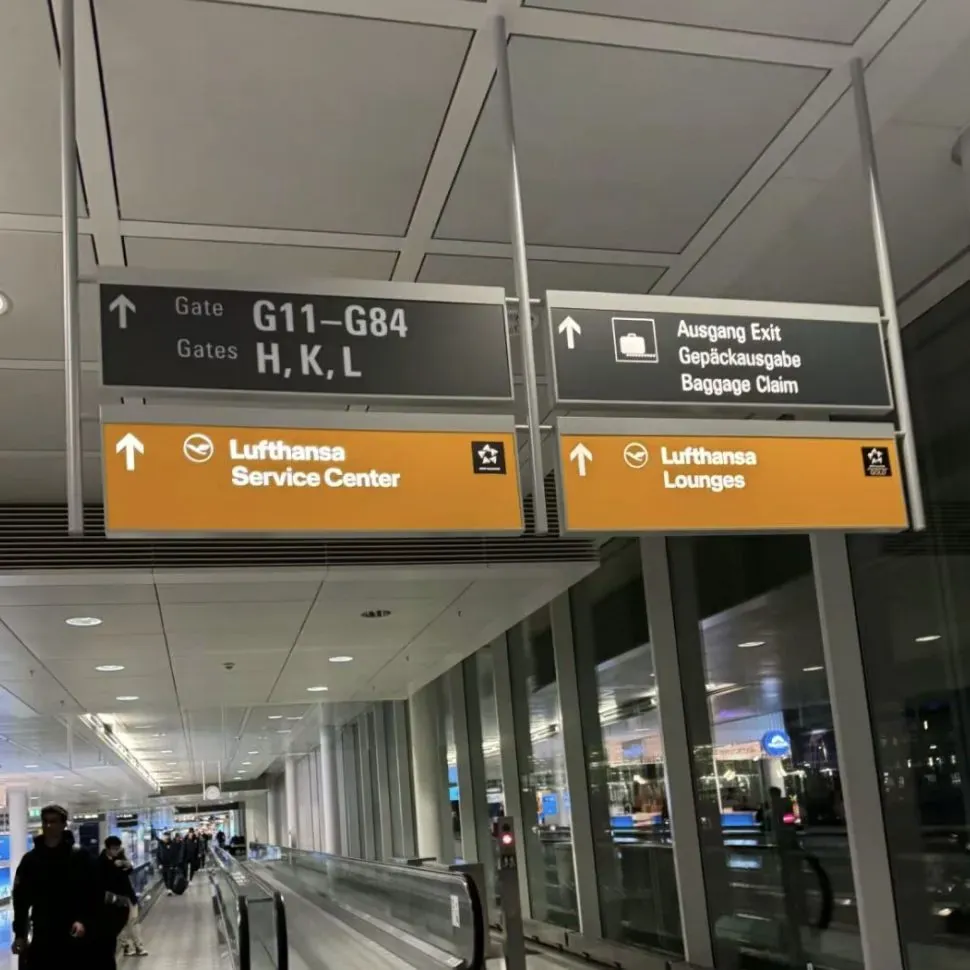
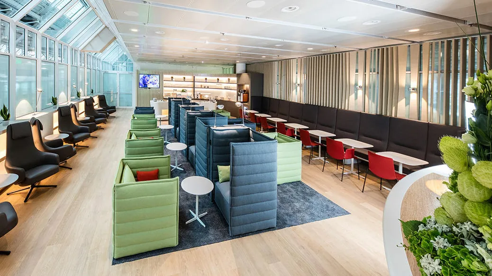
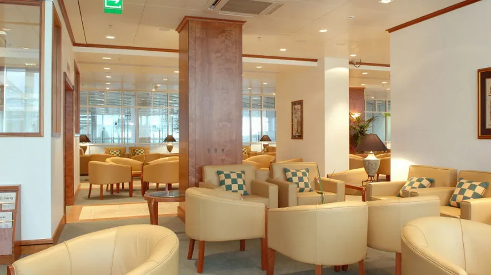
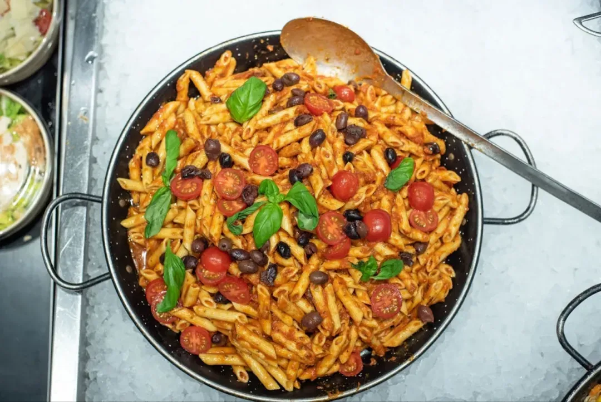
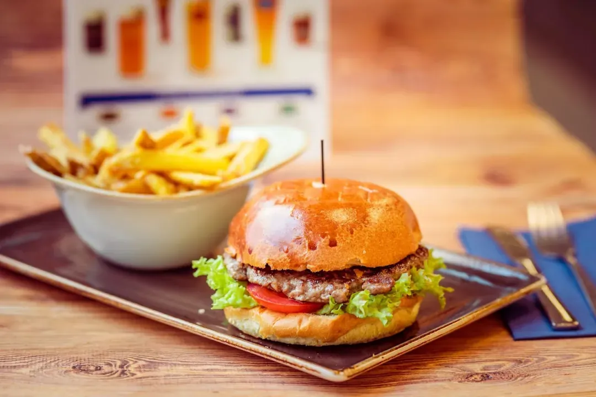
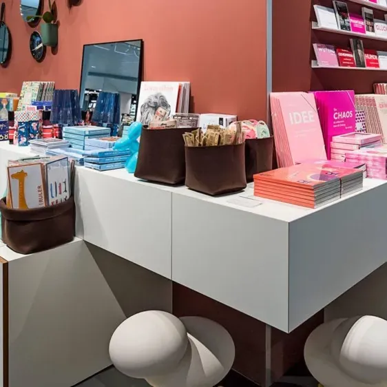
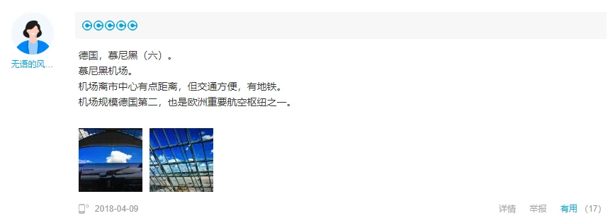

यह गाइड **म्यूनिख एयरपोर्ट (MUC)** के बारे में है — सबसे पहले ट्रांसफर, फिर एयरपोर्ट की सुविधाएँ और उड़ान संचालन। यहाँ कनेक्ट करने से जुड़ी हर बात — कितना समय चाहिए और कौन-से दस्तावेज़ लगेंगे, से लेकर चरण-दर-चरण प्रक्रिया तक — इसी एक लेख में है।

## ट्रांसफर

### कितना समय रखें

म्यूनिख एयरपोर्ट शेंगेन और गैर-शेंगेन क्षेत्रों में बँटा है, इसलिए यहाँ चार तरह के ट्रांसफर होते हैं — **शेंगेन से गैर-शेंगेन**, **गैर-शेंगेन से शेंगेन**, **गैर-शेंगेन से गैर-शेंगेन** और **शेंगेन से शेंगेन**। अपनी यात्रा योजना के अनुसार 1.5–3 घंटे का समय रखें।

### चार संयोजन

| संयोजन | इसमें क्या शामिल है |
| --- | --- |
| **शेंगेन से शेंगेन** | केवल सुरक्षा जाँच। अलग-अलग बुक किए गए टिकटों पर आपको अपना सामान लेना और दोबारा चेक-इन कराना होगा। |
| **शेंगेन से गैर-शेंगेन** | केवल सुरक्षा जाँच; आगे की अंतरराष्ट्रीय उड़ान के लिए प्रवेश वीज़ा की ज़रूरत नहीं। अगर आपके चेक-इन बैग में ऐसी वस्तुएँ हैं जिनका टैक्स रिफंड लेना है, तो पहले उन पर कस्टम से मोहर लगवाएँ, फिर चेक-इन करें, सुरक्षा जाँच पार करें, निकास नियंत्रण पर पासपोर्ट पर मोहर लगवाएँ और गेट की ओर जाने से पहले रिफंड डेस्क से रिफंड ले लें। थ्रू-टिकट पर टैक्स रिफंड शेंगेन के भीतर अपने प्रस्थान एयरपोर्ट पर किया जा सकता है। |
| **गैर-शेंगेन से शेंगेन** | आप थ्रू-टिकट पर हों या नहीं, म्यूनिख में आपको हमेशा इमिग्रेशन से गुज़रना होगा और आपको शेंगेन वीज़ा चाहिए। थ्रू-टिकट वाला सामान चेक-इन थ्रू रह सकता है; वरना देश में प्रवेश करें, अपने बैग लें, शेंगेन के भीतर की उड़ान के लिए दोबारा चेक-इन करें, फिर सुरक्षा जाँच से होकर अपने गेट पर जाएँ। |
| **गैर-शेंगेन से गैर-शेंगेन** | थ्रू-टिकट पर सामान लेने की ज़रूरत नहीं, लेकिन गैर-शेंगेन गंतव्य के लिए आपको वीज़ा चाहिए। ट्रांसफर चैनल का पालन करें; आप जर्मनी में प्रवेश नहीं करते और आपको शेंगेन वीज़ा की ज़रूरत नहीं। |

### चरण दर चरण

म्यूनिख में कनेक्ट करना तेज़ और आसान है — साइनबोर्ड आपको सीधे आपके गेट तक ले जाते हैं। उदाहरण के लिए **शंघाई → म्यूनिख (ट्रांसिट) → नेपल्स (LH727)** लें। पूरा क्रम यह है:

**म्यूनिख पहुँचें → अपना गेट पुष्ट करें → ट्रांसफर सुरक्षा जाँच → शटल ट्रेन लें → कस्टम से गुज़रें → गेट पर प्रतीक्षा करें**

1. उतरने के बाद साइनबोर्ड आपको निकास की ओर ले जाते हैं।

2. थोड़ी दूर चलने पर एक बड़ी फ्लाइट-इन्फॉर्मेशन स्क्रीन मिलती है। **अपना असली गेट ज़रूर जाँच लें** — यह टिकट पर लिखे गेट से अलग हो सकता है। जैसे टिकट पर K लिखा हो सकता है (जो कस्टम के लिए इस्तेमाल होता है), जबकि स्क्रीन पर G35 दिखता है, जो आपका असली गेट है।

3. स्क्रीन के बगल में नीचे जाने वाला एस्केलेटर ट्रांसफर सुरक्षा जाँच तक ले जाता है। कतार अक्सर लंबी होती है, इसलिए खूब समय रखें।

4. सुरक्षा जाँच के बाद साइनबोर्ड का पालन करते हुए शटल ट्रेन तक जाएँ, जो आपको प्रवेश मोहर के लिए K क्षेत्र ले जाती है। फिर G के साइनबोर्ड देखते हुए अपने गेट तक पहुँचें।

> **ध्यान दें:** अगर थ्रू-टिकट पर आपका सामान गंतव्य तक चेक-इन थ्रू है, तो ट्रांसफर के दौरान आपको उसे लेना नहीं होता। अगर सामान चेक-इन थ्रू नहीं है, तो ट्रांसफर सुरक्षा जाँच के बगल वाले कस्टम चैनल से जाएँ, अपने बैग लें और दोबारा चेक-इन करें।

### ट्रांसफर के व्यावहारिक सुझाव

- **थ्रू-टिकट है या नहीं, यही रास्ता तय करता है।** थ्रू-टिकट पर आपके बैग चेक-इन थ्रू रहते हैं और आप ट्रांसफर चैनल पर रहते हैं; अलग टिकट का मतलब है देश में प्रवेश, अपने बैग लेना और दोबारा चेक-इन — इसमें कम से कम एक घंटा और जोड़ें।
- **दस्तावेज़ अपने पास रखें।** पासपोर्ट (छह महीने की वैधता सलाहित), शेंगेन वीज़ा, आगे की उड़ान का बोर्डिंग पास, यात्रा कार्यक्रम और होटल की बुकिंग — सीमा अधिकारी इनमें से कोई भी माँग सकते हैं।
- **गलत ज़ोन के लिए समय रखें।** टर्मिनल 2 के कुछ गेट क्षेत्रों तक शटल ट्रेन से पहुँचा जाता है (जैसे K क्षेत्र)। पहले स्क्रीन पढ़ें, फिर अपने पुराने बोर्डिंग पास पर छपे गेट के बजाय G / H / K / L अक्षरों का पालन करें।

## एयरपोर्ट की बुनियादी जानकारी

- **नाम:** म्यूनिख एयरपोर्ट
- **कोड:** MUC (IATA) / EDDM (ICAO)
- **स्थान:** एर्डिंग मूस, म्यूनिख से 28 किमी उत्तर-पूर्व
- **मुख्य एयरलाइनें:** Lufthansa, Augsburg Airways, Air Dolomiti
- **शुरुआत:** 1992

## इसका निर्माण कैसे हुआ

- **स्थल का चुनाव:** एर्डिंग मूस पहली पसंद नहीं था — इसमें सिफ़ारिश करने लायक कुछ ख़ास नहीं था — जब तक जर्मन संघीय रक्षा मंत्रालय ने एर्डिंग वायुसेना बेस बंद करने का फैसला नहीं किया, जिससे वहाँ बड़े एयरपोर्ट का रास्ता खुल गया। जुलाई 1969 में नए एयरपोर्ट को आधिकारिक रूप से एर्डिंग मूस पर बसाने का निर्णय हुआ, इस आधार पर कि यह क्षेत्रीय और राष्ट्रीय नियोजन के अनुरूप है।
- **चुनौती:** दक्षिण की ओर चौथे रनवे की योजनाएँ खारिज हो गईं — प्रति घंटे 120 टेक-ऑफ़ और लैंडिंग को बहुत अधिक माना गया, और इसके खिलाफ़ 5,724 आपत्तियाँ दर्ज हुईं। बाद की अपीलें भी खारिज हुईं, जिससे निर्माण के कुछ हिस्से रुक गए।
- **डिज़ाइन:** इसके जवाब में म्यूनिख एयरपोर्ट GmbH ने 1981 में दोहरे रनवे प्रणाली, रात्रि-उड़ान नियमों और अधिक यात्री अनुमानों के साथ संशोधित योजना प्रस्तुत की; इसे जून 1984 में मंज़ूरी मिली।
- **उद्घाटन:** म्यूनिख एयरपोर्ट ने 11 मई 1992 को परिचालन शुरू किया। 16–17 मई की रात में एयरलाइनें म्यूनिख-रीम से यहाँ आ गईं, और जब रीम का आख़िरी Lufthansa बोइंग 737 आधी रात से ठीक पहले उड़ा, तो पुराने एयरपोर्ट का इतिहास समाप्त हो गया।

## सुविधाएँ और सेवाएँ

### लाउंज

**मुफ़्त विश्राम क्षेत्र**

- **① Bayern Lounge:** टर्मिनल 2, गेट G और H, स्तर 03 (सुरक्षा जाँच से पहले); 24 घंटे; मुफ़्त।

- **② Recreation Areas:** टर्मिनल 2, स्तर 04 गेट G और K, स्तर 05 गेट H और L (सुरक्षा जाँच के बाद); 24 घंटे; यात्रियों के लिए मुफ़्त।

**सशुल्क लाउंज**

- **① Airport Lounge Europe:** टर्मिनल 1, मॉड्यूल B, स्तर 05 (सुरक्षा जाँच के बाद); प्रतिदिन 06:00–21:00; प्रति व्यक्ति €43 से।

- **② Airport Lounge World:** टर्मिनल 1, मॉड्यूल B, स्तर 06 (सुरक्षा जाँच के बाद); प्रतिदिन 05:15–21:45; प्रति व्यक्ति €48 से।

**एयरलाइन लाउंज**

- **① Lufthansa Lounges** (केवल Lufthansa और Star Alliance सदस्यों के लिए): टर्मिनल 2, स्तर 04 गेट G–L, और स्तर 05 का गैर-सार्वजनिक क्षेत्र।

- **② Emirates Lounge** (Emirates की फ़र्स्ट और बिज़नेस क्लास, गोल्ड और प्लेटिनम सदस्य, साथ ही Qantas के गोल्ड और प्लेटिनम सदस्य): टर्मिनल 1, मॉड्यूल C, स्तर 05; प्रतिदिन तीन अवधियों में खुला — 07:30–10:15, 12:00–15:30 और 18:30–22:15।

**NapCabs स्लीपिंग पॉड**

NapCabs म्यूनिख एयरपोर्ट के रात्रि-विश्राम स्लीपिंग पॉड हैं, जिन पर विचार करना फ़ायदेमंद है अगर आपको रात बितानी हो या लंबा ट्रांसफर हो। इनमें मुफ़्त ईथरनेट और पावर सॉकेट तथा मनोरंजन वाली स्क्रीन के साथ आरामदायक और बेहद निजी सोने की जगह मिलती है।

- **कहाँ:** T2 स्तर 04, गेट G06; T2 स्तर 05, गेट H32; T2 स्तर 03, सेवा केंद्र; T2 SAT स्तर 05, गेट L04
- **कीमत:** 06:00–22:00 प्रति घंटा €15; 22:00–06:00 प्रति घंटा €10 (कम से कम दो घंटे)

### भोजन

म्यूनिख एयरपोर्ट में 60 से अधिक रेस्टोरेंट और टैवर्न हैं, जिनमें स्थानीय व्यंजन, परिचित एशियाई खाना और बाक़ी हर जगह के व्यंजन मिलते हैं। एयरपोर्ट की अपनी क्राफ़्ट बीयर प्रसिद्ध है — दस यूरो से कुछ ज़्यादा में आप बवेरियाई खाने और रात की हवा के बीच आधी रात तक बैठकर पी सकते हैं।

- **Bamee**

- **Seafood Sylt**

- **Airbräu**

- **4 URBS**

### ड्यूटी-फ्री

म्यूनिख एयरपोर्ट में बहुत सी ड्यूटी-फ्री दुकानें हैं, जहाँ अंतरराष्ट्रीय ब्रांड — परफ़्यूम, कॉस्मेटिक्स, एक्सेसरीज़ और बहुत कुछ — ड्यूटी-फ्री कीमतों पर खरीदे जा सकते हैं।

| श्रेणी | ब्रांड |
| --- | --- |
| लक्ज़री | Gucci, Armani, Zegna, Ferragamo, Bulgari और अन्य |
| परफ़्यूम और कॉस्मेटिक्स | Dior, La Mer, Chanel, Sisley, Shiseido, MAC, Estée Lauder, Lancôme और अन्य |
| चमड़े की वस्तुएँ और बैग | Hermès, Longchamp, Furla, Mandarina Duck, Liebeskind और अन्य |
| एक्सेसरीज़ | Swarovski, Misaki, Fossil, Esprit और अन्य |

> शेंगेन के भीतर कनेक्ट कर रहे हैं? ड्यूटी-फ्री की खरीदारी रसीद के साथ सीलबंद रखें, और अगर टैक्स रिफंड चाहिए तो कतार में लगने का समय रखें (रिफंड का रास्ता ऊपर "चार संयोजन" में बताया गया है)।

### एयरपोर्ट होटल

ट्रांसफर यात्रियों के लिए एयरपोर्ट के ठीक बगल में दो होटल हैं।

**Hilton Munich Airport**

- T1 और T2 के बीच
- फ़ोन: +49 89 97820
- US$160 से

**Novotel München Airport**

- Flughafen Besucherpark स्टेशन से 700 मीटर
- फ़ोन: +49 89 9705130
- US$100 से

### धूम्रपान क्षेत्र

म्यूनिख एयरपोर्ट के धूम्रपान क्षेत्र टर्मिनल 1 (ज़ोन A, B, C, D और F) और टर्मिनल 2 (ज़ोन G, H, K और L) के एयरसाइड गैर-सार्वजनिक क्षेत्रों में हैं।

## उड़ान संचालन

म्यूनिख यूरोप के सबसे बड़े विमानन हब में से एक है, जहाँ 101 एयरलाइनें 68 देशों के 242 गंतव्यों के लिए उड़ानें भरती हैं। एयरपोर्ट दिन में 24 घंटे उच्च आवृत्ति के साथ चलता है, और इसका सख़्त, कुशल प्रबंधन समय-पालन को ऊँचा रखता है ताकि यात्री समय पर पहुँचें।

## एयरलाइन परिदृश्य

म्यूनिख के लिए कई एयरलाइनें उड़ानें भरती हैं, जिनमें Lufthansa और Star Alliance सदस्य अग्रणी हैं। आज Lufthansa साझेदारी से बाहर की हर उड़ान (Air France, British Airways आदि) टर्मिनल 1 का उपयोग करती है, जबकि टर्मिनल 2 Lufthansa और Star Alliance की एयरलाइनों जैसे Qatar Airways, PrivatAir और EVA Air के लिए आरक्षित है। इस विविधता से यात्रियों को मार्गों का व्यापक विकल्प मिलता है। एयरपोर्ट उपनगरों में होने के बावजूद अच्छी तरह जुड़ा हुआ है, इसका कार्गो कारोबार मज़बूत है, और इसके आसपास एक विमानन उद्योग समूह विकसित हुआ है। यात्रियों की बेहतर सेवा के लिए म्यूनिख एयरपोर्ट अपने परिवहन संपर्कों को लगातार सुधारने और अपने टर्मिनलों व रनवे का विस्तार करने की योजना बना रहा है।

## यात्री क्या कहते हैं

ये तीन समीक्षाएँ 2015 और 2018 के बीच सार्वजनिक प्लेटफ़ॉर्म पर लिखी गई पोस्ट हैं, जो उतरने से पहले जगह का अंदाज़ा लगाने के लिए उपयोगी हैं:

- **स्थान और संपर्क:** केंद्र से थोड़ा दूर, लेकिन S-Bahn सीधे आती है और ट्रांसफर का रास्ता सुगम है; जर्मनी का दूसरा सबसे बड़ा एयरपोर्ट और यूरोप के प्रमुख हब में से एक।
- **सुविधाएँ और सेवा:** मुफ़्त कॉफ़ी, चाय और Wi-Fi की बात बार-बार आती है, खरीदारी बेहतरीन है, खाने के लिए बहुत कुछ है, और सीमा कर्मचारी मिलनसार हैं; Lufthansa का टर्मिनल 2 में अपना चेक-इन और ट्रांसफर क्षेत्र है।
- **कार किराये और खरीदारी:** एयरपोर्ट के अंदर ही कार किराए पर ली जा सकती है, जो खुद ड्राइव करने की यात्रा के लिए सुविधाजनक है; टर्मिनल 2 में शेंगेन आगमन के बाद एक छोटा सा प्लाज़ा है जहाँ सुपरमार्केट, रेस्टोरेंट और Bayern Munich का स्टोर है, और ड्यूटी-फ्री तथा ब्रांड दुकानें अच्छी तरह भरी हुई हैं।

## संबंधित लिंक

- **इस साइट पर:** [म्यूनिख एयरपोर्ट (MUC)](/airport/MUC), [जर्मनी (DE)](/country/DE)
- **विकिपीडिया:** [म्यूनिख एयरपोर्ट](https://en.wikipedia.org/wiki/Munich_Airport)
- **Baidu Baike:** [म्यूनिख एयरपोर्ट](https://baike.baidu.com/item/%E6%85%95%E5%B0%BC%E9%BB%91%E6%9C%BA%E5%9C%BA)
- **एयरपोर्ट साइट:** [म्यूनिख एयरपोर्ट](https://www.munich-airport.com/)
- **और लेख:** [म्यूनिख एयरपोर्ट आगमन और कस्टम गाइड](/blog/munich-airport-arrival-customs-guide), [म्यूनिख एयरपोर्ट शटल बस और शहर परिवहन](/blog/munich-airport-shuttle-bus-guide)

चित्र स्रोत: मूल लेख के चित्र, "亦出旅行" वीचैट अकाउंट से। किराए, खुलने का समय, गेट नंबर और सुविधाओं के स्थान गाइड बनाते समय दर्ज किए गए थे और बदल सकते हैं; यात्रा के दिन म्यूनिख एयरपोर्ट और ऑपरेटर की वेबसाइट देखें।
