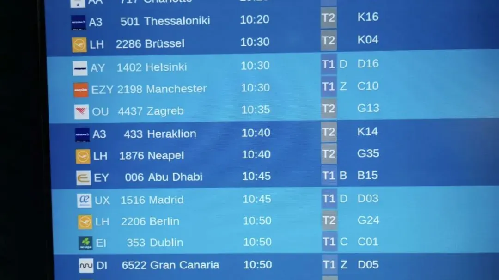
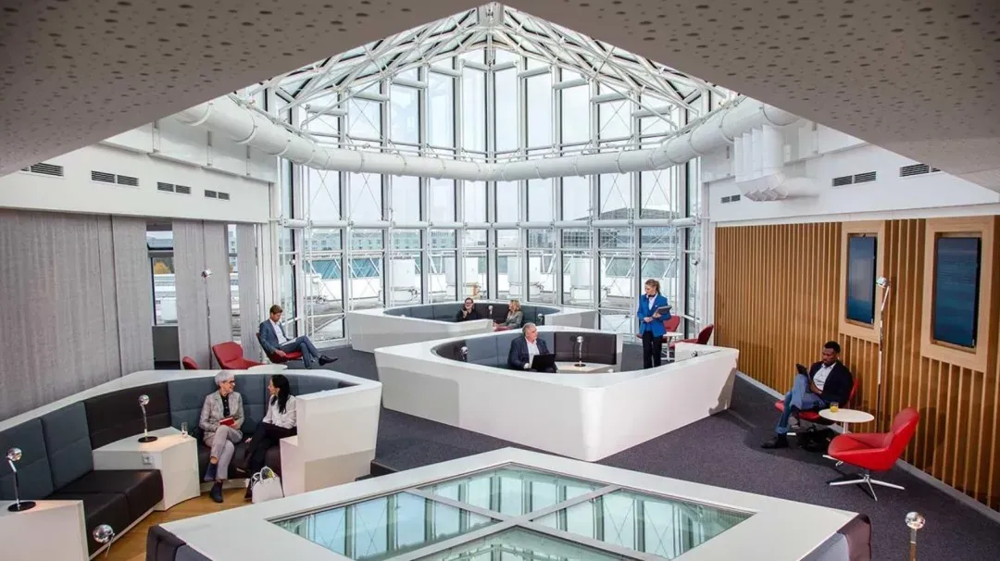
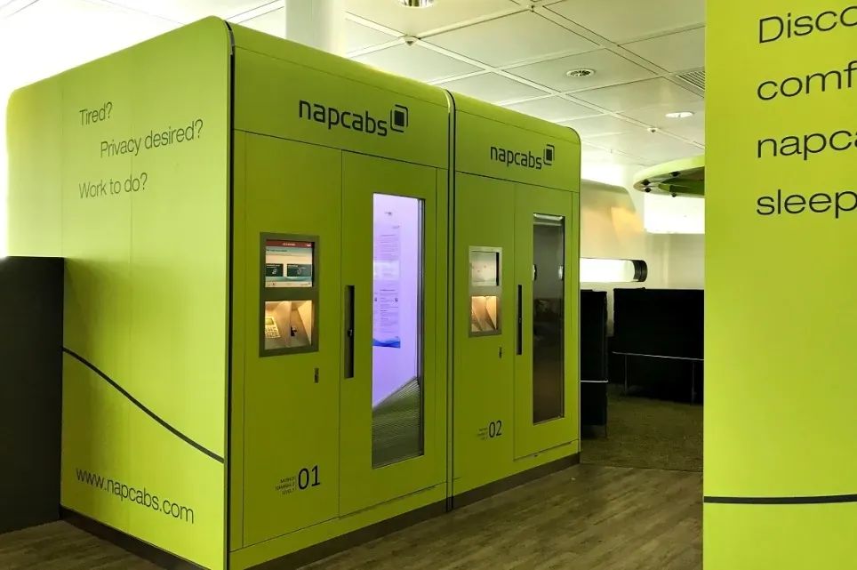
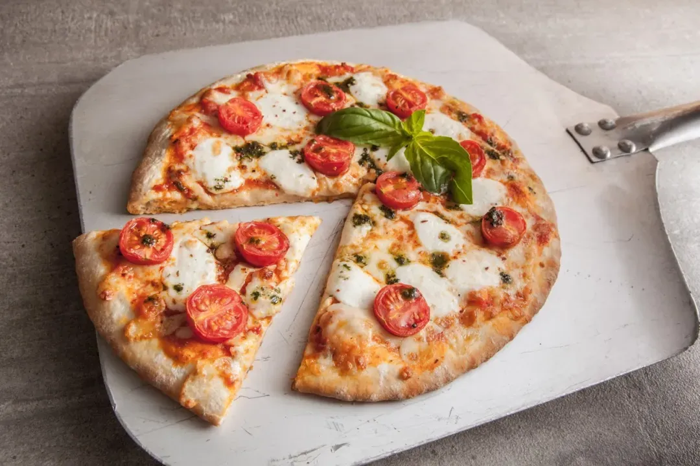

Panduan ini membahas **Bandara Munich (MUC)** — terutama transfer, lalu fasilitas dan operasi penerbangan bandara. Segala hal tentang transit di sini, dari waktu yang Anda butuhkan dan dokumen yang terlibat hingga proses langkah demi langkah, ada dalam satu artikel ini.

## Transfer

### Berapa lama yang harus disediakan

Bandara Munich terbagi menjadi area Schengen dan non-Schengen, yang menghasilkan empat jenis transfer — **Schengen ke non-Schengen**, **non-Schengen ke Schengen**, **non-Schengen ke non-Schengen**, dan **Schengen ke Schengen**. Sediakan 1,5–3 jam tergantung rencana perjalanan Anda.

### Empat kombinasi

| Kombinasi | Apa yang terlibat |
| --- | --- |
| **Schengen ke Schengen** | Hanya pemeriksaan keamanan. Pada tiket yang dipesan terpisah, Anda harus mengambil bagasi dan menyerahkannya lagi. |
| **Schengen ke non-Schengen** | Hanya pemeriksaan keamanan; tidak diperlukan visa masuk untuk penerbangan internasional lanjutan. Jika bagasi tercatat Anda berisi barang yang ingin Anda minta pengembalian pajaknya, mintalah cap di bea cukai terlebih dahulu, lalu check-in, lewati keamanan, minta cap paspor di kontrol keluar dan klaim pengembaliannya di meja pengembalian sebelum menuju gerbang. Pada tiket terusan, pengembalian pajak dapat diurus di bandara keberangkatan Anda di dalam Schengen. |
| **Non-Schengen ke Schengen** | Anda selalu melewati imigrasi di Munich, baik dengan tiket terusan maupun tidak, dan Anda memerlukan visa Schengen. Bagasi dengan tiket terusan dapat tetap check-through; jika tidak, masuk negara, ambil bagasi, check-in lagi untuk penerbangan intra-Schengen, lalu lewati keamanan menuju gerbang. |
| **Non-Schengen ke non-Schengen** | Tidak ada pengambilan bagasi pada tiket terusan, tetapi Anda memerlukan visa untuk tujuan non-Schengen. Ikuti jalur transfer; Anda tidak masuk Jerman dan tidak memerlukan visa Schengen. |

### Langkah demi langkah

Transit di Munich cepat dan mudah — rambunya membawa Anda langsung ke gerbang. Ambil contoh **Shanghai → Munich (transit) → Naples (LH727)**. Seluruh urutannya adalah:

**Tiba di Munich → konfirmasi gerbang → keamanan transfer → naik kereta shuttle → lewati bea cukai → tunggu di gerbang**

1. Setelah mendarat, rambu menuntun Anda menuju pintu keluar.

2. Tidak jauh di sepanjang jalan, Anda mencapai layar informasi penerbangan besar. **Periksa ulang gerbang Anda yang sebenarnya** — bisa berbeda dari tiket. Misalnya, tiket mungkin bertuliskan K (digunakan untuk bea cukai), sementara layar menunjukkan G35, yang merupakan gerbang sebenarnya.

3. Di samping layar, eskalator turun menuju pemeriksaan keamanan transfer. Antreannya sering panjang, jadi sediakan banyak waktu.

4. Setelah keamanan, terus ikuti rambu ke kereta shuttle, yang membawa Anda ke area K untuk cap masuk. Lalu ikuti tanda G ke gerbang Anda.

> **Catatan:** pada tiket terusan dengan bagasi check-through ke tujuan, Anda tidak mengambilnya selama transfer. Jika tidak check-through, ambil jalur bea cukai di samping pemeriksaan keamanan transfer, ambil bagasi, dan check-in lagi.

### Tips transfer praktis

- **Tiket terusan atau bukan menentukan rute.** Tiket terusan menjaga bagasi Anda check-through dan menempatkan Anda di jalur transfer; tiket terpisah berarti masuk negara, mengambil bagasi, dan check-in lagi — tambahkan setidaknya satu jam.
- **Bawa dokumen bersama Anda.** Paspor (disarankan berlaku enam bulan), visa Schengen, boarding pass lanjutan, rencana perjalanan, dan pemesanan hotel — petugas perbatasan dapat meminta salah satunya.
- **Sediakan waktu untuk zona yang salah.** Sebagian area gerbang Terminal 2 dicapai dengan kereta shuttle (misalnya area K). Baca layar dulu, lalu ikuti huruf G / H / K / L daripada gerbang yang tercetak di boarding pass lama Anda.

## Dasar-dasar bandara

- **Nama:** Bandara Munich
- **Kode:** MUC (IATA) / EDDM (ICAO)
- **Lokasi:** Erding Moos, 28 km timur laut Munich
- **Maskapai utama:** Lufthansa, Augsburg Airways, Air Dolomiti
- **Dibuka:** 1992

## Bagaimana bandara ini dibangun

- **Pemilihan lokasi:** Erding Moos bukan pilihan pertama — tidak banyak yang bisa direkomendasikan — sampai Kementerian Pertahanan Federal Jerman memutuskan menutup pangkalan udara Erding, yang membuka pintu bagi bandara besar di sana. Pada Juli 1969, bandara baru secara resmi ditetapkan di Erding Moos, dengan alasan sesuai perencanaan regional dan nasional.
- **Tantangannya:** rencana landasan pacu keempat di selatan ditolak — 120 lepas landas dan pendaratan per jam dianggap terlalu sering, dan 5.724 keberatan diajukan terhadapnya. Banding berikutnya juga ditolak, menghentikan sebagian konstruksi.
- **Desainnya:** sebagai tanggapan, Munich Airport GmbH mengajukan rencana yang diubah pada 1981 dengan sistem dua landasan pacu, aturan penerbangan malam, dan prakiraan penumpang yang lebih tinggi; rencana itu disetujui pada Juni 1984.
- **Pembukaan:** Bandara Munich mulai beroperasi pada 11 Mei 1992. Pada malam 16–17 Mei, maskapai-maskapai pindah dari Munich-Riem, dan ketika Boeing 737 Lufthansa terakhir dari Riem lepas landas tepat sebelum tengah malam, sejarah bandara lama itu berakhir.

## Fasilitas dan layanan

### Lounge

**Area istirahat gratis**

- **① Bayern Lounge:** Terminal 2, gerbang G dan H, level 03 (sebelum keamanan); 24 jam; gratis.

- **② Recreation Areas:** Terminal 2, level 04 gerbang G dan K, level 05 gerbang H dan L (setelah keamanan); 24 jam; gratis untuk penumpang.

**Lounge berbayar**

- **① Airport Lounge Europe:** Terminal 1, Modul B, Level 05 (setelah keamanan); setiap hari 06.00–21.00; mulai €43 per orang.

- **② Airport Lounge World:** Terminal 1, Modul B, Level 06 (setelah keamanan); setiap hari 05.15–21.45; mulai €48 per orang.

**Lounge maskapai**

- **① Lufthansa Lounges** (hanya anggota Lufthansa dan Star Alliance): Terminal 2, level 04 gerbang G–L, dan area non-publik level 05.

- **② Emirates Lounge** (kelas satu dan bisnis Emirates, anggota gold dan platinum, plus anggota gold dan platinum Qantas): Terminal 1, Modul C, Level 05; buka setiap hari dalam tiga jendela — 07.30–10.15, 12.00–15.30, dan 18.30–22.15.

**Pod tidur NapCabs**

NapCabs adalah pod tidur semalam di Bandara Munich, layak dipertimbangkan jika Anda menginap semalam atau transit panjang. Pod ini menawarkan ruang tidur yang nyaman dan sangat privat dengan Ethernet dan soket listrik gratis, serta layar dengan hiburan.

- **Lokasi:** T2 level 04, gerbang G06; T2 level 05, gerbang H32; T2 level 03, pusat layanan; T2 SAT level 05, gerbang L04
- **Harga:** €15 per jam 06.00–22.00; €10 per jam 22.00–06.00 (minimum dua jam)

### Makanan

Bandara Munich memiliki lebih dari 60 restoran dan taverna, mencakup keistimewaan lokal, makanan Asia yang akrab, dan hidangan dari berbagai tempat lain. Bir kerajinan bandara ini terkenal — sekitar sepuluh euro cukup untuk menemani Anda minum sampai tengah malam, dibalut makanan Bavaria dan udara malam.

- **Bamee**

- **Seafood Sylt**

- **Airbräu**

- **4 URBS**

### Bebas bea

Bandara Munich memiliki banyak toko bebas bea tempat merek internasional — parfum, kosmetik, aksesori, dan lainnya — dapat dibeli dengan harga bebas bea.

| Kategori | Merek |
| --- | --- |
| Mewah | Gucci, Armani, Zegna, Ferragamo, Bulgari, dan lainnya |
| Parfum dan kosmetik | Dior, La Mer, Chanel, Sisley, Shiseido, MAC, Estée Lauder, Lancôme, dan lainnya |
| Barang kulit dan tas | Hermès, Longchamp, Furla, Mandarina Duck, Liebeskind, dan lainnya |
| Aksesori | Swarovski, Misaki, Fossil, Esprit, dan lainnya |

> Transit di dalam Schengen? Simpan pembelian bebas bea tetap tersegel bersama struk, dan sediakan waktu antre jika Anda memerlukan pengembalian pajak (rute pengembalian dijelaskan di “Empat kombinasi” di atas).

### Hotel bandara

Dua hotel berada tepat di samping bandara untuk penumpang transit.

**Hilton Munich Airport**

- Di antara T1 dan T2
- Tel: +49 89 97820
- Mulai US$160

**Novotel München Airport**

- 700 m dari stasiun Flughafen Besucherpark
- Tel: +49 89 9705130
- Mulai US$100

### Area merokok

Area merokok Bandara Munich berada di area non-publik sisi udara Terminal 1 (zona A, B, C, D, dan F) dan Terminal 2 (zona G, H, K, dan L).

## Operasi penerbangan

Munich adalah salah satu hub penerbangan terbesar di Eropa, dengan 101 maskapai terbang ke 242 tujuan di 68 negara. Bandara beroperasi 24 jam sehari dengan frekuensi tinggi, dan manajemennya yang ketat dan efisien menjaga ketepatan waktu tetap tinggi sehingga penumpang tiba tepat waktu.

## Lanskap maskapai

Banyak maskapai melayani Munich, dipimpin Lufthansa dan anggota Star Alliance. Saat ini setiap penerbangan di luar kemitraan Lufthansa (Air France, British Airways, dan sebagainya) menggunakan Terminal 1, sementara Terminal 2 diperuntukkan bagi Lufthansa dan maskapai Star Alliance seperti Qatar Airways, PrivatAir, dan EVA Air. Keragaman ini memberi penumpang banyak pilihan rute. Meskipun bandara berada di pinggiran kota, koneksinya baik, bisnis kargonya kuat, dan klaster industri penerbangan tumbuh di sekitarnya. Untuk melayani penumpang lebih baik, Bandara Munich berencana terus meningkatkan koneksi transportasinya serta memperluas terminal dan landasan pacunya.

## Kata wisatawan

Tiga ulasan ini adalah unggahan platform publik yang ditulis antara 2015 dan 2018, berguna sebagai gambaran singkat tempat ini sebelum Anda mendarat:

- **Lokasi dan koneksi:** agak jauh dari pusat kota, tetapi S-Bahn berjalan langsung masuk dan rute transfernya lancar; bandara terbesar kedua Jerman dan salah satu hub utama Eropa.
- **Fasilitas dan layanan:** kopi, teh, dan Wi-Fi gratis muncul berulang kali, belanjanya kelas satu, banyak pilihan makanan, dan staf perbatasan ramah; Lufthansa memiliki area check-in dan transfer sendiri di Terminal 2.
- **Sewa mobil dan belanja:** Anda dapat menyewa mobil di dalam bandara, praktis untuk perjalanan berkemudi sendiri; setelah kedatangan Schengen di Terminal 2 ada plaza kecil dengan supermarket, restoran, dan toko Bayern Munich, serta toko bebas bea dan toko merek yang lengkap.

## Tautan terkait

- **Di situs ini**: [Bandara Munich (MUC)](/airport/MUC), [Jerman (DE)](/country/DE)
- **Wikipedia**: [Bandara Munich](https://en.wikipedia.org/wiki/Munich_Airport)
- **Baidu Baike**: [Bandara Munich](https://baike.baidu.com/item/%E6%85%95%E5%B0%BC%E9%BB%91%E6%9C%BA%E5%9C%BA)
- **Situs bandara**: [Bandara Munich](https://www.munich-airport.com/)
- **Artikel lainnya**: [Panduan kedatangan dan bea cukai Bandara Munich](/blog/munich-airport-arrival-customs-guide), [Bus shuttle dan transportasi kota Bandara Munich](/blog/munich-airport-shuttle-bus-guide)

Sumber gambar: gambar artikel asli, dari akun WeChat “亦出旅行”. Tarif, jam buka, nomor gerbang, dan lokasi fasilitas sesuai yang tercatat saat panduan disusun dan dapat berubah; periksa situs Bandara Munich dan operator pada hari perjalanan.
