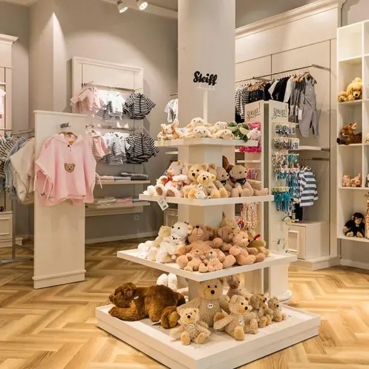
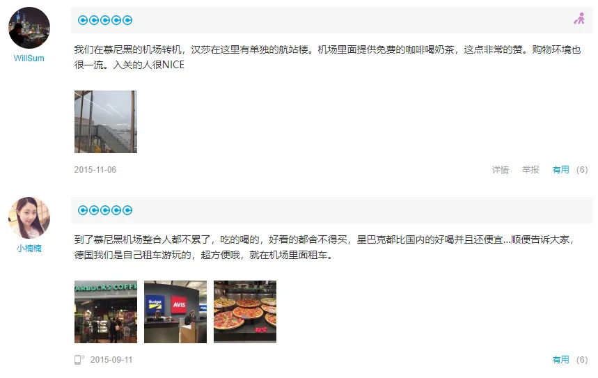

このガイドは**ミュンヘン空港（MUC）**を扱います。何より乗り継ぎ、次に空港の施設と運航状況です。ここでの乗り継ぎに関するすべて（必要な時間、必要な書類、順を追った手順）をこの1本にまとめています。

## 乗り継ぎ

### 所要時間の目安

ミュンヘン空港はシェンゲン域と非シェンゲン域に分かれ、乗り継ぎは4種類あります。**シェンゲン→非シェンゲン**、**非シェンゲン→シェンゲン**、**非シェンゲン→非シェンゲン**、**シェンゲン→シェンゲン**です。旅程に応じて1.5〜3時間を見てください。

### 4つの組み合わせ

| 組み合わせ | 内容 |
| --- | --- |
| **シェンゲン→シェンゲン** | 保安検査のみ。別々に予約したチケットでは手荷物を受け取り、再度チェックインする必要がある。 |
| **シェンゲン→非シェンゲン** | 保安検査のみ。国際線への乗り継ぎにビザは不要。預け荷物に還付対象品がある場合は先に税関でスタンプをもらい、チェックイン、保安検査、出国審査でパスポートにスタンプを受け、還付カウンターで還付を受けてからゲートへ。スルーチケットならシェンゲン圏内の出発空港で免税手続きができる。 |
| **非シェンゲン→シェンゲン** | スルーチケットかどうかに関わらず、ミュンヘンで必ず入国審査を受ける。シェンゲンビザが必要。スルーチケットの荷物はそのまま預けられ、そうでなければ入国して荷物を受け取り、シェンゲン域内便に再チェックインし、保安検査を通ってゲートへ。 |
| **非シェンゲン→非シェンゲン** | スルーチケットなら荷物の受取は不要だが、非シェンゲン圏の目的地のビザが必要。乗り継ぎ通路に従い、ドイツには入国しないためシェンゲンビザは不要。 |

### 順を追って

ミュンヘンでの乗り継ぎは速くて簡単です。案内がゲートまで直接導きます。**上海→ミュンヘン（乗り継ぎ）→ナポリ（LH727）**を例にしましょう。全体の流れは次のとおりです。

**ミュンヘン到着 → ゲート確認 → 乗り継ぎ保安検査 → シャトルトレイン → 税関 → ゲートで待機**

1. 着陸後、案内に従って出口方面へ進みます。

2. 少し進むと大きなフライト情報スクリーンがあります。**実際のゲートを再確認**してください。航空券と異なることがあります。例えば航空券にはK（税関用）とあっても、スクリーンには実際のゲートG35と表示されます。

3. スクリーンの横の下りエスカレーターが乗り継ぎ保安検査へ続きます。列が長いことが多いので、余裕を持って。

4. 保安検査後、案内に従ってシャトルトレインへ。入国スタンプのKエリアへ運ばれます。その後Gの案内に従ってゲートへ。

> **注意**：スルーチケットで荷物が目的地までスルーチェックインされている場合、乗り継ぎ中に受け取る必要はありません。スルーでなければ、乗り継ぎ保安検査横の税関通路を通り、荷物を受け取って再チェックインします。

### 乗り継ぎの実用ヒント

- **スルーチケットかどうかでルートが決まる。** スルーチケットなら荷物はスルーで乗り継ぎ通路へ。別々のチケットなら入国し、荷物を受け取り、再チェックインするため、最低1時間は余分に必要。
- **書類を手元に。** パスポート（残存6か月推奨）、シェンゲンビザ、次の搭乗券、旅程、ホテル予約。国境審査官がどれかを求めることがある。
- **別ゾーンへの移動時間を確保。** 第2ターミナルの一部ゲートエリアはシャトルトレインで行く（例：Kエリア）。まずスクリーンを読み、古い搭乗券のゲートではなくG / H / K / Lの文字に従う。

## 空港の基本情報

- **名称**：ミュンヘン空港
- **コード**：MUC（IATA） / EDDM（ICAO）
- **所在地**：ミュンヘン北東28 kmのエルディンガー・モース
- **主要航空会社**：ルフトハンザ、アウクスブルク航空、エア・ドロミティ
- **開港**：1992年

## 建設の経緯

- **立地選定**：エルディンガー・モースは第一候補ではなく、推奨する材料もほとんどなかったが、ドイツ連邦国防省がエルディング空軍基地の閉鎖を決めたことで、大規模空港の道が開けた。1969年7月、地域・国の計画に適合するとして、新空港はエルディンガー・モースに正式に立地が決まった。
- **課題**：南側への第4滑走路計画は却下された。1時間120回の発着は頻繁すぎると判断され、5,724件の反対意見が寄せられた。その後の異議申し立ても退けられ、建設の一部が止まった。
- **設計**：これを受けてミュンヘン空港会社は1981年、2本の滑走路、夜間飛行規則、より高い旅客予測を盛り込んだ修正計画を提出し、1984年6月に承認された。
- **開港**：ミュンヘン空港は1992年5月11日に運用を開始した。5月16日から17日の夜に航空会社がミュンヘン・リーム空港から移転し、リーム空港の最後のルフトハンザ・ボーイング737が真夜中直前に離陸すると、旧空港の歴史は幕を閉じた。

## 施設とサービス

### ラウンジ

**無料休憩エリア**

- **① バイエルン・ラウンジ**：第2ターミナル、G・Hゲート、03階（保安検査前）、24時間、無料。

- **② レクリエーション・エリア**：第2ターミナル、04階G・Kゲート、05階H・Lゲート（保安検査後）、24時間、旅客無料。

**有料ラウンジ**

- **① エアポート・ラウンジ・ヨーロッパ**：第1ターミナル、モジュールB、05階（保安検査後）、毎日06:00〜21:00、1人€43から。

- **② エアポート・ラウンジ・ワールド**：第1ターミナル、モジュールB、06階（保安検査後）、毎日05:15〜21:45、1人€48から。

**航空会社ラウンジ**

- **① ルフトハンザ・ラウンジ**（ルフトハンザおよびスターアライアンス加盟者限定）：第2ターミナル、04階G〜Lゲート、および05階の非公開エリア。

- **② エミレーツ・ラウンジ**（エミレーツのファースト・ビジネスクラス、ゴールド・プラチナ会員、カンタスのゴールド・プラチナ会員）：第1ターミナル、モジュールC、05階。毎日3つの時間帯に営業：07:30〜10:15、12:00〜15:30、18:30〜22:15。

**NapCabs仮眠ポッド**

NapCabsはミュンヘン空港の宿泊用仮眠ポッドで、夜間滞在や長い乗り継ぎがあるなら検討する価値があります。快適でプライバシーの高い睡眠空間に、無料の有線LANと電源コンセント、娯楽用スクリーンが付いています。

- **場所**：T2 04階G06ゲート、T2 05階H32ゲート、T2 03階サービスセンター、T2 SAT 05階L04ゲート
- **料金**：06:00〜22:00は1時間€15、22:00〜06:00は1時間€10（最低2時間）

### 食事

ミュンヘン空港には60以上のレストランや居酒屋があり、地元の名物、馴染みのアジア料理、世界各地の料理をカバーしています。空港自家製のクラフトビールが有名で、10ユーロあまりで真夜中まで飲み続けられ、バイエルン料理と夜の空気に包まれます。

- **Bamee**

- **Seafood Sylt**

- **Airbräu**

- **4 URBS**

### 免税店

ミュンヘン空港には非常に多くの免税店があり、香水、化粧品、アクセサリーなどの国際ブランドを免税価格で買えます。

| カテゴリー | ブランド |
| --- | --- |
| ラグジュアリー | Gucci、Armani、Zegna、Ferragamo、Bulgariなど |
| 香水・化粧品 | Dior、La Mer、Chanel、Sisley、Shiseido、MAC、Estée Lauder、Lancômeなど |
| 革製品・バッグ | Hermès、Longchamp、Furla、Mandarina Duck、Liebeskindなど |
| アクセサリー | Swarovski、Misaki、Fossil、Espritなど |

> シェンゲン圏内で乗り継ぎですか。免税品はレシート付きのまま封印し、免税還付が必要なら列に並ぶ時間を見込んでください（還付ルートは上記「4つの組み合わせ」に記載）。

### 空港ホテル

乗り継ぎ旅客向けに、空港のすぐ隣に2つのホテルがあります。

**ヒルトン・ミュンヘン・エアポート**

- T1とT2の間
- 電話：+49 89 97820
- US$160から

**ノボテル・ミュンヘン・エアポート**

- フルークハーフェン・ベズーハーパーク駅から700 m
- 電話：+49 89 9705130
- US$100から

### 喫煙エリア

ミュンヘン空港の喫煙エリアは、第1ターミナル（A、B、C、D、Fゾーン）と第2ターミナル（G、H、K、Lゾーン）の制限エリア内非公開区域にあります。

## 運航状況

ミュンヘンはヨーロッパ最大級の航空ハブの一つで、101社の航空会社が68か国242都市へ就航しています。空港は24時間高頻度で運航し、厳格で効率的な管理が定時性を高く保ち、旅客は時間どおりに到着します。

## 航空会社の顔ぶれ

多くの航空会社がミュンヘンに乗り入れ、ルフトハンザとスターアライアンス加盟会社が中心です。現在、ルフトハンザ・パートナーシップ外のすべての便（エールフランス、ブリティッシュ・エアウェイズなど）は第1ターミナルを使用し、第2ターミナルはルフトハンザとカタール航空、プライベートエア、エバー航空などのスターアライアンス系に割り当てられています。多様性により旅客は幅広い路線を選べます。空港は郊外にありますが接続は良く、貨物事業も強く、周辺には航空産業クラスターが育っています。旅客サービス向上のため、ミュンヘン空港は交通接続の改善とターミナル・滑走路の拡張を続ける計画です。

## 旅行者の声

以下の3つのレビューは2015年から2018年の間に公開プラットフォームに投稿されたもので、到着前に現地の雰囲気をつかむのに役立ちます。

- **立地と接続**：中心部から少し離れているが、Sバーンが直通し乗り継ぎルートもスムーズ。ドイツ第2の空港で、ヨーロッパの主要ハブの一つ。
- **施設とサービス**：無料のコーヒー、紅茶、Wi-Fiが繰り返し挙げられ、買い物は一流、食事も豊富、国境スタッフも親切。ルフトハンザは第2ターミナルに専用のチェックイン・乗り継ぎエリアを持つ。
- **レンタカーと買い物**：空港内でレンタカーを借りられ、セルフドライブに便利。第2ターミナルのシェンゲン到着後にはスーパー、レストラン、バイエルン・ミュンヘンのショップがある小さな広場があり、免税店とブランドショップも充実。

## 関連リンク

- **このサイト内**：[ミュンヘン空港 (MUC)](/airport/MUC)、[ドイツ (DE)](/country/DE)
- **Wikipedia**：[ミュンヘン空港](https://en.wikipedia.org/wiki/Munich_Airport)
- **百度百科**：[ミュンヘン空港](https://baike.baidu.com/item/%E6%85%95%E5%B0%BC%E9%BB%91%E6%9C%BA%E5%9C%BA)
- **空港サイト**：[ミュンヘン空港](https://www.munich-airport.com/)
- **関連記事**：[ミュンヘン空港到着と税関ガイド](/blog/munich-airport-arrival-customs-guide)、[ミュンヘン空港シャトルバスと市内交通](/blog/munich-airport-shuttle-bus-guide)

画像出典：元記事の図版、「亦出旅行」WeChatアカウントより。運賃、営業時間、ゲート番号、施設の場所はガイド作成時の記録であり、変更される可能性があります。旅行当日はミュンヘン空港と各運営会社のウェブサイトで確認してください。
