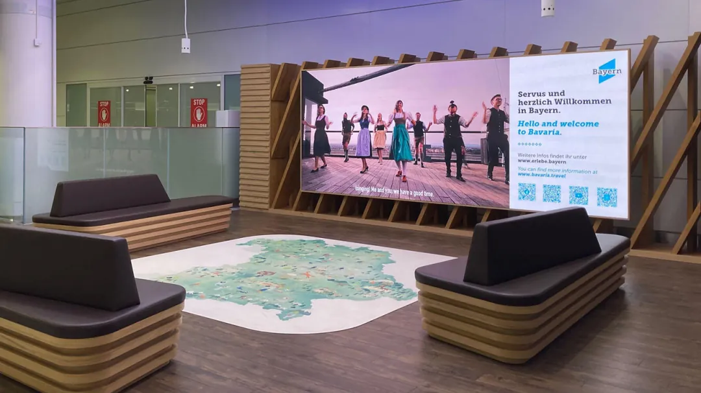

Ten przewodnik dotyczy **lotniska w Monachium (MUC)** — przede wszystkim przesiadek, a następnie infrastruktury lotniska i obsługi lotów. Wszystko, co wiąże się z przesiadką, od potrzebnego czasu i dokumentów po proces krok po kroku, znajduje się w tym jednym artykule.

## Przesiadki

### Ile czasu zarezerwować

Lotnisko w Monachium dzieli się na strefę Schengen i strefę poza Schengen, co daje cztery rodzaje przesiadek — **ze strefy Schengen do strefy poza Schengen**, **ze strefy poza Schengen do strefy Schengen**, **ze strefy poza Schengen do strefy poza Schengen** oraz **ze strefy Schengen do strefy Schengen**. Zarezerwuj 1,5–3 godziny w zależności od planu podróży.

### Cztery kombinacje

| Kombinacja | Co obejmuje |
| --- | --- |
| **Ze strefy Schengen do strefy Schengen** | Tylko kontrola bezpieczeństwa. Przy osobno rezerwowanych biletach trzeba odebrać bagaż i ponownie go odprawić. |
| **Ze strefy Schengen do strefy poza Schengen** | Tylko kontrola bezpieczeństwa; do dalszego lotu międzynarodowego nie jest potrzebna wiza wjazdowa. Jeśli w odprawionym bagażu są towary, za które chcesz odzyskać podatek, najpierw zdobądź pieczątkę celną, następnie odpraw się, przejdź kontrolę bezpieczeństwa, otrzymaj pieczątkę w paszporcie przy kontroli wyjazdowej i odbierz zwrot przy stanowisku zwrotów, zanim udasz się do bramki. Przy bilecie łączonym zwrot podatku można załatwić na lotnisku odlotu w strefie Schengen. |
| **Ze strefy poza Schengen do strefy Schengen** | W Monachium zawsze przechodzisz kontrolę graniczną, niezależnie od tego, czy masz bilet łączony, i potrzebujesz wizy Schengen. Bagaż na bilecie łączonym może pozostać nadany do końca podróży; w przeciwnym razie wjedź do kraju, odbierz bagaże, ponownie odpraw się na lot wewnątrz strefy Schengen, a następnie przejdź kontrolę bezpieczeństwa i udaj się do bramki. |
| **Ze strefy poza Schengen do strefy poza Schengen** | Przy bilecie łączonym nie odbierasz bagażu, ale potrzebujesz wizy do celu poza strefą Schengen. Idź kanałem tranzytowym; nie wjeżdżasz do Niemiec i nie potrzebujesz wizy Schengen. |

### Krok po kroku

Przesiadka w Monachium jest szybka i prosta — oznaczenia prowadzą cię prosto do bramki. Weźmy przykład **Szanghaj → Monachium (tranzyt) → Neapol (LH727)**. Cała sekwencja wygląda tak:

**Przylot do Monachium → potwierdzenie bramki → kontrola bezpieczeństwa tranzytu → przejazd kolejką wahadłową → kontrola celna → oczekiwanie przy bramce**

1. Po wylądowaniu oznaczenia prowadzą cię w kierunku wyjścia.

2. Po krótkim odcinku dochodzisz do dużego ekranu z informacjami o lotach. **Sprawdź dokładnie swoją faktyczną bramkę** — może się różnić od tej na bilecie. Na przykład na bilecie może być K (używane przy kontroli celnej), a ekran pokazuje G35, czyli twoją rzeczywistą bramkę.

3. Obok ekranu schody ruchome w dół prowadzą do kontroli bezpieczeństwa tranzytu. Kolejka bywa długa, więc zarezerwuj dużo czasu.

4. Po kontroli bezpieczeństwa podążaj dalej za oznaczeniami do kolejki wahadłowej, która zawiezie cię do strefy K po pieczątkę wjazdową. Następnie idź za oznaczeniami G do swojej bramki.

> **Uwaga:** przy bilecie łączonym z bagażem nadanym do miejsca docelowego nie odbierasz go podczas przesiadki. Jeśli bagaż nie jest nadany do końca podróży, skorzystaj z kanału celnego obok kontroli bezpieczeństwa tranzytu, odbierz bagaże i odpraw się ponownie.

### Praktyczne wskazówki dotyczące przesiadek

- **Bilet łączony decyduje o trasie.** Bilet łączony oznacza, że bagaż jest nadany do końca podróży, a ty idziesz kanałem tranzytowym; osobne bilety oznaczają wjazd do kraju, odbiór bagaży i ponowną odprawę — dolicz co najmniej godzinę.
- **Miej dokumenty przy sobie.** Paszport (zalecana ważność sześciu miesięcy), wiza Schengen, karta pokładowa na dalszy lot, plan podróży i rezerwacja hotelu — funkcjonariusze straży granicznej mogą poprosić o każdy z nich.
- **Zarezerwuj czas na pomyłkę ze strefą.** Do niektórych stref bramek Terminala 2 dociera się kolejką wahadłową (na przykład strefa K). Najpierw przeczytaj ekrany, a potem idź za literami G / H / K / L, a nie za bramką wydrukowaną na starej karcie pokładowej.

## Podstawowe informacje o lotnisku

- **Nazwa:** Lotnisko w Monachium
- **Kody:** MUC (IATA) / EDDM (ICAO)
- **Lokalizacja:** Erding Moos, 28 km na północny wschód od Monachium
- **Główne linie lotnicze:** Lufthansa, Augsburg Airways, Air Dolomiti
- **Otwarcie:** 1992

## Jak powstało lotnisko

- **Wybór lokalizacji:** Erding Moos nie było pierwszym wyborem — niewiele za nim przemawiało — dopóki niemieckie Federalne Ministerstwo Obrony nie zdecydowało o zamknięciu bazy lotniczej Erding, co otworzyło drogę do budowy tam dużego lotniska. W lipcu 1969 roku oficjalnie wyznaczono lokalizację nowego lotniska na Erding Moos, argumentując, że odpowiada ona planowaniu regionalnemu i krajowemu.
- **Wyzwanie:** odrzucono plany czwartej drogi startowej na południu — uznano, że 120 startów i lądowań na godzinę to zbyt dużo, a przeciwko inwestycji złożono 5724 sprzeciwy. Kolejne odwołania również oddalono, co wstrzymało część budowy.
- **Projekt:** w odpowiedzi Munich Airport GmbH przedłożyła w 1981 roku zmieniony plan z systemem dwóch dróg startowych, przepisami o lotach nocnych i wyższymi prognozami liczby pasażerów; został zatwierdzony w czerwcu 1984 roku.
- **Otwarcie:** Lotnisko w Monachium rozpoczęło działalność 11 maja 1992 roku. W nocy z 16 na 17 maja linie lotnicze przeniosły się z Munich-Riem, a gdy ostatni Boeing 737 Lufthansy wystartował z Riem tuż przed północą, historia starego lotniska dobiegła końca.

## Infrastruktura i usługi

### Loże

**Bezpłatne strefy odpoczynku**

- **① Bayern Lounge:** Terminal 2, bramki G i H, poziom 03 (przed kontrolą bezpieczeństwa); 24 godziny; bezpłatnie.

- **② Strefy rekreacji:** Terminal 2, poziom 04 bramki G i K, poziom 05 bramki H i L (po kontroli bezpieczeństwa); 24 godziny; bezpłatnie dla pasażerów.

**Loże płatne**

- **① Airport Lounge Europe:** Terminal 1, moduł B, poziom 05 (po kontroli bezpieczeństwa); codziennie 06:00–21:00; od 43 € za osobę.

- **② Airport Lounge World:** Terminal 1, moduł B, poziom 06 (po kontroli bezpieczeństwa); codziennie 05:15–21:45; od 48 € za osobę.

**Loże linii lotniczych**

- **① Loże Lufthansa** (tylko dla członków Lufthansy i Star Alliance): Terminal 2, poziom 04 bramki G–L oraz strefa niepubliczna na poziomie 05.

- **② Emirates Lounge** (klasa pierwsza i biznes Emirates, posiadacze statusów Gold i Platinum oraz posiadacze statusów Gold i Platinum Qantas): Terminal 1, moduł C, poziom 05; otwarta codziennie w trzech przedziałach czasowych — 07:30–10:15, 12:00–15:30 i 18:30–22:15.

**Kapsuły do spania NapCabs**

NapCabs to kapsuły do spania na lotnisku w Monachium, warte rozważenia, jeśli czeka cię nocleg lub długa przesiadka. Oferują wygodną i bardzo prywatną przestrzeń do spania z bezpłatnym dostępem do sieci Ethernet i gniazdkami zasilania oraz ekranem z rozrywką.

- **Gdzie:** T2 poziom 04, bramka G06; T2 poziom 05, bramka H32; T2 poziom 03, centrum obsługi; T2 SAT poziom 05, bramka L04
- **Cena:** 15 € za godzinę 06:00–22:00; 10 € za godzinę 22:00–06:00 (minimum dwie godziny)

### Gastronomia

Lotnisko w Monachium ma ponad 60 restauracji i piwiarni serwujących lokalne specjały, znajome azjatyckie potrawy i dania z całego świata. Słynne jest lotniskowe piwo rzemieślnicze — kilkanaście euro wystarczy, by pić do północy, w otoczeniu bawarskiego jedzenia i nocnego powietrza.

- **Bamee**

- **Seafood Sylt**

- **Airbräu**

- **4 URBS**

### Strefa bezcłowa

Lotnisko w Monachium ma bardzo wiele sklepów bezcłowych, w których międzynarodowe marki — perfumy, kosmetyki, akcesoria i nie tylko — można kupić w cenach bezcłowych.

| Kategoria | Marki |
| --- | --- |
| Luksusowe | Gucci, Armani, Zegna, Ferragamo, Bulgari i inne |
| Perfumy i kosmetyki | Dior, La Mer, Chanel, Sisley, Shiseido, MAC, Estée Lauder, Lancôme i inne |
| Wyroby skórzane i torby | Hermès, Longchamp, Furla, Mandarina Duck, Liebeskind i inne |
| Akcesoria | Swarovski, Misaki, Fossil, Esprit i inne |

> Przesiadasz się w strefie Schengen? Trzymaj zakupy bezcłowe zapakowane i opieczętowane razem z paragonem, a jeśli potrzebujesz zwrotu podatku, zarezerwuj czas na kolejkę (trasę zwrotu opisano powyżej w sekcji „Cztery kombinacje”).

### Hotele lotniskowe

Dwa hotele znajdują się tuż obok lotniska, z myślą o pasażerach przesiadujących.

**Hilton Munich Airport**

- Między T1 i T2
- Tel.: +49 89 97820
- Od 160 USD

**Novotel München Airport**

- 700 m od stacji Flughafen Besucherpark
- Tel.: +49 89 9705130
- Od 100 USD

### Miejsca dla palących

Miejsca dla palących na lotnisku w Monachium znajdują się w niepublicznych strefach za kontrolą bezpieczeństwa Terminala 1 (strefy A, B, C, D i F) oraz Terminala 2 (strefy G, H, K i L).

## Obsługa lotów

Monachium to jedno z największych europejskich centrów lotniczych — 101 linii lotniczych obsługuje loty do 242 miejsc docelowych w 68 krajach. Lotnisko działa całą dobę i obsługuje dużą liczbę połączeń, a rygorystyczne i sprawne zarządzanie zapewnia wysoką punktualność, dzięki czemu pasażerowie przylatują na czas.

## Linie lotnicze na lotnisku

W Monachium lata wiele linii lotniczych, na czele z Lufthansą i członkami Star Alliance. Dziś każdy lot poza partnerstwem Lufthansy (Air France, British Airways i tak dalej) obsługiwany jest z Terminala 1, natomiast Terminal 2 zarezerwowany jest dla Lufthansy i przewoźników Star Alliance, takich jak Qatar Airways, PrivatAir i EVA Air. Ta różnorodność daje pasażerom szeroki wybór tras. Choć lotnisko leży na przedmieściach, ma dobre połączenia, jego działalność cargo jest silna, a wokół niego rozwinął się klaster przemysłu lotniczego. Aby lepiej obsługiwać pasażerów, lotnisko w Monachium planuje stale poprawiać połączenia transportowe oraz rozbudowywać terminale i drogi startowe.

## Opinie podróżnych

Te trzy opinie to posty z publicznych platform napisane w latach 2015–2018, przydatne, by szybko wyrobić sobie wyobrażenie o miejscu przed przylotem:

- **Lokalizacja i połączenia:** nieco poza centrum, ale S-Bahn jedzie prosto do miasta, a trasa przesiadki jest płynna; drugie co do wielkości lotnisko Niemiec i jeden z kluczowych węzłów Europy.
- **Infrastruktura i obsługa:** bezpłatna kawa, herbata i Wi-Fi pojawiają się w opiniach raz po raz, sklepy są znakomite, jedzenia nie brakuje, a personel graniczny jest przyjazny; Lufthansa ma własną strefę odprawy i przesiadek w Terminalu 2.
- **Wynajem samochodów i zakupy:** na lotnisku można wynająć samochód, co jest wygodne w podróży własnym autem; po przylotach ze strefy Schengen w Terminalu 2 znajduje się niewielki plac z supermarketem, restauracjami i sklepem Bayernu Monachium, a sklepy bezcłowe i markowe są dobrze zaopatrzone.

## Powiązane linki

- **Na tej stronie**: [Lotnisko w Monachium (MUC)](/airport/MUC), [Niemcy (DE)](/country/DE)
- **Wikipedia**: [Lotnisko w Monachium](https://en.wikipedia.org/wiki/Munich_Airport)
- **Baidu Baike**: [Lotnisko w Monachium](https://baike.baidu.com/item/%E6%85%95%E5%B0%BC%E9%BB%91%E6%9C%BA%E5%9C%BA)
- **Strona lotniska**: [Lotnisko w Monachium](https://www.munich-airport.com/)
- **Więcej artykułów**: [Przylot i odprawa celna na lotnisku w Monachium](/blog/munich-airport-arrival-customs-guide), [Autobus wahadłowy i transport miejski z lotniska w Monachium](/blog/munich-airport-shuttle-bus-guide)

Źródło zdjęć: ilustracje z oryginalnego artykułu, z konta WeChat „亦出旅行”. Opłaty, godziny otwarcia, numery bramek i lokalizacje obiektów podano zgodnie ze stanem z czasu opracowania przewodnika i mogą się zmienić; w dniu podróży sprawdź strony internetowe lotniska w Monachium i operatorów.
