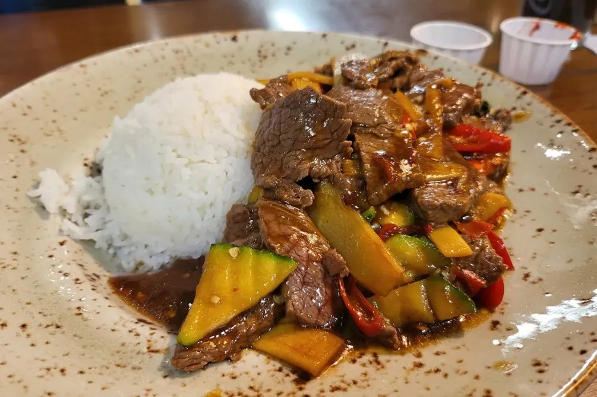
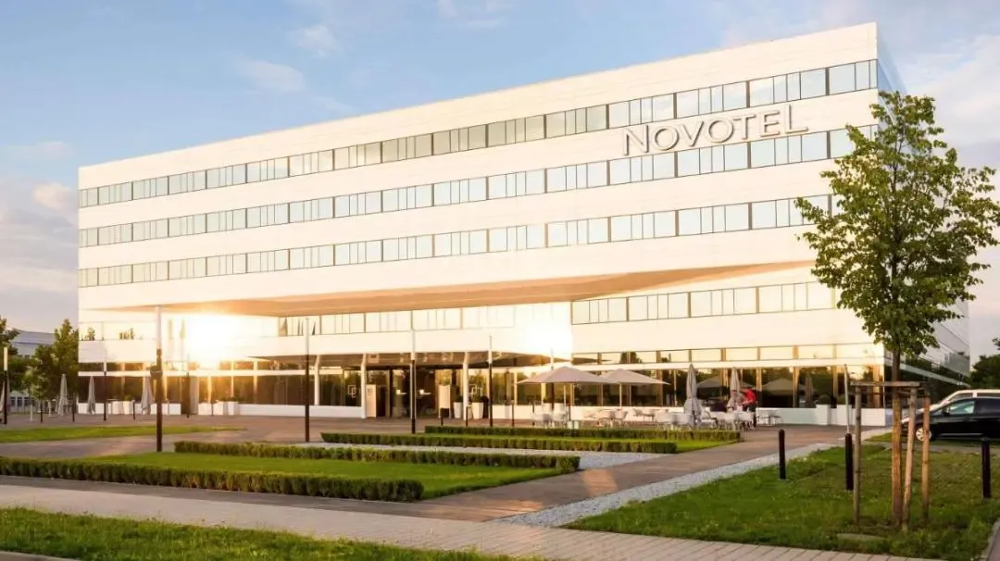

Este guia cobre o **Aeroporto de Munique (MUC)** — transfers acima de tudo, depois as instalações e as operações de voo do aeroporto. Tudo sobre fazer conexão aqui, desde o tempo necessário e os documentos envolvidos até o processo passo a passo, está neste único artigo.

## Transfers

### Quanto tempo reservar

O Aeroporto de Munique é dividido em área Schengen e não Schengen, o que gera quatro tipos de transfer — **Schengen para não Schengen**, **não Schengen para Schengen**, **não Schengen para não Schengen** e **Schengen para Schengen**. Reserve de 1,5 a 3 horas, dependendo do itinerário.

### As quatro combinações

| Combinação | O que envolve |
| --- | --- |
| **Schengen para Schengen** | Somente triagem de segurança. Em bilhetes comprados separadamente, você precisa retirar a bagagem e despachá-la novamente. |
| **Schengen para não Schengen** | Somente triagem de segurança; não é necessário visto de entrada para o voo internacional seguinte. Se a bagagem despachada contém bens pelos quais você quer reembolso, peça o carimbo na alfândega primeiro, depois faça o check-in, passe pela segurança, carimbe o passaporte no controle de saída e receba o reembolso no balcão antes de ir ao portão. Com um bilhete de ponta a ponta, o reembolso de impostos pode ser tratado no aeroporto de partida dentro do Schengen. |
| **Não Schengen para Schengen** | Você sempre passa pela imigração em Munique, tenha ou não um bilhete de ponta a ponta, e precisa de visto Schengen. A bagagem despachada de ponta a ponta pode permanecer assim; caso contrário, entre no país, retire as malas, faça o check-in novamente para o voo intra-Schengen e depois passe pela segurança até o portão. |
| **Não Schengen para não Schengen** | Sem retirada de bagagem em um bilhete de ponta a ponta, mas você precisa de visto para o destino fora do Schengen. Siga o canal de transferência; você não entra na Alemanha e não precisa de visto Schengen. |

### Passo a passo

Fazer conexão em Munique é rápido e fácil — as placas levam você direto ao portão. Tome como exemplo **Xangai → Munique (trânsito) → Nápoles (LH727)**. Toda a sequência é:

**Chegada a Munique → confirme seu portão → segurança de transfer → pegue o trem shuttle → passe pela alfândega → espere no portão**

1. Após o pouso, as placas orientam você em direção à saída.

2. Um pouco adiante você chega a uma grande tela de informações de voo. **Confira novamente seu portão real** — ele pode diferir do bilhete. Por exemplo, o bilhete pode dizer K (usado para a alfândega), enquanto a tela mostra G35, que é seu portão real.

3. Ao lado da tela, uma escada rolante desce até a verificação de segurança do transfer. A fila costuma ser longa, então reserve bastante tempo.

4. Depois da segurança, continue seguindo as placas até o trem shuttle, que leva você à área K para o carimbo de entrada. Depois siga as placas G até seu portão.

> **Observação:** em um bilhete de ponta a ponta com bagagem despachada até o destino, você não a retira durante a conexão. Se ela não estiver despachada de ponta a ponta, pegue o canal da alfândega ao lado da segurança de transfer, retire as malas e faça o check-in novamente.

### Dicas práticas de transfer

- **Ter ou não um bilhete de ponta a ponta decide a rota.** Um bilhete de ponta a ponta mantém sua bagagem despachada e coloca você no canal de transferência; bilhetes separados significam entrar no país, retirar as malas e fazer o check-in novamente — acrescente pelo menos uma hora.
- **Mantenha os documentos com você.** Passaporte (recomenda-se validade de seis meses), visto Schengen, cartão de embarque do voo seguinte, itinerário e reserva do hotel — os oficiais de fronteira podem pedir qualquer um deles.
- **Reserve tempo para o caso de uma zona errada.** Algumas áreas de portões do Terminal 2 são alcançadas pelo trem shuttle (a área K, por exemplo). Leia as telas primeiro e depois siga as letras G / H / K / L, em vez do portão impresso no cartão de embarque antigo.

## Noções básicas do aeroporto

- **Nome:** Aeroporto de Munique
- **Códigos:** MUC (IATA) / EDDM (ICAO)
- **Localização:** o Erdinger Moos, 28 km a nordeste de Munique
- **Principais companhias aéreas:** Lufthansa, Augsburg Airways, Air Dolomiti
- **Inauguração:** 1992

## Como foi construído

- **Escolha do local:** o Erdinger Moos não foi a primeira escolha — havia pouco a recomendá-lo — até o Ministério Federal da Defesa da Alemanha decidir fechar a base aérea de Erding, o que abriu a porta para um grande aeroporto ali. Em julho de 1969, o novo aeroporto foi oficialmente situado no Erdinger Moos, sob o argumento de que se encaixava no planejamento regional e nacional.
- **O desafio:** os planos para uma quarta pista ao sul foram rejeitados — 120 decolagens e pousos por hora foi considerado frequente demais, e 5.724 objeções foram apresentadas contra ele. Os recursos seguintes também foram indeferidos, interrompendo partes da construção.
- **O projeto:** em resposta, a Munich Airport GmbH apresentou em 1981 um plano alterado com um sistema de duas pistas, regras para voos noturnos e previsões de passageiros mais altas; ele foi aprovado em junho de 1984.
- **Abertura:** o Aeroporto de Munique iniciou as operações em 11 de maio de 1992. Durante a noite de 16–17 de maio, as companhias aéreas se transferiram de Munique-Riem, e quando o último Boeing 737 da Lufthansa em Riem decolou pouco antes da meia-noite, a história do antigo aeroporto chegou ao fim.

## Instalações e serviços

### Salas VIP

**Áreas de descanso gratuitas**

- **① Bayern Lounge:** Terminal 2, portões G e H, nível 03 (antes da segurança); 24 horas; gratuito.

- **② Recreation Areas (áreas de descanso):** Terminal 2, nível 04 portões G e K, nível 05 portões H e L (depois da segurança); 24 horas; gratuito para passageiros.

**Salas VIP pagas**

- **① Airport Lounge Europe:** Terminal 1, Módulo B, Nível 05 (depois da segurança); diariamente 06:00–21:00; a partir de €43 por pessoa.

- **② Airport Lounge World:** Terminal 1, Módulo B, Nível 06 (depois da segurança); diariamente 05:15–21:45; a partir de €48 por pessoa.

**Salas VIP de companhias aéreas**

- **① Lufthansa Lounges** (somente Lufthansa e membros da Star Alliance): Terminal 2, nível 04 portões G–L, e a área não pública do nível 05.

- **② Emirates Lounge** (primeira classe e executiva da Emirates, membros gold e platinum, além de membros gold e platinum da Qantas): Terminal 1, Módulo C, Nível 05; aberta diariamente em três janelas — 07:30–10:15, 12:00–15:30 e 18:30–22:15.

**Cabines para dormir NapCabs**

As NapCabs são cabines para dormir durante a noite no Aeroporto de Munique, que vale considerar se você tiver uma estadia noturna ou uma conexão longa. Elas oferecem um espaço confortável e muito privado para dormir, com Ethernet e tomadas gratuitas, além de uma tela com entretenimento.

- **Onde:** T2 nível 04, portão G06; T2 nível 05, portão H32; T2 nível 03, centro de serviços; T2 SAT nível 05, portão L04
- **Preço:** €15 por hora 06:00–22:00; €10 por hora 22:00–06:00 (mínimo de duas horas)

### Gastronomia

O Aeroporto de Munique tem mais de 60 restaurantes e tavernas, cobrindo especialidades locais, comida asiática conhecida e pratos de todos os lugares. A cerveja artesanal do próprio aeroporto é famosa — uns dez euros mantêm você bebendo até a meia-noite, entre comida bávara e ar noturno.

- **Bamee**

- **Seafood Sylt**

- **Airbräu**

- **4 URBS**

### Duty-free

O Aeroporto de Munique tem muitas lojas duty-free onde marcas internacionais — perfume, cosméticos, acessórios e mais — podem ser comprados a preços duty-free.

| Categoria | Marcas |
| --- | --- |
| Luxo | Gucci, Armani, Zegna, Ferragamo, Bulgari e mais |
| Perfume e cosméticos | Dior, La Mer, Chanel, Sisley, Shiseido, MAC, Estée Lauder, Lancôme e mais |
| Artigos de couro e bolsas | Hermès, Longchamp, Furla, Mandarina Duck, Liebeskind e mais |
| Acessórios | Swarovski, Misaki, Fossil, Esprit e mais |

> Fazendo conexão dentro do Schengen? Mantenha as compras duty-free lacradas com o recibo e reserve tempo para a fila se precisar de reembolso de impostos (a rota de reembolso está descrita em “As quatro combinações” acima).

### Hotéis do aeroporto

Dois hotéis ficam ao lado do aeroporto para passageiros em conexão.

**Hilton Munich Airport**

- Entre T1 e T2
- Tel: +49 89 97820
- A partir de US$160

**Novotel München Airport**

- 700 m da estação Flughafen Besucherpark
- Tel: +49 89 9705130
- A partir de US$100

### Áreas para fumantes

As áreas para fumantes do Aeroporto de Munique ficam nas zonas restritas não públicas do Terminal 1 (zonas A, B, C, D e F) e do Terminal 2 (zonas G, H, K e L).

## Operações de voo

Munique é um dos maiores hubs de aviação da Europa, com 101 companhias aéreas voando para 242 destinos em 68 países. O aeroporto funciona 24 horas por dia com altas frequências, e sua gestão rigorosa e eficiente mantém a pontualidade alta para que os passageiros cheguem na hora.

## O panorama das companhias aéreas

Muitas companhias servem Munique, lideradas pela Lufthansa e pelos membros da Star Alliance. Hoje, todos os voos de companhias fora da parceria com a Lufthansa (Air France, British Airways e assim por diante) usam o Terminal 1, enquanto o Terminal 2 é reservado para a Lufthansa e companhias da Star Alliance, como Qatar Airways, PrivatAir e EVA Air. A variedade dá aos passageiros uma ampla escolha de rotas. Embora o aeroporto fique nos subúrbios, é bem conectado, seu negócio de carga é forte e um cluster da indústria de aviação cresceu ao seu redor. Para atender melhor os passageiros, o Aeroporto de Munique planeja continuar melhorando suas ligações de transporte e expandir seus terminais e pistas.

## O que dizem os viajantes

Estas três avaliações são publicações em plataformas públicas escritas entre 2015 e 2018, úteis para ter uma ideia rápida do lugar antes de pousar:

- **Localização e conexões:** um pouco longe do centro, mas o S-Bahn vai direto e a rota de transfer é tranquila; segundo maior aeroporto da Alemanha e um dos principais hubs da Europa.
- **Instalações e serviço:** café, chá e Wi-Fi gratuitos aparecem repetidamente, as compras são de primeira, há muita comida e a equipe de fronteira é simpática; a Lufthansa tem sua própria área de check-in e transfer no Terminal 2.
- **Aluguel de carro e compras:** você pode alugar um carro dentro do aeroporto, prático para uma viagem de carro; depois das chegadas Schengen no Terminal 2, há uma pequena praça com supermercado, restaurantes e uma loja do Bayern de Munique, e as lojas duty-free e de marcas são bem sortidas.

## Links relacionados

- **Neste site**: [Aeroporto de Munique (MUC)](/airport/MUC), [Alemanha (DE)](/country/DE)
- **Wikipédia**: [Aeroporto de Munique](https://en.wikipedia.org/wiki/Munich_Airport)
- **Baidu Baike**: [Aeroporto de Munique](https://baike.baidu.com/item/%E6%85%95%E5%B0%BC%E9%BB%91%E6%9C%BA%E5%9C%BA)
- **Site do aeroporto**: [Aeroporto de Munique](https://www.munich-airport.com/)
- **Mais artigos**: [Guia de chegada e alfândega no Aeroporto de Munique](/blog/munich-airport-arrival-customs-guide), [Ônibus shuttle e transporte urbano no Aeroporto de Munique](/blog/munich-airport-shuttle-bus-guide)

Fonte da imagem: as figuras do artigo original, da conta WeChat “亦出旅行”. Tarifas, horários de funcionamento, números de portão e localizações das instalações são os registrados quando o guia foi compilado e podem mudar; consulte os sites do Aeroporto de Munique e dos operadores no dia da viagem.
