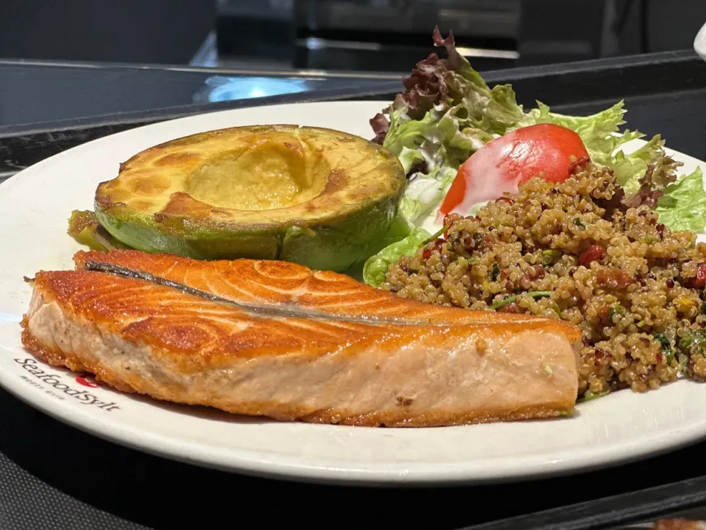
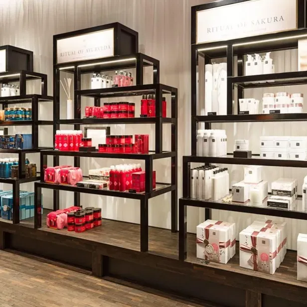

Acest ghid acoperă **Aeroportul München (MUC)** — în primul rând transferurile, apoi facilitățile aeroportului și operațiunile de zbor. Tot ce ține de o escală aici, de la timpul necesar și documentele implicate până la procesul pas cu pas, se află în acest singur articol.

## Transferuri

### Cât timp să prevedeți

Aeroportul München este împărțit într-o zonă Schengen și una non-Schengen, ceea ce dă patru tipuri de transfer — **Schengen către non-Schengen**, **non-Schengen către Schengen**, **non-Schengen către non-Schengen** și **Schengen către Schengen**. Prevedeți 1,5–3 ore, în funcție de itinerariul dumneavoastră.

### Cele patru combinații

| Combinație | Ce presupune |
| --- | --- |
| **Schengen către Schengen** | Doar controlul de securitate. Cu bilete rezervate separat, trebuie să vă ridicați bagajele și să le înregistrați din nou. |
| **Schengen către non-Schengen** | Doar controlul de securitate; nu este nevoie de viză de intrare pentru zborul internațional de continuare. Dacă în bagajele de cală aveți bunuri pentru care doriți rambursarea taxelor, cereți mai întâi ștampila vamală, apoi faceți check-in, treceți de securitate, obțineți ștampila pe pașaport la controlul de ieșire și ridicați rambursarea de la ghișeul de rambursare înainte de a pleca spre poartă. Cu un bilet unic, rambursarea taxelor se poate face la aeroportul de plecare din spațiul Schengen. |
| **Non-Schengen către Schengen** | Trecerea prin controlul de frontieră se face întotdeauna la München, indiferent dacă aveți sau nu bilet unic, și aveți nevoie de viză Schengen. Bagajele înregistrate pe un bilet unic pot rămâne în tranzit; altfel, intrați în țară, vă ridicați bagajele, faceți din nou check-in pentru zborul intra-Schengen, apoi treceți de securitate spre poarta dumneavoastră. |
| **Non-Schengen către non-Schengen** | Nu vă ridicați bagajele dacă aveți bilet unic, dar aveți nevoie de viză pentru destinația non-Schengen. Urmați culoarul de transfer; nu intrați în Germania și nu aveți nevoie de viză Schengen. |

### Pas cu pas

Escala la München este rapidă și simplă — indicatoarele vă duc direct la poartă. Luați ca exemplu **Shanghai → München (tranzit) → Napoli (LH727)**. Întreaga succesiune este:

**Sosiți la München → confirmați poarta → securitatea de transfer → luați trenul navetă → treceți de vamă → așteptați la poartă**

1. După aterizare, indicatoarele vă ghidează spre ieșire.

2. După puțin mers ajungeți la un ecran mare cu informații de zbor. **Verificați încă o dată poarta reală** — poate diferi de cea de pe bilet. De exemplu, biletul poate indica K (folosit pentru vamă), în timp ce ecranul arată G35, care este poarta dumneavoastră reală.

3. Lângă ecran, o scară rulantă în jos duce la controlul de securitate pentru transfer. Coada este adesea lungă, așa că prevedeți suficient timp.

4. După securitate, urmați în continuare indicatoarele spre trenul navetă, care vă duce în zona K pentru ștampila de intrare. Apoi urmați indicatoarele G spre poarta dumneavoastră.

> **Notă:** cu un bilet unic și bagaje înregistrate până la destinație, nu le ridicați în timpul transferului. Dacă bagajele nu sunt înregistrate până la destinație, luați culoarul vamal de lângă controlul de securitate pentru transfer, ridicați-vă bagajele și faceți din nou check-in.

### Sfaturi practice pentru transfer

- **Biletul unic sau nu decide ruta.** Un bilet unic vă ține bagajele înregistrate până la destinație și vă duce pe culoarul de transfer; biletele separate înseamnă intrare în țară, ridicarea bagajelor și un nou check-in — adăugați cel puțin o oră în plus.
- **Țineți documentele la dumneavoastră.** Pașaport (valabilitate de șase luni recomandată), viză Schengen, cartea de îmbarcare pentru zborul următor, itinerariul și rezervarea la hotel — polițiștii de frontieră pot cere oricare dintre ele.
- **Prevedeți timp pentru zona greșită.** Unele zone de porți din Terminalul 2 se ating cu trenul navetă (zona K, de exemplu). Citiți mai întâi ecranele, apoi urmați literele G / H / K / L, nu poarta tipărită pe vechea carte de îmbarcare.

## Informații de bază despre aeroport

- **Nume:** Aeroportul München
- **Coduri:** MUC (IATA) / EDDM (ICAO)
- **Locație:** Erding Moos, la 28 km nord-est de München
- **Companii aeriene principale:** Lufthansa, Augsburg Airways, Air Dolomiti
- **Deschis:** 1992

## Cum a fost construit

- **Alegerea amplasamentului:** Erding Moos nu a fost prima opțiune — avea puține argumente în favoarea sa — până când Ministerul Federal al Apărării al Germaniei a decis să închidă baza aeriană Erding, ceea ce a deschis calea pentru un aeroport mare acolo. În iulie 1969, noul aeroport a fost amplasat oficial pe Erding Moos, pe motiv că se potrivea planificării regionale și naționale.
- **Provocarea:** planurile pentru o a patra pistă spre sud au fost respinse — 120 de decolări și aterizări pe oră au fost considerate prea frecvente, iar împotriva ei s-au depus 5.724 de obiecții. Au fost respinse și recursurile ulterioare, ceea ce a oprit o parte a construcției.
- **Proiectul:** ca răspuns, Munich Airport GmbH a depus în 1981 un plan modificat, cu un sistem cu două piste, reguli pentru zborurile de noapte și previziuni mai mari de pasageri; acesta a fost aprobat în iunie 1984.
- **Deschiderea:** Aeroportul München a început operațiunile pe 11 mai 1992. În noaptea de 16–17 mai, companiile aeriene s-au mutat de la München-Riem, iar când ultimul Boeing 737 Lufthansa al aeroportului Riem a decolat chiar înainte de miezul nopții, istoria vechiului aeroport s-a încheiat.

## Facilități și servicii

### Lounge-uri

**Zone de odihnă gratuite**

- **① Bayern Lounge:** Terminalul 2, porțile G și H, nivelul 03 (înainte de securitate); 24 de ore; gratuit.

- **② Recreation Areas:** Terminalul 2, nivelul 04, porțile G și K, nivelul 05, porțile H și L (după securitate); 24 de ore; gratuit pentru pasageri.

**Lounge-uri cu plată**

- **① Airport Lounge Europe:** Terminalul 1, Modulul B, nivelul 05 (după securitate); zilnic 06:00–21:00; de la 43 € de persoană.

- **② Airport Lounge World:** Terminalul 1, Modulul B, nivelul 06 (după securitate); zilnic 05:15–21:45; de la 48 € de persoană.

**Lounge-uri ale companiilor aeriene**

- **① Lufthansa Lounges** (numai pentru membrii Lufthansa și Star Alliance): Terminalul 2, nivelul 04, porțile G–L, și zona nepublică a nivelului 05.

- **② Emirates Lounge** (clasa întâi și business Emirates, membrii gold și platinum, plus membrii gold și platinum Qantas): Terminalul 1, Modulul C, nivelul 05; deschis zilnic în trei intervale — 07:30–10:15, 12:00–15:30 și 18:30–22:15.

**Cabine de dormit NapCabs**

NapCabs sunt cabine de dormit peste noapte la Aeroportul München, demne de luat în calcul dacă aveți o ședere peste noapte sau un transfer lung. Oferă un spațiu de dormit confortabil și foarte privat, cu Ethernet și prize de curent gratuite, plus un ecran cu divertisment.

- **Unde:** T2 nivelul 04, poarta G06; T2 nivelul 05, poarta H32; T2 nivelul 03, centrul de servicii; T2 SAT nivelul 05, poarta L04
- **Preț:** 15 € pe oră 06:00–22:00; 10 € pe oră 22:00–06:00 (minimum două ore)

### Restaurante

Aeroportul München are peste 60 de restaurante și berării, care acoperă specialități locale, mâncare asiatică familiară și preparate din toate colțurile lumii. Berea artizanală a aeroportului este celebră — vreo zece euro vă țin la băut până la miezul nopții, învăluit în mâncare bavareză și aer de noapte.

- **Bamee**

- **Seafood Sylt**

- **Airbräu**

- **4 URBS**

### Duty-free

Aeroportul München are foarte multe magazine duty-free, unde mărci internaționale — parfumuri, cosmetice, accesorii și altele — pot fi cumpărate la prețuri duty-free.

| Categorie | Mărci |
| --- | --- |
| De lux | Gucci, Armani, Zegna, Ferragamo, Bulgari și altele |
| Parfumuri și cosmetice | Dior, La Mer, Chanel, Sisley, Shiseido, MAC, Estée Lauder, Lancôme și altele |
| Articole din piele și genți | Hermès, Longchamp, Furla, Mandarina Duck, Liebeskind și altele |
| Accesorii | Swarovski, Misaki, Fossil, Esprit și altele |

> Faceți escală în spațiul Schengen? Păstrați cumpărăturile duty-free sigilate, împreună cu bonul, și prevedeți timp de așteptare la coadă dacă aveți nevoie de rambursarea taxelor (ruta de rambursare este descrisă la „Cele patru combinații" mai sus).

### Hoteluri la aeroport

Două hoteluri se află chiar lângă aeroport, pentru pasagerii în transfer.

**Hilton Munich Airport**

- Între T1 și T2
- Tel: +49 89 97820
- De la 160 USD

**Novotel München Airport**

- La 700 m de stația Flughafen Besucherpark
- Tel: +49 89 9705130
- De la 100 USD

### Zone pentru fumat

Zonele pentru fumat ale Aeroportului München se află în zonele neublice din interiorul perimetrului de zbor ale Terminalului 1 (zonele A, B, C, D și F) și ale Terminalului 2 (zonele G, H, K și L).

## Operațiuni de zbor

München este unul dintre cele mai mari huburi aviatice din Europa, cu 101 companii aeriene care zboară spre 242 de destinații din 68 de țări. Aeroportul funcționează 24 de ore pe zi, cu frecvențe mari, iar managementul strict și eficient menține punctualitatea ridicată, astfel încât pasagerii ajung la timp.

## Peisajul companiilor aeriene

Multe companii aeriene deservesc München, în frunte cu Lufthansa și membrii Star Alliance. Astăzi, fiecare zbor din afara parteneriatului Lufthansa (Air France, British Airways și altele) folosește Terminalul 1, în timp ce Terminalul 2 este rezervat companiilor Lufthansa și Star Alliance, precum Qatar Airways, PrivatAir și EVA Air. Varietatea le oferă pasagerilor o gamă largă de rute. Deși aeroportul se află în afara orașului, este bine conectat, activitatea de cargo este puternică, iar în jurul lui s-a dezvoltat un cluster al industriei aviatice. Pentru a servi mai bine pasagerii, Aeroportul München plănuiește să își îmbunătățească în continuare legăturile de transport și să își extindă terminalele și pistele.

## Ce spun călătorii

Aceste trei recenzii sunt postări de pe platforme publice, scrise între 2015 și 2018, utile pentru o impresie rapidă despre loc înainte de a ateriza:

- **Locație și legături:** puțin departe de centru, dar S-Bahn-ul merge direct în oraș, iar ruta de transfer este fluentă; al doilea aeroport ca mărime din Germania și unul dintre huburile-cheie ale Europei.
- **Facilități și serviciu:** cafeaua, ceaiul și Wi-Fi-ul gratuit apar iar și iar, cumpărăturile sunt de primă clasă, există o mulțime de opțiuni de mâncare, iar personalul de frontieră este prietenos; Lufthansa are propriul spațiu de check-in și transfer în Terminalul 2.
- **Închirieri auto și cumpărături:** puteți închiria o mașină în interiorul aeroportului, util pentru o călătorie cu mașina proprie; după sosirile Schengen în Terminalul 2 există o mică piațetă cu un supermarket, restaurante și un magazin Bayern München, iar magazinele duty-free și cele de brand sunt bine aprovizionate.

## Linkuri utile

- **Pe acest site**: [Aeroportul München (MUC)](/airport/MUC), [Germania (DE)](/country/DE)
- **Wikipedia**: [Aeroportul München](https://en.wikipedia.org/wiki/Munich_Airport)
- **Baidu Baike**: [Aeroportul München](https://baike.baidu.com/item/%E6%85%95%E5%B0%BC%E9%BB%91%E6%9C%BA%E5%9C%BA)
- **Site-ul aeroportului**: [Aeroportul München](https://www.munich-airport.com/)
- **Mai multe articole**: [Ghid de sosire și vamă la Aeroportul München](/blog/munich-airport-arrival-customs-guide), [Naveta și transportul urban la Aeroportul München](/blog/munich-airport-shuttle-bus-guide)

Sursa imaginilor: ilustrațiile articolului original, de pe contul WeChat „亦出旅行". Tarifele, programul de funcționare, numerele porților și locațiile facilităților sunt cele consemnate la data întocmirii ghidului și se pot schimba; verificați site-urile Aeroportului München și ale operatorilor în ziua călătoriei.
