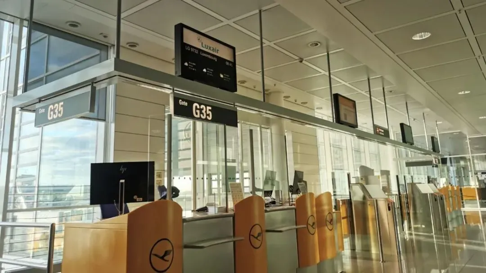

Den här guiden täcker **Münchens flygplats (MUC)** – framför allt transfer, därefter flygplatsens faciliteter och flygtrafik. Allt om att byta plan här, från tiden du behöver och dokumenten som gäller till själva processen steg för steg, finns i den här artikeln.

## Transfer

### Hur mycket tid du bör avsätta

Münchens flygplats är uppdelad i ett Schengenområde och ett icke-Schengenområde, vilket ger fyra typer av transfer – **Schengen till icke-Schengen**, **icke-Schengen till Schengen**, **icke-Schengen till icke-Schengen** och **Schengen till Schengen**. Avsätt 1,5–3 timmar beroende på din resplan.

### De fyra kombinationerna

| Kombination | Vad den innebär |
| --- | --- |
| **Schengen till Schengen** | Endast säkerhetskontroll. Med separat bokade biljetter måste du hämta ditt bagage och checka in det igen. |
| **Schengen till icke-Schengen** | Endast säkerhetskontroll; inget inresevisum krävs för det fortsatta internationella flyget. Om ditt incheckade bagage innehåller varor som du vill få återbetalning för ska du först få dem stämplade i tullen, sedan checka in, passera säkerhetskontrollen, få passet stämplat i utresekontrollen och hämta återbetalningen vid återbetalningsdisken innan du går mot gaten. Med en genomgående biljett kan skatteåterbetalningen hanteras på din avgångsflygplats inom Schengen. |
| **Icke-Schengen till Schengen** | Du passerar alltid immigrationskontrollen i München, oavsett om du har en genomgående biljett eller inte, och du behöver ett Schengenvisum. Bagage på genomgående biljett kan checkas hela vägen; annars reser du in i landet, hämtar ditt bagage, checkar in igen för flyget inom Schengen och passerar säkerhetskontrollen till din gate. |
| **Icke-Schengen till icke-Schengen** | Ingen bagagehämtning med genomgående biljett, men du behöver visum för destinationen utanför Schengen. Följ transferkanalen; du reser inte in i Tyskland och behöver inget Schengenvisum. |

### Steg för steg

Att byta plan i München går snabbt och enkelt – skyltarna leder dig direkt till din gate. Ta **Shanghai → München (transit) → Neapel (LH727)** som exempel. Hela sekvensen är:

**Ankomst München → bekräfta din gate → transferns säkerhetskontroll → ta transfertåget → passera tullen → vänta vid gaten**

1. Efter landning leder skyltarna dig mot utgången.

2. En bit framme når du en stor flyginformationstavla. **Dubbelkolla din faktiska gate** – den kan skilja sig från biljetten. Biljetten kan till exempel ange K (används för tullen), medan tavlan visar G35, vilket är din riktiga gate.

3. Bredvid tavlan leder en rulltrappa ner till transferns säkerhetskontroll. Kön är ofta lång, så avsätt gott om tid.

4. Efter säkerhetskontrollen fortsätter du att följa skyltarna till transfertåget, som tar dig till område K för inresestämpeln. Följ sedan G-skyltarna till din gate.

> **Obs:** med en genomgående biljett där bagaget är incheckat hela vägen till destinationen hämtar du inte bagaget under transfern. Om det inte är incheckat hela vägen tar du tullkanalen bredvid transferns säkerhetskontroll, hämtar ditt bagage och checkar in igen.

### Praktiska transfertips

- **Genomgående biljett eller ej avgör rutten.** En genomgående biljett håller bagaget incheckat hela vägen och leder dig till transferkanalen; separata biljetter innebär att du reser in i landet, hämtar ditt bagage och checkar in igen – räkna med minst en timme extra.
- **Ha dokumenten på dig.** Pass (minst sex månaders giltighet rekommenderas), Schengenvisum, boardingkortet för det fortsatta flyget, resplanen och hotellbokningen – gränspoliser kan fråga efter vilket som helst av dem.
- **Avsätt tid för fel zon.** Vissa gateområden i terminal 2 nås med transfertåget (till exempel område K). Läs tavlorna först och följ sedan bokstäverna G / H / K / L i stället för gaten som står på ditt gamla boardingkort.

## Flygplatsens grundfakta

- **Namn:** Münchens flygplats
- **Koder:** MUC (IATA) / EDDM (ICAO)
- **Läge:** Erding Moos, 28 km nordost om München
- **Huvudflygbolag:** Lufthansa, Augsburg Airways, Air Dolomiti
- **Öppnad:** 1992

## Hur flygplatsen byggdes

- **Platsvalet:** Erding Moos var inte förstahandsvalet – det fanns lite som talade för platsen – tills Tysklands försvarsdepartement beslutade att stänga flygbasen Erding, vilket öppnade dörren för en stor flygplats där. I juli 1969 fastställdes officiellt den nya flygplatsens placering i Erding Moos, med motiveringen att den passade regional och nationell planering.
- **Utmaningen:** planerna på en fjärde rullbana söderut avslogs – 120 starter och landningar i timmen ansågs vara för ofta, och 5 724 invändningar lämnades in mot den. Även efterföljande överklaganden avvisades, vilket stoppade delar av bygget.
- **Utformningen:** som svar lämnade Munich Airport GmbH in en reviderad plan 1981 med ett system med två rullbanor, regler för nattflyg och högre passagerarprognoser; den godkändes i juni 1984.
- **Invigningen:** Münchens flygplats inledde verksamheten den 11 maj 1992. Natten mellan den 16 och 17 maj flyttade flygbolagen över från München-Riem, och när Riems sista Lufthansa Boeing 737 lyfte strax före midnatt var den gamla flygplatsens historia över.

## Faciliteter och tjänster

### Lounger

**Kostnadsfria vilområden**

- **① Bayern Lounge:** terminal 2, gaterna G och H, plan 03 (före säkerhetskontrollen); dygnet runt; kostnadsfritt.

- **② Rekreationsområden:** terminal 2, plan 04 gaterna G och K, plan 05 gaterna H och L (efter säkerhetskontrollen); dygnet runt; kostnadsfritt för passagerare.

**Betalda lounger**

- **① Airport Lounge Europe:** terminal 1, modul B, plan 05 (efter säkerhetskontrollen); dagligen 06:00–21:00; från 43 € per person.

- **② Airport Lounge World:** terminal 1, modul B, plan 06 (efter säkerhetskontrollen); dagligen 05:15–21:45; från 48 € per person.

**Flygbolagens lounger**

- **① Lufthansa Lounger** (endast Lufthansa- och Star Alliance-medlemmar): terminal 2, plan 04 gaterna G–L, samt det icke-offentliga området på plan 05.

- **② Emirates Lounge** (Emirates första klass och business class, guld- och platinamedlemmar, samt Qantas guld- och platinamedlemmar): terminal 1, modul C, plan 05; öppen dagligen i tre tidsfönster – 07:30–10:15, 12:00–15:30 och 18:30–22:15.

**NapCabs-sovkapslar**

NapCabs är sovkapslar för övernattning på Münchens flygplats, värda att överväga om du har en övernattning eller en lång transfer. De erbjuder en bekväm och mycket privat sovplats med gratis Ethernet och eluttag, samt en skärm med underhållning.

- **Var:** T2 plan 04, gate G06; T2 plan 05, gate H32; T2 plan 03, servicecenter; T2 SAT plan 05, gate L04
- **Pris:** 15 € per timme 06:00–22:00; 10 € per timme 22:00–06:00 (minst två timmar)

### Restauranger

Münchens flygplats har fler än 60 restauranger och värdshus, med lokala specialiteter, välbekant asiatisk mat och rätter från resten av världen. Flygplatsens egen hantverksöl är berömd – ett tiotal euro räcker för att dricka ända till midnatt, inramat av bayersk mat och nattluft.

- **Bamee**

- **Seafood Sylt**

- **Airbräu**

- **4 URBS**

### Taxfree

Münchens flygplats har många taxfreebutiker där internationella märken – parfym, kosmetika, accessoarer och mer – kan köpas till taxfreepriser.

| Kategori | Märken |
| --- | --- |
| Lyx | Gucci, Armani, Zegna, Ferragamo, Bulgari med flera |
| Parfym och kosmetika | Dior, La Mer, Chanel, Sisley, Shiseido, MAC, Estée Lauder, Lancôme med flera |
| Läderartiklar och väskor | Hermès, Longchamp, Furla, Mandarina Duck, Liebeskind med flera |
| Accessoarer | Swarovski, Misaki, Fossil, Esprit med flera |

> Ska du vidare inom Schengen? Låt taxfreeköpen vara förseglade med kvittot kvar, och räkna med kötid om du behöver skatteåterbetalning (återbetalningsrutten beskrivs under ”De fyra kombinationerna” ovan).

### Flygplatshotell

Två hotell ligger alldeles intill flygplatsen för transferpassagerare.

**Hilton Munich Airport**

- Mellan T1 och T2
- Tel: +49 89 97820
- Från 160 US$

**Novotel München Airport**

- 700 m från stationen Flughafen Besucherpark
- Tel: +49 89 9705130
- Från 100 US$

### Rökområden

Münchens flygplats rökområden finns i de icke-offentliga områdena airside i terminal 1 (zonerna A, B, C, D och F) och terminal 2 (zonerna G, H, K och L).

## Flygtrafik

München är en av Europas största flyghubbar, med 101 flygbolag som flyger till 242 destinationer i 68 länder. Flygplatsen är öppen dygnet runt med hög frekvens, och dess strikta och effektiva ledning håller punktligheten hög så att passagerarna kommer fram i tid.

## Flygbolagslandskapet

Många flygbolag trafikerar München, med Lufthansa och Star Alliance-medlemmarna i täten. I dag använder alla flyg utanför Lufthansas partnerskap (Air France, British Airways och så vidare) terminal 1, medan terminal 2 är reserverad för Lufthansa och Star Alliance-bolag som Qatar Airways, PrivatAir och EVA Air. Variationen ger passagerarna ett brett utbud av rutter. Även om flygplatsen ligger ute i förstäderna är den väl förbunden, fraktverksamheten är stark och ett kluster av flygindustri har vuxit upp runt den. För att betjäna passagerarna bättre planerar Münchens flygplats att fortsätta förbättra sina transportförbindelser och bygga ut terminaler och rullbanor.

## Vad resenärer säger

Dessa tre recensioner är inlägg från offentliga plattformar skrivna mellan 2015 och 2018, användbara för att snabbt få en känsla för platsen innan du landar:

- **Läge och förbindelser:** en bit från centrum, men S-Bahn går direkt in och transfervägen är smidig; Tysklands näst största flygplats och en av Europas viktigaste hubbar.
- **Faciliteter och service:** gratis kaffe, te och wi-fi nämns om och om igen, shoppingen är förstklassig, det finns gott att äta och gränspersonalen är vänlig; Lufthansa har egen incheckning och transferområde i terminal 2.
- **Biluthyrning och shopping:** du kan hyra bil inne på flygplatsen, praktiskt för en rundresa med egen bil; efter ankomster från Schengen i terminal 2 finns ett litet torg med stormarknad, restauranger och en Bayern München-butik, och taxfree- och märkesbutikerna är välfyllda.

## Relaterade länkar

- **På den här sidan**: [Münchens flygplats (MUC)](/airport/MUC), [Tyskland (DE)](/country/DE)
- **Wikipedia**: [Münchens flygplats](https://en.wikipedia.org/wiki/Munich_Airport)
- **Baidu Baike**: [Münchens flygplats](https://baike.baidu.com/item/%E6%85%95%E5%B0%BC%E9%BB%91%E6%9C%BA%E5%9C%BA)
- **Flygplatsens webbplats**: [Münchens flygplats](https://www.munich-airport.com/)
- **Fler artiklar**: [Guide till ankomst och tull på Münchens flygplats](/blog/munich-airport-arrival-customs-guide), [Transferbussar och transport till staden från Münchens flygplats](/blog/munich-airport-shuttle-bus-guide)

Bildkälla: originalartikelns bilder, från WeChat-kontot ”亦出旅行”. Biljettpriser, öppettider, gatunummer och faciliteternas placering är som de registrerades när guiden sammanställdes och kan ändras; kontrollera Münchens flygplats och operatörernas webbplatser på resdagen.
