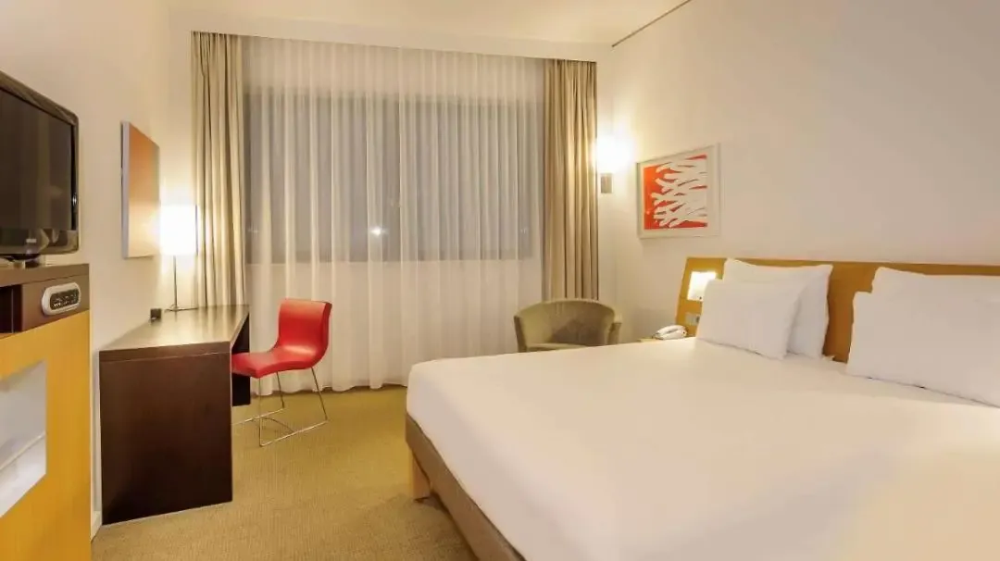
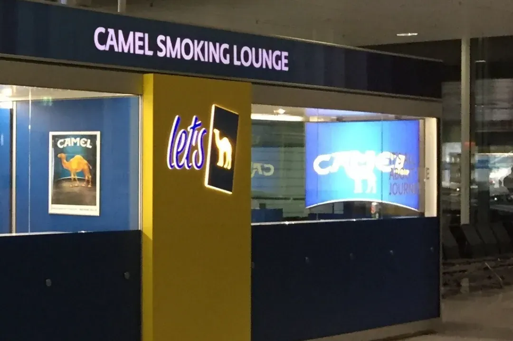

Mwongozo huu unashughulikia **Uwanja wa Ndege wa Munich (MUC)** — uhamishaji kwanza kabisa, kisha huduma za uwanja wa ndege na shughuli za ndege. Kila kitu kuhusu kuunganisha hapa, kuanzia muda unaohitaji na nyaraka zinazohusika hadi mchakato wa hatua kwa hatua, kiko katika makala hii moja.

## Uhamishaji

### Muda unaostahili kutenga

Uwanja wa Ndege wa Munich umegawanywa katika eneo la Schengen na lisilo la Schengen, jambo linalotoa aina nne za uhamishaji — **kutoka Schengen kwenda nje ya Schengen**, **kutoka nje ya Schengen kwenda Schengen**, **kutoka nje ya Schengen kwenda nje ya Schengen** na **kutoka Schengen kwenda Schengen**. Tenga saa 1.5–3 kulingana na ratiba yako.

### Michanganyiko minne

| Mchanganyiko | Kinachohusika |
| --- | --- |
| **Schengen hadi Schengen** | Ukaguzi wa usalama pekee. Kwenye tikiti zilizowekwa kando lazima ukusanye mizigo yako na kuisajili tena. |
| **Schengen hadi nje ya Schengen** | Ukaguzi wa usalama pekee; hakuna visa ya kuingia inayohitajika kwa ndege ya kimataifa inayoendelea. Ikiwa mizigo yako iliyosajiliwa ina bidhaa unazotaka kurejeshewa, pata muhuri wa forodha kwanza, kisha jisajili, pite ukaguzi wa usalama, pata muhuri wa pasipoti kwenye udhibiti wa kutoka na ukusanye marejesho kwenye dawati la marejesho kabla ya kuelekea getini. Kwenye tikiti ya safari nzima, marejesho ya kodi yanaweza kushughulikiwa kwenye uwanja wako wa ndege wa kuondoka ndani ya Schengen. |
| **Nje ya Schengen hadi Schengen** | Daima unapitia udhibiti wa uhamiaji huko Munich, iwe uko kwenye tikiti ya safari nzima au la, na unahitaji visa ya Schengen. Mizigo ya tikiti ya safari nzima inaweza kubaki imesajiliwa hadi mwisho; vinginevyo ingia nchini, kusanya mizigo yako, jisajili tena kwa ndege ya ndani ya Schengen, kisha pita ukaguzi wa usalama hadi getini kwako. |
| **Nje ya Schengen hadi nje ya Schengen** | Hakuna ukusanyaji wa mizigo kwenye tikiti ya safari nzima, lakini unahitaji visa ya nchi unakoenda nje ya Schengen. Fuata njia ya uhamishaji; huingii Ujerumani na huhitaji visa ya Schengen. |

### Hatua kwa hatua

Kuunganisha huko Munich ni haraka na rahisi — alama zikupeleka moja kwa moja hadi getini kwako. Chukua **Shanghai → Munich (kupitia) → Naples (LH727)** kama mfano. Mfululizo wote ni:

**Wasili Munich → thibitisha geti lako → ukaguzi wa uhamishaji → panda treni ya kuhamisha abiria → pita forodha → subiri getini**

1. Baada ya kutua, alama zinaelekeza kuelekea njia ya kutoka.

2. Ukiwa umetembea kidogo unafikia skrini kubwa ya taarifa za ndege. **Hakikisha geti lako halisi** — linaweza kutofautiana na lile lililo kwenye tikiti yako. Kwa mfano, tikiti inaweza kuonyesha K (inayotumika kwa forodha), wakati skrini inaonyesha G35, ambayo ni geti lako halisi.

3. Kando ya skrini, eskaleta ya kushuka inaelekea kwenye ukaguzi wa uhamishaji. Foleni huwa ndefu mara nyingi, kwa hiyo tenga muda wa kutosha.

4. Baada ya ukaguzi wa usalama, endelea kufuata alama kuelekea treni ya kuhamisha abiria, ambayo inakupeleka eneo K kwa muhuri wa kuingia. Kisha fuata alama za G hadi getini kwako.

> **Kumbuka:** kwenye tikiti ya safari nzima yenye mizigo iliyosajiliwa hadi mwisho, huikusanyi wakati wa uhamishaji. Ikiwa haijasajiliwa hadi mwisho, chukua njia ya forodha kando ya ukaguzi wa uhamishaji, kusanya mizigo yako na ujisajili tena.

### Vidokezo vya vitendo vya uhamishaji

- **Tikiti ya safari nzima au la huamua njia.** Tikiti ya safari nzima huweka mizigo yako imesajiliwa hadi mwisho na kukuweka kwenye njia ya uhamishaji; tikiti tofauti zinamaanisha kuingia nchini, kukusanya mizigo yako na kujisajili tena — ongeza angalau saa moja zaidi.
- **Beba nyaraka zako kila wakati.** Pasipoti (inashauriwa uhalali wa miezi sita), visa ya Schengen, kadi ya kupanda ya ndege inayoendelea, ratiba na uhifadhi wa hoteli — maafisa wa mipaka wanaweza kuomba yoyote kati ya haya.
- **Tenga muda kwa eneo lisilofaa.** Baadhi ya maeneo ya geti ya Terminal 2 hufikiwa kwa treni ya kuhamisha abiria (eneo K, kwa mfano). Soma skrini kwanza, kisha fuata herufi G / H / K / L badala ya geti lililochapishwa kwenye kadi yako ya zamani ya kupanda.

## Mambo ya msingi ya uwanja wa ndege

- **Jina:** Uwanja wa Ndege wa Munich
- **Misimbo:** MUC (IATA) / EDDM (ICAO)
- **Mahali:** Erding Moos, kilomita 28 kaskazini-mashariki mwa Munich
- **Mashirika makubwa ya ndege:** Lufthansa, Augsburg Airways, Air Dolomiti
- **Ulifunguliwa:** 1992

## Jinsi ulivyojengwa

- **Uchaguzi wa eneo:** Erding Moos haukuwa chaguo la kwanza — hapakuwa na kitu cha kuvutia — hadi Wizara ya Ulinzi ya Shirikisho la Ujerumani ilipoamua kufunga kituo cha ndege cha Erding, jambo lililofungua mlango kwa uwanja mkubwa wa ndege hapo. Mnamo Julai 1969 uwanja mpya wa ndege uliwekwa rasmi Erding Moos, kwa sababu ulioana na mipango ya kikanda na kitaifa.
- **Changamoto:** mipango ya njia ya nne ya kuruka kuelekea kusini ilikataliwa — kuruka na kutua mara 120 kwa saa kulionekana kuwa kwingi mno, na pingamizi 5,724 ziliwasilishwa dhidi yake. Rufaa zilizofuata pia zilikataliwa, zikisimamisha sehemu za ujenzi.
- **Muundo:** kwa kujibu, Munich Airport GmbH iliwasilisha mpango uliorekebishwa mwaka 1981 wenye mfumo wa njia mbili za kuruka, kanuni za ndege za usiku na makadirio makubwa ya abiria; uliidhinishwa mnamo Juni 1984.
- **Ufunguzi:** Uwanja wa Ndege wa Munich ulianza kufanya kazi tarehe 11 Mei 1992. Katika usiku wa 16–17 Mei mashirika ya ndege yalihama kutoka Munich-Riem, na Boeing 737 ya mwisho ya Lufthansa ya Riem ilipopaa dakika chache kabla ya saa sita usiku, historia ya uwanja wa ndege wa zamani ilifikia mwisho.

## Huduma na vifaa

### Mapumziko

**Maeneo ya mapumziko ya bure**

- **① Bayern Lounge:** Terminal 2, geti G na H, ngazi ya 03 (kabla ya ukaguzi wa usalama); saa 24; bure.

- **② Maeneo ya Mapumziko:** Terminal 2, ngazi ya 04 geti G na K, ngazi ya 05 geti H na L (baada ya ukaguzi wa usalama); saa 24; bure kwa abiria.

**Mapumziko ya kulipia**

- **① Airport Lounge Europe:** Terminal 1, Module B, Ngazi ya 05 (baada ya ukaguzi wa usalama); kila siku 06:00–21:00; kuanzia €43 kwa mtu.

- **② Airport Lounge World:** Terminal 1, Module B, Ngazi ya 06 (baada ya ukaguzi wa usalama); kila siku 05:15–21:45; kuanzia €48 kwa mtu.

**Mapumziko ya mashirika ya ndege**

- **① Lufthansa Lounges** (wanachama wa Lufthansa na Star Alliance pekee): Terminal 2, ngazi ya 04 geti G–L, na eneo lisilo la umma la ngazi ya 05.

- **② Emirates Lounge** (daraja la kwanza na la biashara la Emirates, wanachama wa dhahabu na platinamu, pamoja na wanachama wa dhahabu na platinamu wa Qantas): Terminal 1, Module C, Ngazi ya 05; hufunguliwa kila siku katika vipindi vitatu — 07:30–10:15, 12:00–15:30 na 18:30–22:15.

**Vyumba vya kulala vya NapCabs**

NapCabs ni vyumba vya kulala vya usiku kucha katika Uwanja wa Ndege wa Munich, vinavyofaa kuzingatiwa ikiwa una malazi ya usiku mmoja au uhamishaji mrefu. Vinatoa nafasi ya kulala yenye starehe na faragha kubwa, pamoja na Ethernet na soketi za umeme bure, na skrini yenye burudani.

- **Wapi:** T2 ngazi ya 04, geti G06; T2 ngazi ya 05, geti H32; T2 ngazi ya 03, kituo cha huduma; T2 SAT ngazi ya 05, geti L04
- **Bei:** €15 kwa saa 06:00–22:00; €10 kwa saa 22:00–06:00 (angalau saa mbili)

### Chakula

Uwanja wa Ndege wa Munich una zaidi ya mikahawa na baa 60, inayojumuisha vyakula maalum vya kienyeji, chakula kinachofahamika cha Asia na vyakula kutoka kila mahali pengine. Bia ya ufundi ya uwanja huo ni maarufu — euro kumi na kadhaa zinakutosha kunywa hadi usiku wa manane, ukiwa umezungukwa na chakula cha Bavaria na hewa ya usiku.

- **Bamee**

- **Seafood Sylt**

- **Airbräu**

- **4 URBS**

### Bidhaa bila ushuru

Uwanja wa Ndege wa Munich una maduka mengi sana ya bidhaa bila ushuru ambapo chapa za kimataifa — manukato, vipodozi, vifaa na zaidi — zinaweza kununuliwa kwa bei bila ushuru.

| Aina | Chapa |
| --- | --- |
| Bidhaa za kifahari | Gucci, Armani, Zegna, Ferragamo, Bulgari na zaidi |
| Manukato na vipodozi | Dior, La Mer, Chanel, Sisley, Shiseido, MAC, Estée Lauder, Lancôme na zaidi |
| Bidhaa za ngozi na mifuko | Hermès, Longchamp, Furla, Mandarina Duck, Liebeskind na zaidi |
| Vifaa | Swarovski, Misaki, Fossil, Esprit na zaidi |

> Unounganisha ndani ya Schengen? Weka bidhaa zilizonunuliwa bila ushuru zimefungwa pamoja na risiti, na tenga muda wa foleni ikiwa unahitaji marejesho ya kodi (njia ya marejesho imeelezwa chini ya “Michanganyiko minne” hapo juu).

### Hoteli za uwanja wa ndege

Hoteli mbili ziko kando kabisa ya uwanja wa ndege kwa abiria wa uhamishaji.

**Hilton Munich Airport**

- Kati ya T1 na T2
- Simu: +49 89 97820
- Kuanzia US$160

**Novotel München Airport**

- Mita 700 kutoka kituo cha Flughafen Besucherpark
- Simu: +49 89 9705130
- Kuanzia US$100

### Maeneo ya kuvuta sigara

Maeneo ya kuvuta sigara ya Uwanja wa Ndege wa Munich yako katika maeneo yasiyo ya umma ya upande wa ndege wa Terminal 1 (kanda A, B, C, D na F) na Terminal 2 (kanda G, H, K na L).

## Shughuli za ndege

Munich ni mojawapo ya vituo vikubwa zaidi vya usafiri wa anga barani Ulaya, kikiwa na mashirika 101 ya ndege yanayoruka hadi maeneo 242 katika nchi 68. Uwanja wa ndege hufanya kazi saa 24 kwa siku kwa mzunguko mkubwa, na usimamizi wake mkali na mzuri huweka usahihi wa muda juu ili abiria wafike kwa wakati.

## Mandhari ya mashirika ya ndege

Mashirika mengi ya ndege huhudumia Munich, yakiongozwa na Lufthansa na wanachama wa Star Alliance. Leo, kila ndege nje ya ushirikiano wa Lufthansa (Air France, British Airways na kadhalika) hutumia Terminal 1, wakati Terminal 2 imetengwa kwa Lufthansa na mashirika ya Star Alliance kama Qatar Airways, PrivatAir na EVA Air. Aina mbalimbali humpa abiria chaguo pana la njia. Ingawa uwanja wa ndege uko nje ya miji, umeunganishwa vizuri, biashara yake ya mizigo ni imara, na kikundi cha sekta ya usafiri wa anga kimekua kuzunguka. Ili kuwahudumia abiria vyema, Uwanja wa Ndege wa Munich unapanga kuendelea kuboresha viungo vyake vya usafiri na kupanua vituo na njia zake za kuruka.

## Wanasema nini wasafiri

Maoni haya matatu ni machapisho ya majukwaa ya umma yaliyoandikwa kati ya 2015 na 2018, yenye manufaa kama taswira ya haraka ya mahali kabla ya kutua:

- **Mahali na viungo:** mbali kidogo na katikati mwa jiji, lakini S-Bahn inaingia moja kwa moja na njia ya uhamishaji ni laini; uwanja wa pili kwa ukubwa nchini Ujerumani na mojawapo ya vituo muhimu vya Ulaya.
- **Huduma na vifaa:** kahawa, chai na Wi-Fi ya bure zinatajwa tena na tena, ununuzi ni wa hali ya juu, kuna chakula kingi, na wafanyakazi wa mipaka ni wakarimu; Lufthansa ina eneo lake la kujisajili na la uhamishaji katika Terminal 2.
- **Kukodisha gari na ununuzi:** unaweza kukodisha gari ndani ya uwanja wa ndege, jambo linalofaa kwa safari ya kuendesha gari mwenyewe; baada ya kuwasili kutoka Schengen katika Terminal 2 kuna uwanja mdogo wenye duka kubwa la bidhaa, mikahawa na duka la Bayern Munich, na maduka ya bidhaa bila ushuru na ya chapa yana bidhaa nyingi.

## Viungo vinavyohusiana

- **Kwenye tovuti hii**: [Uwanja wa Ndege wa Munich (MUC)](/airport/MUC), [Ujerumani (DE)](/country/DE)
- **Wikipedia**: [Uwanja wa Ndege wa Munich](https://en.wikipedia.org/wiki/Munich_Airport)
- **Baidu Baike**: [Uwanja wa Ndege wa Munich](https://baike.baidu.com/item/%E6%85%95%E5%B0%BC%E9%BB%91%E6%9C%BA%E5%9C%BA)
- **Tovuti ya uwanja wa ndege**: [Uwanja wa Ndege wa Munich](https://www.munich-airport.com/)
- **Makala zaidi**: [Mwongozo wa kuwasili na forodha wa Uwanja wa Ndege wa Munich](/blog/munich-airport-arrival-customs-guide), [Basi la kuhamisha abiria na usafiri wa jiji wa Uwanja wa Ndege wa Munich](/blog/munich-airport-shuttle-bus-guide)

Chanzo cha picha: takwimu za makala ya awali, kutoka akaunti ya WeChat “亦出旅行”. Nauli, saa za kufungua, namba za geti na maeneo ya huduma ni kama zilivyorekodiwa wakati mwongozo ulipotayarishwa na zinaweza kubadilika; angalia tovuti za Uwanja wa Ndege wa Munich na za waendeshaji siku ya safari.
