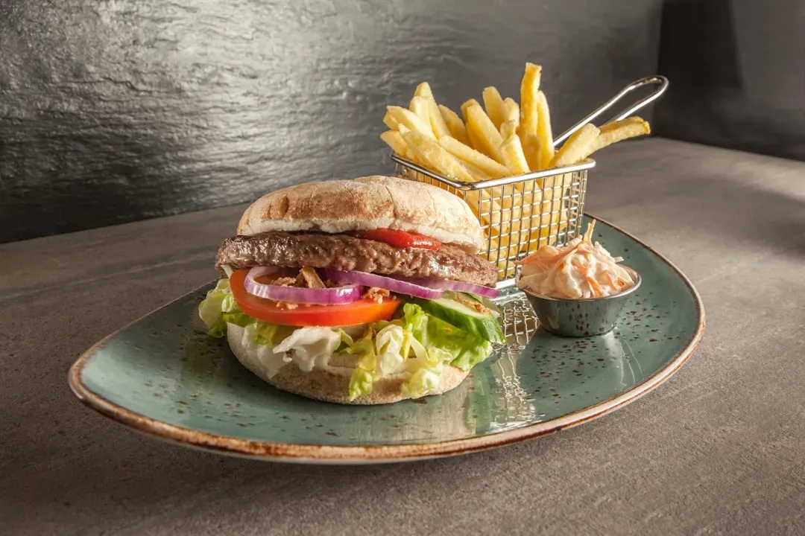
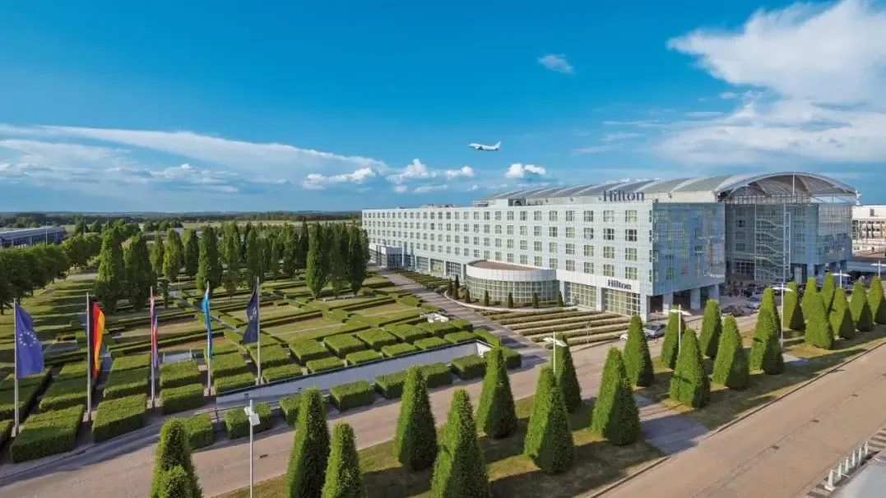

คู่มือนี้ครอบคลุม **สนามบินมิวนิก (MUC)** — เรื่องเปลี่ยนเครื่องเป็นหลัก ตามด้วยสิ่งอำนวยความสะดวกและการดำเนินเที่ยวบินของสนามบิน ทุกอย่างเกี่ยวกับการเปลี่ยนเครื่องที่นี่ ตั้งแต่เวลาที่ต้องเผื่อและเอกสารที่เกี่ยวข้อง ไปจนถึงขั้นตอนทีละขั้น อยู่ในบทความเดียวนี้

## การเปลี่ยนเครื่อง

### ควรเผื่อเวลาเท่าไร

สนามบินมิวนิกแบ่งเป็นพื้นที่เชงเกนและนอกเชงเกน ทำให้มีการเปลี่ยนเครื่องสี่แบบ — **เชงเกนไปนอกเชงเกน**, **นอกเชงเกนไปเชงเกน**, **นอกเชงเกนไปนอกเชงเกน** และ **เชงเกนไปเชงเกน** เผื่อ 1.5–3 ชั่วโมงขึ้นอยู่กับแผนการเดินทาง

### สี่รูปแบบ

| รูปแบบ | มีขั้นตอนอะไร |
| --- | --- |
| **เชงเกนไปเชงเกน** | ตรวจความปลอดภัยเท่านั้น หากซื้อตั๋วแยก ต้องรับกระเป๋าและเช็คอินใหม่ |
| **เชงเกนไปนอกเชงเกน** | ตรวจความปลอดภัยเท่านั้น ไม่ต้องใช้วีซ่าเข้าประเทศสำหรับเที่ยวบินระหว่างประเทศต่อไป หากกระเป๋าโหลดมีสินค้าที่ต้องการขอคืนภาษี ให้นำไปประทับตราที่ศุลกากรก่อน แล้วเช็คอิน ผ่านความปลอดภัย ประทับตราหนังสือเดินทางที่ด่านขาออก และรับเงินคืนที่เคาน์เตอร์คืนภาษีก่อนไปประตูขึ้นเครื่อง ด้วยตั๋วเชื่อมต่อ การคืนภาษีสามารถทำได้ที่สนามบินขาออกภายในเชงเกน |
| **นอกเชงเกนไปเชงเกน** | คุณต้องผ่านตรวจคนเข้าเมืองที่มิวนิกเสมอ ไม่ว่าจะเป็นตั๋วเชื่อมต่อหรือไม่ และต้องมีวีซ่าเชงเกน กระเป๋าโหลดตรงปลายทางสามารถโหลดต่อไปได้ มิฉะนั้นให้เข้าประเทศ รับกระเป๋า เช็คอินใหม่สำหรับเที่ยวบินในเชงเกน แล้วผ่านความปลอดภัยไปประตูขึ้นเครื่อง |
| **นอกเชงเกนไปนอกเชงเกน** | ไม่ต้องรับกระเป๋าด้วยตั๋วเชื่อมต่อ แต่ต้องมีวีซ่าสำหรับจุดหมายนอกเชงเกน ตามช่องเปลี่ยนเครื่อง คุณไม่เข้าประเทศเยอรมนีและไม่ต้องมีวีซ่าเชงเกน |

### ทีละขั้นตอน

การเปลี่ยนเครื่องที่มิวนิกรวดเร็วและง่าย — ป้ายพาคุณตรงไปยังประตูขึ้นเครื่อง ยกตัวอย่าง **เซี่ยงไฮ้ → มิวนิก (เปลี่ยนเครื่อง) → เนเปิลส์ (LH727)** ลำดับทั้งหมดคือ:

**ถึงมิวนิก → ยืนยันประตูขึ้นเครื่อง → ผ่านความปลอดภัยเปลี่ยนเครื่อง → ขึ้นรถไฟรับส่ง → ผ่านศุลกากร → รอที่ประตูขึ้นเครื่อง**

1. หลังลงเครื่อง ป้ายจะนำคุณไปทางออก

2. เดินไปสักระยะจะถึงจอข้อมูลเที่ยวบินขนาดใหญ่ **ตรวจสอบประตูขึ้นเครื่องจริงอีกครั้ง** — อาจต่างจากตั๋ว ตัวอย่างเช่น ตั๋วอาจระบุ K (ใช้สำหรับศุลกากร) ขณะที่จอแสดง G35 ซึ่งเป็นประตูจริงของคุณ

3. ข้างจอมีบันไดเลื่อนลงไปยังจุดตรวจความปลอดภัยเปลี่ยนเครื่อง คิวมักยาว ดังนั้นเผื่อเวลาไว้มาก

4. หลังความปลอดภัย ให้ตามป้ายไปยังรถไฟรับส่งซึ่งพาคุณไปพื้นที่ K เพื่อประทับตราเข้า จากนั้นตามป้าย G ไปประตูขึ้นเครื่อง

> **หมายเหตุ:** ด้วยตั๋วเชื่อมต่อที่กระเป๋าโหลดตรงถึงจุดหมาย คุณไม่ต้องรับกระเป๋าระหว่างเปลี่ยนเครื่อง หากไม่ได้โหลดตรง ให้ใช้ช่องศุลกากรข้างจุดตรวจความปลอดภัยเปลี่ยนเครื่อง รับกระเป๋า และเช็คอินใหม่

### เคล็ดลับการเปลี่ยนเครื่อง

- **ตั๋วเชื่อมต่อหรือไม่เป็นตัวกำหนดเส้นทาง** ตั๋วเชื่อมต่อทำให้กระเป๋าโหลดตรงและพาคุณเข้าช่องเปลี่ยนเครื่อง ตั๋วแยกหมายถึงเข้าประเทศ รับกระเป๋า และเช็คอินใหม่ — เพิ่มเวลาอย่างน้อยหนึ่งชั่วโมง
- **พกเอกสารติดตัว** หนังสือเดินทาง (แนะนำให้เหลืออายุอย่างน้อยหกเดือน) วีซ่าเชงเกน บัตรขึ้นเครื่องเที่ยวต่อไป แผนการเดินทาง และการจองโรงแรม — เจ้าหน้าที่ชายแดนอาจขอสิ่งใดก็ได้
- **เผื่อเวลาไว้สำหรับกรณีอยู่ผิดโซน** พื้นที่ประตูอาคารผู้โดยสาร 2 บางส่วนไปถึงด้วยรถไฟรับส่ง (เช่น พื้นที่ K) อ่านจอก่อน แล้วตามตัวอักษร G / H / K / L แทนประตูที่พิมพ์บนบัตรขึ้นเครื่องเก่า

## ข้อมูลพื้นฐานสนามบิน

- **ชื่อ:** สนามบินมิวนิก
- **รหัส:** MUC (IATA) / EDDM (ICAO)
- **ที่ตั้ง:** ที่ราบเออร์ดิง ห่างจากมิวนิกไปทางตะวันออกเฉียงเหนือ 28 กม.
- **สายการบินหลัก:** ลุฟท์ฮันซา, Augsburg Airways, Air Dolomiti
- **เปิดทำการ:** 1992

## สนามบินถูกสร้างอย่างไร

- **การเลือกที่ตั้ง:** ที่ราบเออร์ดิงไม่ใช่ตัวเลือกแรก — มีเหตุผลสนับสนุนน้อย — จนกระทั่งกระทรวงกลาโหมเยอรมนีตัดสินใจปิดฐานทัพอากาศเออร์ดิง ซึ่งเปิดประตูสำหรับสนามบินขนาดใหญ่ที่นั่น ในเดือนกรกฎาคม 1969 สนามบินใหม่ได้รับการกำหนดที่ตั้งอย่างเป็นทางการบนที่ราบเออร์ดิง โดยอ้างว่าเหมาะกับการวางแผนระดับภูมิภาคและระดับชาติ
- **ความท้าทาย:** แผนสร้างรันเวย์ที่สี่ทางใต้ถูกปฏิเสธ — 120 เที่ยวบินขึ้นลงต่อชั่วโมงถือว่าถี่เกินไป และมีการคัดค้าน 5,724 ข้อ อุทธรณ์ในภายหลังก็ถูกยกเช่นกัน ทำให้การก่อสร้างบางส่วนหยุดชะงัก
- **การออกแบบ:** เพื่อตอบสนอง บริษัท Munich Airport GmbH ยื่นแผนแก้ไขในปี 1981 ด้วยระบบรันเวย์คู่ กฎเที่ยวบินกลางคืน และการคาดการณ์ผู้โดยสารที่สูงขึ้น ได้รับอนุมัติในเดือนมิถุนายน 1984
- **การเปิด:** สนามบินมิวนิกเริ่มดำเนินการเมื่อวันที่ 11 พฤษภาคม 1992 ในคืนวันที่ 16–17 พฤษภาคม สายการบินย้ายจากมิวนิก-รีม และเมื่อโบอิ้ง 737 ลำสุดท้ายของลุฟท์ฮันซาที่รีมบินขึ้นก่อนเที่ยงคืน ประวัติศาสตร์ของสนามบินเก่าก็สิ้นสุด

## สิ่งอำนวยความสะดวกและบริการ

### เลานจ์

**พื้นที่พักผ่อนฟรี**

- **① Bayern Lounge:** อาคารผู้โดยสาร 2 ประตู G และ H ชั้น 03 (ก่อนความปลอดภัย) 24 ชั่วโมง ฟรี

- **② Recreation Areas:** อาคารผู้โดยสาร 2 ชั้น 04 ประตู G และ K ชั้น 05 ประตู H และ L (หลังความปลอดภัย) 24 ชั่วโมง ฟรีสำหรับผู้โดยสาร

**เลานจ์เสียเงิน**

- **① Airport Lounge Europe:** อาคารผู้โดยสาร 1 โมดูล B ชั้น 05 (หลังความปลอดภัย) ทุกวัน 06:00–21:00 เริ่มต้น €43 ต่อคน

- **② Airport Lounge World:** อาคารผู้โดยสาร 1 โมดูล B ชั้น 06 (หลังความปลอดภัย) ทุกวัน 05:15–21:45 เริ่มต้น €48 ต่อคน

**เลานจ์สายการบิน**

- **① Lufthansa Lounges** (เฉพาะสมาชิกลุฟท์ฮันซาและ Star Alliance): อาคารผู้โดยสาร 2 ชั้น 04 ประตู G–L และพื้นที่ไม่เปิดสาธารณะชั้น 05

- **② Emirates Lounge** (ชั้นธุรกิจและชั้นหนึ่งของเอมิเรตส์ สมาชิกโกลด์และแพลตินัม รวมถึงสมาชิกโกลด์และแพลตินัมของแคนตัส): อาคารผู้โดยสาร 1 โมดูล C ชั้น 05 เปิดทุกวันสามช่วง — 07:30–10:15, 12:00–15:30 และ 18:30–22:15

**ตู้หลับ NapCabs**

NapCabs เป็นตู้หลับข้ามคืนที่สนามบินมิวนิก คุ้มค่าพิจารณาหากคุณต้องพักค้างคืนหรือเปลี่ยนเครื่องนาน ให้พื้นที่นอนที่สะดวกและเป็นส่วนตัวมาก พร้อมอีเทอร์เน็ตและปลั๊กไฟฟรี และจอพร้อมความบันเทิง

- **ที่ตั้ง:** T2 ชั้น 04 ประตู G06; T2 ชั้น 05 ประตู H32; T2 ชั้น 03 ศูนย์บริการ; T2 SAT ชั้น 05 ประตู L04
- **ราคา:** €15 ต่อชั่วโมง 06:00–22:00; €10 ต่อชั่วโมง 22:00–06:00 (ขั้นต่ำสองชั่วโมง)

### อาหาร

สนามบินมิวนิกมีร้านอาหารและโรงเบียร์มากกว่า 60 แห่ง ครอบคลุมอาหารท้องถิ่น อาหารเอเชียที่คุ้นเคย และอาหารจากทุกที่ เบียร์คราฟต์ของสนามบินเองมีชื่อเสียง — ราคาสิบกว่ายูโรทำให้คุณดื่มได้ถึงเที่ยงคืน ท่ามกลางอาหารบาวาเรียและอากาศยามค่ำคืน

- **Bamee**

- **Seafood Sylt**

- **Airbräu**

- **4 URBS**

### ปลอดภาษี

สนามบินมิวนิกมีร้านปลอดภาษีมากมายที่สามารถซื้อแบรนด์ระดับสากล — น้ำหอม เครื่องสำอาง เครื่องประดับ และอื่น ๆ — ในราคาปลอดภาษี

| ประเภท | แบรนด์ |
| --- | --- |
| สินค้าหรูหรา | Gucci, Armani, Zegna, Ferragamo, Bulgari และอื่น ๆ |
| น้ำหอมและเครื่องสำอาง | Dior, La Mer, Chanel, Sisley, Shiseido, MAC, Estée Lauder, Lancôme และอื่น ๆ |
| เครื่องหนังและกระเป๋า | Hermès, Longchamp, Furla, Mandarina Duck, Liebeskind และอื่น ๆ |
| เครื่องประดับ | Swarovski, Misaki, Fossil, Esprit และอื่น ๆ |

> เปลี่ยนเครื่องภายในเชงเกน? เก็บสินค้าปลอดภาษีปิดผนึกพร้อมใบเสร็จ และเผื่อเวลาต่อคิวหากต้องขอคืนภาษี (เส้นทางคืนภาษีอธิบายไว้ใน «สี่รูปแบบ» ด้านบน)

### โรงแรมสนามบิน

มีโรงแรมสองแห่งติดสนามบินสำหรับผู้โดยสารเปลี่ยนเครื่อง

**Hilton Munich Airport**

- ระหว่าง T1 และ T2
- โทร: +49 89 97820
- เริ่มต้น US$160

**Novotel München Airport**

- ห่างจากสถานี Flughafen Besucherpark 700 ม.
- โทร: +49 89 9705130
- เริ่มต้น US$100

### พื้นที่สูบบุหรี่

พื้นที่สูบบุหรี่ของสนามบินมิวนิกอยู่ในพื้นที่ไม่เปิดสาธารณะหลังด่านของอาคารผู้โดยสาร 1 (โซน A, B, C, D และ F) และอาคารผู้โดยสาร 2 (โซน G, H, K และ L)

## การดำเนินเที่ยวบิน

มิวนิกเป็นหนึ่งในศูนย์กลางการบินที่ใหญ่ที่สุดของยุโรป มีสายการบิน 101 แห่งบินไปยัง 242 จุดหมายใน 68 ประเทศ สนามบินเปิด 24 ชั่วโมงด้วยความถี่สูง และการบริหารที่เข้มงวดและมีประสิทธิภาพรักษาความตรงต่อเวลาไว้ได้ดี ผู้โดยสารจึงมาถึงตรงเวลา

## ภาพรวมสายการบิน

มีสายการบินหลายแห่งให้บริการมิวนิก นำโดยลุฟท์ฮันซาและสมาชิก Star Alliance ปัจจุบันทุกเที่ยวบินนอกพันธมิตรลุฟท์ฮันซา (แอร์ฟรานซ์ บริติชแอร์เวย์ และอื่น ๆ) ใช้อาคารผู้โดยสาร 1 ส่วนอาคารผู้โดยสาร 2 สงวนไว้สำหรับลุฟท์ฮันซาและสายการบิน Star Alliance เช่น กาตาร์แอร์เวย์, PrivatAir และ EVA Air ความหลากหลายมอบทางเลือกเส้นทางมากมายให้ผู้โดยสาร แม้สนามบินจะอยู่ชานเมือง แต่เชื่อมต่อดี ธุรกิจสินค้าแข็งแกร่ง และมีกลุ่มอุตสาหกรรมการบินเติบโตรอบ ๆ เพื่อให้บริการผู้โดยสารดีขึ้น สนามบินมิวนิกวางแผนปรับปรุงการเชื่อมต่อขนส่งและขยายอาคารผู้โดยสารและรันเวย์อย่างต่อเนื่อง

## สิ่งที่ผู้เดินทางพูด

รีวิวสามข้อนี้เป็นโพสต์บนแพลตฟอร์มสาธารณะที่เขียนระหว่างปี 2015 ถึง 2018 มีประโยชน์ในการทำความรู้จักสถานที่อย่างรวดเร็วก่อนลงเครื่อง:

- **ที่ตั้งและการเชื่อมต่อ:** ห่างจากใจกลางเมืองเล็กน้อย แต่ S-Bahn วิ่งตรงเข้าเมืองและเส้นทางเปลี่ยนเครื่องราบรื่น เป็นสนามบินที่ใหญ่เป็นอันดับสองของเยอรมนีและหนึ่งในศูนย์กลางสำคัญของยุโรป
- **สิ่งอำนวยความสะดวกและบริการ:** กาแฟ ชา และ Wi-Fi ฟรีถูกพูดถึงซ้ำ ๆ การช้อปปิ้งยอดเยี่ยม มีอาหารให้เลือกมาก และเจ้าหน้าที่ชายแดนเป็นมิตร ลุฟท์ฮันซามีพื้นที่เช็คอินและเปลี่ยนเครื่องของตนเองในอาคารผู้โดยสาร 2
- **รถเช่าและการช้อปปิ้ง:** เช่ารถได้ภายในสนามบิน สะดวกสำหรับการขับเอง หลังขาเข้าเชงเกนในอาคารผู้โดยสาร 2 มีลานเล็ก ๆ พร้อมซูเปอร์มาร์เก็ต ร้านอาหาร และร้านสโมสรไบเอิร์น มิวนิก และร้านปลอดภาษีกับร้านแบรนด์มีสินค้าเยอะ

## ลิงก์ที่เกี่ยวข้อง

- **บนเว็บไซต์นี้**: [สนามบินมิวนิก (MUC)](/airport/MUC), [เยอรมนี (DE)](/country/DE)
- **วิกิพีเดีย**: [Munich Airport](https://en.wikipedia.org/wiki/Munich_Airport)
- **Baidu Baike**: [Munich Airport](https://baike.baidu.com/item/%E6%85%95%E5%B0%BC%E9%BB%91%E6%9C%BA%E5%9C%BA)
- **เว็บไซต์สนามบิน**: [Munich Airport](https://www.munich-airport.com/)
- **บทความเพิ่มเติม**: [คู่มือขาเข้าและศุลกากรสนามบินมิวนิก](/blog/munich-airport-arrival-customs-guide), [รถรับส่งและขนส่งในเมืองที่สนามบินมิวนิก](/blog/munich-airport-shuttle-bus-guide)

ที่มาภาพ: ภาพจากบทความต้นฉบับ โดยบัญชี WeChat «亦出旅行» ค่าโดยสาร เวลาเปิดทำการ หมายเลขประตู และตำแหน่งสิ่งอำนวยความสะดวกเป็นไปตามที่บันทึกไว้เมื่อรวบรวมคู่มือและอาจเปลี่ยนแปลง ตรวจสอบเว็บไซต์สนามบินมิวนิกและผู้ให้บริการในวันเดินทาง
