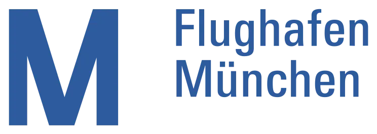

Bu rehber **Münih Havalimanı'nı (MUC)** kapsıyor — her şeyden önce aktarmalar, ardından havalimanının olanakları ve uçuş operasyonları. Buradaki bağlantılarla ilgili her şey, ihtiyaç duyduğunuz süre ve ilgili belgelerden adım adım sürece kadar tek makalede.

## Aktarmalar

### Ne kadar süre ayırmalı

Münih Havalimanı Schengen ve Schengen dışı alan olarak ikiye ayrılıyor, bu da dört tür aktarma doğuruyor — **Schengen'den Schengen dışına**, **Schengen dışından Schengen'e**, **Schengen dışından Schengen dışına** ve **Schengen'den Schengen'e**. Güzergâhınıza göre 1,5–3 saat ayırın.

### Dört kombinasyon

| Kombinasyon | Neleri kapsar |
| --- | --- |
| **Schengen'den Schengen'e** | Yalnızca güvenlik taraması. Ayrı biletlerde bagajınızı toplayıp yeniden teslim etmelisiniz. |
| **Schengen'den Schengen dışına** | Yalnızca güvenlik taraması; devam uluslararası uçuşu için giriş vizesi gerekmez. Kayıtlı bagajınızda iadesini istediğiniz eşyalar varsa önce gümrükte kaşeletin, sonra check-in yapın, güvenlikten geçin, çıkış kontrolünde pasaportunuzu kaşeletin ve kapıya gitmeden önce iade gişesinde iadenizi alın. Tek bilette vergi iadesi Schengen içindeki kalkış havalimanınızda halledilebilir. |
| **Schengen dışından Schengen'e** | Tek bilette olsanız da olmasanız da her zaman pasaport kontrolünden Münih'te geçersiniz ve Schengen vizeniz olmalı. Uçtan uca etiketlenmiş bagaj aktarmalı kalabilir; aksi halde ülkeye girin, bagajınızı alın, Schengen içi uçuş için yeniden check-in yapın, sonra güvenlikten geçip kapınıza gidin. |
| **Schengen dışından Schengen dışına** | Tek bilette bagaj alımı yok, ama Schengen dışı varış noktası için vize gerekir. Aktarma kanalını izleyin; Almanya'ya girmezsiniz ve Schengen vizesi gerekmez. |

### Adım adım

Münih'te aktarma hızlı ve kolay — tabelalar sizi doğrudan kapınıza götürüyor. Örnek olarak **Şanghay → Münih (aktarma) → Napoli (LH727)** alın. Tüm sıra şöyle:

**Münih'e varış → kapınızı doğrulama → aktarma güvenliği → servis trenine binme → gümrükten geçme → kapıda bekleme**

1. İndikten sonra tabelalar sizi çıkışa doğru yönlendirir.

2. Kısa bir yürüyüşten sonra büyük bir uçuş bilgi ekranına ulaşırsınız. **Gerçek kapınızı iki kez kontrol edin** — biletinizden farklı olabilir. Örneğin bilet K diyor olabilir (gümrük için kullanılır), ekran ise gerçek kapınız olan G35'i gösterir.

3. Ekranın yanındaki iniş yürüyen merdiveni aktarma güvenlik kontrolüne çıkar. Kuyruk genellikle uzundur, bolca zaman ayırın.

4. Güvenlikten sonra servis treni tabelalarını izlemeye devam edin; tren sizi giriş kaşesi için K bölgesine götürür. Sonra kapınıza gitmek için G tabelalarını izleyin.

> **Not:** Bagajı varış noktasına kadar etiketlenmiş tek bilette, aktarma sırasında bagajınızı almazsınız. Etiketli değilse aktarma güvenlik kontrolünün yanındaki gümrük kanalından gidin, bagajınızı alın ve yeniden check-in yapın.

### Pratik aktarma ipuçları

- **Tek bilet olup olmaması güzergâhı belirler.** Tek bilet bagajınızı etiketli tutar ve sizi aktarma kanalına sokar; ayrı biletler ülkeye girmek, bagajı almak ve yeniden check-in yapmak demektir — en az bir saat daha ekleyin.
- **Belgeleri üzerinizde tutun.** Pasaport (altı ay geçerlilik önerilir), Schengen vizesi, devam biniş kartı, güzergâh ve otel rezervasyonu — sınır memurları bunlardan herhangi birini isteyebilir.
- **Yanlış bölge için zaman ayırın.** Bazı Terminal 2 kapı alanlarına servis treniyle ulaşılır (örneğin K bölgesi). Önce ekranları okuyun, sonra eski biniş kartınızda basılı kapıya değil G / H / K / L harflerine göre gidin.

## Havalimanı temel bilgileri

- **Ad:** Münih Havalimanı
- **Kodlar:** MUC (IATA) / EDDM (ICAO)
- **Konum:** Erding Moos, Münih'in 28 km kuzeydoğusu
- **Ana havayolları:** Lufthansa, Augsburg Airways, Air Dolomiti
- **Açılış:** 1992

## Nasıl inşa edildi

- **Yer seçimi:** Erding Moos ilk tercih değildi — önerilecek az şey vardı — ta ki Alman Federal Savunma Bakanlığı Erding hava üssünü kapatmaya karar verip orada büyük bir havalimanının kapısını açana kadar. Temmuz 1969'da yeni havalimanının yeri bölgesel ve ulusal planlamaya uyduğu gerekçesiyle resmen Erding Moos olarak belirlendi.
- **Zorluk:** güneyde dördüncü pist planları reddedildi — saatte 120 kalkış ve iniş çok sık görüldü ve plana 5.724 itiraz yapıldı. Sonraki temyizler de reddedildi ve inşaatın bazı bölümleri durdu.
- **Tasarım:** bunun üzerine Münih Havalimanı GmbH 1981'de çift pistli bir sistem, gece uçuşu kuralları ve daha yüksek yolcu tahminleriyle değiştirilmiş bir plan sundu; plan Haziran 1984'te onaylandı.
- **Açılış:** Münih Havalimanı 11 Mayıs 1992'de faaliyete başladı. 16–17 Mayıs gecesi havayolları Münih-Riem'den taşındı ve Riem'in son Lufthansa Boeing 737'si gece yarısından hemen önce kalkış yapınca eski havalimanının tarihi sona erdi.

## Olanaklar ve hizmetler

### Yolcu salonları

**Ücretsiz dinlenme alanları**

- **① Bayern Lounge:** Terminal 2, G ve H kapıları, 03. kat (güvenlikten önce); 24 saat; ücretsiz.

- **② Recreation Areas:** Terminal 2, 04. kat G ve K kapıları, 05. kat H ve L kapıları (güvenlikten sonra); 24 saat; yolcular için ücretsiz.

**Ücretli salonlar**

- **① Airport Lounge Europe:** Terminal 1, B Modülü, 05. kat (güvenlikten sonra); her gün 06.00–21.00; kişi başı 43 €'dan.

- **② Airport Lounge World:** Terminal 1, B Modülü, 06. kat (güvenlikten sonra); her gün 05.15–21.45; kişi başı 48 €'dan.

**Havayolu salonları**

- **① Lufthansa Lounges** (yalnızca Lufthansa ve Star Alliance üyeleri): Terminal 2, 04. kat G–L kapıları ve 05. katın kamusal olmayan alanı.

- **② Emirates Lounge** (Emirates birinci ve business sınıfı, altın ve platin üyeler, ayrıca Qantas altın ve platin üyeleri): Terminal 1, C Modülü, 05. kat; her gün üç zaman aralığında açık — 07.30–10.15, 12.00–15.30 ve 18.30–22.15.

**NapCabs uyku kabinleri**

NapCabs, Münih Havalimanı'nda gece konaklaması veya uzun aktarması olanların düşünmesine değer uyku kabinleri. Ücretsiz Ethernet ve elektrik prizleri ile eğlence ekranı sunan konforlu ve çok özel bir uyku alanı sağlıyor.

- **Yer:** T2 04. kat, G06 kapısı; T2 05. kat, H32 kapısı; T2 03. kat, hizmet merkezi; T2 SAT 05. kat, L04 kapısı
- **Fiyat:** 06.00–22.00 arası saat başı 15 €; 22.00–06.00 arası saat başı 10 € (en az iki saat)

### Yeme-içme

Münih Havalimanı'nda yerel spesiyalitelerden tanıdık Asya yemeklerine ve dünyanın her yerinden tabaklara kadar 60'tan fazla restoran ve meyhane var. Havalimanının kendi zanaat birası ünlü — on küsur euro ile gece yarısına kadar içebilir, kendinizi Bavyera yemeği ve gece havasına sarabilirsiniz.

- **Bamee**

- **Seafood Sylt**

- **Airbräu**

- **4 URBS**

### Gümrüksüz alışveriş

Münih Havalimanı'nda parfüm, kozmetik, aksesuar ve daha fazlası gibi uluslararası markaların gümrüksüz fiyatlarla alınabildiği pek çok gümrüksüz mağaza var.

| Kategori | Markalar |
| --- | --- |
| Lüks | Gucci, Armani, Zegna, Ferragamo, Bulgari ve daha fazlası |
| Parfüm ve kozmetik | Dior, La Mer, Chanel, Sisley, Shiseido, MAC, Estée Lauder, Lancôme ve daha fazlası |
| Deri ürünler ve çantalar | Hermès, Longchamp, Furla, Mandarina Duck, Liebeskind ve daha fazlası |
| Aksesuarlar | Swarovski, Misaki, Fossil, Esprit ve daha fazlası |

> Schengen içinde aktarma mı yapıyorsunuz? Gümrüksüz alımlarınızı fişiyle birlikte kapalı tutun ve vergi iadesi gerekiyorsa kuyruk için zaman ayırın (iade güzergâhı yukarıdaki “Dört kombinasyon” bölümünde anlatılıyor).

### Havalimanı otelleri

Aktarma yolcuları için havalimanının hemen yanında iki otel var.

**Hilton Munich Airport**

- T1 ile T2 arasında
- Tel: +49 89 97820
- 160 ABD dolarından

**Novotel München Airport**

- Flughafen Besucherpark istasyonundan 700 m
- Tel: +49 89 9705130
- 100 ABD dolarından

### Sigara içme alanları

Münih Havalimanı'nın sigara içme alanları Terminal 1 (A, B, C, D ve F bölgeleri) ile Terminal 2'nin (G, H, K ve L bölgeleri) hava tarafındaki kamusal olmayan alanlarında.

## Uçuş operasyonları

Münih, 101 havayolunun 68 ülkedeki 242 varış noktasına uçtuğu Avrupa'nın en büyük havacılık merkezlerinden biri. Havalimanı yüksek frekanslarla 24 saat çalışıyor ve sıkı, verimli yönetimi dakikliği yüksek tutarak yolcuların zamanında varmasını sağlıyor.

## Havayolu manzarası

Münih'e Lufthansa ve Star Alliance üyelerinin öncülüğünde birçok havayolu hizmet veriyor. Bugün Lufthansa ortaklığı dışındaki her uçuş (Air France, British Airways vb.) Terminal 1'i kullanırken Terminal 2, Qatar Airways, PrivatAir ve EVA Air gibi Lufthansa ve Star Alliance taşıyıcılarına ayrılmış. Çeşitlilik yolculara geniş bir rota seçimi sunuyor. Havalimanı banliyölerde olsa da iyi bağlantılı, kargo işi güçlü ve çevresinde bir havacılık sanayi kümesi büyümüş. Yolculara daha iyi hizmet vermek için Münih Havalimanı ulaşım bağlantılarını iyileştirmeyi ve terminal ile pistlerini genişletmeyi planlıyor.

## Yolcular ne diyor

Bu üç yorum 2015–2018 arasında yazılmış kamuya açık platform gönderileri; inişten önce yer hakkında hızlı bir fikir edinmek için faydalı:

- **Konum ve bağlantılar:** merkezden biraz uzak, ama S-Bahn doğrudan giriyor ve aktarma güzergâhı akıcı; Almanya'nın ikinci büyük havalimanı ve Avrupa'nın kilit merkezlerinden biri.
- **Olanaklar ve hizmet:** ücretsiz kahve, çay ve Wi-Fi tekrar tekrar öne çıkıyor, alışveriş birinci sınıf, yiyecek bol ve sınır personeli güler yüzlü; Lufthansa'nın Terminal 2'de kendi check-in ve aktarma alanı var.
- **Araç kiralama ve alışveriş:** havalimanı içinde araç kiralayabilirsiniz, kendi kendine sürüş gezisi için pratik; Terminal 2'de Schengen varışlarından sonra süpermarket, restoranlar ve bir Bayern Münih mağazasının olduğu küçük bir meydan var ve gümrüksüz ile marka mağazaları iyi stoklu.

## İlgili bağlantılar

- **Bu sitede**: [Münih Havalimanı (MUC)](/airport/MUC), [Almanya (DE)](/country/DE)
- **Wikipedia**: [Münih Havalimanı](https://en.wikipedia.org/wiki/Munich_Airport)
- **Baidu Baike**: [Münih Havalimanı](https://baike.baidu.com/item/%E6%85%95%E5%B0%BC%E9%BB%91%E6%9C%BA%E5%9C%BA)
- **Havalimanı sitesi**: [Münih Havalimanı](https://www.munich-airport.com/)
- **Daha fazla makale**: [Münih Havalimanı varış ve gümrük rehberi](/blog/munich-airport-arrival-customs-guide), [Münih Havalimanı servis otobüsü ve şehir ulaşımı](/blog/munich-airport-shuttle-bus-guide)

Görsel kaynağı: özgün makalenin görselleri, “亦出旅行” WeChat hesabından. Ücretler, açılış saatleri, kapı numaraları ve tesis konumları rehber derlendiğinde kaydedildiği gibidir ve değişebilir; seyahat günü Münih Havalimanı ve işletme web sitelerini kontrol edin.
