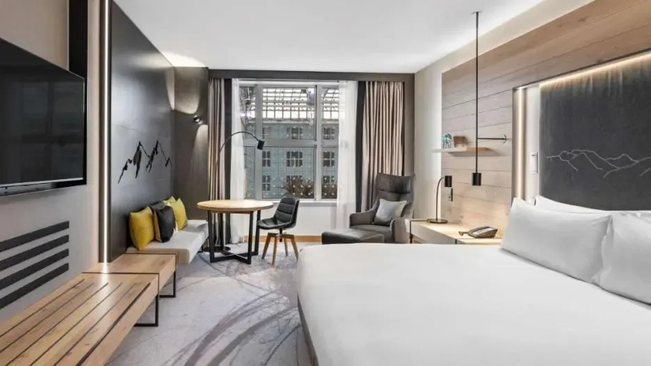

Цей путівник присвячено **аеропорту Мюнхена (MUC)** — передусім пересадкам, а далі інфраструктурі аеропорту та польотним операціям. Усе про пересадки тут, від потрібного часу й документів до покрокового процесу, зібрано в одній статті.

## Пересадки

### Скільки часу закладати

Аеропорт Мюнхена поділено на шенгенську та нешенгенську зони, що дає чотири типи пересадки — **з Шенгену до не-Шенгену**, **з не-Шенгену до Шенгену**, **з не-Шенгену до не-Шенгену** та **в межах Шенгену**. Закладайте 1,5–3 години залежно від маршруту.

### Чотири комбінації

| Комбінація | Що вона передбачає |
| --- | --- |
| **У межах Шенгену** | Лише перевірка безпеки. За окремо заброньованими квитками потрібно забрати багаж і здати його знову. |
| **З Шенгену до не-Шенгену** | Лише перевірка безпеки; для подальшого міжнародного рейсу в'їзна віза не потрібна. Якщо у зданому багажі є товари, за які ви хочете отримати відшкодування, спершу поставте на них печатку в митниці, потім зареєструйтеся, пройдіть перевірку безпеки, отримайте штамп у паспорт на виїзному контролі й заберіть відшкодування на стійці повернення коштів, перш ніж іти до виходу. За наскрізним квитком повернення податку можна оформити в аеропорту вильоту в межах Шенгену. |
| **З не-Шенгену до Шенгену** | Паспортний контроль ви завжди проходите в Мюнхені, незалежно від того, чи маєте наскрізний квиток, і вам потрібна шенгенська віза. Багаж за наскрізним квитком може залишатися зареєстрованим до кінця; інакше в'їжджайте до країни, забирайте багаж, реєструйтеся знову на рейс у межах Шенгену, а потім проходьте перевірку безпеки до свого виходу. |
| **З не-Шенгену до не-Шенгену** | За наскрізним квитком багаж не забирають, але вам потрібна віза країни призначення поза Шенгеном. Ідіть трансферним коридором; ви не в'їжджаєте до Німеччини, тож шенгенська віза не потрібна. |

### Покроково

Пересадка в Мюнхені швидка й проста — покажчики ведуть прямо до вашого виходу. Візьмімо приклад **Шанхай → Мюнхен (транзит) → Неаполь (LH727)**. Уся послідовність така:

**Приліт до Мюнхена → уточніть свій вихід → перевірка безпеки для трансферу → поїздка трансферним потягом → митний контроль → очікування біля виходу**

1. Після посадки покажчики ведуть вас до виходу.

2. Трохи далі ви побачите великий екран з інформацією про рейси. **Обов'язково перевірте свій фактичний вихід** — він може відрізнятися від зазначеного в квитку. Наприклад, у квитку може стояти K (використовується для митниці), а на екрані — G35, і саме це ваш справжній вихід.

3. Поруч з екраном ескалатор униз веде до перевірки безпеки для трансферу. Черга часто довга, тож закладайте достатньо часу.

4. Після перевірки безпеки далі йдіть за покажчиками до трансферного потяга, який відвезе вас до зони K по штамп про в'їзд. Потім ідіть за покажчиками G до свого виходу.

> **Примітка:** за наскрізним квитком, коли багаж зареєстровано до кінцевого пункту, під час пересадки ви його не забираєте. Якщо багаж не зареєстровано до кінця, скористайтеся митним коридором біля перевірки безпеки для трансферу, заберіть свої речі та зареєструйтеся знову.

### Практичні поради щодо пересадки

- **Наскрізний квиток чи ні — це визначає маршрут.** Наскрізний квиток зберігає багаж зареєстрованим до кінця й веде вас трансферним коридором; окремі квитки означають в'їзд до країни, отримання багажу та повторну реєстрацію — додайте щонайменше годину.
- **Тримайте документи при собі.** Паспорт (рекомендовано термін дії шість місяців), шенгенська віза, посадковий талон на подальший рейс, маршрут подорожі та бронювання готелю — прикордонники можуть попросити будь-який із них.
- **Закладайте час на «не ту зону».** До деяких зон виходів Терміналу 2 можна дістатися лише трансферним потягом (наприклад, зона K). Спершу читайте екрани, а далі орієнтуйтеся на літери G / H / K / L, а не на вихід, надрукований у вашому старому посадковому талоні.

## Основні відомості про аеропорт

- **Назва:** аеропорт Мюнхена
- **Коди:** MUC (IATA) / EDDM (ICAO)
- **Розташування:** Ердингер-Моос (Erding Moos), 28 км на північний схід від Мюнхена
- **Основні авіакомпанії:** Lufthansa, Augsburg Airways, Air Dolomiti
- **Відкрито:** 1992

## Як його будували

- **Вибір місця:** Ердингер-Моос не був першим вибором — мало що говорило на його користь — аж доки Федеральне міністерство оборони Німеччини не вирішило закрити авіабазу Ердинг, що відкрило шлях для великого аеропорту саме там. У липні 1969 року новий аеропорт офіційно розмістили на Ердингер-Моосі, обґрунтувавши це відповідністю регіональному та національному плануванню.
- **Виклик:** плани четвертої злітно-посадкової смуги на південь відхилили — 120 злетів і посадок на годину визнали надто високою частотою, а проти проєкту подали 5 724 заперечення. Подальші апеляції також відхилили, що зупинило частину будівництва.
- **Проєкт:** у відповідь Munich Airport GmbH подала 1981 року змінений план із системою з двох злітно-посадкових смуг, правилами нічних польотів і вищими прогнозами пасажиропотоку; його затвердили в червні 1984 року.
- **Відкриття:** аеропорт Мюнхена почав роботу 11 травня 1992 року. У ніч на 16–17 травня авіакомпанії переїхали з Мюнхен-Ріма, і коли останній Boeing 737 Lufthansa злетів із Ріма незадовго до півночі, історія старого аеропорту завершилася.

## Інфраструктура та послуги

### Лаунжі

**Безкоштовні зони відпочинку**

- **① Bayern Lounge:** Термінал 2, виходи G і H, рівень 03 (до перевірки безпеки); цілодобово; безкоштовно.

- **② Recreation Areas:** Термінал 2, рівень 04, виходи G і K; рівень 05, виходи H і L (після перевірки безпеки); цілодобово; безкоштовно для пасажирів.

**Платні лаунжі**

- **① Airport Lounge Europe:** Термінал 1, модуль B, рівень 05 (після перевірки безпеки); щодня 06:00–21:00; від €43 з особи.

- **② Airport Lounge World:** Термінал 1, модуль B, рівень 06 (після перевірки безпеки); щодня 05:15–21:45; від €48 з особи.

**Лаунжі авіакомпаній**

- **① Лаунжі Lufthansa** (лише для Lufthansa та учасників Star Alliance): Термінал 2, рівень 04, виходи G–L, і закрита зона рівня 05.

- **② Emirates Lounge** (пасажири першого й бізнес-класу Emirates, учасники рівнів gold і platinum, а також учасники рівнів gold і platinum Qantas): Термінал 1, модуль C, рівень 05; щодня працює у три проміжки — 07:30–10:15, 12:00–15:30 та 18:30–22:15.

**Капсули для сну NapCabs**

NapCabs — це капсули для сну в аеропорту Мюнхена, варті уваги, якщо у вас нічна зупинка або довга пересадка. Вони пропонують комфортний і дуже приватний простір для сну, безкоштовний Ethernet і розетки, а також екран із розважальним контентом.

- **Де:** T2, рівень 04, вихід G06; T2, рівень 05, вихід H32; T2, рівень 03, сервісний центр; T2 SAT, рівень 05, вихід L04
- **Ціна:** €15 за годину з 06:00 до 22:00; €10 за годину з 22:00 до 06:00 (мінімум дві години)

### Харчування

В аеропорту Мюнхена понад 60 ресторанів і пивних, де є місцеві страви, звичні азійські смаки та кухня з усього світу. Крафтове пиво самого аеропорту тут уславлене — за десять з гаком євро можна пити до півночі, загорнувшись у баварську їжу та нічне повітря.

- **Bamee**

- **Seafood Sylt**

- **Airbräu**

- **4 URBS**

### Безмитна торгівля

В аеропорту Мюнхена безліч безмитних магазинів, де міжнародні бренди — парфумерія, косметика, аксесуари та інше — можна купити за безмитними цінами.

| Категорія | Бренди |
| --- | --- |
| Люкс | Gucci, Armani, Zegna, Ferragamo, Bulgari та інші |
| Парфумерія та косметика | Dior, La Mer, Chanel, Sisley, Shiseido, MAC, Estée Lauder, Lancôme та інші |
| Шкіргалантерея та сумки | Hermès, Longchamp, Furla, Mandarina Duck, Liebeskind та інші |
| Аксесуари | Swarovski, Misaki, Fossil, Esprit та інші |

> Пересадка в межах Шенгену? Тримайте безмитні покупки запечатаними разом із чеком і закладайте час у черзі, якщо вам потрібне повернення податку (маршрут повернення описано вище в розділі «Чотири комбінації»).

### Готелі в аеропорту

Просто біля аеропорту є два готелі для пасажирів, що пересаджуються.

**Hilton Munich Airport**

- Між T1 і T2
- Тел.: +49 89 97820
- Від 160 дол. США

**Novotel München Airport**

- 700 м від станції Flughafen Besucherpark
- Тел.: +49 89 9705130
- Від 100 дол. США

### Місця для куріння

Місця для куріння в аеропорту Мюнхена розташовані в закритих зонах після контролю Терміналу 1 (зони A, B, C, D і F) та Терміналу 2 (зони G, H, K і L).

## Польотні операції

Мюнхен — один із найбільших авіаційних хабів Європи: 101 авіакомпанія виконує рейси до 242 напрямків у 68 країнах. Аеропорт працює цілодобово з високою частотою рейсів, а суворе й ефективне управління забезпечує високу пунктуальність, тож пасажири прибувають вчасно.

## Авіакомпанії в аеропорту

До Мюнхена літає багато авіакомпаній, і очолюють їх Lufthansa та учасники Star Alliance. Сьогодні всі рейси поза партнерством Lufthansa (Air France, British Airways тощо) обслуговує Термінал 1, тоді як Термінал 2 закріплено за Lufthansa та перевізниками Star Alliance, як-от Qatar Airways, PrivatAir і EVA Air. Таке розмаїття дає пасажирам широкий вибір маршрутів. Хоча аеропорт лежить у передмісті, транспортне сполучення з ним добре налагоджене, вантажний бізнес міцний, а навколо виріс кластер авіаційної індустрії. Щоб краще обслуговувати пасажирів, аеропорт Мюнхена планує й далі вдосконалювати транспортні зв'язки та розширювати термінали й злітно-посадкові смуги.

## Що кажуть мандрівники

Ці три відгуки — публікації на відкритих платформах, написані між 2015 і 2018 роками; вони допоможуть швидко відчути атмосферу місця ще до посадки:

- **Розташування та сполучення:** трохи далеко від центру, але S-Bahn іде прямо туди, а трансферний маршрут зручний; другий за розміром аеропорт Німеччини й один із ключових хабів Європи.
- **Інфраструктура та сервіс:** безкоштовні кава, чай і Wi-Fi згадують знову й знову, магазини чудові, їжі багато, а прикордонники привітні; Lufthansa має власну зону реєстрації та трансферу в Терміналі 2.
- **Оренда авто та шопінг:** автомобіль можна орендувати прямо в аеропорту, що зручно для подорожі власним кермом; після прибуття шенгенських рейсів у Терміналі 2 є невелика площа з супермаркетом, ресторанами та крамницею «Баварії» (Bayern Munich), а безмитні магазини й брендові бутики добре заповнені.

## Пов'язані посилання

- **На цьому сайті**: [Аеропорт Мюнхена (MUC)](/airport/MUC), [Німеччина (DE)](/country/DE)
- **Вікіпедія**: [Аеропорт Мюнхена](https://en.wikipedia.org/wiki/Munich_Airport)
- **Baidu Baike**: [Аеропорт Мюнхена](https://baike.baidu.com/item/%E6%85%95%E5%B0%BC%E9%BB%91%E6%9C%BA%E5%9C%BA)
- **Сайт аеропорту**: [Аеропорт Мюнхена](https://www.munich-airport.com/)
- **Більше статей**: [Путівник прибуттям і митним контролем в аеропорту Мюнхена](/blog/munich-airport-arrival-customs-guide), [Шатл-бас і міський транспорт аеропорту Мюнхена](/blog/munich-airport-shuttle-bus-guide)

Джерело зображень: ілюстрації з оригінальної статті, з WeChat-акаунта «亦出旅行». Тарифи, години роботи, номери виходів і розташування об'єктів наведено станом на час укладання путівника, вони можуть змінитися; перевіряйте сайти аеропорту Мюнхена та операторів у день подорожі.
