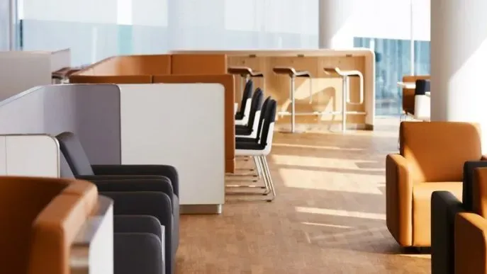

Hướng dẫn này bao gồm **Sân bay Munich (MUC)** — trước hết là trung chuyển, sau đó là tiện ích và hoạt động bay của sân bay. Mọi thứ về việc nối chuyến tại đây, từ thời gian cần thiết và giấy tờ liên quan đến quy trình từng bước, đều nằm trong bài viết này.

## Trung chuyển

### Nên dự trù bao lâu

Sân bay Munich được chia thành khu Schengen và khu ngoài Schengen, tạo ra bốn kiểu trung chuyển — **Schengen sang ngoài Schengen**, **ngoài Schengen sang Schengen**, **ngoài Schengen sang ngoài Schengen** và **Schengen sang Schengen**. Hãy dự trù 1,5–3 giờ tùy theo lịch trình của bạn.

### Bốn tổ hợp

| Tổ hợp | Bao gồm những gì |
| --- | --- |
| **Schengen sang Schengen** | Chỉ kiểm tra an ninh. Với vé đặt riêng, bạn phải nhận hành lý và gửi lại. |
| **Schengen sang ngoài Schengen** | Chỉ kiểm tra an ninh; không cần thị thực nhập cảnh cho chuyến bay quốc tế tiếp theo. Nếu hành lý ký gửi có hàng hóa bạn muốn hoàn thuế, hãy đóng dấu tại hải quan trước, rồi check-in, qua an ninh, đóng dấu hộ chiếu tại kiểm soát xuất cảnh và nhận tiền hoàn tại quầy hoàn thuế trước khi đến cổng. Với vé xuyên suốt, việc hoàn thuế có thể được xử lý tại sân bay khởi hành của bạn trong Schengen. |
| **Ngoài Schengen sang Schengen** | Bạn luôn phải qua nhập cảnh tại Munich, dù có vé xuyên suốt hay không, và bạn cần thị thực Schengen. Hành lý của vé xuyên suốt có thể được ký gửi thẳng; nếu không, hãy nhập cảnh, nhận hành lý, check-in lại cho chuyến bay nội Schengen, rồi qua an ninh đến cổng. |
| **Ngoài Schengen sang ngoài Schengen** | Không nhận hành lý với vé xuyên suốt, nhưng bạn cần thị thực cho điểm đến ngoài Schengen. Hãy đi theo làn trung chuyển; bạn không nhập cảnh Đức và không cần thị thực Schengen. |

### Từng bước

Nối chuyến tại Munich nhanh và dễ — biển chỉ dẫn đưa bạn thẳng đến cổng. Lấy ví dụ **Thượng Hải → Munich (trung chuyển) → Naples (LH727)**. Toàn bộ trình tự là:

**Đến Munich → xác nhận cổng → an ninh trung chuyển → đi tàu trung chuyển → qua hải quan → chờ ở cổng**

1. Sau khi hạ cánh, biển chỉ dẫn hướng bạn về phía lối ra.

2. Đi một đoạn, bạn sẽ gặp một màn hình thông tin chuyến bay lớn. **Hãy kiểm tra lại cổng thực tế** — cổng có thể khác với trên vé. Ví dụ, vé có thể ghi K (dùng cho hải quan), trong khi màn hình hiện G35, đó mới là cổng thật của bạn.

3. Cạnh màn hình có thang cuốn đi xuống khu kiểm tra an ninh trung chuyển. Hàng chờ thường dài, nên hãy dự trù nhiều thời gian.

4. Sau an ninh, tiếp tục đi theo biển chỉ dẫn đến tàu trung chuyển, đưa bạn đến khu K để đóng dấu nhập cảnh. Sau đó đi theo biển G đến cổng của bạn.

> **Lưu ý:** với vé xuyên suốt có hành lý ký gửi thẳng đến điểm đến, bạn không nhận hành lý trong lúc trung chuyển. Nếu hành lý không được ký gửi thẳng, hãy đi làn hải quan bên cạnh khu an ninh trung chuyển, nhận hành lý và check-in lại.

### Mẹo trung chuyển thực tế

- **Có vé xuyên suốt hay không quyết định lộ trình.** Vé xuyên suốt giữ hành lý ký gửi thẳng và đưa bạn vào làn trung chuyển; vé riêng nghĩa là nhập cảnh, nhận hành lý và check-in lại — cộng thêm ít nhất một giờ.
- **Giữ giấy tờ bên mình.** Hộ chiếu (khuyến nghị còn hạn sáu tháng), thị thực Schengen, thẻ lên máy bay chuyến tiếp, lịch trình và đặt phòng khách sạn — nhân viên biên giới có thể yêu cầu bất kỳ giấy tờ nào.
- **Dự trù thời gian cho việc đi nhầm khu.** Một số khu cổng Nhà ga 2 đến bằng tàu trung chuyển (ví dụ khu K). Hãy đọc màn hình trước, rồi đi theo chữ G / H / K / L thay vì cổng in trên thẻ lên máy bay cũ.

## Thông tin cơ bản về sân bay

- **Tên:** Sân bay Munich
- **Mã:** MUC (IATA) / EDDM (ICAO)
- **Vị trí:** vùng Erding Moos, 28 km về phía đông bắc Munich
- **Hãng hàng không chính:** Lufthansa, Augsburg Airways, Air Dolomiti
- **Khai trương:** 1992

## Sân bay được xây dựng thế nào

- **Chọn địa điểm:** Erding Moos không phải lựa chọn đầu tiên — có rất ít lý do để chọn nơi này — cho đến khi Bộ Quốc phòng Liên bang Đức quyết định đóng căn cứ không quân Erding, mở đường cho một sân bay lớn tại đó. Tháng 7 năm 1969, sân bay mới chính thức được đặt tại Erding Moos, với lý do phù hợp với quy hoạch vùng và quốc gia.
- **Thách thức:** kế hoạch xây đường băng thứ tư về phía nam bị bác bỏ — 120 lượt cất cánh và hạ cánh mỗi giờ bị coi là quá dày, và 5.724 ý kiến phản đối được gửi về. Các kháng nghị sau đó cũng bị bác, khiến một phần công trình bị dừng.
- **Thiết kế:** để đáp lại, Munich Airport GmbH trình một kế hoạch sửa đổi vào năm 1981 với hệ thống hai đường băng, quy định bay đêm và dự báo hành khách cao hơn; kế hoạch được phê duyệt tháng 6 năm 1984.
- **Khai trương:** Sân bay Munich bắt đầu hoạt động ngày 11 tháng 5 năm 1992. Trong đêm 16–17 tháng 5, các hãng hàng không chuyển từ Munich-Riem sang, và khi chiếc Boeing 737 cuối cùng của Lufthansa tại Riem cất cánh ngay trước nửa đêm, lịch sử của sân bay cũ kết thúc.

## Tiện ích và dịch vụ

### Phòng chờ

**Khu nghỉ miễn phí**

- **① Bayern Lounge:** Nhà ga 2, cổng G và H, tầng 03 (trước an ninh); 24 giờ; miễn phí.

- **② Recreation Areas:** Nhà ga 2, tầng 04 cổng G và K, tầng 05 cổng H và L (sau an ninh); 24 giờ; miễn phí cho hành khách.

**Phòng chờ trả phí**

- **① Airport Lounge Europe:** Nhà ga 1, Module B, tầng 05 (sau an ninh); hằng ngày 06:00–21:00; từ 43 euro mỗi người.

- **② Airport Lounge World:** Nhà ga 1, Module B, tầng 06 (sau an ninh); hằng ngày 05:15–21:45; từ 48 euro mỗi người.

**Phòng chờ của hãng hàng không**

- **① Lufthansa Lounges** (chỉ dành cho thành viên Lufthansa và Star Alliance): Nhà ga 2, tầng 04 cổng G–L, và khu không công cộng ở tầng 05.

- **② Emirates Lounge** (hạng nhất và hạng thương gia của Emirates, thành viên vàng và bạch kim, cùng thành viên vàng và bạch kim của Qantas): Nhà ga 1, Module C, tầng 05; mở hằng ngày theo ba khung giờ — 07:30–10:15, 12:00–15:30 và 18:30–22:15.

**Buồng ngủ NapCabs**

NapCabs là các buồng ngủ qua đêm tại Sân bay Munich, đáng cân nhắc nếu bạn có lưu trú qua đêm hoặc trung chuyển dài. Chúng mang lại không gian ngủ thoải mái và rất riêng tư với Ethernet và ổ cắm điện miễn phí, cùng màn hình giải trí.

- **Vị trí:** T2 tầng 04, cổng G06; T2 tầng 05, cổng H32; T2 tầng 03, trung tâm dịch vụ; T2 SAT tầng 05, cổng L04
- **Giá:** 15 euro mỗi giờ từ 06:00–22:00; 10 euro mỗi giờ từ 22:00–06:00 (tối thiểu hai giờ)

### Ăn uống

Sân bay Munich có hơn 60 nhà hàng và quán bia, bao phủ đặc sản địa phương, món châu Á quen thuộc và các món từ khắp nơi khác. Bia thủ công của sân bay nổi tiếng — hơn mười euro là bạn uống đến nửa đêm, quấn mình trong ẩm thực Bavaria và không khí ban đêm.

- **Bamee**

- **Seafood Sylt**

- **Airbräu**

- **4 URBS**

### Miễn thuế

Sân bay Munich có rất nhiều cửa hàng miễn thuế, nơi các thương hiệu quốc tế — nước hoa, mỹ phẩm, phụ kiện và nhiều thứ khác — có thể được mua với giá miễn thuế.

| Danh mục | Thương hiệu |
| --- | --- |
| Hàng xa xỉ | Gucci, Armani, Zegna, Ferragamo, Bulgari và nhiều hãng khác |
| Nước hoa và mỹ phẩm | Dior, La Mer, Chanel, Sisley, Shiseido, MAC, Estée Lauder, Lancôme và nhiều hãng khác |
| Đồ da và túi | Hermès, Longchamp, Furla, Mandarina Duck, Liebeskind và nhiều hãng khác |
| Phụ kiện | Swarovski, Misaki, Fossil, Esprit và nhiều hãng khác |

> Nối chuyến trong Schengen? Hãy giữ hàng miễn thuế còn niêm phong cùng hóa đơn, và dự trù thời gian xếp hàng nếu bạn cần hoàn thuế (lộ trình hoàn thuế được mô tả ở mục “Bốn tổ hợp” phía trên).

### Khách sạn sân bay

Hai khách sạn nằm ngay cạnh sân bay dành cho hành khách trung chuyển.

**Hilton Munich Airport**

- Giữa T1 và T2
- Điện thoại: +49 89 97820
- Từ 160 đô la Mỹ

**Novotel München Airport**

- Cách ga Flughafen Besucherpark 700 m
- Điện thoại: +49 89 9705130
- Từ 100 đô la Mỹ

### Khu hút thuốc

Các khu hút thuốc của Sân bay Munich nằm trong khu không công cộng sau an ninh của Nhà ga 1 (khu A, B, C, D và F) và Nhà ga 2 (khu G, H, K và L).

## Hoạt động bay

Munich là một trong những trung tâm hàng không lớn nhất châu Âu, với 101 hãng hàng không bay đến 242 điểm đến tại 68 quốc gia. Sân bay hoạt động 24 giờ mỗi ngày với tần suất cao, và công tác quản lý nghiêm ngặt, hiệu quả giữ tỷ lệ đúng giờ cao để hành khách đến đúng hẹn.

## Bối cảnh hãng hàng không

Nhiều hãng hàng không phục vụ Munich, dẫn đầu là Lufthansa và các thành viên Star Alliance. Ngày nay, mọi chuyến bay ngoài quan hệ đối tác Lufthansa (Air France, British Airways, v.v.) đều dùng Nhà ga 1, trong khi Nhà ga 2 dành cho Lufthansa và các hãng Star Alliance như Qatar Airways, PrivatAir và EVA Air. Sự đa dạng mang lại cho hành khách nhiều lựa chọn đường bay. Dù sân bay nằm ở ngoại ô, nó được kết nối tốt, hoạt động hàng hóa mạnh, và một cụm công nghiệp hàng không đã phát triển quanh đó. Để phục vụ hành khách tốt hơn, Sân bay Munich dự định tiếp tục cải thiện kết nối giao thông và mở rộng nhà ga, đường băng.

## Du khách nói gì

Ba bài đánh giá này là các bài đăng công khai viết trong khoảng 2015 đến 2018, hữu ích để nhanh chóng cảm nhận nơi này trước khi hạ cánh:

- **Vị trí và kết nối:** hơi xa trung tâm, nhưng tàu S-Bahn chạy thẳng vào và lộ trình trung chuyển trơn tru; sân bay lớn thứ hai của Đức và là một trong những trung tâm chính của châu Âu.
- **Tiện ích và dịch vụ:** cà phê, trà và Wi-Fi miễn phí được nhắc đi nhắc lại, mua sắm hạng nhất, có nhiều lựa chọn ăn uống, và nhân viên biên giới thân thiện; Lufthansa có khu check-in và trung chuyển riêng ở Nhà ga 2.
- **Thuê xe và mua sắm:** bạn có thể thuê xe ngay trong sân bay, tiện cho chuyến tự lái; sau khi nhập cảnh Schengen ở Nhà ga 2 có một quảng trường nhỏ với siêu thị, nhà hàng và cửa hàng Bayern Munich, còn các cửa hàng miễn thuế và thương hiệu được dự trữ đầy đủ.

## Liên kết liên quan

- **Trên trang này**: [Sân bay Munich (MUC)](/airport/MUC), [Đức (DE)](/country/DE)
- **Wikipedia**: [Munich Airport](https://en.wikipedia.org/wiki/Munich_Airport)
- **Baidu Baike**: [Munich Airport](https://baike.baidu.com/item/%E6%85%95%E5%B0%BC%E9%BB%91%E6%9C%BA%E5%9C%BA)
- **Trang sân bay**: [Munich Airport](https://www.munich-airport.com/)
- **Bài khác**: [Hướng dẫn nhập cảnh và hải quan Sân bay Munich](/blog/munich-airport-arrival-customs-guide), [Xe trung chuyển và giao thông thành phố Sân bay Munich](/blog/munich-airport-shuttle-bus-guide)

Nguồn ảnh: hình ảnh trong bài gốc, từ tài khoản WeChat “亦出旅行”. Giá vé, giờ mở cửa, số cổng và vị trí tiện ích theo ghi nhận khi biên soạn hướng dẫn và có thể thay đổi; hãy kiểm tra trang web của Sân bay Munich và các đơn vị vận hành trong ngày đi.
