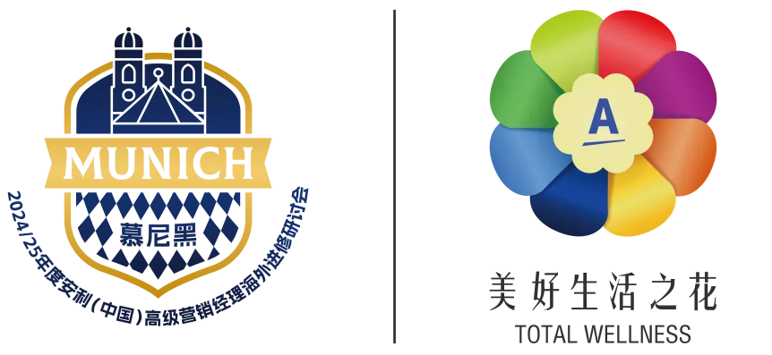

With the Munich seminar drawing near, colleagues who booked their own international flights should note: the company runs an airport shuttle bus on the arrival day. If you want a seat, read the meeting points and schedule below carefully and don't miss it.

## A word of warning

If you have not submitted your international flight details online before the company's deadline, we cannot reserve you a shuttle seat — seats on site go first to colleagues who have already signed up.

## The arrival-day shuttle schedule

> The shuttle plan may be adjusted slightly once the final flight registrations are in. Before you travel, check the live timetable in the "安利带你看世界" official account under "高级经理研讨会 - 我的 - 班车时刻表".

| Terminal | Meeting / departure point | Times (Munich local time) |
| --- | --- | --- |
| T1 | Meet at the large screen by exit B; staff walk the group to T2 for boarding | **14:10 / 15:10 / 16:10 / 17:10 / 18:10** (meeting) |
| T2 | In front of the Starbucks at the international arrivals exit | **14:30 / 15:30 / 16:30 / 17:30 / 18:30** (departure) |

### The Terminal 1 meeting point

**At the large screen by Terminal 1's exit B.** Staff holding the "美花" sign will gather the group, then walk everyone to Terminal 2 for boarding.

- Meeting times at T1 (Munich local time): **14:10 / 15:10 / 16:10 / 17:10 / 18:10**

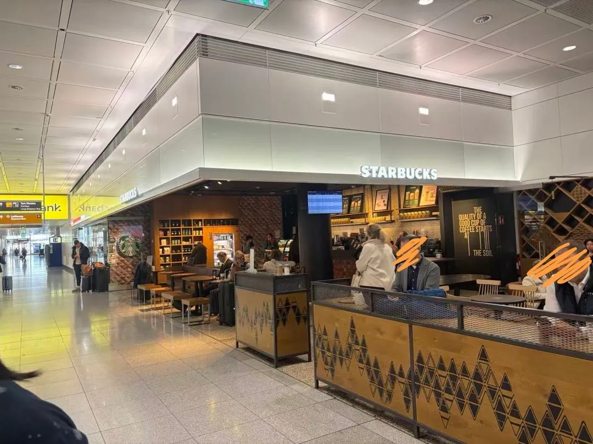

### The Terminal 2 meeting point

**In front of the Starbucks at Terminal 2's international arrivals exit.**

- Shuttle departure times (Munich local time): **14:30 / 15:30 / 16:30 / 17:30 / 18:30**

### The pick-up sign

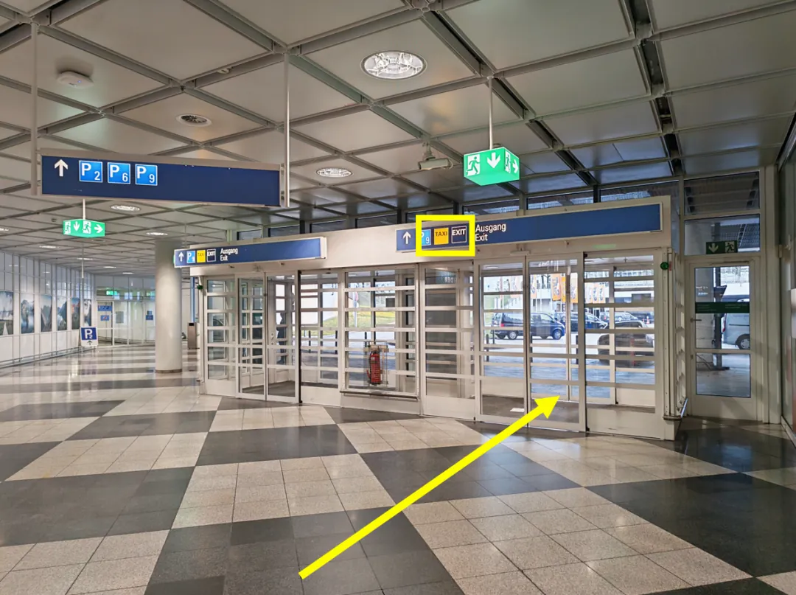

### Where to find the schedule

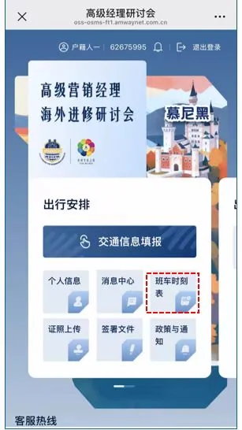

## Things to know about the shuttle

1. Passengers share the bus, which stops in turn according to where everyone is staying — get off at your hotel. Check you have all your luggage when you do. If your flight does not line up with a shuttle time, make your own way to the hotel.
2. If you did not register your flight details and plan your own transport both ways, note that hotel check-in starts at 16:00 and check-out on the return day is before 11:00.
3. Munich Airport is 35–40 km from the city-centre hotels and the drive takes about 35–50 minutes; a taxi costs about €60–80 one way and is largely cash in euros, with only some taxis taking Visa or Mastercard — bring euro coins and notes. Munich traffic jams often, so watch live traffic and leave enough time.
4. The return-day shuttle will be announced during the seminar. Ask the Amway staff at your hotel if in doubt.

## Getting from the airport into the city

If you arranged your own flights, these are the other ways to reach your city-centre hotel.

### Taxi

From the airport to the city-centre hotels is 35–40 km and 35–50 minutes; a one-way fare is about €60–80. Visa and Mastercard are commonly accepted, but bring euro cash for convenience (fares are indicative only — the on-site price prevails).

**T1:** the door with the taxi sign is right at the exit; the taxi rank is just outside.

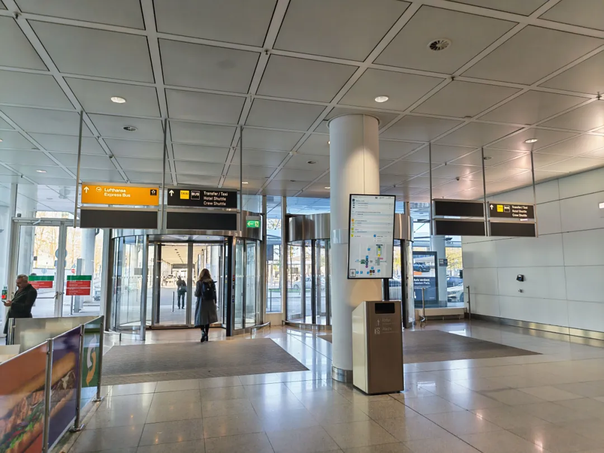

**T2:** from the exit, turn right following the signs; the taxi rank is just outside the door.

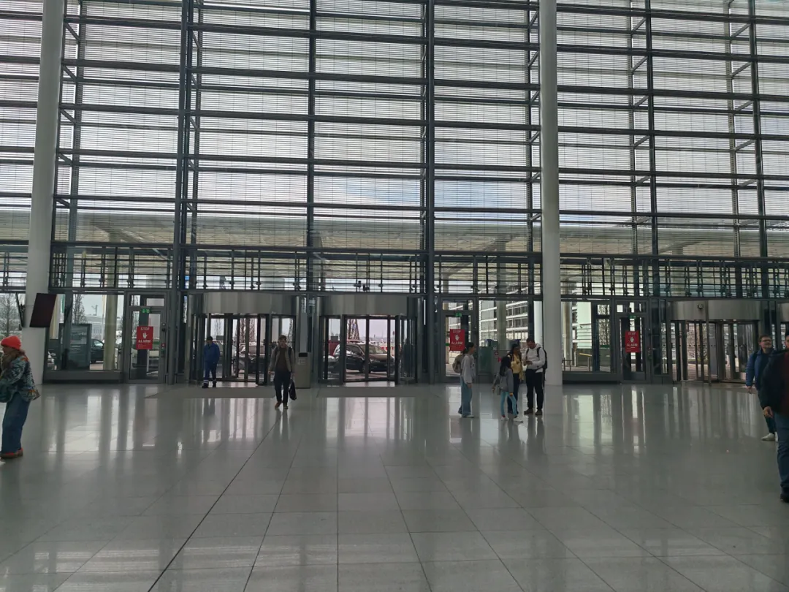

> Before you get in, confirm the hotel and the payment method with the driver.

### Ride-hailing (Uber)

**Uber** is the app to use in Munich — book and pay through the app. Compared with a taxi, Uber shows an estimate before you order and charges the card you linked, which suits travellers who would rather not negotiate the address and payment on the spot; taxis are there and waiting, and some take cards. Late at night or with a lot of luggage, check the vehicle type and pick-up point in the app first.

**T1:** the door with the taxi sign is right at the exit, and just outside is the pick-up area for both Uber and taxis — one shared waiting zone, shown in the taxi photos above.

**T2:** turn left at the exit, where the Uber sign is; walk out the door and the Uber pick-up point is ahead.

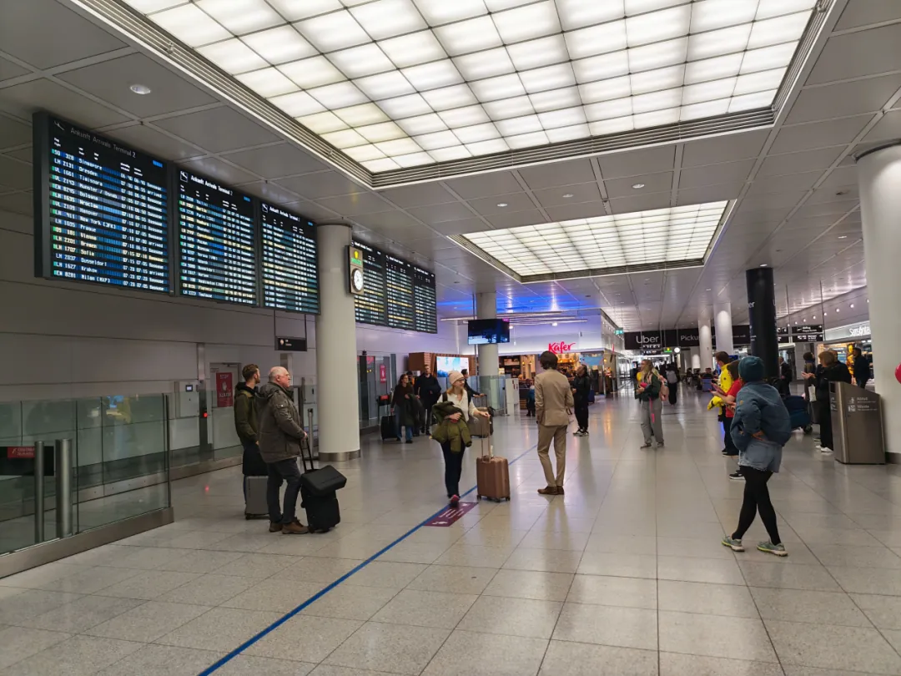

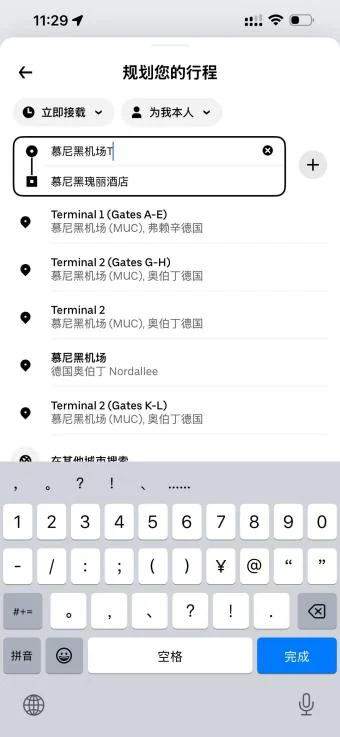

**How to use Uber:**

1. **Open the app.** Make sure Uber has location permission and a credit card or another valid payment method linked, then open the app and tap the input box on the home screen.

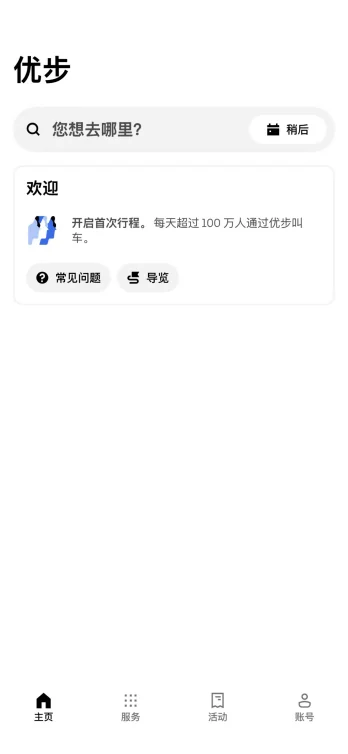

2. **Confirm the order.** Enter your destination, pick the vehicle type and confirm the pick-up point.

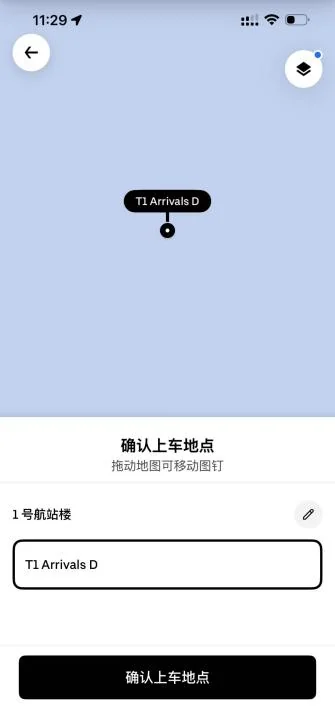

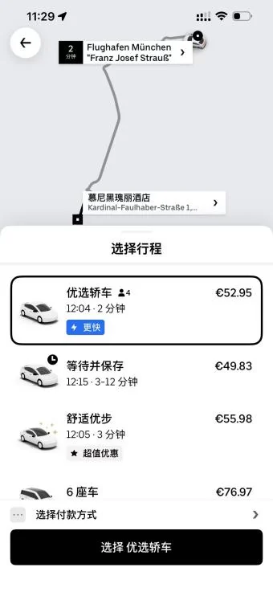

3. **Go to the pick-up point** shown on your order and get in there.

> Link an international credit card in Uber beforehand — the fare is charged automatically when you order (a cross-border fee may apply). Ride fares are indicative and can change with traffic and routing; the actual journey is what counts.

### S-Bahn

- **Lines:** S1 / S8, from the airport's underground station
- **Time:** 35–45 minutes to the Hauptbahnhof (central station)
- **Frequency:** every 10 minutes
- **Hours:** 04:00–00:30
- **Fares:** €11.20 single; day tickets €13–€15.50

(Fares and service details are indicative — check on site.)

**Buying a ticket at the airport:**

1. Find a ticket machine — "FAHRKARTEN / Tickets / Billets / Biglietti" is printed on top.
2. Switch to English: tap the flag / Change language and choose English.
3. Choose "MVV offers" on the home screen.
4. Pick your ticket type: a Single ticket or a Single day ticket.
5. Choose zone **M-5** — Munich fares are zonal; the city centre is zone M and the airport is in Zone 5, so airport-to-city needs M-5.
6. Choose the number of travellers: Single ticket for one person, Group ticket for 2–5.
7. Pay and collect the ticket and receipt — the machines generally take international credit cards.

**T1:** take the escalator down and follow the green S signs all the way to the S-Bahn station.

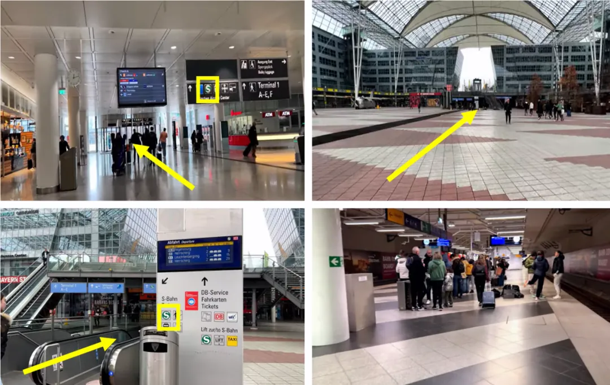

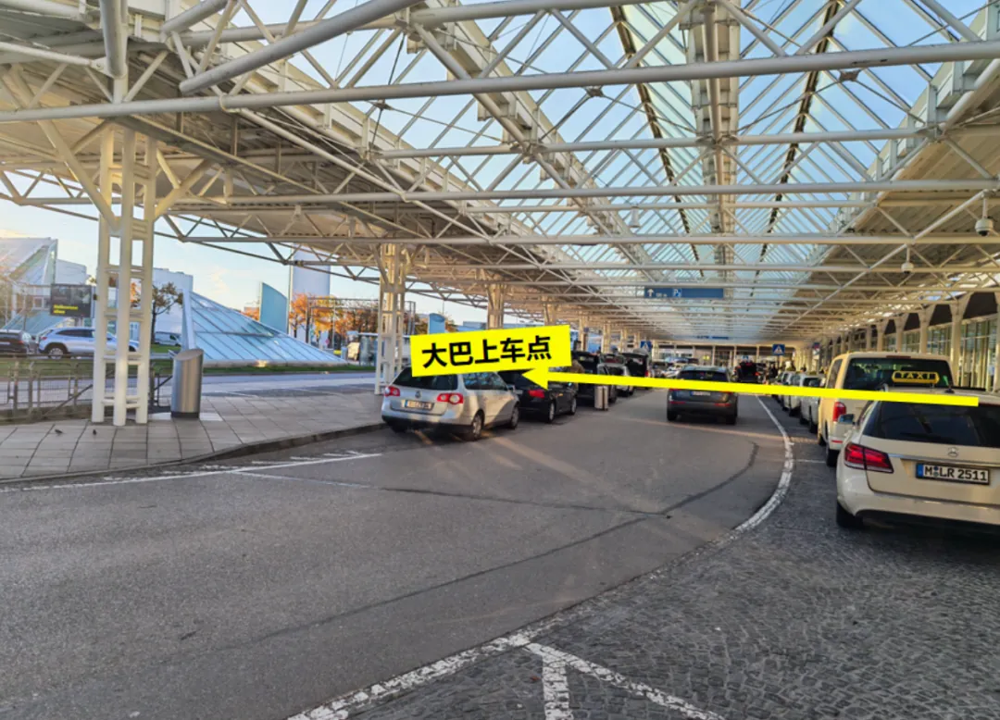

**T2:** follow the green S signs across the square and take the escalator down to the station.

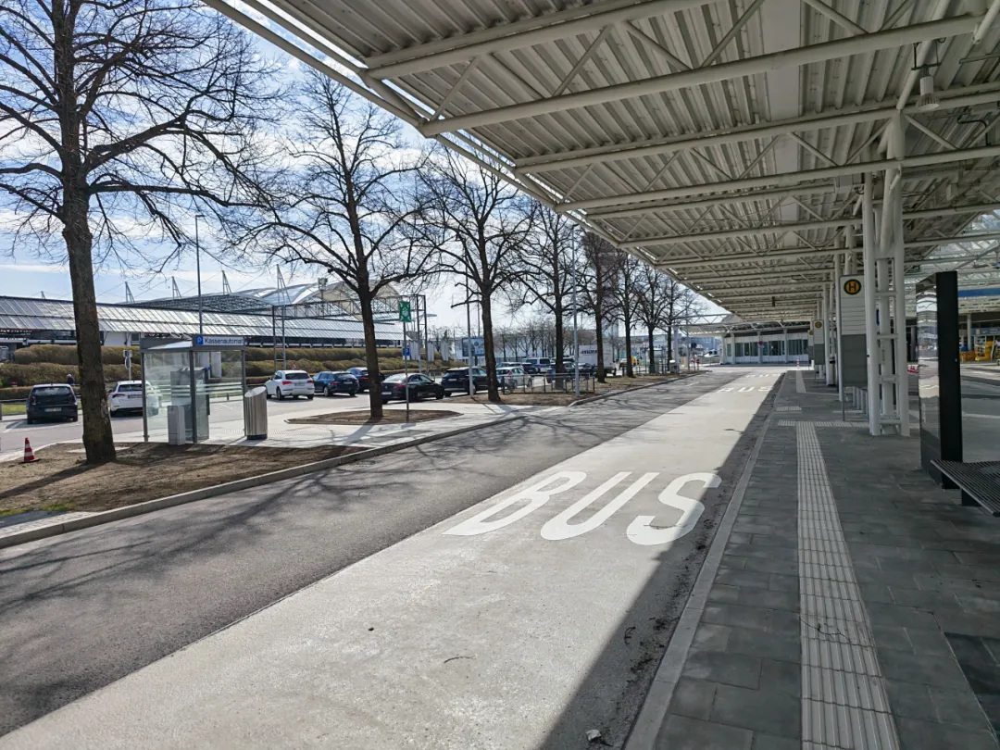

### Lufthansa Express Bus

- **Route:** Airport T1 / T2 → central station, with a stop at Schwabing
- **Time:** 40–45 minutes (off peak)
- **Frequency:** every 20 minutes; airport departures 06:30–22:30
- **Fares:** €11 single bought on site, €10.5 online, €17 return

Tickets are sold on the bus and international credit cards are accepted.

**T1:** the taxi rank is right outside the door; cross the road to the second lane and the coach stop is there.

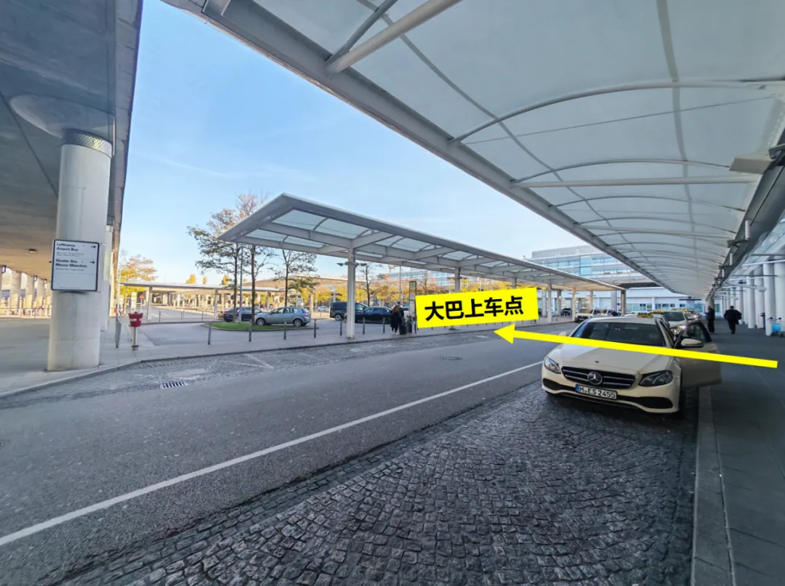

**T2:** turn right at the exit towards the taxi rank and keep walking to reach the coach stop.

> A note if you take this option to your hotel: the stop is a walk away from the Court Hotel, the Rosewood and the Charles Hotel, so you may need to walk on or take a cab. Also, under Munich rules a cyclist on the bike lane is not liable if they hit a pedestrian, so keep clear of bike lanes when getting on and off.

## Joining the airport's free Wi-Fi

If you need a connection at the airport, the free network works like this:

1. Select the network "Free Wifi – Munich Airport" and tap connect.

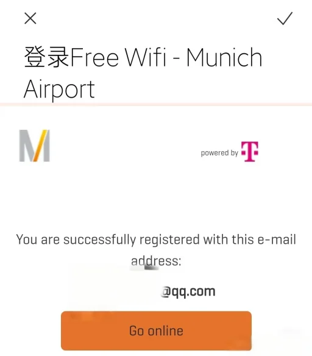

2. Enter your email address, tick the consent box and tap "Continue".

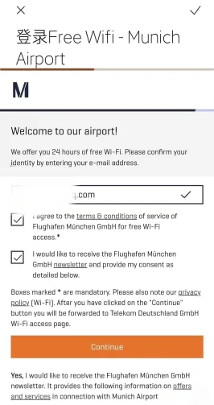

3. Tap "Go online" and you are connected.

## Related links

- **On this site**: [Munich Airport (MUC)](/airport/MUC), [Germany (DE)](/country/DE)
- **Wikipedia**: [Munich Airport](https://en.wikipedia.org/wiki/Munich_Airport)
- **Baidu Baike**: [Munich Airport](https://baike.baidu.com/item/%E6%85%95%E5%B0%BC%E9%BB%91%E6%9C%BA%E5%9C%BA)
- **Airport site**: [Munich Airport – arrival and departure](https://www.munich-airport.com/arrival-and-departure-261432)
- **More articles**: [Munich Airport transfer guide](/blog/munich-airport-guide), [Munich Airport arrival and customs guide](/blog/munich-airport-arrival-customs-guide)

Image source: the original article's figures, from the "安利带你看世界" WeChat account. Shuttle times, fares and pick-up points are as recorded when the guide was compiled; check the official account's latest notice and the airport and operator websites on the day of travel.
