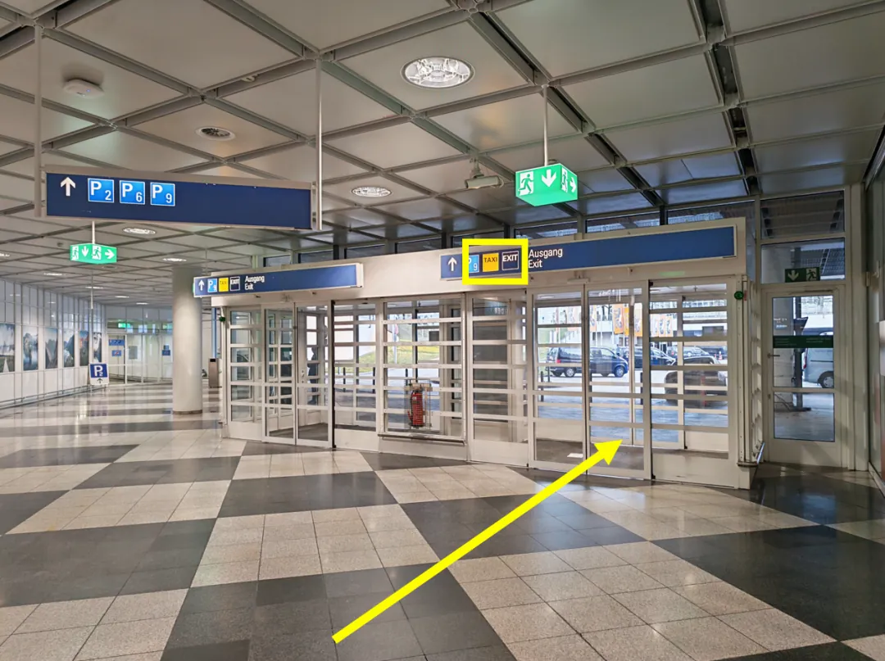
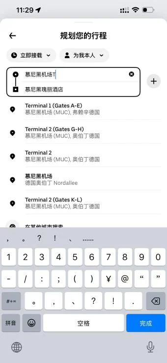

Con el seminario de Múnich a la vuelta de la esquina, los colegas que hayan reservado sus vuelos internacionales por su cuenta deben tener en cuenta una cosa: la empresa pone un autobús lanzadera desde el aeropuerto el día de llegada. Si quieres un asiento, lee con atención los puntos de encuentro y el horario que vienen a continuación y no lo pierdas.

## Una advertencia

Si no has enviado los datos de tu vuelo internacional por internet antes del plazo que fija la empresa, no podemos reservarte plaza en la lanzadera: las plazas disponibles in situ se dan primero a los colegas que ya se han inscrito.

## El horario de la lanzadera del día de llegada

> El plan de la lanzadera puede ajustarse ligeramente cuando estén cerrados los registros definitivos de vuelos. Antes de viajar, consulta el horario en directo en la cuenta oficial “安利带你看世界”, en “高级经理研讨会 - 我的 - 班车时刻表” (Seminario de gerentes sénior - Mi cuenta - Horario de autobuses).

| Terminal | Punto de encuentro / salida | Horas (hora local de Múnich) |
| --- | --- | --- |
| T1 | Encuentro junto a la gran pantalla de la salida B; el personal acompaña al grupo hasta la T2 para embarcar | **14:10 / 15:10 / 16:10 / 17:10 / 18:10** (encuentro) |
| T2 | Delante del Starbucks de la salida de llegadas internacionales | **14:30 / 15:30 / 16:30 / 17:30 / 18:30** (salida) |

### El punto de encuentro de la Terminal 1

**Junto a la gran pantalla de la salida B de la Terminal 1.** El personal con el cartel “美花” reúne al grupo y luego lo acompaña hasta la Terminal 2 para embarcar.

- Horas de encuentro en la T1 (hora local de Múnich): **14:10 / 15:10 / 16:10 / 17:10 / 18:10**

### El punto de encuentro de la Terminal 2

**Delante del Starbucks de la salida de llegadas internacionales de la Terminal 2.**

- Horas de salida de la lanzadera (hora local de Múnich): **14:30 / 15:30 / 16:30 / 17:30 / 18:30**

### Dónde consultar el horario

## Cosas que conviene saber sobre la lanzadera

1. Los pasajeros comparten el autobús, que va parando según el alojamiento de cada uno: bájate en tu hotel y comprueba que tienes todo el equipaje. Si tu vuelo no coincide con ninguna hora de la lanzadera, llega al hotel por tu cuenta.
2. Si no registraste los datos de tu vuelo y organizas tu propio transporte en ambos sentidos, ten en cuenta que el registro en el hotel empieza a las 16:00 y la salida el día de vuelta es antes de las 11:00.
3. El aeropuerto de Múnich está a 35–40 km de los hoteles del centro y el trayecto dura unos 35–50 minutos; un taxi cuesta unos 60–80 € por trayecto y se paga en gran parte en efectivo en euros, ya que solo algunos taxis aceptan Visa o Mastercard: lleva monedas y billetes de euro. En Múnich hay atascos con frecuencia, así que consulta el tráfico en directo y calcula tiempo suficiente.
4. La lanzadera del día de vuelta se anunciará durante el seminario. Si tienes dudas, pregunta al personal de Amway de tu hotel.

## Cómo ir del aeropuerto a la ciudad

Si organizaste tus propios vuelos, estas son las otras formas de llegar a tu hotel del centro.

### Taxi

Del aeropuerto a los hoteles del centro hay 35–40 km y 35–50 minutos; una carrera cuesta unos 60–80 €. Visa y Mastercard se aceptan habitualmente, pero lleva efectivo en euros por comodidad (las tarifas son orientativas; prevalece el precio in situ).

**T1:** la puerta con el cartel de taxi está justo en la salida; la parada de taxis queda justo fuera.

**T2:** desde la salida, gira a la derecha siguiendo los carteles; la parada de taxis está justo fuera de la puerta.

> Antes de subir, confirma con el conductor el hotel y la forma de pago.

### VTC (Uber)

**Uber** es la aplicación que se usa en Múnich: reserva y paga desde la app. Frente a un taxi, Uber muestra una estimación antes de pedir el viaje y cobra a la tarjeta vinculada, lo que va bien a quien prefiere no negociar la dirección y el pago sobre el terreno; los taxis están ahí esperando y algunos aceptan tarjeta. De noche o con mucho equipaje, comprueba antes en la app el tipo de vehículo y el punto de recogida.

**T1:** la puerta con el cartel de taxi está justo en la salida, y justo fuera se encuentra la zona de recogida tanto de Uber como de taxis: una zona de espera compartida, que aparece en las fotos de los taxis de arriba.

**T2:** gira a la izquierda en la salida, donde está el cartel de Uber; cruza la puerta y el punto de recogida de Uber queda delante.

**Cómo usar Uber:**

1. **Abre la app.** Asegúrate de que Uber tiene permiso de ubicación y una tarjeta de crédito u otro método de pago válido vinculado; luego abre la app y toca el cuadro de texto de la pantalla de inicio.

2. **Confirma el pedido.** Introduce el destino, elige el tipo de vehículo y confirma el punto de recogida.

3. **Ve al punto de recogida** que indica tu pedido y súbete allí.

> Vincula antes una tarjeta de crédito internacional en Uber: la tarifa se cobra automáticamente al pedir el viaje (puede aplicarse una comisión transfronteriza). Las tarifas son orientativas y pueden cambiar según el tráfico y el recorrido; lo que cuenta es el viaje real.

### S-Bahn

- **Líneas:** S1 / S8, desde la estación subterránea del aeropuerto
- **Tiempo:** 35–45 minutos hasta la Hauptbahnhof (estación central)
- **Frecuencia:** cada 10 minutos
- **Horario:** 04:00–00:30
- **Tarifas:** 11,20 € el billete sencillo; abonos de día de 13–15,50 €

(Las tarifas y los datos del servicio son orientativos; compruébalos in situ.)

**Comprar un billete en el aeropuerto:**

1. Busca una máquina expendedora: “FAHRKARTEN / Tickets / Billets / Biglietti” está impreso en la parte superior.
2. Cambia al inglés: toca la bandera / Change language y elige English.
3. Elige “MVV offers” en la pantalla de inicio.
4. Escoge el tipo de billete: sencillo o abono de un día.
5. Elige la zona **M-5**: las tarifas de Múnich son por zonas; el centro es la zona M y el aeropuerto está en la zona 5, así que del aeropuerto al centro hace falta la M-5.
6. Elige el número de viajeros: billete individual para una persona, billete de grupo para 2–5.
7. Paga y recoge el billete y el recibo: las máquinas suelen aceptar tarjetas de crédito internacionales.

**T1:** baja por la escalera mecánica y sigue los carteles verdes de la S hasta la estación de S-Bahn.

**T2:** sigue los carteles verdes de la S cruzando la plaza y baja por la escalera mecánica hasta la estación.

### Lufthansa Express Bus

- **Ruta:** aeropuerto T1 / T2 → estación central, con parada en Schwabing
- **Tiempo:** 40–45 minutos (fuera de hora punta)
- **Frecuencia:** cada 20 minutos; salidas del aeropuerto de 06:30 a 22:30
- **Tarifas:** 11 € el sencillo comprado in situ, 10,5 € por internet, 17 € ida y vuelta

Los billetes se venden en el autobús y se aceptan tarjetas de crédito internacionales.

**T1:** la parada de taxis está justo fuera de la puerta; cruza la calle hasta el segundo carril y allí está la parada del autocar.

**T2:** gira a la derecha en la salida hacia la parada de taxis y sigue caminando hasta la parada del autocar.

> Una advertencia si tomas esta opción hasta tu hotel: la parada queda a cierta distancia a pie del Court Hotel, el Rosewood y el Charles Hotel, así que puede que tengas que seguir andando o tomar un taxi. Además, según las normas de Múnich, un ciclista en el carril bici no es responsable si atropella a un peatón, así que mantente fuera de los carriles bici al subir y bajar.

## Conectarse al wifi gratuito del aeropuerto

Si necesitas conexión en el aeropuerto, la red gratuita funciona así:

1. Selecciona la red “Free Wifi – Munich Airport” y toca conectar.

2. Introduce tu dirección de correo electrónico, marca la casilla de consentimiento y toca “Continue”.

3. Toca “Go online” y ya estás conectado.

## Enlaces relacionados

- **En este sitio**: [Aeropuerto de Múnich (MUC)](/airport/MUC), [Alemania (DE)](/country/DE)
- **Wikipedia**: [Aeropuerto de Múnich](https://en.wikipedia.org/wiki/Munich_Airport)
- **Baidu Baike**: [Aeropuerto de Múnich](https://baike.baidu.com/item/%E6%85%95%E5%B0%BC%E9%BB%91%E6%9C%BA%E5%9C%BA)
- **Web del aeropuerto**: [Aeropuerto de Múnich – llegadas y salidas](https://www.munich-airport.com/arrival-and-departure-261432)
- **Más artículos**: [Guía de transporte del aeropuerto de Múnich](/blog/munich-airport-guide), [Guía de llegada y aduanas del aeropuerto de Múnich](/blog/munich-airport-arrival-customs-guide)

Fuente de las imágenes: las figuras del artículo original, de la cuenta de WeChat “安利带你看世界”. Los horarios de la lanzadera, las tarifas y los puntos de recogida son los registrados cuando se elaboró la guía; consulta el último aviso de la cuenta oficial y las webs del aeropuerto y del operador el día del viaje.
