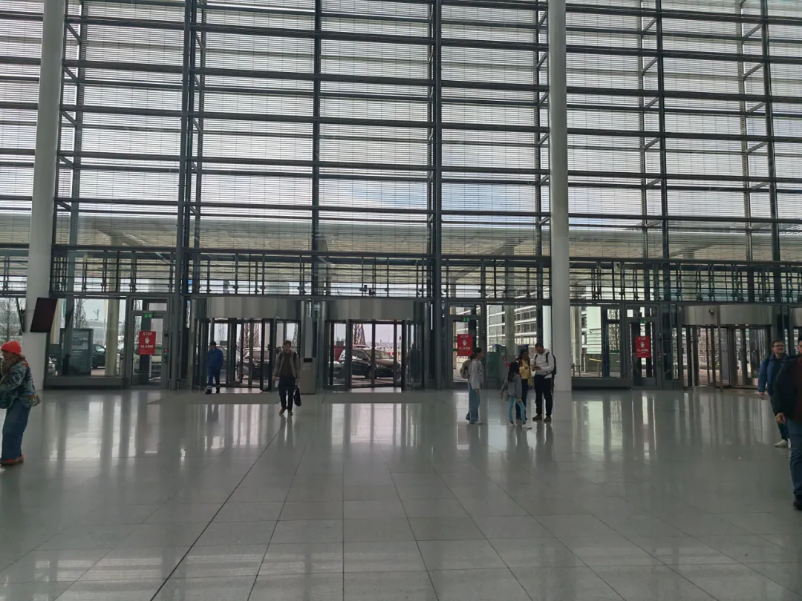
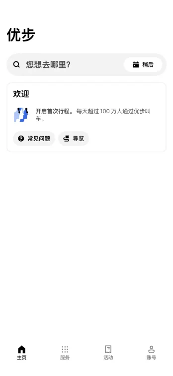

म्यूनिख सेमिनार नज़दीक आ रहा है, इसलिए जिन साथियों ने अपनी अंतरराष्ट्रीय उड़ानें खुद बुक की हैं, वे ध्यान दें: कंपनी आगमन के दिन एयरपोर्ट शटल बस चलाती है। अगर आप सीट चाहते हैं, तो नीचे दिए मिलने के स्थान और समय-सारिणी ध्यान से पढ़ें और इसे न चूकें।

## एक चेतावनी

अगर आपने कंपनी की अंतिम तिथि से पहले अपनी अंतरराष्ट्रीय उड़ान का विवरण ऑनलाइन जमा नहीं किया है, तो हम आपके लिए शटल सीट आरक्षित नहीं कर सकते — मौके पर सीटें पहले उन साथियों को मिलती हैं जो पहले से पंजीकरण कर चुके हैं।

## आगमन के दिन की शटल समय-सारिणी

> अंतिम उड़ान पंजीकरण आने के बाद शटल योजना में थोड़ा बदलाव हो सकता है। यात्रा से पहले "安利带你看世界" आधिकारिक अकाउंट में "高级经理研讨会 - 我的 - 班车时刻表" के अंतर्गत लाइव समय-सारिणी देखें।

| टर्मिनल | मिलने / प्रस्थान का स्थान | समय (म्यूनिख स्थानीय समय) |
| --- | --- | --- |
| T1 | निकास B के पास बड़ी स्क्रीन पर मिलें; कर्मचारी समूह को बोर्डिंग के लिए T2 तक ले जाते हैं | **14:10 / 15:10 / 16:10 / 17:10 / 18:10** (मिलने का समय) |
| T2 | अंतरराष्ट्रीय आगमन निकास पर Starbucks के सामने | **14:30 / 15:30 / 16:30 / 17:30 / 18:30** (प्रस्थान) |

### टर्मिनल 1 पर मिलने का स्थान

**टर्मिनल 1 के निकास B के पास बड़ी स्क्रीन पर।** "美花" का साइनबोर्ड लिए कर्मचारी समूह को इकट्ठा करेंगे, फिर सबको बोर्डिंग के लिए टर्मिनल 2 तक ले जाएँगे।

- टर्मिनल 1 पर मिलने के समय (म्यूनिख स्थानीय समय): **14:10 / 15:10 / 16:10 / 17:10 / 18:10**

### टर्मिनल 2 पर मिलने का स्थान

**टर्मिनल 2 के अंतरराष्ट्रीय आगमन निकास पर Starbucks के सामने।**

- शटल प्रस्थान के समय (म्यूनिख स्थानीय समय): **14:30 / 15:30 / 16:30 / 17:30 / 18:30**

### समय-सारिणी कहाँ देखें

## शटल के बारे में जानने योग्य बातें

1. यात्री एक ही बस साझा करते हैं, जो सबके ठहरने की जगह के अनुसार बारी-बारी रुकती है — अपने होटल पर उतरें। उतरते समय देख लें कि आपका सारा सामान साथ है। अगर आपकी उड़ान किसी शटल समय से मेल नहीं खाती, तो होटल तक अपने साधन से जाएँ।
2. अगर आपने अपनी उड़ान का विवरण पंजीकृत नहीं किया है और आने-जाने दोनों का परिवहन खुद कर रहे हैं, तो ध्यान दें कि होटल में चेक-इन 16:00 से शुरू होता है और वापसी के दिन चेक-आउट 11:00 से पहले है।
3. म्यूनिख एयरपोर्ट शहर के केंद्र के होटलों से 35–40 किमी दूर है और गाड़ी से लगभग 35–50 मिनट लगते हैं; टैक्सी का एक तरफ़ा किराया लगभग €60–80 है और अधिकतर यूरो में नकद लिया जाता है, केवल कुछ टैक्सियाँ Visa या Mastercard लेती हैं — यूरो के सिक्के और नोट साथ रखें। म्यूनिख में अक्सर जाम लगता है, इसलिए लाइव ट्रैफ़िक देखें और पर्याप्त समय रखें।
4. वापसी के दिन की शटल की घोषणा सेमिनार के दौरान की जाएगी। संदेह हो तो अपने होटल में Amway के कर्मचारियों से पूछें।

## एयरपोर्ट से शहर तक पहुँचना

अगर आपने अपनी उड़ानें खुद व्यवस्थित की हैं, तो शहर के केंद्र के होटल तक पहुँचने के अन्य तरीके ये हैं।

### टैक्सी

एयरपोर्ट से शहर के केंद्र के होटलों तक 35–40 किमी और 35–50 मिनट हैं; एक तरफ़ा किराया लगभग €60–80 है। Visa और Mastercard आमतौर पर स्वीकार किए जाते हैं, पर सुविधा के लिए यूरो नकद साथ रखें (किराए केवल अनुमान हैं — मौके पर लगने वाली कीमत ही मान्य है)।

**T1:** टैक्सी के साइनबोर्ड वाला दरवाज़ा निकास पर ही है; टैक्सी स्टैंड ठीक बाहर है।

**T2:** निकास से साइनबोर्ड देखते हुए दाएँ मुड़ें; टैक्सी स्टैंड दरवाज़े के ठीक बाहर है।

> बैठने से पहले ड्राइवर से होटल और भुगतान का तरीका पक्का कर लें।

### राइड-हेलिंग (Uber)

**Uber** म्यूनिख में इस्तेमाल करने वाला ऐप है — बुकिंग और भुगतान ऐप से ही करें। टैक्सी की तुलना में Uber ऑर्डर करने से पहले अनुमानित किराया दिखाता है और आपके लिंक किए कार्ड से शुल्क लेता है, जो उन यात्रियों के लिए उपयुक्त है जो मौके पर पता और भुगतान पर मोल-भाव नहीं करना चाहते; टैक्सियाँ वहीं तैयार मिलती हैं और कुछ कार्ड लेती हैं। देर रात या बहुत सारे सामान के साथ पहले ऐप में गाड़ी का प्रकार और पिक-अप स्थान देख लें।

**T1:** टैक्सी के साइनबोर्ड वाला दरवाज़ा निकास पर ही है, और ठीक बाहर Uber और टैक्सी दोनों के लिए पिक-अप क्षेत्र है — एक ही साझा प्रतीक्षा क्षेत्र, जो ऊपर टैक्सी की तस्वीरों में दिखाया गया है।

**T2:** निकास पर बाएँ मुड़ें, जहाँ Uber का साइनबोर्ड है; दरवाज़े से बाहर निकलें और Uber का पिक-अप स्थान सामने है।

**Uber कैसे इस्तेमाल करें:**

1. **ऐप खोलें।** सुनिश्चित करें कि Uber को लोकेशन की अनुमति है और उसमें क्रेडिट कार्ड या कोई और मान्य भुगतान तरीका जुड़ा है, फिर ऐप खोलें और होम स्क्रीन पर इनपुट बॉक्स पर टैप करें।

2. **ऑर्डर की पुष्टि करें।** अपना गंतव्य डालें, गाड़ी का प्रकार चुनें और पिक-अप स्थान की पुष्टि करें।

3. अपने ऑर्डर में दिखाए गए **पिक-अप स्थान पर जाएँ** और वहीं गाड़ी में बैठें।

> पहले से Uber में अंतरराष्ट्रीय क्रेडिट कार्ड जोड़ें — ऑर्डर करते ही किराया स्वतः लिया जाता है (सीमा-पार शुल्क लग सकता है)। सवारी के किराए अनुमानित हैं और यातायात व मार्ग के अनुसार बदल सकते हैं; असल यात्रा ही मायने रखती है।

### S-Bahn

- **लाइनें:** S1 / S8, एयरपोर्ट के भूमिगत स्टेशन से
- **समय:** Hauptbahnhof (मुख्य स्टेशन) तक 35–45 मिनट
- **आवृत्ति:** हर 10 मिनट
- **समय:** 04:00–00:30
- **किराए:** एकल €11.20; दैनिक टिकट €13–€15.50

(किराए और सेवा विवरण अनुमानित हैं — मौके पर जाँचें।)

**एयरपोर्ट पर टिकट खरीदना:**

1. टिकट मशीन खोजें — उसके ऊपर "FAHRKARTEN / Tickets / Billets / Biglietti" लिखा होता है।
2. अंग्रेज़ी में बदलें: झंडे / Change language पर टैप करें और अंग्रेज़ी चुनें।
3. होम स्क्रीन पर "MVV offers" चुनें।
4. अपने टिकट का प्रकार चुनें: एकल टिकट या एक दिन का टिकट।
5. ज़ोन **M-5** चुनें — म्यूनिख के किराए ज़ोन के अनुसार हैं; शहर का केंद्र ज़ोन M में है और एयरपोर्ट ज़ोन 5 में, इसलिए एयरपोर्ट से शहर के लिए M-5 चाहिए।
6. यात्रियों की संख्या चुनें: एक व्यक्ति के लिए एकल टिकट, 2–5 के लिए समूह टिकट।
7. भुगतान करें और टिकट तथा रसीद लें — मशीनें आमतौर पर अंतरराष्ट्रीय क्रेडिट कार्ड स्वीकार करती हैं।

**T1:** एस्केलेटर से नीचे जाएँ और हरे S साइनबोर्ड देखते हुए सीधे S-Bahn स्टेशन तक जाएँ।

**T2:** चौक पार करते हुए हरे S साइनबोर्ड का पालन करें और एस्केलेटर से नीचे स्टेशन तक जाएँ।

### Lufthansa Express Bus

- **मार्ग:** एयरपोर्ट T1 / T2 → मुख्य स्टेशन, Schwabing में एक स्टॉप के साथ
- **समय:** 40–45 मिनट (गैर-व्यस्त समय)
- **आवृत्ति:** हर 20 मिनट; एयरपोर्ट से प्रस्थान 06:30–22:30
- **किराए:** मौके पर खरीदा एकल टिकट €11, ऑनलाइन €10.5, वापसी टिकट €17

टिकट बस में बेचे जाते हैं और अंतरराष्ट्रीय क्रेडिट कार्ड स्वीकार किए जाते हैं।

**T1:** टैक्सी स्टैंड दरवाज़े के ठीक बाहर है; सड़क पार करके दूसरी लेन में जाएँ, वहीं कोच स्टॉप है।

**T2:** निकास पर टैक्सी स्टैंड की ओर दाएँ मुड़ें और चलते रहें, कोच स्टॉप वहाँ पहुँच जाएगा।

> अगर आप होटल तक इस विकल्प से जाते हैं तो ध्यान दें: यह स्टॉप Court Hotel, Rosewood और Charles Hotel से पैदल दूरी पर है, इसलिए आपको आगे पैदल चलना पड़ सकता है या टैक्सी लेनी पड़ सकती है। साथ ही, म्यूनिख के नियमों के अनुसार बाइक लेन पर साइकिल चालक पैदल यात्री को टक्कर मारने पर उत्तरदायी नहीं होता, इसलिए बस में चढ़ते-उतरते समय बाइक लेन से दूर रहें।

## एयरपोर्ट के मुफ़्त Wi-Fi से जुड़ना

अगर एयरपोर्ट पर आपको इंटरनेट की ज़रूरत है, तो मुफ़्त नेटवर्क इस तरह काम करता है:

1. नेटवर्क "Free Wifi – Munich Airport" चुनें और कनेक्ट पर टैप करें।

2. अपना ईमेल पता डालें, सहमति का बॉक्स चुनें और "Continue" पर टैप करें।

3. "Go online" पर टैप करें और आप जुड़ जाएँगे।

## संबंधित लिंक

- **इस साइट पर:** [म्यूनिख एयरपोर्ट (MUC)](/airport/MUC), [जर्मनी (DE)](/country/DE)
- **विकिपीडिया:** [म्यूनिख एयरपोर्ट](https://en.wikipedia.org/wiki/Munich_Airport)
- **Baidu Baike:** [म्यूनिख एयरपोर्ट](https://baike.baidu.com/item/%E6%85%95%E5%B0%BC%E9%BB%91%E6%9C%BA%E5%9C%BA)
- **एयरपोर्ट साइट:** [म्यूनिख एयरपोर्ट – आगमन और प्रस्थान](https://www.munich-airport.com/arrival-and-departure-261432)
- **और लेख:** [म्यूनिख एयरपोर्ट ट्रांसफर गाइड](/blog/munich-airport-guide), [म्यूनिख एयरपोर्ट आगमन और कस्टम गाइड](/blog/munich-airport-arrival-customs-guide)

चित्र स्रोत: मूल लेख के चित्र, "安利带你看世界" वीचैट अकाउंट से। शटल समय, किराए और पिक-अप स्थान गाइड बनाते समय दर्ज किए गए थे; यात्रा के दिन आधिकारिक अकाउंट की नवीनतम सूचना तथा एयरपोर्ट और ऑपरेटर की वेबसाइट देखें।
