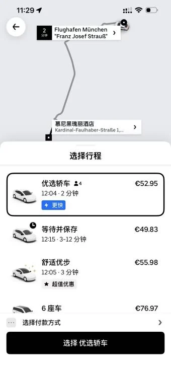
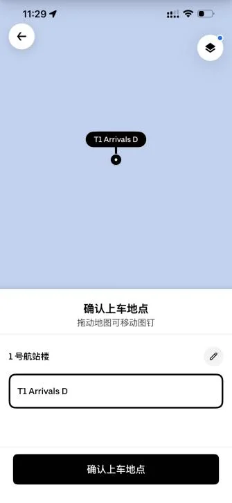

Nu het seminar in München nadert, is er een punt voor collega's die zelf hun internationale vluchten hebben geboekt: het bedrijf zet op de aankomstdag een luchthavenshuttle in. Wil je een plaats, lees dan de verzamelpunten en het schema hieronder goed en mis hem niet.

## Een waarschuwing vooraf

Heb je je internationale vluchtgegevens niet vóór de deadline van het bedrijf online doorgegeven, dan kunnen we geen shuttleplaats voor je reserveren — plaatsen ter plaatse gaan eerst naar collega's die zich al hebben aangemeld.

## Het shuttleschema op de aankomstdag

> Het shuttleplan kan licht worden aangepast zodra de definitieve vluchtaanmeldingen binnen zijn. Controleer vóór je reis het actuele schema in het officiële account "安利带你看世界" onder "高级经理研讨会 - 我的 - 班车时刻表".

| Terminal | Verzamel-/vertrekpunt | Tijden (lokale tijd München) |
| --- | --- | --- |
| T1 | Verzamelen bij het grote scherm bij uitgang B; medewerkers begeleiden de groep naar T2 voor het instappen | **14:10 / 15:10 / 16:10 / 17:10 / 18:10** (verzamelen) |
| T2 | Voor de Starbucks bij de uitgang van de internationale aankomst | **14:30 / 15:30 / 16:30 / 17:30 / 18:30** (vertrek) |

### Het verzamelpunt in Terminal 1

**Bij het grote scherm bij uitgang B van Terminal 1.** Medewerkers met het bord "美花" verzamelen de groep en lopen daarna met iedereen naar Terminal 2 om in te stappen.

- Verzameltijden bij T1 (lokale tijd München): **14:10 / 15:10 / 16:10 / 17:10 / 18:10**

### Het verzamelpunt in Terminal 2

**Voor de Starbucks bij de uitgang van de internationale aankomst van Terminal 2.**

- Vertrektijden van de shuttle (lokale tijd München): **14:30 / 15:30 / 16:30 / 17:30 / 18:30**

### Waar je het schema vindt

## Praktische informatie over de shuttle

1. Passagiers delen de bus, die achtereenvolgens stopt waar iedereen verblijft — stap uit bij je hotel. Controleer bij het uitstappen of je al je bagage hebt. Sluit je vlucht niet aan op een shuttletijd, ga dan zelf naar het hotel.
2. Heb je je vluchtgegevens niet doorgegeven en regel je zelf je vervoer heen en terug, let dan op: inchecken in het hotel kan vanaf 16:00 en uitchecken op de terugdag is vóór 11:00.
3. Luchthaven München ligt 35–40 km van de hotels in het centrum en de rit duurt ongeveer 35–50 minuten; een taxi kost ongeveer €60–80 enkele reis en werkt grotendeels met contant geld in euro's, slechts sommige taxi's nemen Visa of Mastercard — neem euromunten en -biljetten mee. In München staan vaak files, dus volg het live verkeer en vertrek ruim op tijd.
4. De shuttle voor de terugdag wordt tijdens het seminar aangekondigd. Vraag bij twijfel de Amway-medewerkers in je hotel.

## Van de luchthaven naar de stad

Heb je je vluchten zelf geregeld, dan zijn dit de andere manieren om bij je hotel in het centrum te komen.

### Taxi

Van de luchthaven naar de hotels in het centrum is het 35–40 km en 35–50 minuten; een enkele reis kost ongeveer €60–80. Visa en Mastercard worden meestal geaccepteerd, maar neem voor het gemak contant euro's mee (prijzen zijn indicatief — de prijs ter plaatse geldt).

**T1:** de deur met het taxibord staat direct bij de uitgang; de taxistandplaats is net buiten.

**T2:** sla bij de uitgang rechtsaf en volg de borden; de taxistandplaats is net buiten de deur.

> Bevestig voor je instapt met de chauffeur naar welk hotel je gaat en hoe je betaalt.

### Taxi via een app (Uber)

**Uber** is de app die je in München gebruikt — boeken en betalen gaat via de app. Vergeleken met een taxi toont Uber een schatting voordat je bestelt en wordt de gekoppelde kaart belast, wat past bij reizigers die adres en betaling liever niet ter plaatse willen regelen; taxi's staan er en wachten, en sommige accepteren kaarten. Controleer laat op de avond of met veel bagage eerst het voertuigtype en het ophaalpunt in de app.

**T1:** de deur met het taxibord staat direct bij de uitgang, en net buiten is het ophaalpunt voor zowel Uber als taxi's — één gedeelde wachtzone, te zien op de taxifoto's hierboven.

**T2:** sla bij de uitgang linksaf, waar het Uber-bord staat; loop de deur uit en het Uber-ophaalpunt ligt voor je.

**Zo gebruik je Uber:**

1. **Open de app.** Zorg dat Uber toestemming heeft voor je locatie en dat er een creditcard of een andere geldige betaalmethode is gekoppeld, open dan de app en tik op het invoerveld op het startscherm.

2. **Bevestig de bestelling.** Voer je bestemming in, kies het voertuigtype en bevestig het ophaalpunt.

3. **Ga naar het ophaalpunt** dat bij je bestelling staat en stap daar in.

> Koppel van tevoren een internationale creditcard aan Uber — de ritprijs wordt automatisch afgeschreven bij het bestellen (er kan een grensoverschrijdende vergoeding gelden). Ritprijzen zijn indicatief en kunnen veranderen met het verkeer en de route; de werkelijke rit telt.

### S-Bahn

- **Lijnen:** S1 / S8, vanaf het ondergrondse station van de luchthaven
- **Tijd:** 35–45 minuten naar de Hauptbahnhof (centraal station)
- **Frequentie:** elke 10 minuten
- **Openingstijden:** 04:00–00:30
- **Tarieven:** €11,20 enkele reis; dagkaarten €13–€15,50

(Tarieven en dienstregeling zijn indicatief — controleer ter plaatse.)

**Een kaartje kopen op de luchthaven:**

1. Zoek een kaartautomaat — bovenop staat "FAHRKARTEN / Tickets / Billets / Biglietti".
2. Schakel over naar het Engels: tik op de vlag / "Change language" en kies "English".
3. Kies "MVV offers" op het startscherm.
4. Kies je tickettype: een enkel ticket of een dagkaart voor één persoon.
5. Kies zone **M-5** — de tarieven in München zijn zonaal; het centrum is zone M en de luchthaven ligt in zone 5, dus van de luchthaven naar de stad heb je M-5 nodig.
6. Kies het aantal reizigers: een enkel ticket voor één persoon, een groepskaart voor 2–5.
7. Betaal en neem het ticket en de bon mee — de automaten nemen over het algemeen internationale creditcards.

**T1:** neem de roltrap naar beneden en volg de groene S-borden helemaal naar het S-Bahnstation.

**T2:** volg de groene S-borden over het plein en neem de roltrap naar beneden naar het station.

### Lufthansa Express Bus

- **Route:** Luchthaven T1 / T2 → centraal station, met een stop in Schwabing
- **Tijd:** 40–45 minuten (buiten de spits)
- **Frequentie:** elke 20 minuten; vertrek van de luchthaven 06:30–22:30
- **Tarieven:** €11 enkele reis ter plaatse gekocht, €10,50 online, €17 retour

Kaartjes worden in de bus verkocht en internationale creditcards worden geaccepteerd.

**T1:** de taxistandplaats is direct buiten de deur; steek de weg over naar de tweede rijstrook en daar is de touringcarhalte.

**T2:** sla bij de uitgang rechtsaf richting taxistandplaats en loop door tot je bij de touringcarhalte bent.

> Een opmerking als je deze optie naar je hotel neemt: de halte ligt op loopafstand van het Court Hotel, het Rosewood en het Charles Hotel, dus je moet misschien verder lopen of een taxi nemen. Let bovendien op: volgens de regels in München is een fietser op het fietspad niet aansprakelijk als hij een voetganger aanrijdt, dus blijf bij het in- en uitstappen uit de buurt van fietspaden.

## Verbinden met de gratis wifi van de luchthaven

Heb je op de luchthaven een verbinding nodig, dan werkt het gratis netwerk zo:

1. Selecteer het netwerk "Free Wifi – Munich Airport" en tik op verbinden.

2. Voer je e-mailadres in, vink het vakje voor toestemming aan en tik op "Continue".

3. Tik op "Go online" en je bent verbonden.

## Gerelateerde links

- **Op deze site**: [Luchthaven München (MUC)](/airport/MUC), [Duitsland (DE)](/country/DE)
- **Wikipedia**: [Luchthaven München](https://en.wikipedia.org/wiki/Munich_Airport)
- **Baidu Baike**: [Luchthaven München](https://baike.baidu.com/item/%E6%85%95%E5%B0%BC%E9%BB%91%E6%9C%BA%E5%9C%BA)
- **Luchthavensite**: [Luchthaven München – aankomst en vertrek](https://www.munich-airport.com/arrival-and-departure-261432)
- **Meer artikelen**: [Gids voor transfers op Luchthaven München](/blog/munich-airport-guide), [Aankomst en douane op Luchthaven München](/blog/munich-airport-arrival-customs-guide)

Bron afbeeldingen: de afbeeldingen uit het oorspronkelijke artikel, afkomstig van het WeChat-account "安利带你看世界". Shuttletijden, tarieven en ophaalpunten zijn zoals vastgelegd toen de gids werd samengesteld; controleer op de dag van reis de laatste mededeling van het officiële account en de websites van de luchthaven en de vervoerders.
