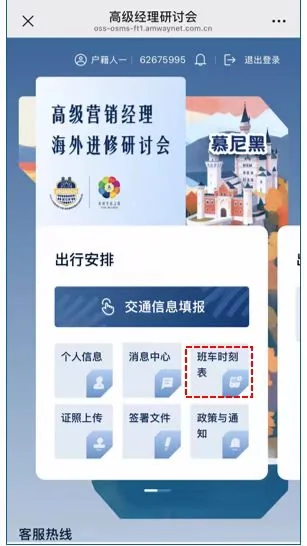

Zbliża się seminarium w Monachium, dlatego współpracownicy, którzy sami rezerwowali loty międzynarodowe, powinni zwrócić uwagę: firma organizuje autobus wahadłowy z lotniska w dniu przyjazdu. Jeśli chcesz mieć miejsce, uważnie przeczytaj poniższe punkty zbiórki i rozkład jazdy i nie spóźnij się.

## Słowo ostrzeżenia

Jeśli nie przesłałeś danych swojego lotu międzynarodowego online przed terminem wyznaczonym przez firmę, nie możemy zarezerwować ci miejsca w autobusie wahadłowym — miejsca na miejscu dostają najpierw współpracownicy, którzy już się zapisali.

## Rozkład jazdy autobusu wahadłowego w dniu przyjazdu

> Plan kursów może zostać nieznacznie skorygowany po zebraniu ostatecznych zgłoszeń lotów. Przed wyjazdem sprawdź bieżący rozkład na oficjalnym koncie „安利带你看世界” w zakładce „高级经理研讨会 - 我的 - 班车时刻表”.

| Terminal | Punkt zbiórki / odjazdu | Godziny (czas lokalny w Monachium) |
| --- | --- | --- |
| T1 | Zbiórka przy dużym ekranie obok wyjścia B; personel prowadzi grupę do T2, gdzie następuje wsiadanie | **14:10 / 15:10 / 16:10 / 17:10 / 18:10** (zbiórka) |
| T2 | Przed kawiarnią Starbucks przy wyjściu z przylotów międzynarodowych | **14:30 / 15:30 / 16:30 / 17:30 / 18:30** (odjazd) |

### Punkt zbiórki w Terminalu 1

**Przy dużym ekranie obok wyjścia B w Terminalu 1.** Personel z tabliczką „美花” zbierze grupę, a następnie zaprowadzi wszystkich do Terminala 2, gdzie odbędzie się wsiadanie.

- Godziny zbiórki w T1 (czas lokalny w Monachium): **14:10 / 15:10 / 16:10 / 17:10 / 18:10**

### Punkt zbiórki w Terminalu 2

**Przed kawiarnią Starbucks przy wyjściu z przylotów międzynarodowych w Terminalu 2.**

- Godziny odjazdu autobusu (czas lokalny w Monachium): **14:30 / 15:30 / 16:30 / 17:30 / 18:30**

### Gdzie sprawdzić rozkład jazdy

## Co warto wiedzieć o autobusie wahadłowym

1. Pasażerowie jadą wspólnym autobusem, który zatrzymuje się kolejno tam, gdzie zatrzymują się wszyscy — wysiądź przy swoim hotelu. Wysiadając, sprawdź, czy masz cały bagaż. Jeśli twój lot nie pokrywa się z godziną odjazdu autobusu, dotrzyj do hotelu na własną rękę.
2. Jeśli nie zarejestrowałeś danych lotu i organizujesz transport we własnym zakresie w obie strony, pamiętaj, że zameldowanie w hotelu rozpoczyna się o 16:00, a w dniu powrotu wymeldowanie następuje przed 11:00.
3. Lotnisko w Monachium dzieli od hoteli w centrum 35–40 km, a jazda trwa około 35–50 minut; taksówka kosztuje około 60–80 € w jedną stronę i w większości przyjmuje gotówkę w euro, tylko część taksówek akceptuje Visa lub Mastercard — weź monety i banknoty euro. W Monachium często tworzą się korki, więc śledź bieżącą sytuację drogową i wyjedź z zapasem czasu.
4. Autobusy na dzień powrotu zostaną ogłoszone podczas seminarium. W razie wątpliwości zapytaj personel Amway w swoim hotelu.

## Jak dostać się z lotniska do miasta

Jeśli sam organizowałeś przeloty, oto inne sposoby dotarcia do hotelu w centrum miasta.

### Taksówka

Z lotniska do hoteli w centrum jest 35–40 km i 35–50 minut; przejazd w jedną stronę kosztuje około 60–80 €. Visa i Mastercard są powszechnie akceptowane, ale dla wygody weź gotówkę w euro (ceny orientacyjne — obowiązuje stawka na miejscu).

**T1:** drzwi z oznaczeniem taksówki są tuż przy wyjściu; postój taksówek znajduje się zaraz na zewnątrz.

**T2:** od wyjścia skręć w prawo, idąc za oznaczeniami; postój taksówek jest tuż za drzwiami.

> Przed wsiadaniem potwierdź z kierowcą hotel i sposób płatności.

### Przewozy na aplikację (Uber)

**Uber** to aplikacja, której warto używać w Monachium — zamawiasz i płacisz przez aplikację. W porównaniu z taksówką Uber pokazuje szacunkową cenę przed złożeniem zamówienia i obciąża przypisaną kartę, co odpowiada podróżnym, którzy wolą nie ustalać adresu i płatności na miejscu; taksówki czekają na postoju, a część przyjmuje karty. Późną nocą lub z dużym bagażem najpierw sprawdź w aplikacji typ pojazdu i miejsce odbioru.

**T1:** drzwi z oznaczeniem taksówki są tuż przy wyjściu, a zaraz na zewnątrz znajduje się strefa odbioru zarówno dla Ubera, jak i taksówek — jedna wspólna strefa oczekiwania, widoczna na zdjęciach taksówek powyżej.

**T2:** przy wyjściu skręć w lewo, gdzie znajduje się oznaczenie Ubera; wyjdź za drzwi, a punkt odbioru Ubera będzie przed tobą.

**Jak korzystać z Ubera:**

1. **Otwórz aplikację.** Upewnij się, że Uber ma zgodę na dostęp do lokalizacji i przypisaną kartę kredytową lub inną ważną metodę płatności, następnie otwórz aplikację i dotknij pola wprowadzania na ekranie głównym.

2. **Potwierdź zamówienie.** Wpisz miejsce docelowe, wybierz typ pojazdu i potwierdź punkt odbioru.

3. **Udaj się do punktu odbioru** wskazanego w zamówieniu i tam wsiądź.

> Wcześniej przypisz w Uberze międzynarodową kartę kredytową — opłata jest pobierana automatycznie przy zamówieniu (może obowiązywać opłata transgraniczna). Ceny przejazdów są orientacyjne i mogą się zmieniać w zależności od ruchu i trasy; liczy się faktyczna podróż.

### S-Bahn

- **Linie:** S1 / S8, z podziemnej stacji lotniska
- **Czas:** 35–45 minut do Hauptbahnhof (dworca głównego)
- **Częstotliwość:** co 10 minut
- **Godziny kursowania:** 04:00–00:30
- **Bilety:** 11,20 € za przejazd jednorazowy; bilety dzienne 13–15,50 €

(Ceny biletów i szczegóły kursowania są orientacyjne — sprawdź na miejscu.)

**Kupowanie biletu na lotnisku:**

1. Znajdź automat biletowy — na górze wydrukowany jest napis „FAHRKARTEN / Tickets / Billets / Biglietti”.
2. Przełącz na angielski: dotknij flagi / opcji zmiany języka i wybierz English.
3. Na ekranie głównym wybierz „MVV offers”.
4. Wybierz typ biletu: bilet jednorazowy lub bilet dzienny.
5. Wybierz strefę **M-5** — taryfy w Monachium są strefowe; centrum miasta to strefa M, a lotnisko leży w strefie 5, więc przejazd z lotniska do miasta wymaga M-5.
6. Wybierz liczbę podróżnych: bilet jednorazowy dla jednej osoby, bilet grupowy dla 2–5 osób.
7. Zapłać i odbierz bilet oraz paragon — automaty zazwyczaj przyjmują międzynarodowe karty kredytowe.

**T1:** zjedź schodami ruchomymi w dół i podążaj za zielonymi oznaczeniami S aż do stacji S-Bahn.

**T2:** idź za zielonymi oznaczeniami S przez plac i zjedź schodami ruchomymi w dół na stację.

### Lufthansa Express Bus

- **Trasa:** lotnisko T1 / T2 → dworzec główny, z przystankiem w Schwabing
- **Czas:** 40–45 minut (poza godzinami szczytu)
- **Częstotliwość:** co 20 minut; odjazdy z lotniska 06:30–22:30
- **Bilety:** 11 € za przejazd jednorazowy kupiony na miejscu, 10,5 € online, 17 € w obie strony

Bilety są sprzedawane w autobusie i akceptowane są międzynarodowe karty kredytowe.

**T1:** postój taksówek jest tuż za drzwiami; przejdź przez jezdnię do drugiego pasa, tam znajduje się przystanek autokaru.

**T2:** przy wyjściu skręć w prawo w stronę postoju taksówek i idź dalej, aż dojdziesz do przystanku autokaru.

> Uwaga, jeśli wybierzesz tę opcję dojazdu do hotelu: przystanek jest oddalony o spacer od Court Hotel, Rosewood i Charles Hotel, więc może być potrzebny dalszy spacer lub taksówka. Ponadto zgodnie z przepisami w Monachium rowerzysta na ścieżce rowerowej nie ponosi odpowiedzialności, jeśli potrąci pieszego, dlatego przy wsiadaniu i wysiadaniu nie wchodź na ścieżki rowerowe.

## Jak połączyć się z bezpłatnym Wi-Fi na lotnisku

Jeśli na lotnisku potrzebujesz internetu, bezpłatna sieć działa tak:

1. Wybierz sieć „Free Wifi – Munich Airport” i dotknij opcji połączenia.

2. Wpisz adres e-mail, zaznacz zgodę i dotknij „Continue”.

3. Dotknij „Go online” i jesteś połączony.

## Powiązane linki

- **Na tej stronie**: [Lotnisko w Monachium (MUC)](/airport/MUC), [Niemcy (DE)](/country/DE)
- **Wikipedia**: [Lotnisko w Monachium](https://en.wikipedia.org/wiki/Munich_Airport)
- **Baidu Baike**: [Lotnisko w Monachium](https://baike.baidu.com/item/%E6%85%95%E5%B0%BC%E9%BB%91%E6%9C%BA%E5%9C%BA)
- **Strona lotniska**: [Lotnisko w Monachium – przyloty i odloty](https://www.munich-airport.com/arrival-and-departure-261432)
- **Więcej artykułów**: [Przewodnik po przesiadkach na lotnisku w Monachium](/blog/munich-airport-guide), [Przylot i odprawa celna na lotnisku w Monachium](/blog/munich-airport-arrival-customs-guide)

Źródło zdjęć: ilustracje z oryginalnego artykułu, z konta WeChat „安利带你看世界”. Godziny kursowania autobusów, ceny biletów i punkty odbioru podano zgodnie ze stanem z czasu opracowania przewodnika; w dniu podróży sprawdź najnowsze ogłoszenie na oficjalnym koncie oraz strony internetowe lotniska i przewoźników.
