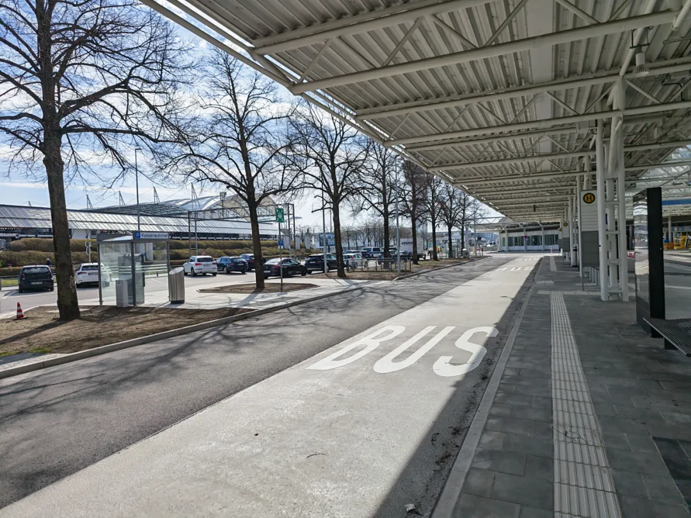

Com o seminário de Munique se aproximando, os colegas que reservaram os próprios voos internacionais devem ficar atentos: a empresa oferece um ônibus de traslado no aeroporto no dia da chegada. Se você quer garantir seu lugar, leia com atenção os pontos de encontro e o horário abaixo e não perca o ônibus.

## Um aviso

Se você não enviou os dados do voo internacional on-line antes do prazo definido pela empresa, não podemos reservar um lugar no traslado — as vagas disponíveis no local são dadas primeiro aos colegas que já se inscreveram.

## O horário do traslado no dia da chegada

> O plano do traslado pode sofrer pequenos ajustes depois que os registros finais de voos forem concluídos. Antes de viajar, consulte o horário ao vivo na conta oficial “安利带你看世界”, em “高级经理研讨会 - 我的 - 班车时刻表”.

| Terminal | Ponto de encontro / partida | Horários (horário local de Munique) |
| --- | --- | --- |
| T1 | Encontro no telão perto da saída B; a equipe acompanha o grupo até o T2 para o embarque | **14:10 / 15:10 / 16:10 / 17:10 / 18:10** (encontro) |
| T2 | Em frente ao Starbucks da saída de chegadas internacionais | **14:30 / 15:30 / 16:30 / 17:30 / 18:30** (partida) |

### O ponto de encontro do Terminal 1

**No telão perto da saída B do Terminal 1.** A equipe com a placa “美花” reúne o grupo e depois acompanha todos até o Terminal 2 para o embarque.

- Horários de encontro no T1 (horário local de Munique): **14:10 / 15:10 / 16:10 / 17:10 / 18:10**

### O ponto de encontro do Terminal 2

**Em frente ao Starbucks da saída de chegadas internacionais do Terminal 2.**

- Horários de partida do traslado (horário local de Munique): **14:30 / 15:30 / 16:30 / 17:30 / 18:30**

### Onde encontrar o horário

## O que saber sobre o traslado

1. Os passageiros compartilham o ônibus, que para conforme o local em que cada um está hospedado — desça no seu hotel. Confira se está com toda a bagagem ao descer. Se o seu voo não coincide com um horário do traslado, vá ao hotel por conta própria.
2. Se você não registrou os dados do voo e planeja o próprio transporte na ida e na volta, observe que o check-in no hotel começa às 16:00 e o check-out no dia da volta é antes das 11:00.
3. O Aeroporto de Munique fica a 35–40 km dos hotéis do centro e o trajeto leva cerca de 35–50 minutos; um táxi custa aproximadamente €60–80 por trecho e é em grande parte pago em dinheiro, em euros, com apenas alguns táxis aceitando Visa ou Mastercard — leve moedas e notas de euro. O trânsito de Munique costuma engarrafar, então acompanhe as condições ao vivo e saia com bastante antecedência.
4. O traslado do dia da volta será anunciado durante o seminário. Em caso de dúvida, pergunte à equipe da Amway no seu hotel.

## Como ir do aeroporto ao centro da cidade

Se você organizou os próprios voos, estas são as outras formas de chegar ao hotel no centro da cidade.

### Táxi

Do aeroporto aos hotéis do centro são 35–40 km e 35–50 minutos; a corrida de ida custa cerca de €60–80. Visa e Mastercard são aceitos com frequência, mas leve dinheiro em euro por conveniência (as tarifas são apenas indicativas — prevalece o preço no local).

**T1:** a porta com a placa de táxi fica bem na saída; o ponto de táxi está logo do lado de fora.

**T2:** na saída, vire à direita seguindo as placas; o ponto de táxi fica logo do lado de fora da porta.

> Antes de entrar, confirme com o motorista o hotel e a forma de pagamento.

### Aplicativos de transporte (Uber)

**O Uber** é o aplicativo usado em Munique — reserve e pague pelo app. Em comparação com o táxi, o Uber mostra uma estimativa antes de você pedir e cobra no cartão vinculado, o que é prático para quem prefere não negociar o endereço e o pagamento na hora; os táxis estão ali esperando, e alguns aceitam cartão. À noite ou com muita bagagem, confira primeiro no app o tipo de veículo e o ponto de embarque.

**T1:** a porta com a placa de táxi fica bem na saída, e logo do lado de fora está a área de embarque para Uber e táxis — uma zona de espera compartilhada, mostrada nas fotos de táxi acima.

**T2:** na saída, vire à esquerda, onde está a placa do Uber; saia pela porta e o ponto de embarque do Uber estará à frente.

**Como usar o Uber:**

1. **Abra o aplicativo.** Verifique se o Uber tem permissão de localização e um cartão de crédito ou outra forma de pagamento válida vinculada, depois abra o app e toque na caixa de texto da tela inicial.

2. **Confirme o pedido.** Digite o destino, escolha o tipo de veículo e confirme o ponto de embarque.

3. **Vá até o ponto de embarque** indicado no seu pedido e entre no veículo ali.

> Vincule um cartão de crédito internacional ao Uber com antecedência — a tarifa é cobrada automaticamente quando você faz o pedido (pode haver uma taxa de transação internacional). As tarifas de corrida são indicativas e podem mudar com o trânsito e o trajeto; o que vale é a viagem real.

### S-Bahn

- **Linhas:** S1 / S8, a partir da estação subterrânea do aeroporto
- **Tempo:** 35–45 minutos até a Hauptbahnhof (estação central)
- **Frequência:** a cada 10 minutos
- **Horário de funcionamento:** 04:00–00:30
- **Tarifas:** €11,20 a passagem simples; bilhetes diários €13–€15,50

(As tarifas e informações de serviço são indicativas — confirme no local.)

**Comprando o bilhete no aeroporto:**

1. Encontre uma máquina de bilhetes — “FAHRKARTEN / Tickets / Billets / Biglietti” está impresso na parte superior.
2. Mude para o inglês: toque na bandeira / Change language e escolha English.
3. Escolha “MVV offers” na tela inicial.
4. Escolha o tipo de bilhete: Single ticket (passagem simples) ou Single day ticket (bilhete diário).
5. Escolha a zona **M-5** — as tarifas de Munique são por zona; o centro da cidade é a zona M e o aeroporto fica na zona 5, então aeroporto–centro exige M-5.
6. Escolha o número de viajantes: Single ticket para uma pessoa, Group ticket para 2–5.
7. Pague e retire o bilhete e o recibo — as máquinas geralmente aceitam cartões de crédito internacionais.

**T1:** desça pela escada rolante e siga as placas verdes com o S até a estação do S-Bahn.

**T2:** siga as placas verdes do S atravessando a praça e desça pela escada rolante até a estação.

### Lufthansa Express Bus

- **Rota:** Aeroporto T1 / T2 → estação central, com parada em Schwabing
- **Tempo:** 40–45 minutos (fora do horário de pico)
- **Frequência:** a cada 20 minutos; partidas do aeroporto das 06:30 às 22:30
- **Tarifas:** €11 a passagem simples comprada no local, €10,50 on-line, €17 ida e volta

Os bilhetes são vendidos no ônibus e cartões de crédito internacionais são aceitos.

**T1:** o ponto de táxi fica logo do lado de fora da porta; atravesse a rua até a segunda faixa e ali está a parada do ônibus.

**T2:** na saída, vire à direita em direção ao ponto de táxi e continue caminhando até a parada do ônibus.

> Uma observação se você usar esta opção até o hotel: a parada fica a uma caminhada do Court Hotel, do Rosewood e do Charles Hotel, então talvez seja preciso continuar a pé ou pegar um táxi. Além disso, pelas regras de Munique, um ciclista na ciclovia não é responsável se atropelar um pedestre, então fique longe das ciclovias ao entrar e sair.

## Como acessar o Wi-Fi gratuito do aeroporto

Se você precisar de conexão no aeroporto, a rede gratuita funciona assim:

1. Selecione a rede “Free Wifi – Munich Airport” e toque em conectar.

2. Digite seu endereço de e-mail, marque a caixa de consentimento e toque em “Continue”.

3. Toque em “Go online” e você estará conectado.

## Links relacionados

- **Neste site**: [Aeroporto de Munique (MUC)](/airport/MUC), [Alemanha (DE)](/country/DE)
- **Wikipedia**: [Aeroporto de Munique](https://en.wikipedia.org/wiki/Munich_Airport)
- **Baidu Baike**: [Aeroporto de Munique](https://baike.baidu.com/item/%E6%85%95%E5%B0%BC%E9%BB%91%E6%9C%BA%E5%9C%BA)
- **Site do aeroporto**: [Aeroporto de Munique – chegadas e partidas](https://www.munich-airport.com/arrival-and-departure-261432)
- **Mais artigos**: [Guia de traslado do Aeroporto de Munique](/blog/munich-airport-guide), [Guia de chegada e alfândega do Aeroporto de Munique](/blog/munich-airport-arrival-customs-guide)

Fonte das imagens: as figuras do artigo original, da conta “安利带你看世界” no WeChat. Os horários do traslado, as tarifas e os pontos de embarque correspondem ao registrado quando o guia foi compilado; consulte o aviso mais recente da conta oficial e os sites do aeroporto e dos operadores no dia da viagem.
