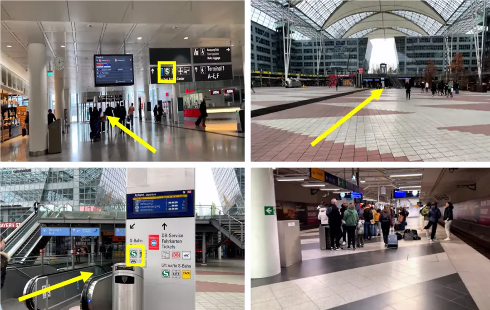
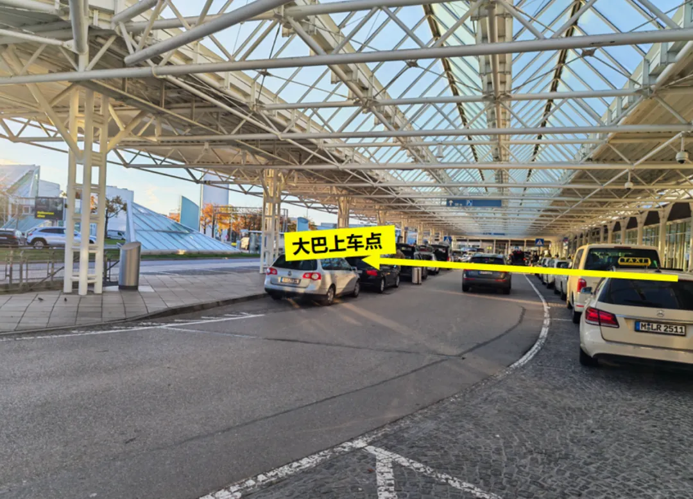

Семинар в Мюнхене уже близко, поэтому коллегам, которые бронировали международные рейсы самостоятельно, стоит учесть: в день прилёта компания организует трансферный автобус из аэропорта. Если хотите занять место, внимательно изучите места встречи и расписание ниже и не опоздайте.

## Важное предупреждение

Если вы не отправили данные о международном рейсе онлайн до установленного компанией срока, мы не сможем забронировать вам место в автобусе: места на месте в первую очередь достаются коллегам, которые уже зарегистрировались.

## Расписание трансфера в день прилёта

> План трансфера может немного измениться после того, как будут собраны окончательные данные о рейсах. Перед поездкой проверьте актуальное расписание в официальном аккаунте «安利带你看世界» в разделе «高级经理研讨会 - 我的 - 班车时刻表».

| Терминал | Место встречи / отправления | Время (по местному времени Мюнхена) |
| --- | --- | --- |
| T1 | Встреча у большого экрана возле выхода B; сотрудники провожают группу к T2 на посадку | **14:10 / 15:10 / 16:10 / 17:10 / 18:10** (встреча) |
| T2 | Перед Starbucks у выхода из зоны международных прилётов | **14:30 / 15:30 / 16:30 / 17:30 / 18:30** (отправление) |

### Место встречи в терминале 1

**У большого экрана возле выхода B терминала 1.** Сотрудники с табличкой «美花» соберут группу, а затем проводят всех к терминалу 2 на посадку.

- Время встречи в T1 (по местному времени Мюнхена): **14:10 / 15:10 / 16:10 / 17:10 / 18:10**

### Место встречи в терминале 2

**Перед Starbucks у выхода из зоны международных прилётов терминала 2.**

- Время отправления автобуса (по местному времени Мюнхена): **14:30 / 15:30 / 16:30 / 17:30 / 18:30**

### Где найти расписание

## Что важно знать о трансфере

1. Автобус общий: он останавливается по очереди там, где остановились пассажиры, — выходите у своего отеля. Не забудьте проверить, что забрали весь багаж. Если ваш рейс не совпадает по времени с трансфером, добирайтесь до отеля самостоятельно.
2. Если вы не зарегистрировали данные о рейсе и планируете добираться туда и обратно самостоятельно, учтите: заселение в отель начинается в 16:00, а выезд в день возвращения — до 11:00.
3. Аэропорт Мюнхена находится в 35–40 км от отелей в центре города, дорога занимает около 35–50 минут; такси стоит примерно €60–80 в одну сторону и в основном принимает наличные в евро, лишь некоторые такси берут Visa или Mastercard, — возьмите с собой евро монетами и купюрами. В Мюнхене часто бывают пробки, поэтому следите за дорожной обстановкой и оставляйте запас времени.
4. Трансфер в день возвращения объявят во время семинара. Если что-то неясно, спросите сотрудников Amway в вашем отеле.

## Как добраться из аэропорта в город

Если вы бронировали рейсы самостоятельно, вот другие способы добраться до отеля в центре города.

### Такси

От аэропорта до отелей в центре города — 35–40 км и 35–50 минут; поездка в одну сторону стоит около €60–80. Visa и Mastercard обычно принимают, но на всякий случай возьмите наличные евро (тарифы ориентировочные — окончательную цену определяют на месте).

**T1:** дверь с табличкой такси находится прямо у выхода; стоянка такси — сразу снаружи.

**T2:** от выхода поверните направо и идите по указателям; стоянка такси — сразу за дверью.

> Прежде чем сесть в машину, уточните у водителя отель и способ оплаты.

### Заказ автомобиля через приложение (Uber)

**Uber** — основное приложение для поездок в Мюнхене: заказ и оплата происходят в приложении. По сравнению с такси Uber показывает предварительную стоимость до заказа и списывает деньги с привязанной карты, что удобно путешественникам, которые не хотят на месте обсуждать адрес и оплату; такси же стоят и ждут, и некоторые принимают карты. Поздно вечером или с большим багажом сначала проверьте в приложении тип автомобиля и точку посадки.

**T1:** дверь с табличкой такси находится прямо у выхода, а сразу снаружи — зона посадки и для Uber, и для такси: общая зона ожидания, показанная на фотографиях такси выше.

**T2:** от выхода поверните налево, где стоит табличка Uber; выйдите за дверь, и точка посадки Uber будет прямо перед вами.

**Как пользоваться Uber:**

1. **Откройте приложение.** Убедитесь, что у Uber есть разрешение на определение местоположения и привязана кредитная карта или другой действующий способ оплаты, затем откройте приложение и нажмите на поле ввода на главном экране.

2. **Подтвердите заказ.** Введите пункт назначения, выберите тип автомобиля и подтвердите точку посадки.

3. **Подойдите к точке посадки**, указанной в заказе, и садитесь там.

> Заранее привяжите в Uber международную кредитную карту: стоимость списывается автоматически при заказе (может взиматься комиссия за трансграничный платёж). Стоимость поездки ориентировочная и может меняться из-за пробок и маршрута; решающее значение имеет фактическая поездка.

### S-Bahn

- **Линии:** S1 / S8, из подземной станции аэропорта
- **Время в пути:** 35–45 минут до Хауптбанхофа (центрального вокзала)
- **Интервал:** каждые 10 минут
- **Часы работы:** 04:00–00:30
- **Тарифы:** €11,20 за разовую поездку; дневные билеты €13–€15,50

(Тарифы и детали работы ориентировочные — проверяйте на месте.)

**Покупка билета в аэропорту:**

1. Найдите билетный автомат — сверху на нём написано «FAHRKARTEN / Tickets / Billets / Biglietti».
2. Переключите на английский: нажмите на флаг / Change language и выберите English.
3. Выберите «MVV offers» на главном экране.
4. Выберите тип билета: разовый (Single ticket) или дневной (Single day ticket).
5. Выберите зону **M-5**: тарифы в Мюнхене зональные; центр города — зона M, аэропорт — зона 5, поэтому для поездки из аэропорта в город нужна M-5.
6. Укажите число пассажиров: Single ticket — на одного, Group ticket — на 2–5 человек.
7. Оплатите и заберите билет и чек — автоматы, как правило, принимают международные кредитные карты.

**T1:** спуститесь на эскалаторе и идите по зелёным указателям S до самой станции S-Bahn.

**T2:** идите по зелёным указателям S через площадь и спуститесь на эскалаторе к станции.

### Экспресс-автобус Lufthansa

- **Маршрут:** аэропорт T1 / T2 → центральный вокзал, с остановкой в Швабинге
- **Время в пути:** 40–45 минут (вне часа пик)
- **Интервал:** каждые 20 минут; отправления из аэропорта 06:30–22:30
- **Тарифы:** €11 за разовую поездку при покупке на месте, €10,5 онлайн, €17 туда и обратно

Билеты продаются в автобусе, принимаются международные кредитные карты.

**T1:** стоянка такси — сразу за дверью; перейдите дорогу ко второй полосе, и там будет остановка автобуса.

**T2:** от выхода поверните направо в сторону стоянки такси и идите дальше до остановки автобуса.

> Замечание, если вы пользуетесь этим вариантом до отеля: остановка находится на расстоянии пешей прогулки от отелей Court Hotel, Rosewood и Charles Hotel, поэтому, возможно, придётся пройти дальше или взять такси. Кроме того, по мюнхенским правилам велосипедист на велодорожке не несёт ответственности, если сбил пешехода, поэтому при посадке и высадке держитесь подальше от велодорожек.

## Подключение к бесплатному Wi-Fi аэропорта

Если вам нужен интернет в аэропорту, бесплатная сеть работает так:

1. Выберите сеть «Free Wifi – Munich Airport» и нажмите «Подключиться».

2. Введите адрес электронной почты, поставьте галочку согласия и нажмите «Continue».

3. Нажмите «Go online» — и вы подключены.

## Связанные ссылки

- **На этом сайте**: [Аэропорт Мюнхена (MUC)](/airport/MUC), [Германия (DE)](/country/DE)
- **Википедия**: [Аэропорт Мюнхена](https://en.wikipedia.org/wiki/Munich_Airport)
- **Байду Байкэ**: [Аэропорт Мюнхена](https://baike.baidu.com/item/%E6%85%95%E5%B0%BC%E9%BB%91%E6%9C%BA%E5%9C%BA)
- **Сайт аэропорта**: [Аэропорт Мюнхена — прилёт и вылет](https://www.munich-airport.com/arrival-and-departure-261432)
- **Ещё статьи**: [Гид по трансферу из аэропорта Мюнхена](/blog/munich-airport-guide), [Прилёт и таможня в аэропорту Мюнхена](/blog/munich-airport-arrival-customs-guide)

Источник изображений: иллюстрации из оригинальной статьи, из аккаунта «安利带你看世界» в WeChat. Время трансфера, тарифы и точки посадки указаны на момент составления гида; в день поездки проверяйте последнее объявление официального аккаунта и сайты аэропорта и перевозчиков.
