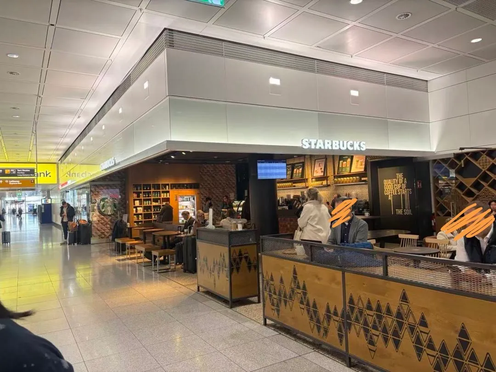
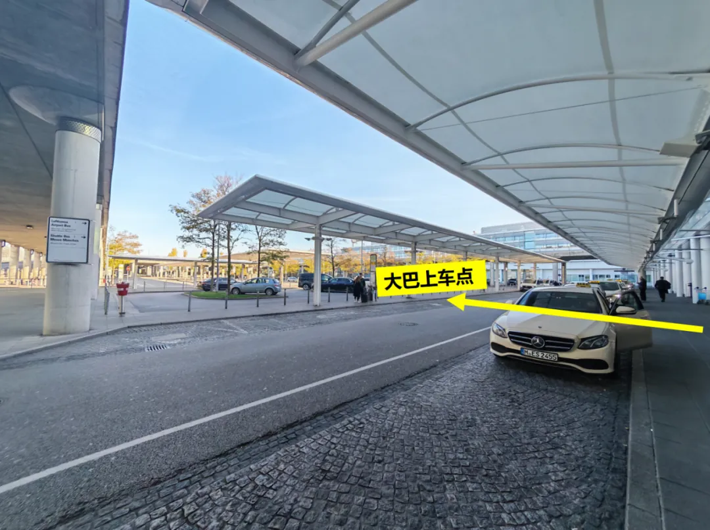
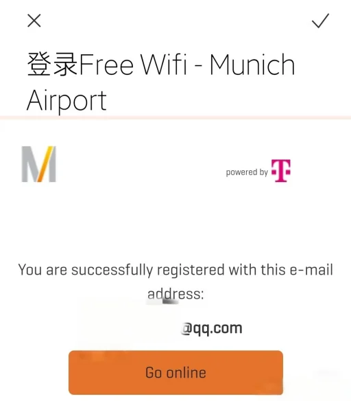

Med Münchenseminariet nära inpå bör kollegor som bokat sina internationella flyg själva notera: företaget kör en transferbuss från flygplatsen på ankomstdagen. Om du vill ha en plats, läs mötesplatserna och tidtabellen nedan noggrant och missa den inte.

## En varning

Om du inte har lämnat in dina internationella flyguppgifter online före företagets deadline kan vi inte reservera en bussplats åt dig – platserna på plats går först till kollegor som redan har anmält sig.

## Busschemat för ankomstdagen

> Bussplanen kan justeras något när de slutliga flyganmälningarna är inne. Innan du reser, kontrollera den aktuella tidtabellen i det officiella kontot ”安利带你看世界” under ”高级经理研讨会 - 我的 - 班车时刻表”.

| Terminal | Mötes- / avgångsplats | Tider (lokal tid i München) |
| --- | --- | --- |
| T1 | Möte vid den stora skärmen vid utgång B; personalen följer gruppen till T2 för ombordstigning | **14:10 / 15:10 / 16:10 / 17:10 / 18:10** (möte) |
| T2 | Framför Starbucks vid den internationella ankomstens utgång | **14:30 / 15:30 / 16:30 / 17:30 / 18:30** (avgång) |

### Mötesplatsen i terminal 1

**Vid den stora skärmen vid terminal 1:s utgång B.** Personal som håller skylten ”美花” samlar gruppen och följer sedan alla till terminal 2 för ombordstigning.

- Mötestider vid T1 (lokal tid i München): **14:10 / 15:10 / 16:10 / 17:10 / 18:10**

### Mötesplatsen i terminal 2

**Framför Starbucks vid terminal 2:s internationella ankomstutgång.**

- Bussens avgångstider (lokal tid i München): **14:30 / 15:30 / 16:30 / 17:30 / 18:30**

### Var du hittar tidtabellen

## Bra att veta om bussen

1. Passagerarna delar buss, som stannar i tur och ordning beroende på var alla bor – stig av vid ditt hotell. Kontrollera att du har allt bagage när du gör det. Om ditt flyg inte passar med en busstid tar du dig till hotellet på egen hand.
2. Om du inte anmälde dina flyguppgifter och ordnar transporten själv båda vägarna, notera att hotellincheckningen börjar 16:00 och att utcheckningen på returdagen är före 11:00.
3. Münchens flygplats ligger 35–40 km från hotellen i centrum och resan tar cirka 35–50 minuter; en taxi kostar ungefär 60–80 € enkel väg och tar till stor del emot kontanter i euro, och bara en del taxibilar tar Visa eller Mastercard – ta med euromynt och sedlar. Trafiken i München stockar sig ofta, så håll koll på trafikläget och avsätt tillräckligt med tid.
4. Returdagens buss meddelas under seminariet. Fråga Amway-personalen på ditt hotell om du är osäker.

## Från flygplatsen in till staden

Om du ordnade dina egna flyg är det här de andra sätten att nå ditt hotell i centrum.

### Taxi

Från flygplatsen till hotellen i centrum är det 35–40 km och 35–50 minuter; en enkel resa kostar cirka 60–80 €. Visa och Mastercard accepteras vanligen, men ta med euro i kontanter för enkelhetens skull (priserna är vägledande – priset på plats gäller).

**T1:** dörren med taxiskylten ligger direkt vid utgången; taxistationen ligger alldeles utanför.

**T2:** sväng höger när du kommer ut och följ skyltarna; taxistationen ligger alldeles utanför dörren.

> Innan du sätter dig i bilen, bekräfta hotellet och betalsättet med föraren.

### Boka bil via app (Uber)

**Uber** är appen att använda i München – boka och betala via appen. Jämfört med taxi visar Uber en uppskattning innan du beställer och debiterar det kort du kopplat, vilket passar resenärer som hellre inte förhandlar om adress och betalning på plats; taxibilar finns där och väntar, och en del tar kort. Sent på kvällen eller med mycket bagage, kontrollera fordonstyp och upphämtningsplats i appen först.

**T1:** dörren med taxiskylten ligger direkt vid utgången, och alldeles utanför finns upphämtningsområdet för både Uber och taxi – en gemensam väntzon, som syns på taxibilderna ovan.

**T2:** sväng vänster vid utgången, där Ubers skylt sitter; gå ut genom dörren och Ubers upphämtningsplats ligger framför dig.

**Så använder du Uber:**

1. **Öppna appen.** Se till att Uber har platstillstånd och ett kreditkort eller annat giltigt betalsätt kopplat, öppna sedan appen och tryck på inmatningsfältet på startsidan.

2. **Bekräfta beställningen.** Ange din destination, välj fordonstyp och bekräfta upphämtningsplatsen.

3. **Gå till upphämtningsplatsen** som visas i din beställning och stig in där.

> Koppla ett internationellt kreditkort i Uber i förväg – resan debiteras automatiskt när du beställer (en gränsöverskridande avgift kan tillkomma). Priserna är vägledande och kan ändras med trafik och rutt; det är den faktiska resan som gäller.

### S-Bahn

- **Linjer:** S1 / S8, från flygplatsens underjordiska station
- **Tid:** 35–45 minuter till Hauptbahnhof (centralstationen)
- **Frekvens:** var 10:e minut
- **Öppettider:** 04:00–00:30
- **Priser:** 11,20 € enkelbiljett; dagbiljetter 13–15,50 €

(Priser och servicedetaljer är vägledande – kontrollera på plats.)

**Så köper du biljett på flygplatsen:**

1. Hitta en biljettautomat – ”FAHRKARTEN / Tickets / Billets / Biglietti” står tryckt högst upp.
2. Byt till engelska: tryck på flaggan / Change language och välj engelska.
3. Välj ”MVV offers” på startsidan.
4. Välj biljettyp: enkelbiljett (Single ticket) eller dagbiljett (Single day ticket).
5. Välj zon **M-5** – München har zonpriser; centrum är zon M och flygplatsen ligger i zon 5, så flygplats–centrum kräver M-5.
6. Välj antal resenärer: enkelbiljett för en person, gruppbiljett för 2–5.
7. Betala och ta biljetten och kvittot – automaterna tar i allmänhet internationella kreditkort.

**T1:** ta rulltrappan ner och följ de gröna S-skyltarna hela vägen till S-Bahn-stationen.

**T2:** följ de gröna S-skyltarna över torget och ta rulltrappan ner till stationen.

### Lufthansa Express Bus

- **Rutt:** flygplatsen T1 / T2 → centralstationen, med stopp i Schwabing
- **Tid:** 40–45 minuter (lågtrafik)
- **Frekvens:** var 20:e minut; avgångar från flygplatsen 06:30–22:30
- **Priser:** 11 € enkelbiljett köpt på plats, 10,50 € online, 17 € tur och retur

Biljetter säljs ombord på bussen och internationella kreditkort accepteras.

**T1:** taxistationen ligger direkt utanför dörren; gå över vägen till andra filen och busshållplatsen ligger där.

**T2:** sväng höger vid utgången mot taxistationen och fortsätt gå för att nå busshållplatsen.

> En notering om du tar det här alternativet till hotellet: hållplatsen ligger en bit att gå från Court Hotel, Rosewood och Charles Hotel, så du kan behöva gå vidare eller ta en taxi. Enligt Münchens regler är en cyklist på cykelbanan inte ansvarig om hen träffar en fotgängare, så håll dig borta från cykelbanan när du stiger på och av.

## Ansluta till flygplatsens gratis wi-fi

Om du behöver en uppkoppling på flygplatsen fungerar det kostnadsfria nätverket så här:

1. Välj nätverket ”Free Wifi – Munich Airport” och tryck på anslut.

2. Ange din e-postadress, kryssa i samtyckesrutan och tryck på ”Continue”.

3. Tryck på ”Go online” och du är ansluten.

## Relaterade länkar

- **På den här sidan**: [Münchens flygplats (MUC)](/airport/MUC), [Tyskland (DE)](/country/DE)
- **Wikipedia**: [Münchens flygplats](https://en.wikipedia.org/wiki/Munich_Airport)
- **Baidu Baike**: [Münchens flygplats](https://baike.baidu.com/item/%E6%85%95%E5%B0%BC%E9%BB%91%E6%9C%BA%E5%9C%BA)
- **Flygplatsens webbplats**: [Münchens flygplats – ankomst och avgång](https://www.munich-airport.com/arrival-and-departure-261432)
- **Fler artiklar**: [Transferguide för Münchens flygplats](/blog/munich-airport-guide), [Guide till ankomst och tull på Münchens flygplats](/blog/munich-airport-arrival-customs-guide)

Bildkälla: originalartikelns bilder, från WeChat-kontot ”安利带你看世界”. Busstider, priser och upphämtningsplatser är som de registrerades när guiden sammanställdes; kontrollera det officiella kontots senaste meddelande och flygplatsens och operatörernas webbplatser på resdagen.
