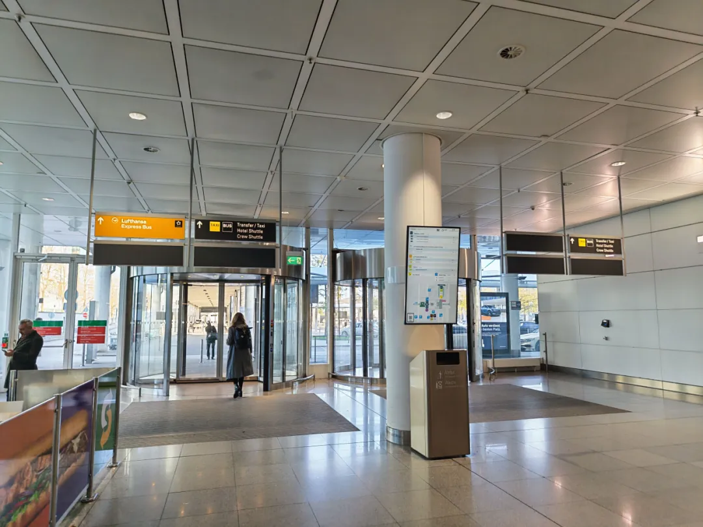
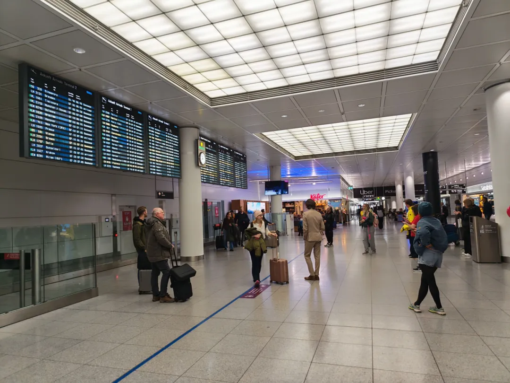

Khi hội thảo München đang đến gần, các đồng nghiệp tự đặt chuyến bay quốc tế nên lưu ý: công ty có xe buýt đưa đón sân bay trong ngày đến. Nếu bạn muốn có chỗ, hãy đọc kỹ điểm tập trung và lịch chạy dưới đây và đừng bỏ lỡ.

## Một lời cảnh báo

Nếu bạn chưa gửi thông tin chuyến bay quốc tế trực tuyến trước hạn chót của công ty, chúng tôi không thể giữ cho bạn một chỗ trên xe buýt đưa đón — chỗ tại chỗ sẽ ưu tiên cho các đồng nghiệp đã đăng ký trước.

## Lịch xe buýt đưa đón ngày đến

> Kế hoạch xe buýt đưa đón có thể được điều chỉnh đôi chút sau khi có đăng ký chuyến bay cuối cùng. Trước khi đi, hãy kiểm tra lịch trực tiếp trong tài khoản chính thức “安利带你看世界”, mục “高级经理研讨会 - 我的 - 班车时刻表” (Hội thảo cấp quản lý cao cấp – Của tôi – Lịch xe buýt đưa đón).

| Nhà ga | Điểm tập trung / khởi hành | Giờ (giờ địa phương München) |
| --- | --- | --- |
| T1 | Tập trung tại màn hình lớn cạnh lối ra B; nhân viên đưa đoàn sang T2 để lên xe | **14:10 / 15:10 / 16:10 / 17:10 / 18:10** (tập trung) |
| T2 | Trước Starbucks ở lối ra khu đến quốc tế | **14:30 / 15:30 / 16:30 / 17:30 / 18:30** (khởi hành) |

### Điểm tập trung tại Nhà ga T1

**Tại màn hình lớn cạnh lối ra B của Nhà ga T1.** Nhân viên cầm biển “美花” sẽ tập hợp đoàn, rồi đưa mọi người sang Nhà ga T2 để lên xe.

- Giờ tập trung tại T1 (giờ địa phương München): **14:10 / 15:10 / 16:10 / 17:10 / 18:10**

### Điểm tập trung tại Nhà ga T2

**Trước Starbucks ở lối ra khu đến quốc tế của Nhà ga T2.**

- Giờ xe khởi hành (giờ địa phương München): **14:30 / 15:30 / 16:30 / 17:30 / 18:30**

### Nơi tra lịch chạy xe

## Những điều cần biết về xe buýt đưa đón

1. Hành khách đi chung xe; xe lần lượt dừng theo nơi mọi người lưu trú — hãy xuống ở khách sạn của bạn. Khi xuống, hãy kiểm tra đã mang đủ hành lý. Nếu chuyến bay của bạn không khớp giờ xe, hãy tự đến khách sạn.
2. Nếu bạn không đăng ký thông tin chuyến bay và tự sắp xếp phương tiện cả hai chiều, lưu ý nhận phòng khách sạn từ 16:00 và trả phòng ngày về trước 11:00.
3. Sân bay München cách các khách sạn trung tâm 35–40 km và mất khoảng 35–50 phút lái xe; taxi khoảng €60–80 một chiều và phần lớn phải trả tiền mặt bằng euro, chỉ một số taxi nhận Visa hoặc Mastercard — hãy mang theo tiền xu và tiền giấy euro. Giao thông München hay tắc, nên theo dõi tình hình trực tiếp và dành đủ thời gian.
4. Xe buýt ngày về sẽ được thông báo trong hội thảo. Nếu có thắc mắc, hãy hỏi nhân viên Amway tại khách sạn.

## Từ sân bay vào trung tâm thành phố

Nếu bạn tự sắp xếp chuyến bay, đây là những cách khác để đến khách sạn trung tâm.

### Taxi

Từ sân bay đến các khách sạn trung tâm là 35–40 km và 35–50 phút; giá một chiều khoảng €60–80. Visa và Mastercard thường được chấp nhận, nhưng hãy mang tiền mặt euro cho tiện (giá chỉ mang tính tham khảo — giá tại chỗ áp dụng).

**T1:** cửa có biển taxi nằm ngay lối ra; bãi taxi ở ngay bên ngoài.

**T2:** từ lối ra, rẽ phải theo biển chỉ dẫn; bãi taxi ở ngay ngoài cửa.

> Trước khi lên xe, hãy xác nhận khách sạn và cách thanh toán với tài xế.

### Gọi xe (Uber)

**Uber** là ứng dụng nên dùng ở München — đặt và trả tiền qua ứng dụng. So với taxi, Uber hiển thị giá ước tính trước khi bạn đặt và tính vào thẻ đã liên kết, phù hợp với du khách không muốn thương lượng địa chỉ và thanh toán tại chỗ; taxi có sẵn và đang chờ, một số nhận thẻ. Đêm muộn hoặc mang nhiều hành lý, hãy kiểm tra loại xe và điểm đón trong ứng dụng trước.

**T1:** cửa có biển taxi nằm ngay lối ra, và ngay bên ngoài là khu đón chung cho cả Uber và taxi — một khu chờ chung, thể hiện trong ảnh taxi ở trên.

**T2:** rẽ trái tại lối ra, nơi có biển Uber; đi ra cửa và điểm đón Uber ở phía trước.

**Cách dùng Uber:**

1. **Mở ứng dụng.** Đảm bảo Uber có quyền truy cập vị trí và đã liên kết thẻ tín dụng hoặc phương thức thanh toán hợp lệ khác, rồi mở ứng dụng và nhấn vào ô nhập trên màn hình chính.

2. **Xác nhận đơn.** Nhập điểm đến, chọn loại xe và xác nhận điểm đón.

3. **Đi đến điểm đón** hiển thị trên đơn và lên xe ở đó.

> Hãy liên kết thẻ tín dụng quốc tế trong Uber trước — giá được tính tự động khi bạn đặt (có thể có phí xuyên biên giới). Giá chuyến chỉ mang tính tham khảo và có thể thay đổi theo giao thông và lộ trình; chuyến đi thực tế mới là điều quyết định.

### S-Bahn

- **Tuyến:** S1 / S8, từ ga ngầm của sân bay
- **Thời gian:** 35–45 phút đến Hauptbahnhof (ga trung tâm)
- **Tần suất:** 10 phút một chuyến
- **Giờ chạy:** 04:00–00:30
- **Giá vé:** €11,20 một lượt; vé ngày €13–€15,50

(Giá vé và thông tin dịch vụ chỉ mang tính tham khảo — hãy kiểm tra tại chỗ.)

**Mua vé tại sân bay:**

1. Tìm máy bán vé — trên đầu máy in dòng “FAHRKARTEN / Tickets / Billets / Biglietti”.
2. Chuyển sang tiếng Anh: nhấn cờ / Change language và chọn English.
3. Chọn “MVV offers” trên màn hình chính.
4. Chọn loại vé: Single ticket hoặc Single day ticket.
5. Chọn vùng **M-5** — giá vé München tính theo vùng; trung tâm là vùng M và sân bay ở vùng 5, nên từ sân bay vào thành phố cần M-5.
6. Chọn số người: Single ticket cho một người, Group ticket cho 2–5 người.
7. Thanh toán và nhận vé cùng hóa đơn — máy thường nhận thẻ tín dụng quốc tế.

**T1:** đi thang cuốn xuống và theo các biển S màu xanh lá đến ga S-Bahn.

**T2:** theo các biển S xanh lá băng qua quảng trường và đi thang cuốn xuống ga.

### Xe buýt Lufthansa Express

- **Tuyến:** Sân bay T1 / T2 → ga trung tâm, dừng tại Schwabing
- **Thời gian:** 40–45 phút (ngoài giờ cao điểm)
- **Tần suất:** 20 phút một chuyến; chuyến từ sân bay 06:30–22:30
- **Giá vé:** €11 mua tại chỗ, €10,5 trực tuyến, €17 khứ hồi

Vé bán trên xe và nhận thẻ tín dụng quốc tế.

**T1:** bãi taxi ngay ngoài cửa; băng qua đường đến làn thứ hai là điểm dừng xe khách.

**T2:** rẽ phải tại lối ra về phía bãi taxi và tiếp tục đi bộ để đến điểm dừng xe khách.

> Một lưu ý nếu bạn chọn cách này đến khách sạn: điểm dừng cách Court Hotel, Rosewood và Charles Hotel một quãng đi bộ, nên bạn có thể phải đi tiếp hoặc bắt taxi. Ngoài ra, theo quy định München, người đi xe đạp trên làn xe đạp không chịu trách nhiệm nếu đâm vào người đi bộ, nên hãy tránh làn xe đạp khi lên xuống xe.

## Kết nối Wi-Fi miễn phí của sân bay

Nếu bạn cần kết nối tại sân bay, mạng miễn phí hoạt động như sau:

1. Chọn mạng “Free Wifi – Munich Airport” và nhấn kết nối.

2. Nhập địa chỉ email, tick vào ô đồng ý và nhấn “Continue”.

3. Nhấn “Go online” và bạn đã kết nối.

## Liên kết liên quan

- **Trên trang này**: [Sân bay München (MUC)](/airport/MUC), [Đức (DE)](/country/DE)
- **Wikipedia**: [Sân bay München](https://en.wikipedia.org/wiki/Munich_Airport)
- **Baidu Baike**: [Sân bay München](https://baike.baidu.com/item/%E6%85%95%E5%B0%BC%E9%BB%91%E6%9C%BA%E5%9C%BA)
- **Trang web sân bay**: [Sân bay München – đến và đi](https://www.munich-airport.com/arrival-and-departure-261432)
- **Thêm bài viết**: [Hướng dẫn trung chuyển Sân bay München](/blog/munich-airport-guide), [Hướng dẫn nhập cảnh và hải quan Sân bay München](/blog/munich-airport-arrival-customs-guide)

Nguồn ảnh: các hình trong bài gốc, từ tài khoản WeChat “安利带你看世界”. Giờ xe, giá vé và điểm đón như ghi nhận khi biên soạn hướng dẫn; hãy kiểm tra thông báo mới nhất của tài khoản chính thức và trang web của sân bay, nhà vận hành vào ngày đi.
