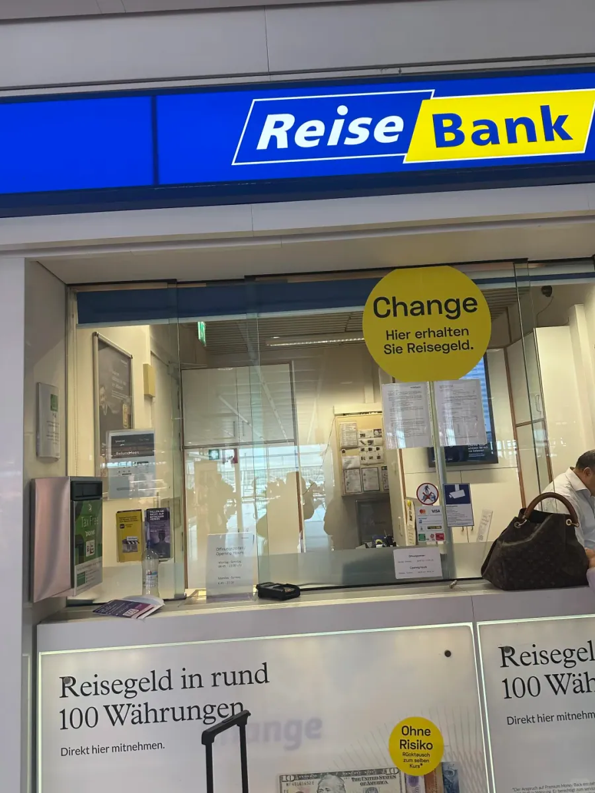

Na vrácení daně na mnichovském letišti je nejméně intuitivní to, že razítko není k dispozici jen na jednom místě. Jedna celní kancelář je před imigrační kontrolou, druhá po pasové kontrole, a výběr špatné strany vás stojí dlouhou cestu zpět. Ti, kdo žádají poprvé, se obávají jazyka, ale cedule i upozornění na přepážkách jsou srozumitelné a Global Blue svůj postup tiskne ve třech krocích a vylepuje ho na pult.

Pro určení trasy platí jediné kritérium: je zboží určené k vrácení daně v odbaveném kufru, nebo v příručním zavazadle? Podle pravidel EU musí celníci zboží vidět, než opustí EU. Jakmile je kufr v odbavovacím systému, už ho neotevřete, takže razítko musí přijít před odbavením; příruční zavazadlo cestuje s vámi, a proto se razítko získává po pasové kontrole.

Následující text probírá oba případy odděleně a poté se věnuje načasování a dokumentům. Uvedená místa vycházejí z žádosti z roku 2026; přepážky se stěhují, proto si před cestou zkontrolujte web letiště.

## 1. Nejprve zjistěte, do kterého ze dvou případů patříte

Odpovězte na to dřív než na cokoli jiného. Kdo to splete, má všechny další kroky obráceně: nechat si orazítkovat odbavené zavazadlo až po pasové kontrole znamená, že celníci kufr neuvidí, a musí vás odmítnout; přinést zboží z příručního zavazadla na kancelář před imigrací znamená, že zboží nemáte u sebe. V praxi leží celní kancelář, přepážka Global Blue a přepážka Reise Bank na malém prostoru a stačí se držet cedulí Zoll/Customs.

| | Případ A: zboží v odbaveném zavazadle | Případ B: zboží v příručním zavazadle |
| --- | --- | --- |
| Kdy získat razítko | Po obdržení palubní vstupenky, před odevzdáním zavazadla | Po bezpečnostní i pasové kontrole |
| Kde | Celní kancelář (Zoll/Customs) vedle fronty na imigrační kontrolu | U **bran H28 a H30**, po pasové kontrole |
| Kam dál | Přepážka Global Blue vedle celní kanceláře | Přepážka Global Blue u brány H30 |
| Hlavní riziko | Zavazadlo je už odbavené a nelze ho zkontrolovat | Nejprve platí limity na tekutiny a ostré předměty |

V obou případech potřebujete totéž: pas, palubní vstupenku, vyplněný formulář, odpovídající účtenky a zboží, které je **nepoužité a stále zapečetěné**. Německá DPH u většiny zboží činí 19 %, ale 19 % nedostanete: společnost vracející daň si účtuje poplatek a částka vytištěná na formuláři je ta, kterou dostanete.

Je tu ještě jedno pravidlo, na které lidé zapomínají: nárok na vrácení daně vzniká v místě, kde naposledy opouštíte EU. Letíte-li domů z Mnichova, žádáte v Mnichově; pokud přestupujete v jiné schengenské zemi, razítko patří tomu poslednímu letišti.

## 2. Před odbavením: celní razítko

Trasa s odbaveným zavazadlem má pevný sled: odbavte se a získejte palubní vstupenku, ale **zavazadlo neodevzdávejte**. Upozornění Global Blue to říká přímo — vezměte si štítek na zavazadlo, ale neodevzdávejte ho. Celníci musí formulář porovnat se zbožím, a jakmile je kufr na pásu, už ho neotevřete.

Celní kancelář (Zoll/Customs) je vedle fronty na imigrační kontrolu: po její pravé straně, když k ní jdete, což znamená **po vaší levici, když stojíte čelem k imigračním přepážkám**. Stejné místo, jiné otočení. Hledejte ceduli Zoll a krátkou frontu lidí s formuláři a pasy.

Autorem zakoupené zboží mělo nízkou hodnotu, celníci nepožádali o otevření kufru a razítko bylo otázkou okamžiku. To ale není záruka: úředníci si mohou vyžádat prohlídku zboží, proto ho nezakládejte na dno kufru a nerozbíjejte obal.

Když máte razítko, odneste formulář Global Blue k přepážce Global Blue vpravo od celní kanceláře, pak se dejte doleva a znovu doleva podle cedulí. Mnozí lidé končí příliš brzy: myslí si, že razítkem je hotovo, ale neorazítkované odevzdání znamená žádné peníze.

Global Blue není jediným formulářem v oběhu. Vedle přepážky visí zelená schránka Planet Tax Free a na její přední straně je seznam, co musí obálka obsahovat: celní razítko, celé jméno, adresu a číslo pasu, číslo karty a originál účtenky. Ostatní provozovatelé fungují stejně, jen formulář přijímá jiná přepážka.

Vlastní upozornění Global Blue zkracuje trasu na tři kroky: odbavte se a vezměte si štítek na zavazadlo, ale zavazadlo neodevzdávejte; odneste označené zavazadlo k celní přepážce hned za pultem; poté se vraťte pro vrácení daně, jakmile je formulář orazítkován.

## 3. Po pasové kontrole: celní kancelář u H30

Příruční zavazadlo jde jinou trasou. „Odlet“ zde nastává dvakrát: nejprve bezpečnostní kontrola a kontrola zavazadel, poté pasová kontrola. Řada cestujících se domnívá, že po bezpečnostní kontrole je papírování u konce, a na vrácení daně si vzpomenou až u brány, což znamená jít celou cestu zpět.

Správný sled: projděte pasovou kontrolou, zamířete k bráně H30 a těsně před bránou je vpravo krátká chodba, na jejímž konci je celní kancelář (Zoll/Customs). Cedule není velká, hledejte modrý panel Zoll a odbočte.

Zboží z příručního zavazadla autora také neotevřeli, ze stejného důvodu — nízké jednotkové ceny. S hotovým razítkem jde formulář Global Blue k přepážce u brány H30; formuláře jiných společností jdou k Reise Bank vedle.

Upozornění společnosti je o geografii přesnější: celní kancelář pro příruční zavazadla je po pasové kontrole, uvnitř nebo naproti **bráně H28**; kancelář Global Blue je u **brány H30**; Planet Tax Free a Reise Bank jsou také v prostoru H30. H28 a H30 jsou sousední brány, takže vás tam dovede kterákoli cedule.

## 4. Global Blue, Planet a Reise Bank

Mnichovské přepážky pro vrácení daní jsou organizované podle společností, takže záleží na tom, které přepážce formulář odevzdáte — podle loga vytištěného na formuláři. Každá výplata má také svůj kompromis: hotovost je okamžitá, ale měna a kurz vám nemusí vyhovovat, zatímco vrácení na kartu nebo přes Alipay dorazí pomaleji, ale obvykle vám z částky zůstane víc.

| Společnost | Kam odevzdat formulář | Typická výplata |
| --- | --- | --- |
| Global Blue | Vedle celní kanceláře (odbavená zavazadla) nebo u brány H30 (příruční zavazadla) | Karta nebo digitální peněženka, jak uvádí upozornění |
| Planet Tax Free | Přepážka Reise Bank v prostoru H30 | Hotovost, Alipay nebo karta, dle volby na přepážce |
| Ostatní provozovatelé (např. Easy Tax Free) | Přepážka Reise Bank v prostoru H30 | Jak výše, registrace na přepážce |

Reise Bank je německý řetězec směnáren; na letišti je to polootevřená přepážka se žlutým kruhovým emblémem Change na skle. Vyplácejí se zde hotovostní vrácení daní a přepážka obvykle drží jen několik měn, proto se zeptejte, kterou můžete dostat.

Vyplňte na formuláři všechno — číslo karty, účet Alipay, podpis — protože chybějící údaj znamená další frontu.

Co je třeba poslat poštou, patří do schránky; autor použil tu vlevo, blízko přepážky, a formulář nejprve vyfotil.

## 5. Načasování a co si vzít

Když dodržíte správný sled, čas vyjde. S odbavenými zavazadly: odbavte se pro palubní vstupenku, získejte celní razítko, vraťte se odevzdat zavazadlo, projděte bezpečnostní a pasovou kontrolou a pak jděte k bráně. S příručním zavazadlem: odbavte se a odevzdejte zavazadlo, projděte bezpečnostní a pasovou kontrolou, získejte razítko u H28/H30, odevzdejte formulář a pošlete, co je třeba. V obou případech dorazte **tři hodiny** před mezinárodním letem.

Kontrolní seznam: pas, palubní vstupenka, vyplněný formulář, účtenky, zapečetěné zboží a kreditní karta nebo aktivní účet Alipay pro přijetí peněz. Zboží a účtenky musí souhlasit a jméno, číslo pasu ani datum opuštění EU nesmí zůstat prázdné.

Čtyři chyby, kterým stojí za to se vyhnout: odevzdat zavazadlo před získáním razítka; zboží použít nebo rozpečetit; získat razítko, ale formulář nikdy neodevzdat; a domnívat se, že daň se žádá tam, kde jste zboží koupili, když patří poslednímu místu odletu z EU.

Jak dlouho peníze trvají, závisí na společnosti a způsobu výplaty — obvykle několik týdnů, proto si účtenku a referenční číslo schovejte, dokud peníze nedorazí. Umístění přepážek a pravidla společností se mění, takže v daný den zkontrolujte web mnichovského letiště, celní úřad a společnost vracející daň.

## Související odkazy

- **Na tomto webu**: [Letiště Mnichov (MUC)](/airport/MUC), [Německo (DE)](/country/DE)
- **Wikipedia**: [Munich Airport](https://en.wikipedia.org/wiki/Munich_Airport)
- **Baidu Baike**: [Munich Airport](https://baike.baidu.com/item/%E6%85%95%E5%B0%BC%E9%BB%91%E6%9C%BA%E5%9C%BA)
