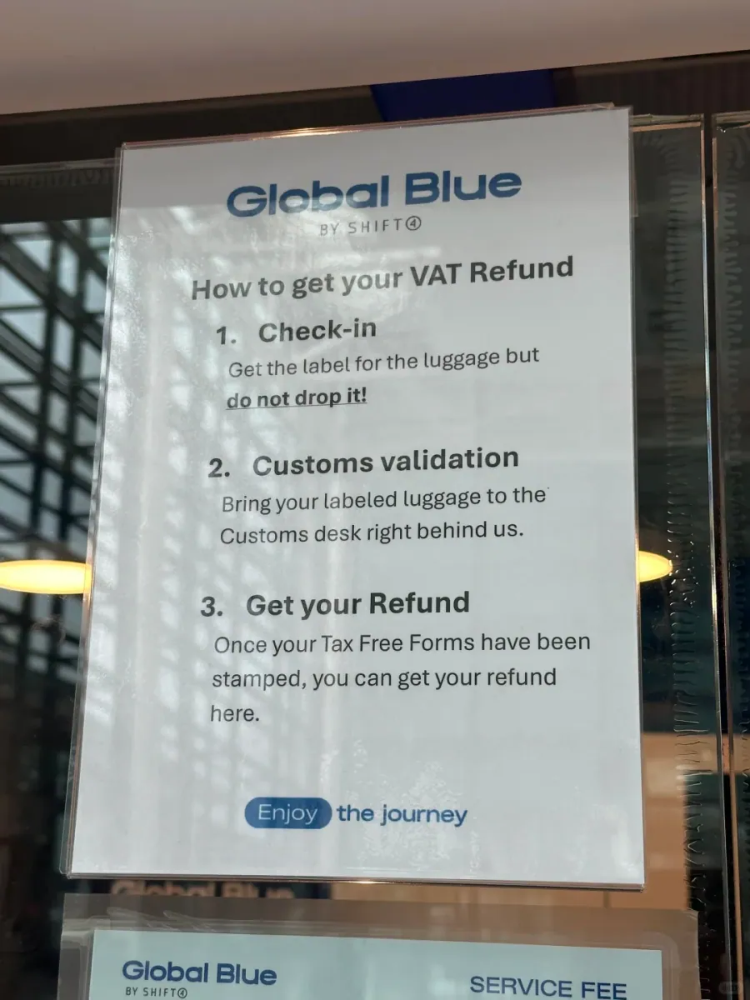

म्यूनिख एयरपोर्ट पर टैक्स रिफंड की उल्टी लगने वाली बात यह है कि मोहर सिर्फ़ एक जगह नहीं मिलती। एक कस्टम कार्यालय इमिग्रेशन से पहले है, दूसरा पासपोर्ट नियंत्रण के बाद, और गलत तरफ़ चुनने पर आपको लंबा रास्ता वापस चलना पड़ता है। पहली बार रिफंड लेने वाले भाषा की चिंता करते हैं, लेकिन साइनबोर्ड और काउंटर की सूचनाएँ स्पष्ट हैं, और Global Blue अपनी प्रक्रिया तीन चरणों में छापकर डेस्क पर लगाता है।

कौन-सा रास्ता लागू होगा, इसकी जाँच सिर्फ़ एक है: रिफंड योग्य वस्तुएँ आपके चेक-इन सूटकेस में हैं या हैंड लगेज में? यूरोपीय संघ के नियमों के अनुसार वस्तुओं को यूरोपीय संघ से बाहर जाने से पहले कस्टम को देखना होता है। सूटकेस बैगेज प्रणाली में जाने के बाद आप उसे दोबारा नहीं खोल सकते, इसलिए मोहर चेक-इन से पहले ही लगवानी होती है; हैंड लगेज आपके साथ चलता है, इसलिए उसकी मोहर पासपोर्ट नियंत्रण के बाद लगती है।

आगे दोनों स्थितियों को अलग-अलग समझाया गया है, फिर समय और कागज़ी प्रक्रिया पर बात की गई है। नीचे दिए स्थान 2026 के एक दावे से हैं; काउंटर बदलते रहते हैं, इसलिए यात्रा से पहले एयरपोर्ट की वेबसाइट देखें।

## 1. पहले तय करें कि आप दोनों में से किस स्थिति में हैं

यह सबसे पहले तय करें। गलती हुई तो हर अगला कदम उलटा हो जाएगा: चेक-इन बैग की मोहर पासपोर्ट नियंत्रण के बाद तक टाल दी, तो कस्टम सूटकेस देख नहीं सकता और मना कर देगा; हैंड लगेज की वस्तुएँ इमिग्रेशन से पहले वाले कार्यालय में ले गए, तो वस्तुएँ आपके साथ ही नहीं हैं। व्यवहार में कस्टम कार्यालय, Global Blue डेस्क और Reise Bank काउंटर एक छोटे से क्षेत्र में हैं, और Zoll/Customs के साइनबोर्ड का पालन ही काफ़ी है।

| | स्थिति A: चेक-इन बैगेज में वस्तुएँ | स्थिति B: हैंड लगेज में वस्तुएँ |
| --- | --- | --- |
| मोहर कब लगवाएँ | बोर्डिंग पास मिलने के बाद, बैग छोड़ने से पहले | सुरक्षा जाँच और पासपोर्ट नियंत्रण दोनों के बाद |
| कहाँ | इमिग्रेशन कतार के बगल में कस्टम कार्यालय (Zoll/Customs) | पासपोर्ट नियंत्रण के बाद, **गेट H28 और H30** के पास |
| इसके बाद कहाँ | कस्टम कार्यालय के बगल में Global Blue डेस्क | गेट H30 के पास Global Blue काउंटर |
| मुख्य जोखिम | बैग पहले ही चेक-इन हो चुका है और उसकी जाँच नहीं हो सकती | पहले तरल पदार्थ और नुकीली वस्तुओं की सीमाएँ लागू होती हैं |

दोनों स्थितियों में एक ही चीज़ें चाहिए: पासपोर्ट, बोर्डिंग पास, भरा हुआ फ़ॉर्म, उससे मेल खाती रसीदें, और **अप्रयुक्त और अभी भी सीलबंद** वस्तुएँ। अधिकतर वस्तुओं पर जर्मन वैट 19% है, पर आपको 19% नहीं मिलता: रिफंड कंपनी शुल्क लेती है, और फ़ॉर्म पर छपी राशि ही आपको मिलती है।

एक और नियम लोगों को चौंका देता है: रिफंड उस जगह का होता है जहाँ से आप आख़िरी बार यूरोपीय संघ छोड़ते हैं। म्यूनिख से घर की उड़ान भर रहे हैं तो दावा म्यूनिख में करें; अगर किसी और शेंगेन देश में विमान बदलते हैं, तो मोहर उस आख़िरी एयरपोर्ट की होगी।

## 2. चेक-इन से पहले: कस्टम की मोहर

चेक-इन बैग वाले रास्ते का क्रम तय है: चेक-इन करें और बोर्डिंग पास लें, पर **बैग मत छोड़ें**। Global Blue की सूचना सीधे शब्दों में कहती है — सामान का लेबल लें, पर उसे छोड़ें नहीं। कस्टम को फ़ॉर्म और वस्तुओं का मेल देखना होता है, और सूटकेस कन्वेयर बेल्ट पर जाने के बाद आप उसे दोबारा नहीं खोलेंगे।

कस्टम कार्यालय (Zoll/Customs) इमिग्रेशन कतार के बगल में है: जैसे-जैसे आप उसकी ओर बढ़ते हैं वह दाईं ओर आता है, यानी **इमिग्रेशन डेस्क की ओर मुँह करके खड़े होने पर वह आपके बाएँ** है। जगह एक ही, दिशा का फ़र्क़। Zoll का साइनबोर्ड और फ़ॉर्म-पासपोर्ट लिए लोगों की छोटी कतार देखें।

लेखक की खरीदारी कम मूल्य की थी, कस्टम ने केस खोलने को नहीं कहा, और मोहर पल भर में लग गई। यह कोई गारंटी नहीं है: अधिकारी वस्तुएँ देखने को कह सकते हैं, इसलिए उन्हें सूटकेस के तल में मत दबाएँ और पैकेजिंग मत तोड़ें।

मोहर लगने के बाद Global Blue का फ़ॉर्म कस्टम कार्यालय के दाईं ओर वाले Global Blue डेस्क पर दें, फिर बाएँ मुड़ें, और साइनबोर्ड देखते हुए फिर बाएँ। बहुत लोग बहुत जल्दी रुक जाते हैं: उन्हें लगता है कि मोहर से काम हो गया, पर बिना मोहर लगाए फ़ॉर्म जमा करने पर पैसे नहीं मिलते।

Global Blue ही एकमात्र चालू फ़ॉर्म नहीं है। काउंटर के बगल में हरा Planet Tax Free ड्रॉप बॉक्स लटका है, और उसके सामने लिखा है कि लिफ़ाफ़े में क्या होना चाहिए: कस्टम की मोहर, आपका पूरा नाम, पता और पासपोर्ट नंबर, कार्ड नंबर, और मूल रसीद। अन्य ऑपरेटर भी इसी तरह काम करते हैं, बस फ़ॉर्म अलग काउंटर पर जमा होता है।

Global Blue की अपनी सूचना इस रास्ते को तीन चरणों में समेटती है: चेक-इन करें और बैग का लेबल लें पर बैग मत छोड़ें; लेबल लगा सामान काउंटर के ठीक पीछे वाले कस्टम डेस्क तक ले जाएँ; फिर फ़ॉर्म पर मोहर लगने के बाद रिफंड के लिए वापस आएँ।

## 3. पासपोर्ट नियंत्रण के बाद: H30 पर कस्टम कार्यालय

हैंड लगेज दूसरा रास्ता लेता है। यहाँ "निकलना" दो बार होता है: पहले सुरक्षा जाँच और बैग की जाँच, फिर पासपोर्ट नियंत्रण। बहुत से यात्री मान लेते हैं कि सुरक्षा जाँच के बाद कागज़ी काम ख़त्म और रिफंड की याद गेट पर आती है, जिसका मतलब है पूरा रास्ता वापस चलना।

सही क्रम: पासपोर्ट नियंत्रण पार करें, गेट H30 की ओर बढ़ें, और गेट से ठीक पहले दाईं ओर एक छोटा कॉरिडोर है जिसके अंत में Zoll/Customs कार्यालय है। साइनबोर्ड बड़ा नहीं है, इसलिए नीला Zoll पैनल देखें और अंदर मुड़ें।

लेखक के हैंड लगेज की वस्तुएँ भी उसी कारण — कम इकाई मूल्य — दोबारा नहीं खोली गईं। मोहर लगने के बाद Global Blue का फ़ॉर्म गेट H30 के पास वाले काउंटर पर जाता है; दूसरी कंपनियों के फ़ॉर्म बगल में Reise Bank पर जाते हैं।

कंपनी की सूचना जगह के बारे में अधिक सटीक है: हैंड लगेज का कस्टम कार्यालय पासपोर्ट नियंत्रण के बाद, **गेट H28** के अंदर या उसके सामने है; Global Blue का कार्यालय **गेट H30** पर है; Planet Tax Free और Reise Bank भी H30 क्षेत्र में हैं। H28 और H30 बगल के गेट हैं, इसलिए कोई भी साइनबोर्ड आपको वहाँ पहुँचा देगा।

## 4. Global Blue, Planet और Reise Bank

म्यूनिख के रिफंड डेस्क कंपनी के अनुसार बँटे हैं, इसलिए कौन-सा काउंटर जाएँगे यह आपके फ़ॉर्म पर छपे लोगो पर निर्भर है। हर भुगतान का अपना फ़ायदा-नुकसान भी है: नकद तुरंत मिलता है पर मुद्रा और दर आपके अनुकूल न हों, जबकि कार्ड या Alipay में रिफंड धीरे आता है पर आमतौर पर रकम का अधिक हिस्सा बचता है।

| कंपनी | फ़ॉर्म कहाँ जमा करें | सामान्य भुगतान |
| --- | --- | --- |
| Global Blue | कस्टम कार्यालय के बगल में (चेक-इन बैग) या गेट H30 के पास (हैंड लगेज) | कार्ड या डिजिटल वॉलेट, जैसा सूचना में लिखा है |
| Planet Tax Free | H30 क्षेत्र में Reise Bank काउंटर | नकद, Alipay या कार्ड, काउंटर पर चुनें |
| अन्य ऑपरेटर (जैसे Easy Tax Free) | H30 क्षेत्र में Reise Bank काउंटर | ऊपर जैसा, काउंटर पर पंजीकरण करें |

Reise Bank जर्मनी की मुद्रा-विनिमय शृंखला है; एयरपोर्ट पर यह आधा खुला काउंटर है जिसके शीशे पर पीला Change राउंडल है। यहीं नकद रिफंड मिलते हैं, और काउंटर पर आमतौर पर कुछ ही मुद्राएँ होती हैं, इसलिए पूछ लें कि आपको कौन-सी मिल सकती है।

फ़ॉर्म पर सब कुछ भरें — कार्ड नंबर, Alipay खाता, हस्ताक्षर — क्योंकि कोई भी खाली जगह छूटी तो दोबारा कतार में लगना पड़ेगा।

जो कुछ डाक से भेजना हो वह मेलबॉक्स में डालें; लेखक ने काउंटर के पास बाईं ओर वाला मेलबॉक्स इस्तेमाल किया और पहले फ़ॉर्म की फ़ोटो ली।

## 5. समय और क्या साथ रखें

क्रम सही रखें तो समय निकल आता है। चेक-इन बैग के साथ: बोर्डिंग पास के लिए चेक-इन करें, कस्टम की मोहर लगवाएँ, बैग छोड़ने के लिए लौटें, सुरक्षा जाँच और पासपोर्ट नियंत्रण पार करें, फिर गेट पर जाएँ। हैंड लगेज के साथ: चेक-इन करें और बैग छोड़ें, सुरक्षा जाँच और पासपोर्ट नियंत्रण पार करें, H28/H30 के पास मोहर लगवाएँ, फ़ॉर्म जमा करें और जो ज़रूरी हो डाक से भेजें। दोनों ही स्थितियों में अंतरराष्ट्रीय उड़ान से **तीन घंटे** पहले पहुँचें।

जाँच-सूची: पासपोर्ट, बोर्डिंग पास, भरा हुआ फ़ॉर्म, रसीदें, सीलबंद वस्तुएँ, और पैसे लेने के लिए क्रेडिट कार्ड या सक्रिय Alipay खाता। वस्तुएँ और रसीदें मेल खानी चाहिए, और नाम, पासपोर्ट नंबर तथा यूरोपीय संघ छोड़ने की तारीख़ खाली नहीं छोड़ी जा सकती।

चार गलतियाँ जिनसे बचना चाहिए: मोहर से पहले बैग छोड़ देना; वस्तुओं का इस्तेमाल करना या सील खोलना; मोहर लगवाकर फ़ॉर्म कभी जमा न करना; और यह मानना कि रिफंड वहीं लेना है जहाँ से वस्तुएँ खरीदी थीं, जबकि वह आपके यूरोपीय संघ से आख़िरी बार निकलने की जगह का होता है।

पैसे आने में कितना समय लगेगा यह कंपनी और भुगतान के तरीके पर निर्भर है — आमतौर पर कुछ हफ़्ते, इसलिए रसीद और संदर्भ संख्या पैसे आने तक रखें। काउंटरों की जगहें और कंपनियों के नियम बदलते रहते हैं, इसलिए उसी दिन म्यूनिख एयरपोर्ट की वेबसाइट, कस्टम प्राधिकरण और रिफंड कंपनी से जाँच लें।

## संबंधित लिंक

- **इस साइट पर:** [म्यूनिख एयरपोर्ट (MUC)](/airport/MUC), [जर्मनी (DE)](/country/DE)
- **विकिपीडिया:** [म्यूनिख एयरपोर्ट](https://en.wikipedia.org/wiki/Munich_Airport)
- **Baidu Baike:** [म्यूनिख एयरपोर्ट](https://baike.baidu.com/item/%E6%85%95%E5%B0%BC%E9%BB%91%E6%9C%BA%E5%9C%BA)
