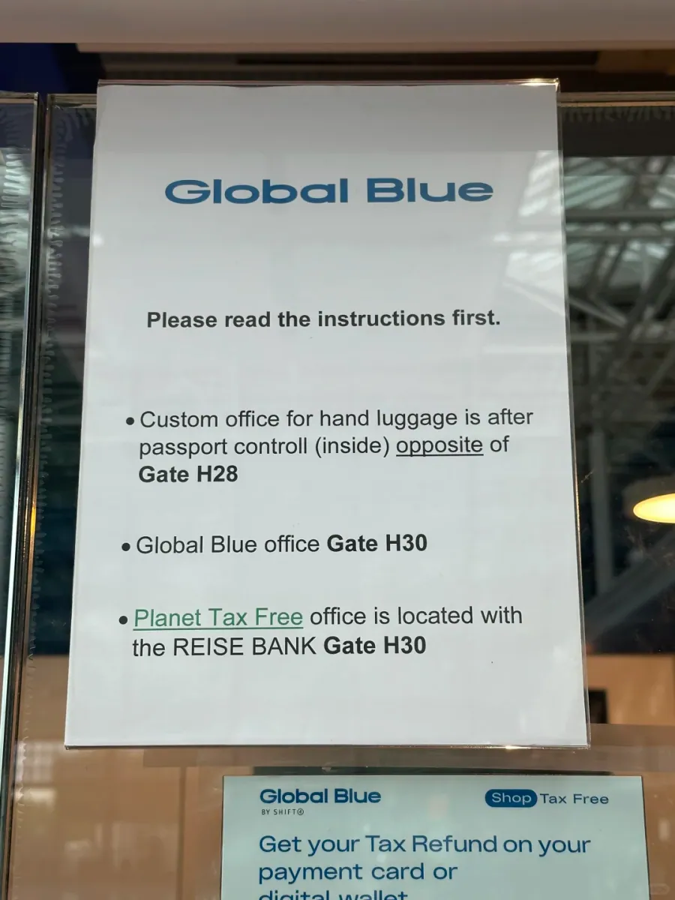

Het tegenintuïtieve aan belasting terugvragen op Luchthaven München is dat de stempel niet op één plek te krijgen is. Het ene douanekantoor zit vóór de immigratie, het andere na de paspoortcontrole, en kies je de verkeerde kant, dan kost dat een lange wandeling terug. Wie voor het eerst terugvraagt, maakt zich zorgen over de taal, maar de bewegwijzering en de aanwijzingen bij de balie zijn duidelijk, en Global Blue drukt zijn proces af als drie stappen en plakt dat op de balie.

Er is maar één criterium voor welke route geldt: zitten de goederen waarvoor je terugvraagt in je ingecheckte koffer of in je handbagage? EU-regels vereisen dat de douane de goederen ziet voordat ze de EU verlaten. Zodra een koffer in het bagagesysteem zit, kun je hem niet meer openen, dus de stempel moet vóór het inchecken gebeuren; handbagage reist met je mee, dus die stempel komt na de paspoortcontrole.

Hierna komen de twee gevallen apart aan bod, daarna de timing en de papieren. De onderstaande posities komen uit een terugvordering uit 2026; balies verhuizen, dus controleer de website van de luchthaven voordat je reist.

## 1. Bepaal eerst in welk van de twee gevallen je zit

Beantwoord dit vóór alles. Heb je het fout, dan keert elke volgende stap om: wacht je met de stempel voor ruimbagage tot na de paspoortcontrole, dan kan de douane de koffer niet zien en moet ze weigeren; neem je goederen uit handbagage mee naar het kantoor vóór de immigratie, dan zijn de goederen er niet bij. In de praktijk liggen het douanekantoor, de Global Blue-balie en de Reise Bank-balie binnen een klein gebied, en volstaat het de borden Zoll/Customs te volgen.

| | Geval A: goederen in ruimbagage | Geval B: goederen in handbagage |
| --- | --- | --- |
| Wanneer de stempel | Na de instapkaart, vóór het afgeven van de koffer | Na zowel de veiligheidscontrole als de paspoortcontrole |
| Waar | Het douanekantoor (Zoll/Customs) naast de immigratierij | Bij **gates H28 en H30**, na de paspoortcontrole |
| Waar daarna | De Global Blue-balie naast het douanekantoor | De Global Blue-balie bij gate H30 |
| Belangrijkste risico | De koffer is al ingecheckt en kan niet worden geïnspecteerd | Eerst gelden de beperkingen voor vloeistoffen en scherpe voorwerpen |

Beide gevallen vragen hetzelfde: paspoort, instapkaart, een ingevuld formulier, de bijbehorende bonnen en goederen die **ongebruikt en nog verzegeld** zijn. De Duitse btw op de meeste goederen is 19%, maar je krijgt geen 19%: het teruggaafbedrijf rekent kosten, en het bedrag dat op het formulier staat, is wat je krijgt.

Nog een regel die mensen verrast: de teruggaaf hoort bij de plek waar je de EU voor het laatst verlaat. Vlieg je vanuit München naar huis, dan vraag je in München terug; stap je in een ander Schengenland over, dan hoort de stempel bij die laatste luchthaven.

## 2. Vóór het inchecken: de douanestempel

De route voor ruimbagage heeft een vaste volgorde: check in en haal de instapkaart, maar **geef de koffer niet af**. De mededeling van Global Blue is onomwonden — vraag het bagagelabel aan, maar geef de koffer niet af. De douane moet het formulier aan de goederen kunnen koppelen, en zodra de koffer op de band ligt, open je hem niet meer.

Het douanekantoor (Zoll/Customs) ligt naast de immigratierij: rechts ervan als je erheen loopt, wat betekent **aan je linkerkant zodra je met je gezicht naar de immigratiebalies staat**. Dezelfde plek, andere draai. Zoek het Zoll-bord en een korte rij mensen met formulieren en paspoorten.

De aankopen van de auteur waren van lage waarde, de douane vroeg niet om de koffer te openen, en de stempel was zo gebeurd. Dat is geen garantie: ambtenaren kunnen vragen de goederen te zien, dus stop ze niet onderin de koffer en maak de verpakking niet open.

Met de stempel op zak geef je het Global Blue-formulier af bij de Global Blue-balie rechts van het douanekantoor, sla dan linksaf, en nog eens linksaf, de borden volgend. Veel mensen stoppen te vroeg: ze denken dat de stempel het werk heeft gedaan, maar een formulier zonder stempel inleveren betekent geen geld.

Global Blue is niet het enige formulier in omloop. Naast de balie hangt een groene inwerpbrievenbus van Planet Tax Free, en op de voorkant staat wat de envelop moet bevatten: een douanestempel, je volledige naam, adres en paspoortnummer, het kaartnummer en de originele bon. Andere exploitanten werken hetzelfde, met een andere balie die het formulier inneemt.

De eigen mededeling van Global Blue reduceert de route tot drie stappen: check in en neem het bagagelabel mee, maar geef de koffer niet af; breng de gelabelde bagage naar de douanebalie direct achter de balie; kom dan terug voor de teruggaaf zodra het formulier is afgestempeld.

## 3. Na de paspoortcontrole: het douanekantoor bij H30

Handbagage volgt de andere route. "Vertrekken" gebeurt hier twee keer: eerst de veiligheidscontrole en bagagecontrole, dan de paspoortcontrole. Veel reizigers denken dat de papieren na de veiligheidscontrole klaar zijn en denken pas bij de gate aan de teruggaaf, wat betekent dat ze helemaal terug moeten lopen.

De juiste volgorde: door de paspoortcontrole, richting gate H30, en vlak voor de gate is er rechts een korte gang waar aan het eind het Zoll/Customs-kantoor zit. Het bord is niet groot, dus zoek het blauwe Zoll-paneel en sla daar in.

De goederen in de handbagage van de auteur werden opnieuw niet geopend, om dezelfde reden — lage stukprijzen. Met de stempel geregeld gaat het Global Blue-formulier naar de balie bij gate H30; formulieren van andere bedrijven gaan naar de Reise Bank ernaast.

De mededeling van het bedrijf is preciezer over de geografie: het douanekantoor voor handbagage ligt na de paspoortcontrole, in of tegenover **gate H28**; het Global Blue-kantoor ligt bij **gate H30**; Planet Tax Free en Reise Bank zitten ook in het H30-gebied. H28 en H30 zijn aangrenzende gates, dus met elk van beide borden kom je er.

## 4. Global Blue, Planet en Reise Bank

De teruggaafbalies in München zijn per bedrijf georganiseerd, dus welke balie je bezoekt, hangt af van het logo op je formulier. Elke uitbetaling heeft ook haar eigen afweging: contant geld is direct, maar de valuta en de koers passen misschien niet bij je, terwijl een terugbetaling op kaart of via Alipay langzamer binnenkomt maar meestal meer van het bedrag overhoudt.

| Bedrijf | Waar je het formulier inlevert | Gebruikelijke uitbetaling |
| --- | --- | --- |
| Global Blue | Naast het douanekantoor (ruimbagage) of bij gate H30 (handbagage) | Kaart of digitale wallet, zoals op de mededeling staat |
| Planet Tax Free | Reise Bank-balie in het H30-gebied | Contant, Alipay of kaart, gekozen aan de balie |
| Andere exploitanten (bijv. Easy Tax Free) | Reise Bank-balie in het H30-gebied | Zoals hierboven, aangemeld aan de balie |

Reise Bank is een Duitse wisselketen; op de luchthaven is het een halfopen balie met een gele Change-roundel op het glas. Contante teruggaven worden hier afgehandeld, en de balie heeft meestal maar een paar valuta's in voorraad, dus vraag welke je kunt krijgen.

Vul alles op het formulier in — kaartnummer, Alipay-account, handtekening — want een ontbrekend veld betekent opnieuw in de rij.

Alles wat per post moet, gaat in de brievenbus; de auteur gebruikte die aan de linkerkant, dicht bij de balie, en fotografeerde het formulier eerst.

## 5. Timing en wat je meeneemt

Zet de volgorde goed en de tijd klopt. Met ruimbagage: check in voor de instapkaart, haal de douanestempel, ga terug om de koffer af te geven, door de veiligheids- en paspoortcontrole, en ga dan naar de gate. Met handbagage: check in en geef de koffer af, door de veiligheids- en paspoortcontrole, haal de stempel bij H28/H30, lever het formulier in en post wat nodig is. Kom in beide gevallen **drie uur** voor een internationale vlucht.

De checklist: paspoort, instapkaart, ingevuld formulier, bonnen, verzegelde goederen en een creditcard of een actief Alipay-account om het geld te ontvangen. De goederen en bonnen moeten overeenkomen, en naam, paspoortnummer en datum van vertrek uit de EU mogen niet leeg blijven.

Vier fouten die je beter kunt vermijden: de koffer afgeven vóór de stempel; de goederen gebruiken of de verzegeling verbreken; de stempel halen maar het formulier nooit inleveren; en aannemen dat je de teruggaaf moet claimen waar je de goederen hebt gekocht, terwijl die bij je laatste vertrekpunt uit de EU hoort.

Hoe lang het geld erover doet, hangt af van het bedrijf en de uitbetalingsmethode — meestal een paar weken, dus bewaar de bon en het referentienummer tot het geld binnen is. Balieposities en bedrijfsregels veranderen, dus controleer op de dag zelf de website van Luchthaven München, de douaneautoriteit en het teruggaafbedrijf.

## Gerelateerde links

- **Op deze site**: [Luchthaven München (MUC)](/airport/MUC), [Duitsland (DE)](/country/DE)
- **Wikipedia**: [Luchthaven München](https://en.wikipedia.org/wiki/Munich_Airport)
- **Baidu Baike**: [Luchthaven München](https://baike.baidu.com/item/%E6%85%95%E5%B0%BC%E9%BB%91%E6%9C%BA%E5%9C%BA)
