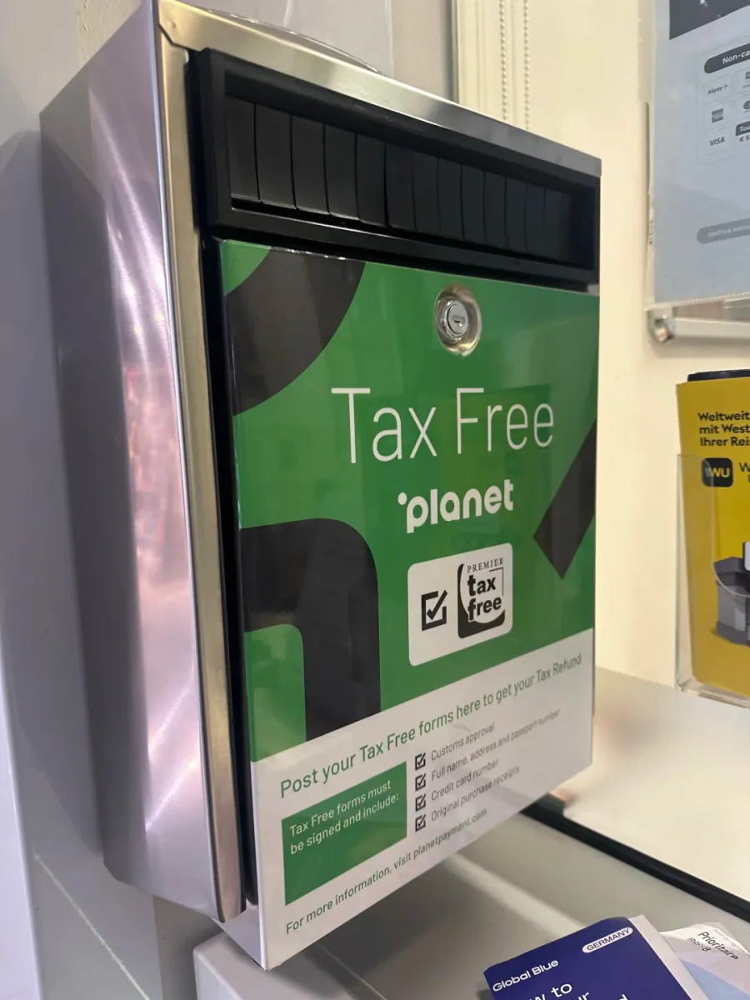

В возврате налога в аэропорту Мюнхена с первого взгляда противоречит логике то, что штамп можно получить не в одном месте. Одна таможенная контора находится до паспортного контроля, другая — после него, и ошибка со стороной стоит долгой дороги назад. Те, кто оформляет возврат впервые, переживают из-за языка, но указатели и объявления на стойках понятны, а Global Blue печатает свой процесс в три шага и приклеивает его на стойку.

Есть только один критерий выбора маршрута: возвращаемые товары лежат в зарегистрированном чемодане или в ручной клади? Правила ЕС требуют, чтобы таможня увидела товары до их вывоза из ЕС. Как только чемодан попал в багажную систему, открыть его уже нельзя, поэтому штамп нужно получить до регистрации; ручная кладь летит с вами, поэтому её штампуют после паспортного контроля.

Далее два случая разобраны отдельно, затем речь пойдёт о времени и документах. Расположение ниже — по опыту оформления в 2026 году; стойки переезжают, поэтому перед поездкой проверьте сайт аэропорта.

## 1. Сначала определите, к какому из двух случаев вы относитесь

Ответьте на этот вопрос прежде всего остального. Ошибётесь — и все последующие шаги перевернутся: отложите штамп для зарегистрированного багажа до паспортного контроля, и таможня не увидит чемодан, поэтому будет вынуждена отказать; принесёте товары из ручной клади в контору до паспортного контроля, и товаров при вас не будет. На практике таможенная контора, стойка Global Blue и стойка Reise Bank находятся в пределах небольшой зоны, и достаточно идти по указателям Zoll/Customs.

| | Случай A: товары в зарегистрированном багаже | Случай B: товары в ручной клади |
| --- | --- | --- |
| Когда получать штамп | После получения посадочного талона, до сдачи чемодана | После предполётного досмотра и паспортного контроля |
| Где | Таможенная контора (Zoll/Customs) рядом с очередью на паспортный контроль | Возле **выходов H28 и H30**, после паспортного контроля |
| Куда дальше | Стойка Global Blue рядом с таможенной конторой | Стойка Global Blue возле выхода H30 |
| Главный риск | Чемодан уже сдан и не может быть досмотрен | Сначала действуют ограничения на жидкости и острые предметы |

В обоих случаях нужно одно и то же: паспорт, посадочный талон, заполненная форма, соответствующие чеки и товары, которые **не использовались и остаются запечатанными**. НДС в Германии на большинство товаров составляет 19%, но 19% вы не получите: компания возврата берёт комиссию, и сумма, напечатанная в форме, — это то, что вы получите.

Ещё одно правило, на котором часто попадаются: возврат привязан к пункту, где вы в последний раз покидаете ЕС. Летите домой из Мюнхена — оформляете возврат в Мюнхене; если пересаживаетесь в другой стране Шенгена, штамп относится к последнему аэропорту.

## 2. До регистрации: таможенный штамп

У маршрута с зарегистрированным багажом фиксированный порядок: зарегистрируйтесь и получите посадочный талон, но **не сдавайте чемодан**. Объявление Global Blue говорит прямо: получите бирку для багажа, но не сдавайте его. Таможня должна сверить форму с товарами, а как только чемодан окажется на ленте, открыть его уже не получится.

Таможенная контора (Zoll/Customs) находится рядом с очередью на паспортный контроль: справа от неё, если идти к ней, то есть **слева, если стоять лицом к стойкам паспортного контроля**. Одно и то же место, но поворот другой. Ищите знак Zoll и короткую очередь из людей с формами и паспортами.

Покупки автора были недорогими, таможня не просила открывать чемодан, и штамп поставили за минуту. Это не гарантия: сотрудники могут попросить показать товары, поэтому не зарывайте их на дно чемодана и не вскрывайте упаковку.

Со штампом отдайте форму Global Blue на стойку Global Blue справа от таможенной конторы, затем поверните налево и ещё раз налево, следуя указателям. Многие останавливаются слишком рано: они думают, что штамп завершил дело, но форма, сданная без штампа, означает отсутствие денег.

Global Blue — не единственная форма в обороте. Рядом со стойкой висит зелёный ящик для форм Planet Tax Free, и на его лицевой стороне перечислено, что должно быть в конверте: таможенный штамп, полное имя, адрес и номер паспорта, номер карты и оригинал чека. Другие операторы работают так же, только форму принимает другая стойка.

Собственное объявление Global Blue сводит маршрут к трём шагам: зарегистрируйтесь и возьмите бирку для багажа, но не сдавайте чемодан; отнесите чемодан с биркой на таможенную стойку сразу за стойкой регистрации; затем вернитесь за возвратом, когда форма будет со штампом.

## 3. После паспортного контроля: таможенная контора у выхода H30

Ручная кладь идёт другим маршрутом. «Вылет» здесь происходит дважды: сначала предполётный досмотр и проверка багажа, затем паспортный контроль. Многие путешественники думают, что с документами покончено после досмотра, и вспоминают о возврате только у выхода, а это значит идти обратно через весь терминал.

Правильная последовательность: пройдите паспортный контроль, идите к выходу H30, и незадолго до выхода справа будет короткий коридор, в конце которого находится контора Zoll/Customs. Указатель небольшой, поэтому ищите синюю табличку Zoll и поворачивайте.

Товары из ручной клади автора снова не открывали по той же причине — низкая стоимость единицы. Когда штамп получен, форму Global Blue относят на стойку возле выхода H30; формы других компаний — в Reise Bank по соседству.

Объявление компании точнее описывает расположение: таможенная контора для ручной клади находится после паспортного контроля, внутри или напротив **выхода H28**; офис Global Blue — у **выхода H30**; Planet Tax Free и Reise Bank также в зоне H30. H28 и H30 — соседние выходы, так что любой из указателей приведёт на место.

## 4. Global Blue, Planet и Reise Bank

Стойки возврата в Мюнхене организованы по компаниям, поэтому то, к какой стойке идти, зависит от логотипа на вашей форме. У каждой выплаты есть свой компромисс: наличные выдают сразу, но валюта и курс могут вам не подойти, тогда как возврат на карту или Alipay приходит медленнее, но обычно сохраняет большую часть суммы.

| Компания | Куда сдавать форму | Обычная выплата |
| --- | --- | --- |
| Global Blue | Рядом с таможенной конторой (зарегистрированный багаж) или возле выхода H30 (ручная кладь) | На карту или цифровой кошелёк, как указано в объявлении |
| Planet Tax Free | Стойка Reise Bank в зоне H30 | Наличные, Alipay или карта — на выбор у стойки |
| Другие операторы (например, Easy Tax Free) | Стойка Reise Bank в зоне H30 | Как указано выше, оформляется у стойки |

Reise Bank — немецкая сеть обмена валюты; в аэропорту это полуоткрытая стойка с жёлтым кругом Change на стекле. Здесь выдают возврат наличными, и обычно на стойке есть лишь несколько валют, поэтому спросите, какую вам могут выдать.

Заполните в форме всё — номер карты, счёт Alipay, подпись, — потому что пропущенное поле означает новую очередь.

Всё, что нужно отправить по почте, опускают в почтовый ящик; автор воспользовался ящиком слева, рядом со стойкой, и сначала сфотографировал форму.

## 5. Время и что взять с собой

Правильный порядок — и времени хватит. С зарегистрированным багажом: зарегистрируйтесь за посадочным талоном, получите таможенный штамп, вернитесь и сдайте чемодан, пройдите досмотр и паспортный контроль, затем идите к выходу. С ручной кладью: зарегистрируйтесь и сдайте чемодан, пройдите досмотр и паспортный контроль, получите штамп возле H28/H30, сдайте форму и отправьте всё, что требуется. В обоих случаях приезжайте **за три часа** до международного рейса.

Контрольный список: паспорт, посадочный талон, заполненная форма, чеки, запечатанные товары и кредитная карта или активный счёт Alipay для получения денег. Товары и чеки должны совпадать, а имя, номер паспорта и дату выезда из ЕС нельзя оставлять пустыми.

Четыре ошибки, которых стоит избегать: сдать чемодан до получения штампа; использовать товары или вскрыть упаковку; получить штамп, но так и не сдать форму; и считать, что возврат нужно оформлять там, где куплены товары, тогда как он привязан к последнему пункту выезда из ЕС.

Срок получения денег зависит от компании и способа выплаты — обычно несколько недель, поэтому храните чек и номер обращения, пока деньги не придут. Расположение стоек и правила компаний меняются, поэтому в день поездки проверяйте сайт аэропорта Мюнхена, таможенное ведомство и компанию возврата.

## Связанные ссылки

- **На этом сайте**: [Аэропорт Мюнхена (MUC)](/airport/MUC), [Германия (DE)](/country/DE)
- **Википедия**: [Аэропорт Мюнхена](https://en.wikipedia.org/wiki/Munich_Airport)
- **Байду Байкэ**: [Аэропорт Мюнхена](https://baike.baidu.com/item/%E6%85%95%E5%B0%BC%E9%BB%91%E6%9C%BA%E5%9C%BA)
