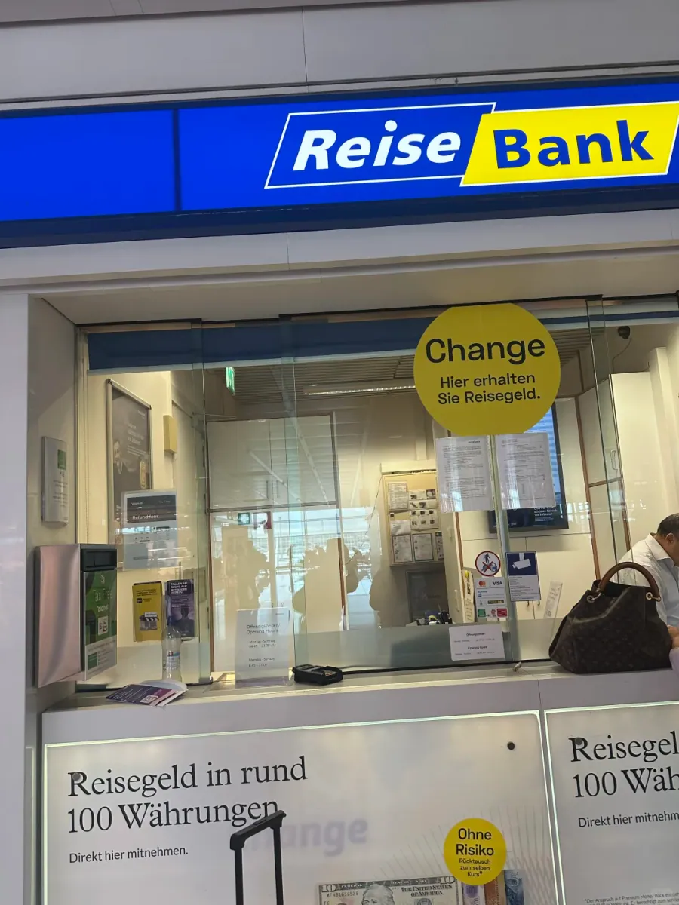
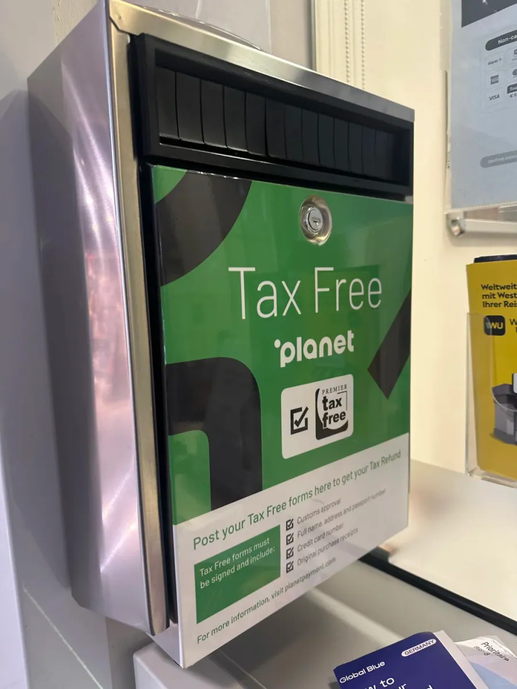
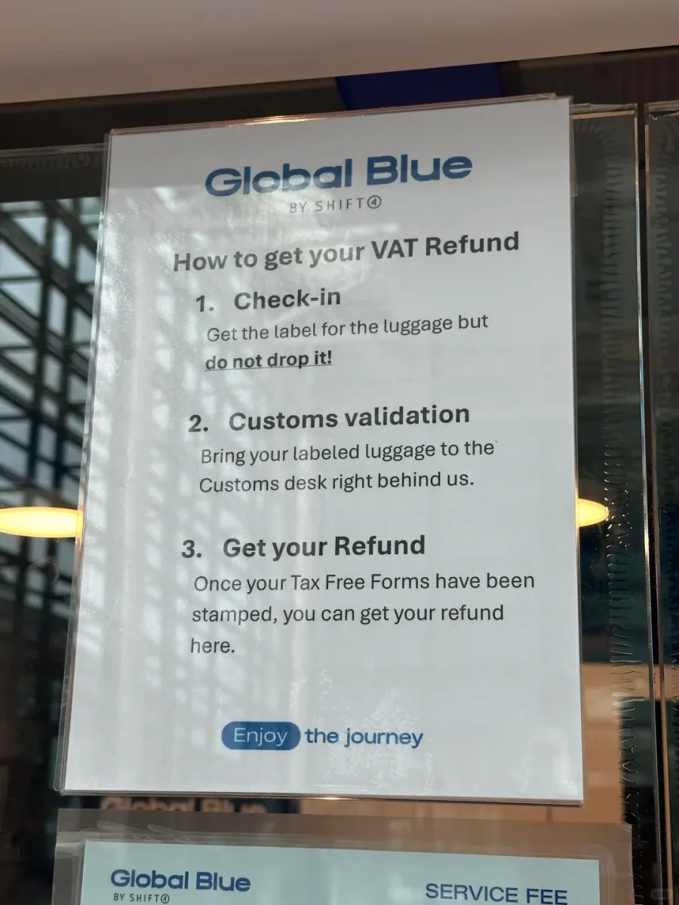
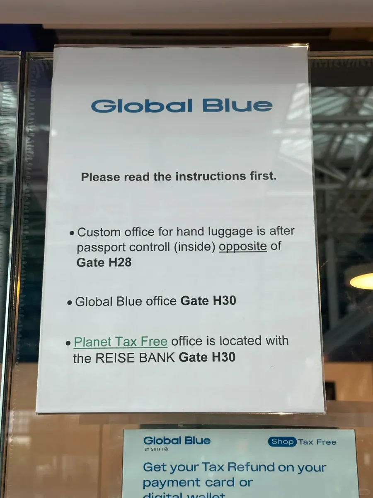

慕尼黑機場退稅最反直覺的地方，是蓋章的櫃檯不止一個：有的在入關之前，有的在護照檢查之後，走錯一邊就要多繞一大圈。第一次辦的人往往在值機島和海關之間來回問，擔心語言不通、擔心單子填錯，其實機場裡的標識和櫃檯告示都寫得很清楚，Global Blue 甚至把流程印成三步貼在櫃檯上。

判斷走哪條動線，標準只有一個：退稅商品放在託運行李裡，還是隨身帶上飛機。歐盟的規矩是海關必須在商品離開歐盟之前看到實物並蓋章，託運的商品一旦進了行李系統就拿不回來，所以蓋章必須排在託運之前；隨身商品跟著人走，蓋章點自然落在護照檢查之後。這一前一後，決定了兩條完全不同的路線。

下面按這兩種情形拆開寫：每一步由誰辦、在哪個位置辦、蓋完章的單子交給誰，最後再補上時間安排和材料清單。文中位置與櫃檯來自 2026 年的一次實際辦理，機場的櫃檯和閘口會調整，出發前最好再看一眼官網。

## 一、先分清兩種情況

先做這道選擇題，再談細節。選錯了，後面的每一步都會反：把該在託運前蓋的章留到出關後，海關看不到行李，只能拒絕；把隨身商品帶去託運前的海關，物品又不在身上，同樣蓋不了。作者出發前也擔心語言不通，實際走下來，海關辦公室、Global Blue 櫃檯和 Reise Bank 櫃檯都集中在一小片區域裡，跟著 Zoll／Customs 的牌子走不會迷路。

| 對比項 | 情形 A：商品在託運行李裡 | 情形 B：商品隨身攜帶 |
| --- | --- | --- |
| 蓋章時間 | 拿到登機牌之後、交執行李之前 | 安檢與護照檢查都完成之後 |
| 蓋章地點 | 入關排隊處一旁的海關辦公室（Zoll／Customs） | 護照檢查後，**H28／H30 閘口**一帶 |
| 蓋完章去哪 | 海關辦公室旁的 Global Blue 櫃檯交單 | H30 附近的 Global Blue 櫃檯交單 |
| 最大風險 | 行李已經交運，海關無法查驗 | 液體、刀具等隨身限制要先處理 |

兩種情形要帶的東西是一樣的：護照、登機牌、已經填好的退稅單、對應的購物小票，以及**未使用、未拆封**的商品。德國一般商品的增值稅是 19%，但到手金額不等於 19%：退稅公司要收手續費，實際退稅率按退稅單上的檔位計算，單子上的金額才是你能拿到的數字。

還有一條容易被忽略：退稅看的是「最後離開歐盟」的那一站。如果你從慕尼黑飛回中國，就在慕尼黑辦；如果先飛另一個申根國家再轉機回國，通常要在最後一個歐盟機場蓋章，別在慕尼黑提前把單子交掉。

能不能退，則取決於兩件事：購物時登記的住址在歐盟以外，以及商品會在三個月內隨人離開歐盟。短期旅遊、探親、商務訪問的旅客符合條件，留學生、長期居留者和歐盟居民不在此列。所以買東西時要把護照交給店員，退稅單上的姓名和護照號是按護照列印的，事後沒法改。

## 二、託運前：海關蓋章

託運這條線的順序是固定的：先值機、拿到登機牌，但**不要把箱子交出去**。Global Blue 貼在櫃檯上的告示寫得非常直白——Check-in：拿到行李條，但別把行李交走（do not drop it）。原因很簡單，海關要核對的是箱子裡的實物，行李一旦上了傳送帶，你就再也沒有機會開啟它。

海關辦公室（Zoll／Customs）在入關排隊處的右側。這句話容易聽反，作者的記法是：**你是面對入關櫃檯站著的，海關在你的左手邊**——同一個位置，看你怎麼轉身。到了那一帶會看到 Zoll 的牌子和一條不長的隊伍，多數人手裡都捏著退稅單和護照。

作者這次帶的東西單價不高，海關沒有要求開箱，看一眼單子就蓋了章。但這不代表一定不查：海關有權要求出示商品本身，所以別把要退稅的東西壓在箱子最底下，也別提前拆封或使用。把商品放在箱子開口處，需要時能立刻拿出來，整個過程會快很多。

蓋完章，把 Global Blue 的退稅單交給海關辦公室右手邊的 Global Blue 櫃檯，然後左轉、再左轉，跟著標識走就能找到。這一段是很多人卡住的地方——蓋完章以為結束了，其實單子還沒交，錢自然也不會到賬。

退稅單不只 Global Blue 一種。Planet Tax Free（原 Premier Tax Free）的綠色投遞箱就掛在櫃檯邊上，箱面寫著投遞前要確認的幾件事：稅單必須已經海關蓋章、填好姓名地址與護照號、信用卡號，並附上原始購物小票。易退稅等渠道的單子也是同樣的邏輯，只是收單的櫃檯不同。

Global Blue 自己的告示把整條線寫成了三步：第一步 Check-in，拿到行李條但不要交運；第二步 Customs validation，把貼好條的行李帶到櫃檯後面的海關處驗貨蓋章；第三步 Get your refund，稅單蓋章之後回到櫃檯領退款。記不住細節的時候，按這三步走就不會錯。

## 三、出關後：H30 的海關辦公室

隨身攜帶商品走的是另一條線。這裡的「出關」其實分兩次：第一次是安檢和行李檢查，第二次才是護照檢查。很多人過完安檢就以為手續結束，把退稅的事忘在腦後，等走到閘口才想起來，只能原路折返。

正確的走法是：過完護照檢查，往 H30 閘口的方向走，在還沒到 H30 的右手邊有一條小走廊，盡頭就是 Zoll／Customs 辦公室。走廊不長，標識也不算大，走快了容易錯過，看到 Zoll 的藍底白字牌就拐進去。

作者隨身帶的商品同樣沒有被要求開箱，理由還是單價不高。蓋章之後，把 Global Blue 的稅單交給 H30 閘口附近的 Global Blue 櫃檯；其他公司的單子（Planet Tax Free、易退稅等）則拿到旁邊的 Reise Bank 辦理。

Global Blue 的告示把位置寫得更明確：隨身行李的海關辦公室在護照檢查之後，位於 **Gate H28** 的內側／對面；Global Blue 辦公室在 **Gate H30**；Planet Tax Free 與 Reise Bank 也在 H30 一帶。H28 和 H30 是相鄰的一組閘口，按任一指示牌走都能到，找不到時問一句「Zoll」，工作人員都會指方向。

## 四、Global Blue、Planet 與 Reise Bank

慕尼黑機場的退稅櫃檯按公司分開，走到哪一家、單子交給誰，取決於你手裡的稅單印的是哪家公司。三家最常見的機構，收單點和退款方式並不一樣，提前分清能少排一次隊。

| 退稅機構 | 收單點 | 常見退款方式 |
| --- | --- | --- |
| Global Blue | 海關辦公室旁的櫃檯（託運情形）／H30 閘口附近（隨身情形） | 退回信用卡或電子錢包，按櫃檯告示與單據填寫 |
| Planet Tax Free | Reise Bank 櫃檯（H30 一帶） | 現金、支付寶或信用卡，可現場選擇 |
| 易退稅等其他渠道 | Reise Bank 櫃檯（H30 一帶） | 同上，按櫃檯要求登記 |

Reise Bank 是德國常見的連鎖貨幣兌換銀行，機場裡的網點做成半開放的櫃檯，玻璃窗上貼著黃色的 Change 圓標，招牌是藍底黃框。現金退稅在這裡辦，櫃檯裡通常備著幾種主要貨幣，能不能拿到歐元、要不要換成別的幣種，當場問清楚再決定。

退款方式的選擇各有代價：現金當場到手，但幣種和匯率未必划算；退回信用卡或支付寶到賬慢一些，金額通常更完整。作者的建議是把單子上的資訊填全——卡號、支付寶賬號、簽名，一個都不能少，否則櫃檯只能讓你重填，隊伍又要重新排。

單子交掉之後還有一個動作別忘：需要寄回的稅單要投進郵箱。作者把單子投進了左手邊的 mailbox，位置就在櫃檯附近。投遞前拍照留底，記下單號，後面查進度會方便很多。

## 五、時間與材料清單

把順序排對，時間就夠用。託運情形是：值機拿登機牌 → 海關蓋章 → 回值機櫃臺交執行李 → 安檢 → 護照檢查 → 閘口；隨身情形是：值機託運 → 安檢 → 護照檢查 → H28／H30 海關蓋章 → 交單 → 投遞。兩種情形都建議國際航班**提前 3 小時**到機場，旺季和早班機再往前留一點。

材料清單可以照著收：護照、登機牌、填好的退稅單、購物小票、未拆封的商品，以及一張能接收退款的信用卡或已開通的支付寶。商品和小票要對得上，單子上的姓名、護照號、離開歐盟的日期都不能空著。

時間上最容易低估的是排隊。海關蓋章要排一次，Global Blue 櫃檯要排一次，Reise Bank 的現金櫃臺還要排一次，三段隊加起來才是真實的辦理時間，而每一段的長度都跟著當天的航班波峰走。早班機人少，中午和傍晚的國際航班高峰，隊會明顯變長，這也是建議提前三小時到機場的原因。

幾個常見的坑：一是先託運再去蓋章，海關看不到行李，直接拒絕；二是把要退稅的商品拆封使用，海關可以不予蓋章；三是隻蓋了章沒交單，錢不會自己到賬；四是以為必須在購買地辦，其實是在最後離開歐盟的機場辦。把這四條避開，剩下的就是排隊。

到賬時間取決於退稅公司和退款方式，通常需要幾週，單號和小票要留到錢到賬為止。以上櫃臺位置、辦理順序與退款方式來自一次實際辦理，機場會調整櫃臺，各退稅公司的規則也會更新，出行前以慕尼黑機場官網、海關與退稅公司當日資訊為準。

## 相關連結

- **本站頁面**：[慕尼黑機場（MUC）](/tw/airport/MUC)、[德國（DE）](/tw/country/DE)
- **維基百科**：[慕尼黑機場](https://zh.wikipedia.org/wiki/%E6%85%95%E5%B0%BC%E9%BB%91%E6%9C%BA%E5%9C%BA)
