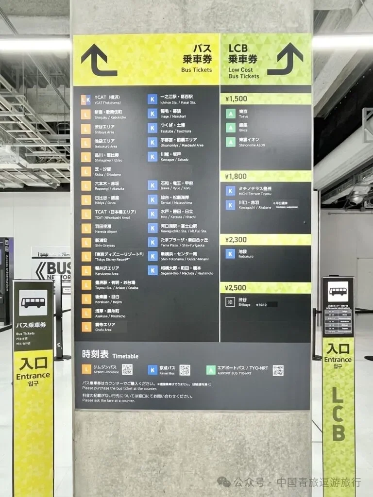

নারিতা থেকে টোকিওতে যেতে এক্সপ্রেস ট্রেনই দ্রুততম — তবে বড় স্যুটকেস আর ট্রান্সফার করিডোরে সিঁড়ি ভাঙার ইচ্ছা না থাকলে প্রায় ¥1,500 খরচের কোচটিই অনেক সময় সহজ পছন্দ। AIRPORT BUS TYO-NRT টার্মিনাল 1, 2 ও 3 থেকে টোকিও স্টেশন পর্যন্ত চলে, কিছু সার্ভিস গিনজার দিকেও যায়, আর গাড়ি বদলাতে বা নিজের ব্যাগ বইতে হয় না।

এই গাইডে রয়েছে সার্ভিসটি আসলে কী, **ভাড়া ও সময়সূচি**, **টিকিট কেনা**, প্রতিটি টার্মিনালে ও টোকিও স্টেশনে **কোথায় উঠবেন**, **লাগেজ ও গাড়ির ভেতরের নিয়ম**, এবং **স্কাইলাইনার ও N'EX-এর সঙ্গে এর তুলনা**। ভাড়া, সময় ও কাউন্টারের অবস্থান 2025 সালের তথ্য; যাত্রার আগে পরিচালকের সঙ্গে নিশ্চিত করে নিন।

## 1. বাসটি কী

নারিতা বিমানবন্দরে তিনটি টার্মিনাল। টার্মিনাল 1 ও 2-এ রেল ও বাস — দুটোই আছে; টার্মিনাল 3 কেবল বাসের, তাই ট্রেন নিতে হলে হেঁটে বা টার্মিনাল শাটলে চড়ে টার্মিনাল 2-এ যেতে হয়। কোচের টিকিট কাউন্টার ও স্টপ তিনটি টার্মিনালেই আছে, আর আগমন হল থেকে বেরোনোর সঙ্গে সঙ্গেই দুটোই চোখে পড়বে।

LCB মানে Low Cost Bus — এই রুটের সস্তা সার্ভিস। এটি টোকিও স্টেশন ও গিনজা পর্যন্ত চলে, এক দিকে প্রায় ¥1,500 খরচ, আর সবচেয়ে ভালো অবস্থায় সময় লাগে প্রায় 65 মিনিট — বাস্তবে রাস্তা ভেদে 60 থেকে 70 মিনিট। গাড়িগুলো 40-এর বেশি আসনের পূর্ণ আকারের কোচ, সব আসনই আনরিজার্ভড।

আসল আকর্ষণ ফ্রিকোয়েন্সি: 2024 সালের 1 আগস্ট থেকে রুটটিতে দুই দিকে দিনে 212টি সার্ভিস চলে, বিমানবন্দর থেকে মোটামুটি প্রতি 10 মিনিটে এবং টোকিও স্টেশন থেকে প্রতি 10 থেকে 20 মিনিটে।

বিনিময়টা হলো, কোচ যানজটে আটকে থাকে। পরিচালকের নিজের হিসাবে 2024 সালের ডিসেম্বর থেকে 2025 সালের জানুয়ারি পর্যন্ত বেশিরভাগ যাত্রা সময়মতো হয়েছে, প্রায় 15% যানজটে দেরি করেছে, আর গড় দেরি 6 থেকে 18 মিনিট।

## 2. ভাড়া ও সময়সূচি

| টিকিট | ভাড়া |
| --- | --- |
| প্রাপ্তবয়স্ক | প্রায় ¥1,500 (23:00-র রাতের সার্ভিসে ¥3,000) |
| শিশু | প্রায় ¥750 (রাতের বেলায় ¥1,500) |
| কোলের শিশু | প্রতি প্রাপ্তবয়স্কের সঙ্গে একজন বিনামূল্যে; আসন লাগলে ¥750 (রাতের বেলায় ¥1,500) |

এক দিকে প্রায় ¥1,500; ভাড়া ও সময় নির্ধারণ করে পরিচালক। 23:00-র দিকের রাতের যাত্রার ভাড়া আলাদা, তাই আপনার কোচ কোন সময়ের মধ্যে পড়ছে দেখে নিন।

সময়সূচি দুই দিকেই চলে — নারিতা বিমানবন্দর থেকে টোকিও স্টেশন, এবং মধ্য টোকিও থেকে ফিরতি বিমানবন্দর। দিনের বেলা সবচেয়ে ঘন; রাতের দিকে ও ভোরে সংখ্যা কমে। যাত্রার দিন পরিচালকের ওয়েবসাইট বা স্টপের বোর্ড দেখে নিন, বিশেষ করে সকালের প্রথম ও রাতের শেষ যাত্রার বিষয়ে।

## 3. টিকিট কেনা: সবুজ কাউন্টার খুঁজুন

আগমন হলে কাউন্টার দুটি রঙে। হলুদে সাধারণ বাস ও লিমুজিন ধরনের সার্ভিসের টিকিট বিক্রি হয়; **সবুজ হলো LCB কাউন্টার**, যেখানে ¥1,500-র টিকিট পাওয়া যায়। উপরের ভাড়ার বোর্ডে টোকিও, গিনজা ও শিনজুকু এলাকার ভাড়া ¥1,500 লেখা।

কর্মীকে গন্তব্য বলুন — টোকিও স্টেশন বা গিনজা, শেষটি কম চলে — এবং টাকা দিন। নগদ, ক্রেডিট কার্ড ও সুইকা-জাতীয় IC ট্রান্সপোর্ট কার্ড সবই গ্রহণযোগ্য। বোর্ডে অন্য LCB গন্তব্যও বেশি ভাড়ায় তালিকাভুক্ত; দিনে কী বিক্রি হচ্ছে কাউন্টারেই নিশ্চিত করুন।

টিকিটে দুটি বিষয় গুরুত্বপূর্ণ: **স্টপ নম্বর** ও **যাত্রার সময়**। এতে ছাপা যাত্রার জন্যই এটি বৈধ, তাই কোচ মিস হলে আবার টিকিট কিনতে হবে। আসন আনরিজার্ভড এবং আসনসংখ্যা পর্যন্তই টিকিট বিক্রি হয়। পরিচালকের ওয়েবসাইটে অনলাইনেও টিকিট কেনা যায়; অনলাইন টিকিট কীভাবে নেবেন ও উঠবেন তা সেখানেই বলা আছে।

## 4. কোথায় উঠবেন: তিনটি টার্মিনাল ও ইয়েসু সাউথ এগজিট

**টার্মিনাল 1.** আগমন হলের দক্ষিণ ও উত্তর — দুই প্রস্থানের বাইরেই কাউন্টার, চোখ এড়াবে না। টিকিটের নম্বর অনুসরণ করুন: টোকিও স্টেশনের সার্ভিস ছাড়ে **স্টপ 7** থেকে। প্রতিটি বে-তে নম্বর আছে; ব্যস্ত মৌসুমে একটু আগেই লাইনে দাঁড়ান।

**টার্মিনাল 2.** আগমন হল খোলে A ও B প্রবেশপথে। বেশিরভাগ যাত্রী B দিয়ে বেরোন, যার ঠিক উল্টো দিকেই কাউন্টার; A থেকে এলে কাউন্টার প্রবেশপথের ঠিক সামনেই। টোকিও স্টেশনের সার্ভিস ছাড়ে **স্টপ 6** থেকে।

**টার্মিনাল 3.** আগমন হল ছোট, কাউন্টার তার ভেতরেই আর স্টপ ঠিক বাইরে — তিনটির মধ্যে সবচেয়ে কম হাঁটা। কম খরচের এয়ারলাইনে আসা যে কারও জন্য এটি স্পষ্ট পছন্দ; ট্রেন নিতে হলে ব্যাগ নিয়ে হেঁটে বা শাটলে করে টার্মিনাল 2-এ ফিরতে হবে।

ফিরতি পথে কোচ ছাড়ে **টোকিও স্টেশনের ইয়েসু সাউথ এগজিট** থেকে। সেখানে কর্মীযুক্ত কাউন্টার ও টিকিট মেশিন আছে, নগদ ও কার্ড গ্রহণ করা হয়। সুইকা-জাতীয় IC কার্ড থাকলে সরাসরি লাইনে দাঁড়ানো যায়; নগদ বা কার্ডে দিতে চাইলে আগে টিকিট কিনুন। 05:00 থেকে 06:00-র মধ্যে যাত্রার সময় কাউন্টার তখনও খোলেনি: স্টপে লাইনে দাঁড়িয়ে গাড়িতেই টাকা দিন।

## 5. লাগেজ, আসন ও গাড়ির ভেতরের নিয়ম

লাগেজেই কোচ নিজের জায়গা করে নেয়। ওঠার আগে চালক প্রতিটি স্যুটকেস লাগেজ-হোল্ডে তোলেন এবং নম্বর দেওয়া একটি ট্যাগ হাতে দেন। ট্যাগটি রাখুন — অন্যপ্রান্তে ব্যাগ ফেরত নিতে এটিই দিতে হবে।

অনুমোদিত সীমা **প্রতি যাত্রী একটি পিস, তিন দিকের মোট মাপ 158 সেন্টিমিটারের বেশি নয়**। অতিরিক্ত আকারের জিনিস, কার্ডবোর্ডের বাক্স, সাইকেল (ফোল্ডিংসহ), স্কি, স্নোবোর্ড, সার্ফবোর্ড, গলফ ব্যাগ ও বড় বাদ্যযন্ত্র নেওয়া হয় না, তাই আগেই কুরিয়ারের ব্যবস্থা করুন।

ভেতরে 40-এর বেশি আসনের পূর্ণ আকারের কোচ, রাশ আওয়ারের কমিউটার ট্রেনের চেয়ে বেশ খানিকটা বেশি জায়গা, আর যেখানে ইচ্ছা বসতে পারেন। স্ক্রলিং ডিসপ্লেতে পরের স্টপ দেখায়, আর ঘোষণা হয় জাপানি, ইংরেজি ও চীনা ভাষায়, তাই জাপানি না জানা কোনো বাধা নয়। ধূমপান নিষিদ্ধ, আর কোচ চলার সময় সিটবেল্ট বাঁধা উচিত।

ভারী ব্যাগের ক্ষেত্রে সুবিধাটা সহজ — আপনাকে সেগুলো তুলতেই হয় না: আগমন হল থেকে স্ট্যান্ড পর্যন্ত পথ সমতল, কর্মীরা স্যুটকেস হোল্ডে রেখে দেন, আর টোকিও স্টেশনে সেগুলো নিয়ে নিলেই হয়, ট্রান্সফারে কিছু টেনে বহন করতে হয় না।

## 6. বাস, স্কাইলাইনার না N'EX

| বিকল্প | প্রধান স্টপ | যাত্রার সময় | ভাড়া |
| --- | --- | --- | --- |
| JR East N'EX (নারিতা এক্সপ্রেস) | টোকিও স্টেশন, শিনজুকু, শিবুয়া | প্রায় 1 ঘণ্টা 30 মিনিট | সাধারণ কারে ¥3,070, গ্রিন কারে ¥5,340 |
| কেইসেই স্কাইলাইনার | উয়েনো, নিপোরি | প্রায় 36 মিনিট | ¥2,730 |
| AIRPORT BUS TYO-NRT | টোকিও স্টেশন, গিনজা | প্রায় 65 মিনিট | প্রায় ¥1,500 |

পছন্দটা বেশ স্পষ্ট। **স্কাইলাইনার** সবচেয়ে দ্রুত, 36 মিনিটে উয়েনো পৌঁছায়, আর উয়েনো, নিপোরি ও আসাকুসার জন্য স্বাভাবিক পছন্দ। **N'EX** তুলনামূলক আরামে সরাসরি টোকিও স্টেশন, শিনজুকু ও শিবুয়ায় চলে, তবে ভাড়া সবচেয়ে বেশি। **বাস** অনেকটাই সস্তা — ট্রেনের ভাড়ার অর্ধেক থেকে এক-তৃতীয়াংশ — আর টোকিও স্টেশনের ইয়েসু দিকে নামায়, যা গিনজা ও নিহোনবাশির জন্যও সুবিধাজনক।

এর বিনিময়ে সময় দিতে হয়। ট্রেন যানজটে পড়ে না; কোচ পড়ে। শিনকানসেন ধরতে, ফ্লাইট ধরতে বা আঁটসাঁট সময়সূচি থাকলে বাসের হিসাবে 30 মিনিট যোগ করুন বা ট্রেন নিন। সপ্তাহের কর্মদিবসে সকাল 07:00 থেকে 09:00 এবং সন্ধ্যা 17:00 থেকে 19:00 এক্সপ্রেসওয়ে ও শহরের রাস্তার জন্য সবচেয়ে খারাপ; রাতের দিকে ও ভোরে কোচ সাধারণত সময়মতোই চলে।

সংক্ষেপে:

- তাড়া থাকলে, বা উয়েনো ও নিপোরির পথে: স্কাইলাইনার।
- শিনজুকু বা শিবুয়ায় সরাসরি যেতে চাইলে: N'EX।
- ভারী ব্যাগ, কম বাজেট আর গন্তব্য টোকিও স্টেশন বা গিনজা হলে: AIRPORT BUS TYO-NRT।

## সংশ্লিষ্ট লিংক

- **এই সাইটে**: [নারিতা আন্তর্জাতিক বিমানবন্দর (NRT)](/airport/NRT), [জাপান (JP)](/country/JP)
- **উইকিপিডিয়া**: [নারিতা আন্তর্জাতিক বিমানবন্দর](https://en.wikipedia.org/wiki/Narita_International_Airport)
- **বাইদু বাইকে**: [নারিতা বিমানবন্দর](https://baike.baidu.com/item/%E6%88%90%E7%94%B0%E6%9C%BA%E5%9C%BA)

ছবির সূত্র: 中国青旅逗游旅行। ভাড়া, সময়সূচি, কাউন্টারের অবস্থান ও লাগেজের নিয়ম 2025 সালের তথ্য এবং বদলাতে পারে; যাত্রার আগে AIRPORT BUS TYO-NRT-এর ওয়েবসাইট (tyo-nrt.com) ও স্টপের নোটিশ দেখে নিন।
