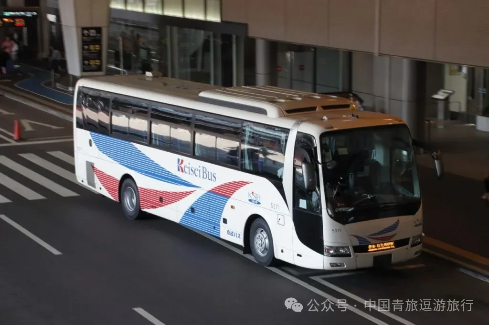
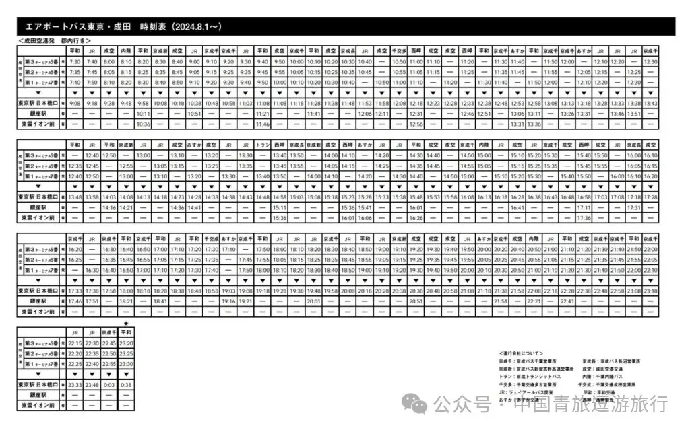

नारिता से टोक्यो पहुँचने का सबसे तेज़ तरीक़ा एक्सप्रेस ट्रेनें हैं — लेकिन अगर साथ में बड़ा सूटकेस हो और ट्रांसफ़र कॉरिडोर की सीढ़ियाँ चढ़ने का जी न हो, तो लगभग ¥1,500 वाला कोच अक्सर ज़्यादा आसान विकल्प होता है। AIRPORT BUS TYO-NRT टर्मिनल 1, 2 और 3 से टोक्यो स्टेशन तक चलती है, कुछ सेवाएँ गिन्ज़ा की ओर आगे बढ़ती हैं, और आपको न वाहन बदलना पड़ता है न अपना सामान खुद ढोना।

यह गाइड बताती है कि यह सेवा क्या है, **किराए और समय-सारणी**, **टिकट खरीदना**, प्रत्येक टर्मिनल और टोक्यो स्टेशन पर **कहाँ से चढ़ना** है, **सामान और बस में लागू नियम**, और **स्काईलाइनर तथा N'EX से इसकी तुलना**। किराए, समय और काउंटरों की जगहें 2025 के आँकड़े हैं; यात्रा से पहले ऑपरेटर से पुष्टि कर लें।

## 1. यह बस क्या है

नारिता हवाई अड्डे के तीन टर्मिनल हैं। टर्मिनल 1 और 2 में रेल और बस, दोनों के स्टॉप हैं; टर्मिनल 3 केवल बस के लिए है, इसलिए जो लोग ट्रेन लेना चाहते हैं, उन्हें पैदल या टर्मिनल शटल से टर्मिनल 2 तक जाना पड़ता है। कोच का टिकट काउंटर और स्टॉप तीनों टर्मिनलों पर हैं, और आगमन से बाहर आते ही दोनों दिख जाते हैं।

LCB का अर्थ है लो कॉस्ट बस — इस मार्ग पर सस्ता विकल्प। यह टोक्यो स्टेशन और गिन्ज़ा तक जाती है, एक तरफ़ का किराया लगभग ¥1,500 है, और सबसे अच्छी स्थिति में सफ़र लगभग 65 मिनट का है — वास्तव में सड़कों के हाल पर 60 से 70 मिनट। गाड़ियाँ 40 से ज़्यादा सीटों वाली फ़ुल-साइज़ कोच हैं, और सभी सीटें अनारक्षित हैं।

आवृत्ति ही इसकी असली खूबी है: 1 अगस्त 2024 से यह मार्ग दोनों दिशाओं में प्रतिदिन 212 सेवाएँ चलाता है — हवाई अड्डे से लगभग हर 10 मिनट में और टोक्यो स्टेशन से हर 10 से 20 मिनट में।

नुकसान यह है कि कोच यातायात में फँसती है। ऑपरेटर के ही दिसंबर 2024 से जनवरी 2025 के आँकड़े बताते हैं कि अधिकांश प्रस्थान समय पर रहे, लगभग 15% भीड़ के कारण देर से चले, और औसत देरी 6 से 18 मिनट रही।

## 2. किराए और समय-सारणी

| टिकट | किराया |
| --- | --- |
| वयस्क | लगभग ¥1,500 (23:00 की देर-रात सेवा में ¥3,000) |
| बच्चा | लगभग ¥750 (देर रात ¥1,500) |
| शिशु | प्रत्येक वयस्क के साथ एक निःशुल्क; सीट चाहिए तो ¥750 (देर रात ¥1,500) |

एक तरफ़ का किराया लगभग ¥1,500 है, और किराए तथा समय ऑपरेटर तय करता है। रात लगभग 23:00 की सेवा का किराया अलग है, इसलिए देख लें कि आपकी कोच किस श्रेणी में आती है।

समय-सारणी दोनों दिशाओं में चलती है — नारिता हवाई अड्डे से टोक्यो स्टेशन, और मध्य टोक्यो से वापस हवाई अड्डे। दिन में सेवाएँ सबसे घनी हैं; देर शाम और सुबह जल्दी संख्या घट जाती है। ऑपरेटर की वेबसाइट या उस दिन स्टॉप पर लगे बोर्ड को देखें, खासकर सुबह के पहले और रात के आख़िरी प्रस्थान के लिए।

## 3. टिकट खरीदना: हरा काउंटर ढूँढें

आगमन हॉल के काउंटर दो रंगों में हैं। पीले रंग पर साधारण बस और लिमोज़ीन-शैली की सेवाएँ मिलती हैं; **हरा रंग LCB का काउंटर** है, जहाँ ¥1,500 का टिकट बिकता है। ऊपर लगे किराया बोर्ड पर टोक्यो, गिन्ज़ा और शिंजुकु क्षेत्र ¥1,500 पर सूचीबद्ध हैं।

क्लर्क को अपना गंतव्य बताएँ — टोक्यो स्टेशन या गिन्ज़ा, जिनमें गिन्ज़ा की सेवाएँ कम हैं — और भुगतान करें। नकद, क्रेडिट कार्ड और सुइका जैसे IC परिवहन कार्ड सभी स्वीकार किए जाते हैं। बोर्ड पर अन्य LCB गंतव्य ज़्यादा किराए पर सूचीबद्ध हैं; उस दिन क्या उपलब्ध है, काउंटर पर पुष्टि कर लें।

टिकट पर दो बातें मायने रखती हैं: **स्टॉप नंबर** और **प्रस्थान का समय**। टिकट सिर्फ़ उसी प्रस्थान के लिए मान्य है जो उस पर छपा है, इसलिए कोच छूटने पर दोबारा टिकट खरीदना पड़ेगा। सीटें अनारक्षित हैं और टिकट सीटों की संख्या तक ही बिकते हैं। टिकट ऑपरेटर की वेबसाइट से ऑनलाइन भी खरीदे जा सकते हैं; ऑनलाइन टिकट कैसे लें और उससे कैसे चढ़ें, यह वहीं समझाया गया है।

## 4. कहाँ से चढ़ें: तीन टर्मिनल और याएसु साउथ एग्ज़िट

**टर्मिनल 1।** काउंटर आगमन हॉल के दक्षिण और उत्तर, दोनों निकासों के बाहर हैं — छूटेंगे नहीं। अपने टिकट पर लिखा नंबर देखें: टोक्यो स्टेशन की सेवाएँ **स्टॉप 7** से रवाना होती हैं। हर बे पर नंबर है; व्यस्त मौसम में थोड़ा पहले कतार में लगें।

**टर्मिनल 2।** आगमन से निकास A और B की ओर निकलते हैं। ज़्यादातर यात्री B से बाहर आते हैं, जहाँ काउंटर सामने ही है; A से आने पर काउंटर निकास के ठीक सामने है। टोक्यो स्टेशन की सेवाएँ **स्टॉप 6** से रवाना होती हैं।

**टर्मिनल 3।** आगमन हॉल छोटा है, काउंटर उसी के अंदर और स्टॉप बाहर ही है — तीनों में सबसे कम पैदल। किफ़ायती एयरलाइन से आने वालों के लिए यह सबसे स्पष्ट विकल्प है; ट्रेन लेने पर सामान के साथ पैदल या शटल से टर्मिनल 2 लौटना पड़ेगा।

वापसी की यात्रा के लिए कोच **टोक्यो स्टेशन के याएसु साउथ एग्ज़िट** से निकलती है। वहाँ कर्मचारी वाला काउंटर और टिकट मशीनें हैं, जो नकद और कार्ड लेती हैं। सुइका जैसे IC कार्ड वाले सीधे कतार में लग सकते हैं; नकद या कार्ड से भुगतान करने वालों को पहले टिकट खरीदना होता है। 05:00 से 06:00 के बीच के प्रस्थानों पर काउंटर अभी खुला नहीं होता: स्टॉप पर कतार में लगें और बस में भुगतान करें।

## 5. सामान, सीटें और बस में लागू नियम

सामान ही वह जगह है जहाँ कोच अपनी कीमत वसूल करती है। चढ़ने से पहले ड्राइवर हर सूटकेस को सामान-खाने में रखता है और आपको नंबर वाला टैग देता है। वह टैग सँभालकर रखें — दूसरे सिरे पर बैग लेने के लिए वही लौटाना होता है।

अनुमति **प्रति यात्री एक सामान, जिसकी तीनों भुजाओं का योग 158 सेमी से अधिक न हो**। बड़े आकार की वस्तुएँ, गत्ते के बक्से, साइकिलें (फ़ोल्डिंग सहित), स्की, स्नोबोर्ड, सर्फ़बोर्ड, गोल्फ़ बैग और बड़े संगीत वाद्य यंत्र नहीं ले जाए जाते, इसलिए पहले से कूरियर की व्यवस्था करें।

अंदर यह 40 से ज़्यादा सीटों वाली फ़ुल-साइज़ कोच है — भीड़ के समय की कम्यूटर ट्रेन से कहीं ज़्यादा जगह — और आप जहाँ चाहें बैठें। स्क्रॉल होने वाला डिस्प्ले अगला स्टॉप दिखाता है, और घोषणाएँ जापानी, अंग्रेज़ी और चीनी में होती हैं, इसलिए जापानी न आना कोई बाधा नहीं है। धूम्रपान मना है, और कोच के चलते समय सीट बेल्ट बाँधें।

भारी बैग के साथ फ़ायदा सीधा है: आपको उन्हें कभी उठाना नहीं पड़ता — आगमन से स्टॉप तक का रास्ता समतल है, कर्मचारी सूटकेस सामान-खाने में रखते हैं, और आप टोक्यो स्टेशन पर उन्हें बिना किसी ट्रांसफ़र में घसीटे ले लेते हैं।

## 6. बस, स्काईलाइनर या N'EX

| विकल्प | मुख्य स्टॉप | यात्रा समय | किराया |
| --- | --- | --- | --- |
| JR ईस्ट N'EX (नारिता एक्सप्रेस) | टोक्यो स्टेशन, शिंजुकु, शिबुया | लगभग 1 घंटा 30 मिनट | साधारण कार ¥3,070, ग्रीन कार ¥5,340 |
| केइसेई स्काईलाइनर | उएनो, निप्पोरी | लगभग 36 मिनट | ¥2,730 |
| AIRPORT BUS TYO-NRT | टोक्यो स्टेशन, गिन्ज़ा | लगभग 65 मिनट | लगभग ¥1,500 |

चुनाव काफ़ी स्पष्ट है। **स्काईलाइनर** सबसे तेज़ है, उएनो 36 मिनट में पहुँचती है, और उएनो, निप्पोरी तथा असाकुसा के लिए स्वाभाविक विकल्प है। **N'EX** टोक्यो स्टेशन, शिंजुकु और शिबुया तक सीधी और तुलनात्मक रूप से आरामदायक है, लेकिन किराया सबसे ज़्यादा है। **बस** काफ़ी हद तक सबसे सस्ती है — ट्रेन किराए के आधे से एक-तिहाई पर — और आपको टोक्यो स्टेशन के याएसु हिस्से में उतारती है, जो गिन्ज़ा और निहोनबाशी के लिए भी सुविधाजनक है।

इसके बदले जो चुकाना पड़ता है वह समय है। ट्रेनें यातायात से अछूती हैं; कोच नहीं। अगर आपको शिंकाशेन पकड़नी है, फ़्लाइट लेनी है या समय कम है, तो बस के अनुमान में 30 मिनट जोड़ें या ट्रेन लें। सप्ताह के दिनों में सुबह 07:00 से 09:00 और शाम 17:00 से 19:00 के बीच एक्सप्रेसवे और शहर की सड़कें सबसे खराब रहती हैं; देर रात और सुबह जल्दी कोच आमतौर पर समय पर रहती है।

संक्षेप में:

- जल्दी में हैं, या उएनो और निप्पोरी जा रहे हैं: स्काईलाइनर।
- शिंजुकु या शिबुया की सीधी सवारी चाहिए: N'EX।
- भारी सामान, सीमित बजट और लक्ष्य टोक्यो स्टेशन या गिन्ज़ा: AIRPORT BUS TYO-NRT।

## संबंधित लिंक

- **इस साइट पर**: [नारिता अंतरराष्ट्रीय हवाई अड्डा (NRT)](/airport/NRT), [जापान (JP)](/country/JP)
- **विकिपीडिया**: [नारिता अंतरराष्ट्रीय हवाई अड्डा](https://en.wikipedia.org/wiki/Narita_International_Airport)
- **बाइदू बाइके**: [नारिता हवाई अड्डा](https://baike.baidu.com/item/%E6%88%90%E7%94%B0%E6%9C%BA%E5%9C%BA)

चित्र स्रोत: 中国青旅逗游旅行। किराए, समय-सारणी, काउंटरों की जगहें और सामान के नियम 2025 के आँकड़े हैं और बदल सकते हैं; यात्रा से पहले AIRPORT BUS TYO-NRT की वेबसाइट (tyo-nrt.com) और स्टॉप पर लगी सूचनाएँ देख लें।
