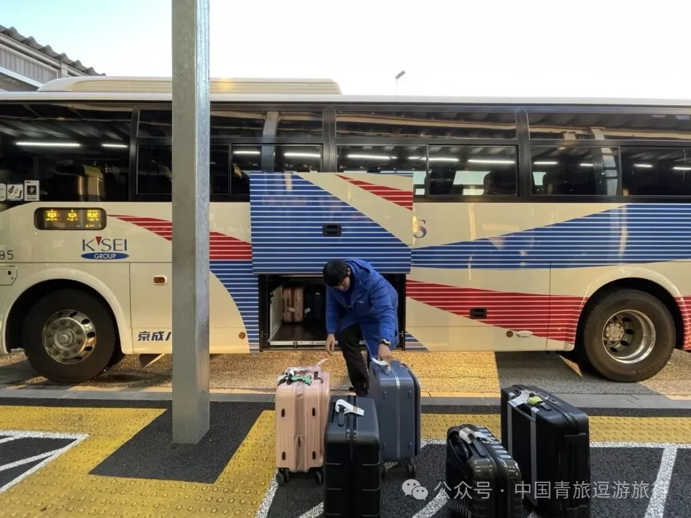

成田から東京へ向かうなら、速いのは特急電車です。ただし大きなスーツケースがあり、乗り換え通路の階段を使いたくないなら、約1,500円の高速バスのほうが楽なことがよくあります。AIRPORT BUS TYO-NRTはターミナル1・2・3から東京駅まで運行し、一部は銀座方面へ直通します。車両を乗り換えることも、自分で荷物を運ぶこともありません。

このガイドでは、サービスの概要、**運賃と時刻表**、**切符の買い方**、各ターミナルと東京駅の**乗り場**、**手荷物と車内の規則**、そして**スカイライナー・N'EXとの比較**を紹介します。運賃、所要時間、カウンターの場所は2025年の情報です。旅行前に運行会社へ確認してください。

## 1. バスの概要

成田空港には3つのターミナルがあります。ターミナル1と2には鉄道とバスの両方の乗り場があり、ターミナル3はバスのみです。電車に乗る人は、歩くかターミナル間シャトルでターミナル2へ移動します。高速バスは3つのターミナルすべてに切符カウンターと乗り場があり、到着ロビーを出ればすぐに見つかります。

LCBはLow Cost Busの略で、この路線の安価な商品です。東京駅と銀座へ運行し、片道約1,500円、所要時間は最速で約65分、実際には道路状況によって60〜70分です。車両は40席以上の大型バスで、席はすべて自由席です。

本当の売りは運行頻度です。2024年8月1日以降、この路線は上下合わせて1日212便を運行しており、空港発は約10分ごと、東京駅発は10〜20分ごとです。

代償は、バスが渋滞に巻き込まれることです。運行会社の2024年12月から2025年1月のデータでは、ほとんどの便は定刻に発車し、約15%が渋滞で遅延、平均遅延時間は6〜18分でした。

## 2. 運賃と時刻表

| 切符 | 運賃 |
| --- | --- |
| 大人 | 約1,500円（23:00の深夜便は3,000円） |
| 小児 | 約750円（深夜は1,500円） |
| 幼児 | 大人1人につき1人無料。座席が必要な場合は750円（深夜は1,500円） |

片道約1,500円で、運賃と時刻は運行会社が定めています。23:00頃の深夜便は別料金なので、自分の便がどの区分に当たるか確認してください。

時刻表は両方向にあり、成田空港から東京駅へと、東京都心から空港へ戻る便があります。日中の便が最も多く、深夜と早朝は減ります。当日は運行会社のウェブサイトか乗り場の掲示で確認してください。とくに朝の始発と夜の最終便は必ず確認しましょう。

## 3. 切符の買い方：緑色のカウンターを探す

到着ロビーのカウンターは2色に分かれています。黄色は一般路線バスとリムジン型のサービスを販売しており、**緑色がLCBのカウンター**で、1,500円の切符を販売しています。上の運賃表には東京、銀座、新宿方面が1,500円と表示されています。

窓口で行き先（東京駅または銀座。銀座行きは便数が少なめです）を伝えて支払います。現金、クレジットカード、Suicaなどの交通系ICカードが使えます。運賃表には他のLCB行き先がより高い運賃で載っています。当日に何が販売されているかはカウンターで確認してください。

切符で重要なのは**乗り場番号**と**出発時刻**の2つです。切符は印刷された便にのみ有効なので、バスを逃すと買い直しになります。席は自由席で、切符は座席数分だけ販売されます。運行会社のウェブサイトでオンライン購入もできます。オンライン切符の受け取り方と乗車方法はそちらで説明されています。

## 4. 乗り場：3つのターミナルと八重洲南口

**ターミナル1。** カウンターは到着ロビーの南口と北口の両方の外にあり、見逃すことはありません。切符に書かれた番号に従ってください。東京駅行きは**7番乗り場**から出発します。すべての乗り場に番号があり、繁忙期は少し早めに列に並びましょう。

**ターミナル2。** 到着ロビーはA出口とB出口に面しています。ほとんどの乗客はB出口から出て、その正面にカウンターがあります。A出口の場合は出口のすぐ前にあります。東京駅行きは**6番乗り場**から出発します。

**ターミナル3。** 到着ロビーは小さく、カウンターはその中、乗り場はすぐ外にあり、3つの中で最も歩く距離が短いです。格安航空会社で到着する人にとっては当然の選択肢です。電車に乗るなら、荷物を持ってターミナル2まで歩くかシャトルで戻ることになります。

帰りは**東京駅八重洲南口**から出発します。有人カウンターと券売機があり、現金とカードが使えます。SuicaなどのICカードを持つ人はそのまま列に並べます。現金またはカードで支払う人は先に切符を買います。05:00〜06:00の便はカウンターがまだ開いていないため、乗り場に並び、車内で支払います。

## 5. 手荷物、座席、車内の規則

手荷物こそ、このバスの価値が発揮される部分です。乗車前に運転手がスーツケースを荷物室へ積み込み、番号の書いたタグを渡します。このタグは降車時に荷物を受け取るために返すので、なくさないでください。

持込許容量は**1人1個、3辺の合計158 cm以内**です。大型の荷物、段ボール箱、自転車（折りたたみ式を含む）、スキー、スノーボード、サーフボード、ゴルフバッグ、大型楽器は運搬できません。事前に宅配便を手配してください。

車内は40席以上の大型バスで、ラッシュ時の通勤電車よりずっと広く、席はどこでも自由です。電光掲示板に次の停留所が流れ、アナウンスは日本語、英語、中国語で行われます。日本語がわからなくても問題ありません。喫煙は禁止で、走行中はシートベルトを着用してください。

重い荷物がある場合の利点は、自分で持ち上げる必要がないことです。到着ロビーから乗り場までは平坦で、スタッフが荷物を荷物室へ積み、東京駅で受け取れます。乗り換えで荷物を引きずる必要はありません。

## 6. バス、スカイライナー、N'EX

| 選択肢 | 主な停車駅 | 所要時間 | 運賃 |
| --- | --- | --- | --- |
| JR東日本 N'EX（成田エクスプレス） | 東京駅、新宿、渋谷 | 約1時間30分 | 普通車3,070円、グリーン車5,340円 |
| 京成スカイライナー | 上野、日暮里 | 約36分 | 2,730円 |
| AIRPORT BUS TYO-NRT | 東京駅、銀座 | 約65分 | 約1,500円 |

選択はかなり明確です。**スカイライナー**は最速で上野まで36分、上野、日暮里、浅草方面ならこれが自然な選択です。**N'EX**は東京駅、新宿、渋谷へ直通し、比較的快適ですが運賃は最も高くなります。**バス**は群を抜いて安く、電車運賃の半分から3分の1で、東京駅の八重洲側に到着するため銀座や日本橋にも便利です。

その代わりに支払うのは時間です。電車は渋滞の影響を受けませんが、バスは受けます。新幹線に乗り継ぐ場合、飛行機に間に合わせる場合、予定が詰まっている場合は、バスの所要時間に30分を足すか、電車を選んでください。平日の07:00〜09:00と17:00〜19:00は高速道路と市街地の道路が最も混みます。深夜と早朝はバスが定刻に運行しやすいです。

まとめると：

- 急いでいる、または上野・日暮里方面：スカイライナー。
- 新宿・渋谷へ直通したい：N'EX。
- 重い荷物、予算重視、行き先が東京駅・銀座：AIRPORT BUS TYO-NRT。

## 関連リンク

- **このサイト内**：[成田国際空港 (NRT)](/airport/NRT)、[日本 (JP)](/country/JP)
- **Wikipedia**：[成田国際空港](https://en.wikipedia.org/wiki/Narita_International_Airport)
- **百度百科**：[成田空港](https://baike.baidu.com/item/%E6%88%90%E7%94%B0%E6%9C%BA%E5%9C%BA)

画像出典：中国青旅逗游旅行。運賃、時刻表、カウンターの場所、手荷物の規則は2025年の情報で、変更される場合があります。旅行前にAIRPORT BUS TYO-NRTのウェブサイト（tyo-nrt.com）と乗り場の掲示を確認してください。
