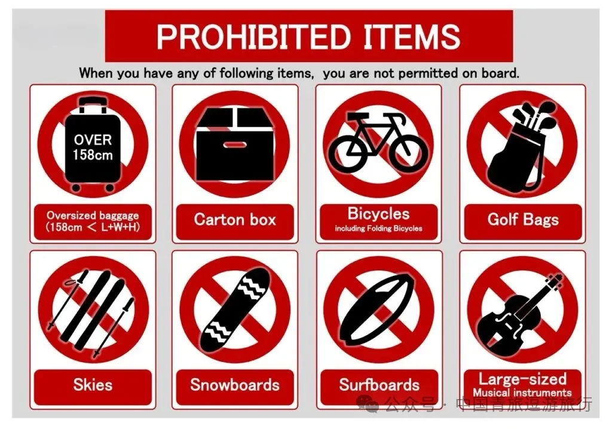

Van Narita naar Tokio zijn de sneltreinen het snelst — maar met een grote koffer en geen zin in trappen in een overstapgang is de coach van ongeveer ¥1.500 vaak de makkelijkere optie. AIRPORT BUS TYO-NRT rijdt van Terminal 1, 2 en 3 naar Tokyo Station, en sommige ritten rijden door richting Ginza; je stapt nooit over en draagt je bagage nooit zelf.

Deze gids behandelt wat de dienst is, **tarieven en dienstregelingen**, **een kaartje kopen**, **waar je instapt** bij elke terminal en bij Tokyo Station, **bagage en regels aan boord**, en **hoe de bus zich verhoudt tot de Skyliner en de N'EX**. Tarieven, tijden en balielocaties zijn cijfers uit 2025; bevestig ze bij de vervoerder voordat je reist.

## 1. Wat de bus is

Narita Airport heeft drie terminals. Terminal 1 en 2 hebben zowel trein- als bushaltes; Terminal 3 is alleen per bus bereikbaar, dus wie de trein neemt, loopt of rijdt met de terminalshuttle naar Terminal 2. De coach heeft bij alle drie de terminals een ticketbalie en een halte, beide direct zichtbaar zodra je door de aankomsthal komt.

LCB staat voor Low Cost Bus, het goedkopere product op deze route. De bus rijdt naar Tokyo Station en Ginza, kost ongeveer ¥1.500 enkele reis en doet er in het beste geval ongeveer 65 minuten over — in de praktijk 60 tot 70 minuten, afhankelijk van de wegen. De voertuigen zijn volwaardige coaches met meer dan 40 zitplaatsen, allemaal zonder reservering.

De frequentie is het echte verkoopargument: sinds 1 augustus 2024 rijdt de route 212 diensten per dag in beide richtingen, ongeveer elke 10 minuten vanaf de luchthaven en elke 10 tot 20 minuten vanaf Tokyo Station.

De keerzijde is dat een coach in het verkeer staat. De eigen cijfers van de vervoerder voor december 2024 tot januari 2025 laten zien dat de meeste vertrekken op tijd zijn, dat ongeveer 15% vertraging oploopt door drukte en dat de gemiddelde vertraging 6 tot 18 minuten bedraagt.

## 2. Tarieven en dienstregeling

| Kaartje | Tarief |
| --- | --- |
| Volwassene | ongeveer ¥1.500 (¥3.000 op de late nachtdienst van 23:00) |
| Kind | ongeveer ¥750 (¥1.500 laat op de avond) |
| Baby | één gratis per volwassene; ¥750 als een zitplaats nodig is (¥1.500 laat op de avond) |

Ongeveer ¥1.500 enkele reis, met tarieven en tijden vastgesteld door de vervoerder. Het late vertrek rond 23:00 heeft een apart tarief, dus controleer in welke categorie je bus valt.

De dienstregeling geldt in beide richtingen — van Narita Airport naar Tokyo Station en van het centrum van Tokio terug naar de luchthaven. Overdag is het het drukst; laat in de avond en vroeg in de ochtend wordt het dunner. Controleer op de dag zelf de website van de vervoerder of het bord bij de halte, vooral voor het eerste vertrek van de ochtend en het laatste van de nacht.

## 3. Een kaartje kopen: zoek de groene balie

De balies in de aankomsthal zijn er in twee kleuren. Geel verkoopt de gewone bus- en limousinediensten; **groen is de LCB-balie**, waar het kaartje van ¥1.500 wordt verkocht. Het tarievenbord erboven vermeldt Tokyo, Ginza en de omgeving van Shinjuku voor ¥1.500.

Noem je bestemming bij de medewerker — Tokyo Station of Ginza, dat laatste minder frequent — en betaal. Contant geld, creditcards en IC-vervoerskaarten zoals Suica worden allemaal geaccepteerd. Op het bord staan andere LCB-bestemmingen tegen hogere tarieven; vraag bij de balie wat er die dag te koop is.

Twee dingen op het kaartje zijn belangrijk: het **haltenummer** en de **vertrektijd**. Het is alleen geldig voor het vertrek dat erop staat, dus een gemiste bus betekent een nieuw kaartje kopen. Er zijn geen gereserveerde zitplaatsen en kaartjes worden alleen verkocht tot het aantal beschikbare stoelen. Kaartjes kunnen ook online via de website van de vervoerder worden gekocht; hoe je een online kaartje ophaalt en instapt, wordt daar uitgelegd.

## 4. Waar je instapt: drie terminals en de Yaesu South Exit

**Terminal 1.** De balies staan buiten zowel de zuidelijke als de noordelijke uitgang van de aankomsthal, niet te missen. Volg het nummer op je kaartje: de diensten naar Tokyo Station vertrekken van **halte 7**. Elke halteplaats is genummerd; sluit in drukke seizoenen iets eerder aan.

**Terminal 2.** De aankomsthal komt uit op uitgang A en B. De meeste reizigers komen uit B, waar de balie recht tegenover ligt; kom je uit A, dan staat de balie vlak voor de uitgang. De diensten naar Tokyo Station vertrekken van **halte 6**.

**Terminal 3.** De aankomsthal is klein, de balie staat erin en de halte ligt er net buiten — de kortste wandeling van de drie. Voor wie met een budgetmaatschappij aankomt, is dit de voor de hand liggende optie; een trein zou betekenen dat je met je bagage terug moet lopen of pendelen naar Terminal 2.

Voor de terugweg vertrekt de coach vanaf de **Yaesu South Exit van Tokyo Station**. Er is een bemande balie en er zijn kaartautomaten, die contant geld en kaarten accepteren. Wie een IC-kaart zoals Suica heeft, kan direct in de rij staan; wie contant of met kaart betaalt, koopt eerst een kaartje. Bij vertrekken tussen 05:00 en 06:00 is de balie nog niet open: wacht bij de halte en betaal in de bus.

## 5. Bagage, zitplaatsen en regels aan boord

Bij bagage bewijst de coach zijn waarde. Voor het instappen laadt de chauffeur elke koffer in het bagageruim en geeft je een label met een nummer erop. Bewaar dat label — daarmee haal je je bagage aan de andere kant weer op.

De toegestane hoeveelheid is **één stuk per passagier, met de drie zijden samen niet meer dan 158 cm**. Te grote voorwerpen, kartonnen dozen, fietsen (ook vouwfietsen), ski's, snowboards, surfboards, golftassen en grote muziekinstrumenten worden niet vervoerd, dus regel vooraf een koerier.

Aan boord is het een volwaardige coach met meer dan 40 zitplaatsen, ruim meer plek dan in een forensentrein in de spits, en je zit waar je wilt. Een rollend display toont de volgende halte en de omroep is in het Japans, Engels en Chinees, dus een gebrek aan Japans is geen belemmering. Roken is niet toegestaan en je moet de veiligheidsgordel om hebben zolang de coach rijdt.

Het voordeel bij zware bagage is simpelweg dat je die nooit hoeft te tillen: de wandeling van de aankomsthal naar de halte is vlak, medewerkers zetten de koffers in het bagageruim en je haalt ze op bij Tokyo Station zonder iets door een overstap te slepen.

## 6. Bus, Skyliner of N'EX

| Optie | Belangrijkste haltes | Reistijd | Tarief |
| --- | --- | --- | --- |
| JR East N'EX (Narita Express) | Tokyo Station, Shinjuku, Shibuya | ongeveer 1 uur 30 min | ¥3.070 gewone klas, ¥5.340 Green Car |
| Keisei Skyliner | Ueno, Nippori | ongeveer 36 min | ¥2.730 |
| AIRPORT BUS TYO-NRT | Tokyo Station, Ginza | ongeveer 65 min | ongeveer ¥1.500 |

De keuze is vrij duidelijk. De **Skyliner** is het snelst, bereikt Ueno in 36 minuten en is de logische keuze voor Ueno, Nippori en Asakusa. De **N'EX** rijdt rechtstreeks naar Tokyo Station, Shinjuku en Shibuya, relatief comfortabel, tegen het hoogste tarief. De **bus** is veruit het goedkoopst — de helft tot een derde van de treintarieven — en zet je af aan de Yaesu-kant van Tokyo Station, ook handig voor Ginza en Nihonbashi.

Wat je daarvoor betaalt, is tijd. Treinen hebben geen last van verkeer; coaches wel. Als je moet overstappen op een shinkansen, een vlucht moet halen of een strak schema hebt, tel dan 30 minuten bij de schatting van de bus op of neem de trein. Doordeweekse ochtenden tussen 07:00 en 09:00 en avonden tussen 17:00 en 19:00 zijn het slechtst voor de snelweg en de stadswegen; laat in de nacht en vroeg in de ochtend is de coach meestal punctueel.

Kort samengevat:

- Heb je haast of ga je naar Ueno en Nippori: Skyliner.
- Wil je rechtstreeks naar Shinjuku of Shibuya: N'EX.
- Zware bagage, een krap budget en een bestemming bij Tokyo Station of Ginza: AIRPORT BUS TYO-NRT.

## Gerelateerde links

- **Op deze site**: [Narita International Airport (NRT)](/airport/NRT), [Japan (JP)](/country/JP)
- **Wikipedia**: [Narita International Airport](https://en.wikipedia.org/wiki/Narita_International_Airport)
- **Baidu Baike**: [Narita Airport](https://baike.baidu.com/item/%E6%88%90%E7%94%B0%E6%9C%BA%E5%9C%BA)

Bron afbeelding: 中国青旅逗游旅行. Tarieven, dienstregelingen, balielocaties en bagageregels zijn cijfers uit 2025 en kunnen veranderen; controleer de website van AIRPORT BUS TYO-NRT (tyo-nrt.com) en de mededelingen bij de halte voordat je reist.
