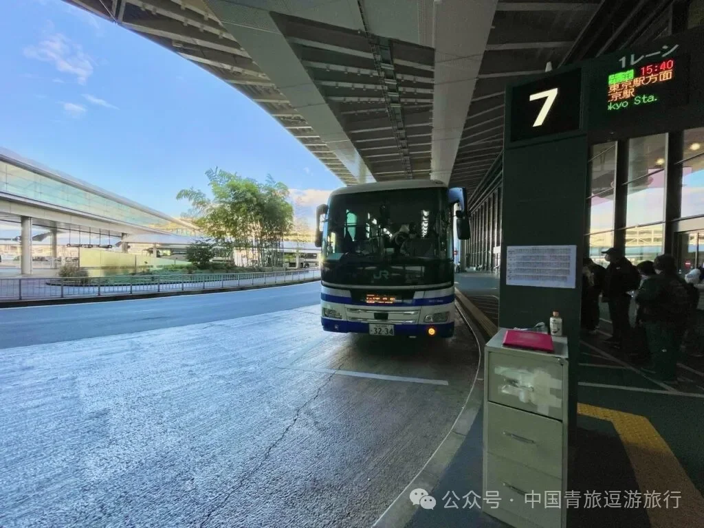
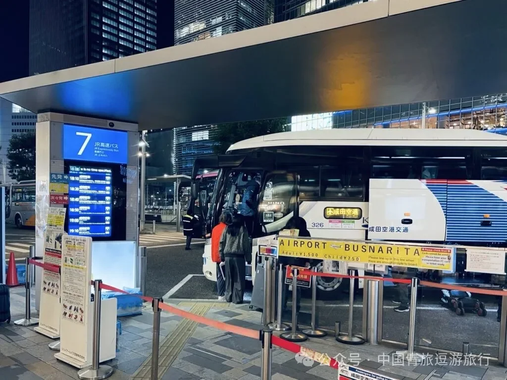

Para ir do Aeroporto de Narita até Tóquio, os trens expressos são os mais rápidos — mas, com uma mala grande e pouca disposição para escadas em um corredor de baldeação, o ônibus rodoviário que custa cerca de ¥1.500 costuma ser a opção mais fácil. O AIRPORT BUS TYO-NRT sai dos Terminais 1, 2 e 3 em direção à Estação de Tóquio, com alguns serviços seguindo para Ginza, e você nunca troca de veículo nem carrega as próprias malas.

Este guia cobre o que é o serviço, **tarifas e horários**, **compra do bilhete**, **onde embarcar** em cada terminal e na Estação de Tóquio, **regras de bagagem e a bordo** e **como ele se compara ao Skyliner e ao N'EX**. As tarifas, os horários e a localização dos balcões são dados de 2025; confirme-os com a operadora antes de viajar.

## 1. O que é o ônibus

O Aeroporto de Narita tem três terminais. Os Terminais 1 e 2 têm paradas de trem e de ônibus; o Terminal 3 é exclusivo para ônibus, então quem vai de trem caminha ou usa o traslado entre terminais até o Terminal 2. O ônibus rodoviário tem balcão de bilhetes e parada nos três terminais, ambos visíveis assim que você passa pela área de chegadas.

LCB significa Low Cost Bus, o produto mais barato desta rota. Ele vai até a Estação de Tóquio e Ginza, custa cerca de ¥1.500 por trecho e leva cerca de 65 minutos no melhor cenário — na prática, 60 a 70 minutos, dependendo do trânsito. Os veículos são ônibus rodoviários de grande porte com mais de 40 assentos, todos sem marcação.

A frequência é o verdadeiro atrativo: desde 1º de agosto de 2024, a rota opera 212 serviços por dia nos dois sentidos, aproximadamente a cada 10 minutos saindo do aeroporto e a cada 10 a 20 minutos saindo da Estação de Tóquio.

A desvantagem é que o ônibus fica no trânsito. Os números da própria operadora de dezembro de 2024 a janeiro de 2025 mostram que a maioria das partidas foi pontual, cerca de 15% atrasaram por congestionamento e o atraso médio foi de 6 a 18 minutos.

## 2. Tarifas e horários

| Bilhete | Tarifa |
| --- | --- |
| Adulto | cerca de ¥1.500 (¥3.000 no serviço da madrugada das 23:00) |
| Criança | cerca de ¥750 (¥1.500 tarde da noite) |
| Bebê | um gratuito por adulto; ¥750 se precisar de assento (¥1.500 tarde da noite) |

Cerca de ¥1.500 por trecho, com tarifas e horários definidos pela operadora. A partida da madrugada, por volta das 23:00, tem preço separado, então confira em qual faixa o seu ônibus se encaixa.

Os horários funcionam nos dois sentidos — do Aeroporto de Narita para a Estação de Tóquio e do centro de Tóquio de volta ao aeroporto. O período diurno é o mais denso; o fim da noite e o início da manhã têm menos opções. Consulte o site da operadora ou o painel na parada no dia, sobretudo para a primeira partida da manhã e a última da noite.

## 3. Comprando o bilhete: procure o balcão verde

Os balcões no saguão de chegadas têm duas cores. O amarelo vende os serviços de ônibus comum e estilo limusine; **o verde é o balcão do LCB**, onde é vendido o bilhete de ¥1.500. O painel de tarifas acima dele lista Tóquio, Ginza e a região de Shinjuku por ¥1.500.

Diga ao atendente o seu destino — Estação de Tóquio ou Ginza, este último com menos frequência — e pague. Dinheiro, cartões de crédito e cartões de transporte IC, como o Suica, são aceitos. O painel lista outros destinos do LCB com tarifas mais altas; confirme no balcão o que está à venda no dia.

Duas coisas no bilhete importam: o **número da parada** e o **horário de partida**. Ele é válido apenas para a partida impressa, então perder o ônibus significa comprar outro. Os assentos não são marcados e os bilhetes são vendidos somente até o limite de lugares. Os bilhetes também podem ser comprados on-line no site da operadora; como retirar e embarcar com um bilhete on-line é explicado lá.

## 4. Onde embarcar: três terminais e a Saída Sul de Yaesu

**Terminal 1.** Os balcões ficam do lado de fora das saídas sul e norte do saguão de chegadas, difíceis de não ver. Siga o número do seu bilhete: os serviços para a Estação de Tóquio saem da **parada 7**. Todas as plataformas são numeradas; em temporadas movimentadas, entre na fila um pouco mais cedo.

**Terminal 2.** As chegadas dão para as saídas A e B. A maioria dos passageiros sai pela B, onde o balcão fica bem em frente; pela A, ele fica logo à frente da saída. Os serviços para a Estação de Tóquio saem da **parada 6**.

**Terminal 3.** O saguão de chegadas é pequeno, o balcão fica dentro dele e a parada fica logo do lado de fora — a caminhada mais curta dos três. Para quem chega em uma companhia aérea de baixo custo, é a opção óbvia; de trem, seria preciso caminhar ou usar o traslado até o Terminal 2 com as malas.

Para a volta, o ônibus sai da **Saída Sul de Yaesu da Estação de Tóquio**. Há um balcão com atendentes e máquinas de bilhetes, que aceitam dinheiro e cartão. Quem tem um cartão IC como o Suica pode entrar direto na fila; quem paga em dinheiro ou cartão compra o bilhete primeiro. Nas partidas entre 05:00 e 06:00, o balcão ainda não está aberto: entre na fila na parada e pague a bordo.

## 5. Bagagem, assentos e regras a bordo

A bagagem é onde o ônibus compensa. Antes do embarque, o motorista coloca cada mala no bagageiro e entrega a você uma etiqueta com um número. Guarde essa etiqueta — é o que você devolve para retirar a mala no destino.

A franquia é **uma peça por passageiro, com a soma dos três lados não superior a 158 cm**. Itens de grande porte, caixas de papelão, bicicletas (inclusive dobráveis), esquis, snowboards, pranchas de surfe, bolsas de golfe e instrumentos musicais grandes não são transportados, então providencie um serviço de entrega com antecedência.

A bordo, é um ônibus rodoviário de grande porte com mais de 40 assentos, bem mais espaço do que um trem urbano no horário de pico, e você se senta onde quiser. Um painel rolante mostra a próxima parada, e os anúncios são feitos em japonês, inglês e chinês, então não saber japonês não é obstáculo. Não é permitido fumar, e você deve usar o cinto de segurança enquanto o ônibus estiver em movimento.

A vantagem com malas pesadas é simplesmente que você nunca as levanta: a caminhada das chegadas até a parada é plana, a equipe coloca as malas no bagageiro e você as retira na Estação de Tóquio sem arrastar nada por uma baldeação.

## 6. Ônibus, Skyliner ou N'EX

| Opção | Principais paradas | Tempo de viagem | Tarifa |
| --- | --- | --- | --- |
| N'EX da JR East (Narita Express) | Estação de Tóquio, Shinjuku, Shibuya | cerca de 1 h 30 min | ¥3.070 no carro comum, ¥5.340 no carro verde |
| Keisei Skyliner | Ueno, Nippori | cerca de 36 min | ¥2.730 |
| AIRPORT BUS TYO-NRT | Estação de Tóquio, Ginza | cerca de 65 min | cerca de ¥1.500 |

A escolha é bastante clara. O **Skyliner** é o mais rápido, chegando a Ueno em 36 minutos, e é a escolha natural para Ueno, Nippori e Asakusa. O **N'EX** vai direto para a Estação de Tóquio, Shinjuku e Shibuya com relativo conforto, pela tarifa mais alta. O **ônibus** é o mais barato com boa margem — metade a um terço das tarifas dos trens — e deixa você no lado de Yaesu da Estação de Tóquio, prático também para Ginza e Nihonbashi.

O que você paga por isso é tempo. Os trens não sofrem com o trânsito; os ônibus, sim. Se você vai pegar um shinkansen, um voo ou tem horário apertado, acrescente 30 minutos à estimativa do ônibus ou pegue o trem. Nas manhãs de dias úteis, entre 07:00 e 09:00, e nas noites entre 17:00 e 19:00, o trânsito é pior na via expressa e nas ruas da cidade; tarde da noite e de manhã cedo, o ônibus costuma ser pontual.

Em resumo:

- Com pressa, ou indo para Ueno e Nippori: Skyliner.
- Quer ir direto para Shinjuku ou Shibuya: N'EX.
- Malas pesadas, orçamento apertado e destino na Estação de Tóquio ou Ginza: AIRPORT BUS TYO-NRT.

## Links relacionados

- **Neste site**: [Aeroporto Internacional de Narita (NRT)](/airport/NRT), [Japão (JP)](/country/JP)
- **Wikipedia**: [Aeroporto Internacional de Narita](https://en.wikipedia.org/wiki/Narita_International_Airport)
- **Baidu Baike**: [Aeroporto de Narita](https://baike.baidu.com/item/%E6%88%90%E7%94%B0%E6%9C%BA%E5%9C%BA)

Fonte das imagens: 中国青旅逗游旅行. As tarifas, os horários, a localização dos balcões e as regras de bagagem são dados de 2025 e podem mudar; consulte o site do AIRPORT BUS TYO-NRT (tyo-nrt.com) e os avisos na parada antes de viajar.
