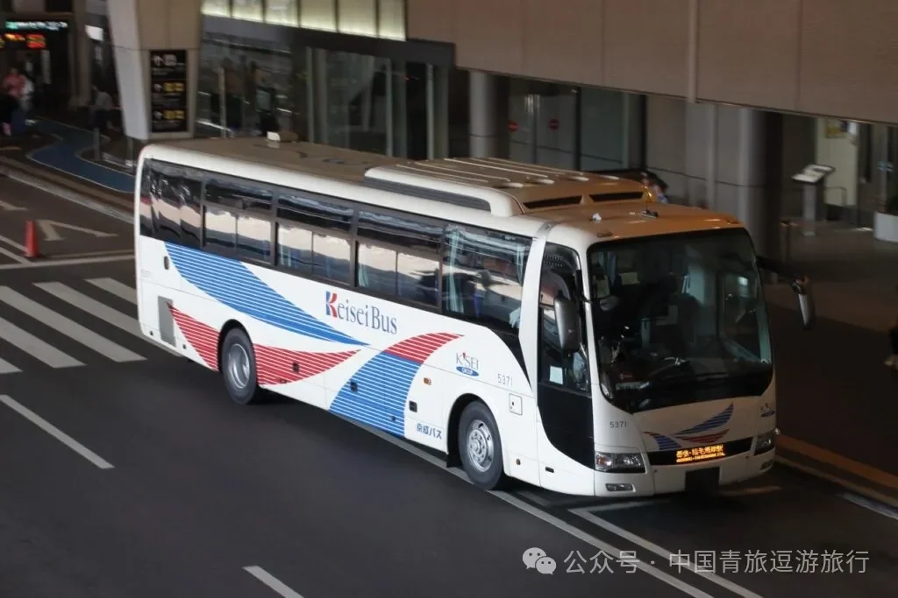
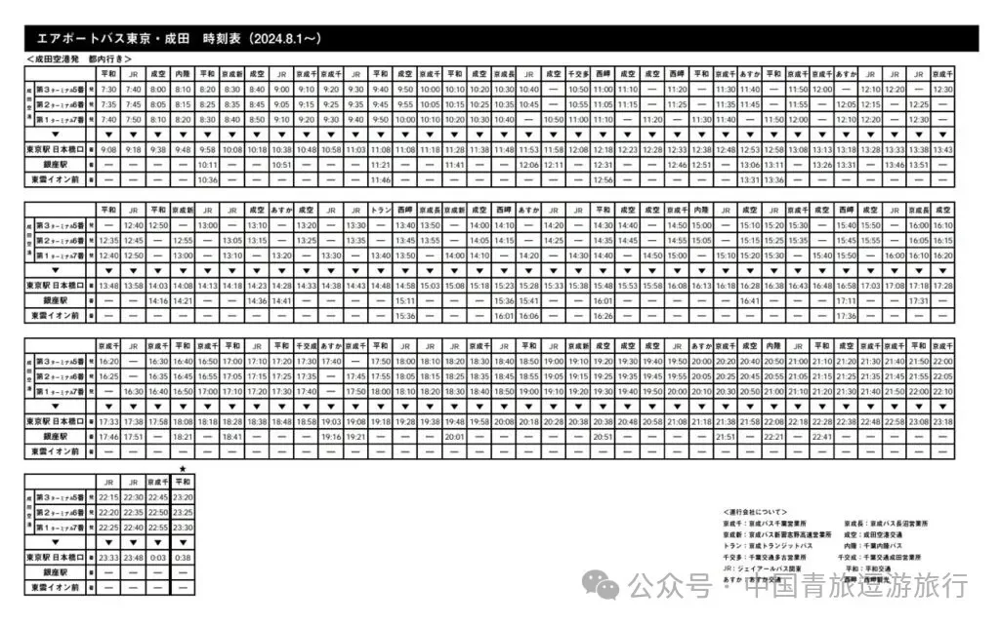
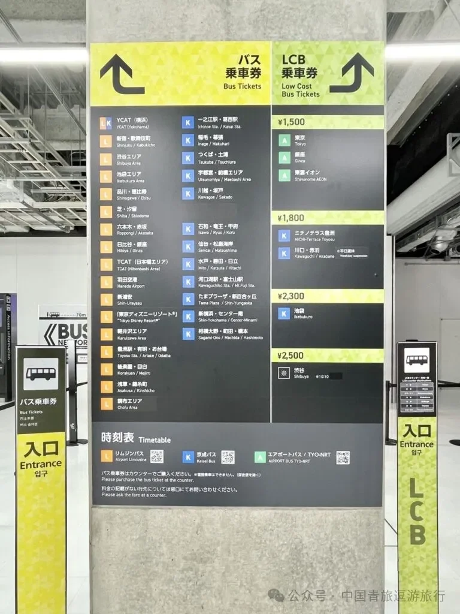
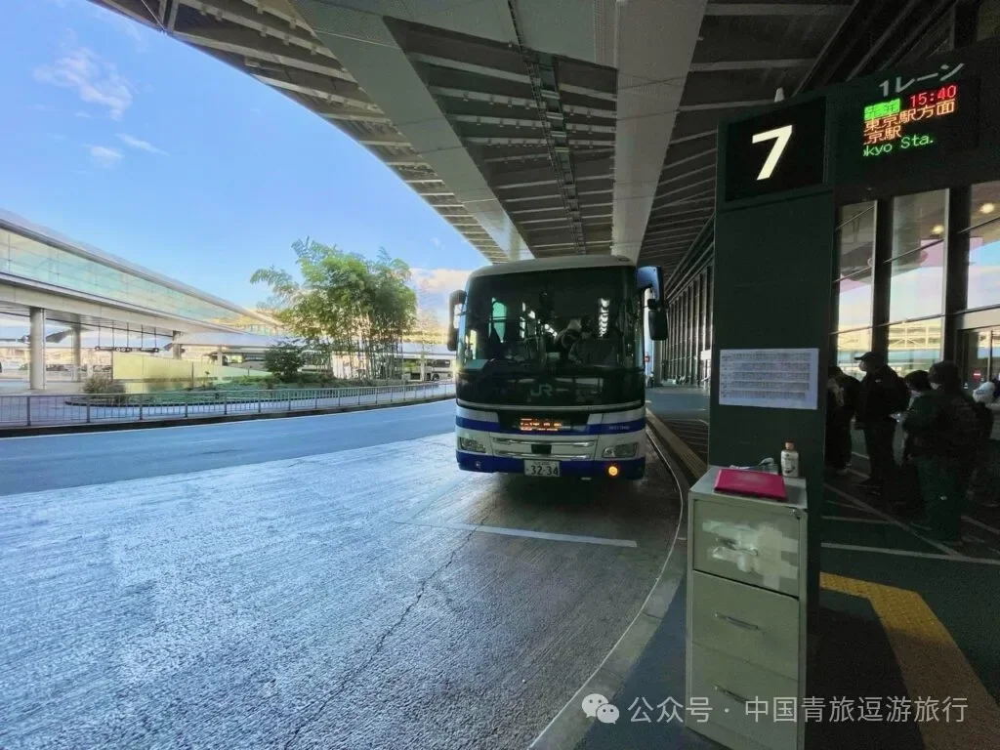
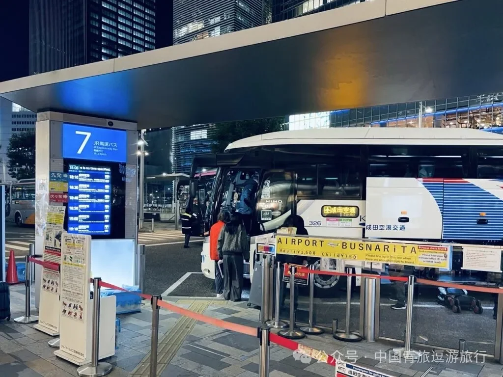
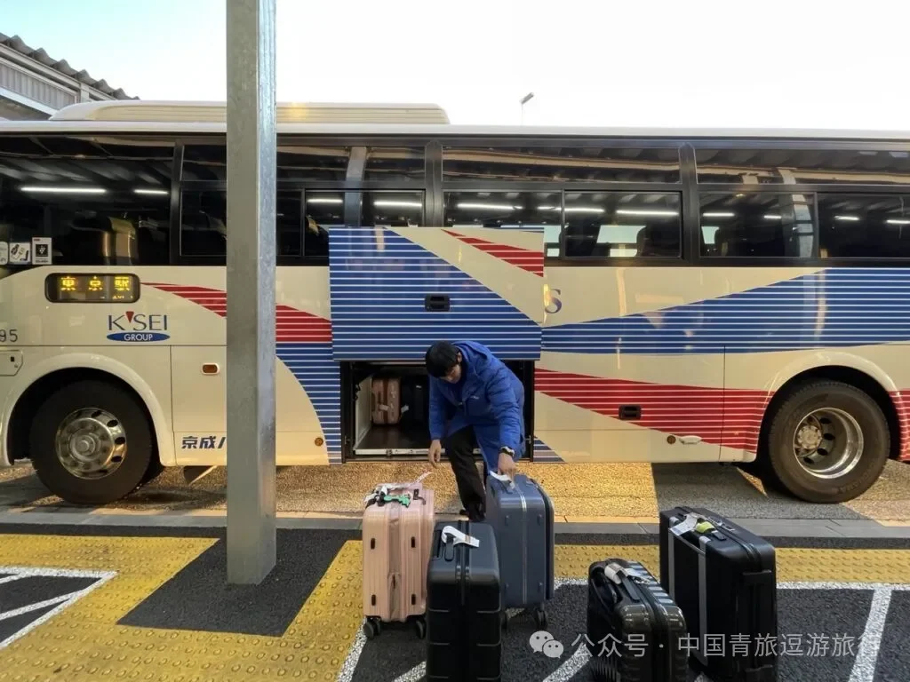
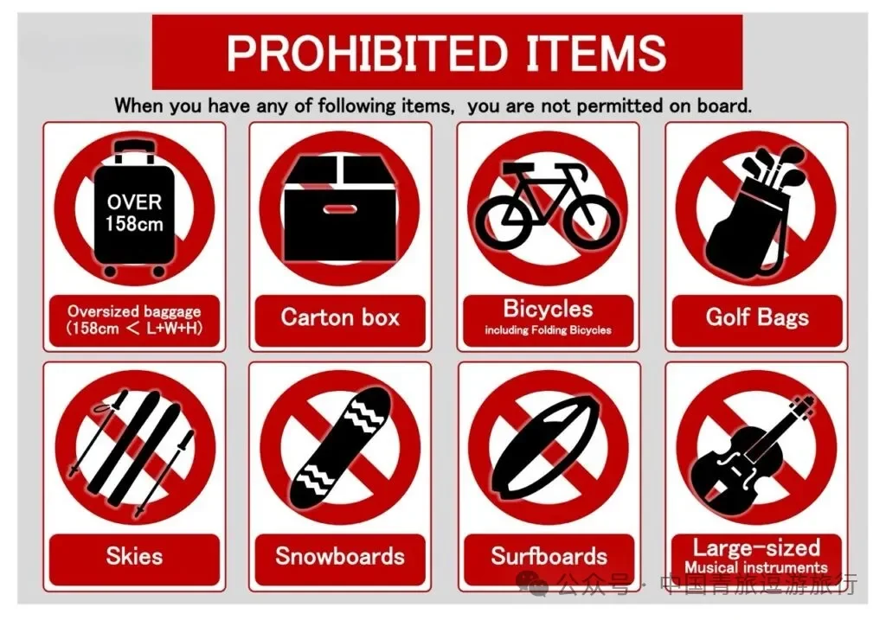

從成田機場進城，快線列車最快，但如果你拖著大箱子、不想在換乘通道里上上下下，一條約 1,500 日元的機場巴士往往更省力。AIRPORT BUS TYO-NRT 由京成巴士等公司運營，從成田機場第一、第二、第三航廈開往東京站，也停銀座方向，全程不用換車，中途不必自己搬行李。

這份指南按「它是什麼」「票價與班次」「怎麼買票」「在哪上車」「行李與車上規矩」「和電車怎麼選」六部分整理。文中的票價、時刻與櫃檯位置為 2025 年的資料，實際以運營方公佈的資訊為準。

## 一、一條為行李多的旅客準備的廉價巴士

成田機場共有三座航廈。第一、第二航廈同時設有電車與巴士站；第三航廈只有巴士站，要坐電車得步行或乘接駁車到第二航廈。這條線路在三座航廈都設櫃臺與乘車處，下飛機、辦完入境手續走進入境大廳，就能看到售票櫃檯。

所謂 LCB 是 Low Cost Bus 的縮寫，指的就是開往東京站與銀座的廉價班次：單程約 1,500 日元，車程最快約 65 分鐘，一般按路況在 60–70 分鐘之間。用車是大型高速巴士，40 個以上座位，全車自由席、不對號。

班次密度是它最大的優勢。2024 年 8 月 1 日起，這條線路增至每日 212 班（往返），從機場出發大致每 10 分鐘一班，東京站方向約 10–20 分鐘一班。取完行李走到站臺，通常不用等太久。

需要提醒的是，巴士走公路，時間並不完全由自己掌握。運營方統計了 2024 年 12 月至 2025 年 1 月的班次：多數班次準點，約 15% 因堵車等原因延誤，平均延誤 6–18 分鐘。

同一條線路上其實有兩種產品：普通巴士與 LCB 廉價巴士。前者去往更多酒店與車站，後者只跑東京站與銀座方向，用更簡單的路線換更低的票價。入境大廳裡兩排櫃檯挨在一起，排隊前先看清顏色，可以少走一次冤枉路。

## 二、票價與班次

| 票種 | 票價 |
| --- | --- |
| 成人 | 約 1,500 日元（23 點深夜班次 3,000 日元） |
| 兒童 | 約 750 日元（深夜班次 1,500 日元） |
| 嬰兒 | 每位成人可免費攜帶一名，如需佔座 750 日元（深夜班次 1,500 日元） |

約 1,500 日元，票價與班次以運營方為準。深夜班次按 3,000 日元計價，買票時留意發車時間是否落在這一檔。

時刻表分兩個方向：成田機場出發往東京站，以及東京都內出發往成田機場。白天班次最密，深夜與清晨變稀，23 點前後另有深夜班次，票價與白天不同。出發前建議在運營方官網或現場公告核對當日時刻，尤其是清晨第一班與深夜末班——這兩個時段最容易被時刻調整影響。

## 三、購票：認準綠色櫃檯

入境大廳的售票櫃檯分成黃色與綠色兩組：黃色賣的是普通巴士與利木津方向的車票，綠色的才是 LCB 廉價巴士。買 1,500 日元這一檔，直接找綠色櫃檯，櫃檯上方掛著整塊價目牌，東京、銀座、新宿一帶都標 1,500 日元。

買票時告訴售票員目的地即可，可選東京站或銀座，去銀座的班次比東京站少。付款可以用現金，也可以刷卡，或用 Suica 等 IC 交通卡。價目牌上還列有豐洲、川口／赤羽、池袋、澀谷等方向的票價，屬於 LCB 的其他下車點，實際發售情況以官網與櫃檯為準。

拿到車票後先看清兩件事：乘車處號碼與發車時間。車票只對應票面時刻的那一班車，錯過需要重新購票；全車自由席，車上只賣與座位數相同的票，坐滿即止。除了櫃檯，運營方官網也提供線上購票入口，線上購票的取票與乘車方式以官網說明為準。

## 四、在哪上車：三座航廈與東京站八重洲南口

第一航廈：入境大廳南、北兩個出口外都有售票櫃檯，很容易看到。買完票按票上的號碼走到站臺，去東京站是 7 號乘車處。站臺區域寬敞，每個位置都有編號，旺季建議提前一點排隊。

第二航廈：入境大廳分 A、B 兩個出口，多數旅客從 B 出口出來，櫃檯就在正對面；從 A 出口出來，櫃檯也在出口前。第二航廈去東京站是 6 號乘車處。

第三航廈：入境大廳較小，售票櫃檯就在廳內，走出去便是站臺，是三座航廈裡最省腳力的一座。對乘坐廉價航空、落在 T3 的旅客來說，這條巴士幾乎是為他們準備的；如果改乘電車，還得步行或搭航廈接駁車回第二航廈，行李多時這一段最費力。

回程從東京站出發，乘車點在八重洲南口。這裡有人工櫃檯，也有自動售票機，現金與信用卡都能用。持 Suica 等 IC 交通卡的旅客可以直接排隊上車，用現金或信用卡的旅客要先在視窗或機器上買票。清晨 5 點至 6 點從東京站出發的班次，售票視窗尚未開放，直接排隊，上車後用現金或 IC 卡付車費。

## 五、行李、座位與車上的規矩

行李是這條巴士最實在的好處。上車前，司機或工作人員會把每件行李放進行李艙，並給一張印著編號的行李牌；下車時憑這張牌子取回行李，牌子要收好。

額度是每位乘客一件，三邊合計不超過 158 釐米。超尺寸行李、紙箱、腳踏車（含摺疊車）、雪板、衝浪板、高爾夫球袋、大型樂器都不能託運，需要提前安排快遞或其他方式。

車廂是大型高速車，座椅間距比高峰時段的電車寬鬆得多，自由選座。車內有跑馬燈顯示下一站，廣播有中文、英文、日文，聽不懂日語也不至於坐過站。全程禁菸，行車時請繫好安全帶。

行李多的時候，巴士的優勢在於「不用搬」：從入境大廳到站臺是平路，行李由工作人員在車側裝艙，到東京站再取出，中途不用拖著箱子換乘。行李牌上的編號與艙內位置一一對應，取行李時報號即可，不必在艙口翻找。

## 六、和 Skyliner、N'EX 怎麼選

| 方式 | 主要停靠站 | 所需時間 | 票價 |
| --- | --- | --- | --- |
| JR 東日本 N'EX（成田特快） | 東京站、新宿、澀谷等 | 最快約 1 小時 30 分鐘 | 普通車廂 3,070 日元，綠色車廂 5,340 日元 |
| 京成電鐵 Skyliner | 上野、日暮裡等 | 最快約 36 分鐘 | 2,730 日元 |
| AIRPORT BUS TYO-NRT | 東京站、銀座等 | 最快約 65 分鐘 | 約 1,500 日元 |

三條路線的取捨很清楚。Skyliner 最快，36 分鐘到上野，去上野、日暮裡、淺草一帶最順；N'EX 直達東京站、新宿、澀谷，座位舒服，票價也最高；巴士最便宜，只相當於前兩者的一半到三分之一，下車點就在東京站八重洲口，去銀座、日本橋也近。

代價是時間。列車不受路況影響，巴士會。若當天要轉新幹線、趕飛機，或行程卡得很緊，把巴士的時間預算放寬 30 分鐘，或者乾脆選電車；如果行李多、預算優先、目的地就在東京站或銀座，巴士幾乎是最省力的答案。

工作日 7–9 點與 17–19 點是首都高速和市區道路最堵的時段，這兩個時段發車的班次延誤機率更高；深夜與清晨車流少，反而更準點。

按場景選就簡單了：

- 趕時間，目的地在上野、日暮裡一帶：Skyliner。
- 要直達新宿、澀谷，或不介意票價：N'EX。
- 行李多、預算優先，終點在東京站或銀座：AIRPORT BUS TYO-NRT。

## 相關連結

- **本站頁面**：[成田國際機場（NRT）](/tw/airport/NRT)、[日本（JP）](/tw/country/JP)
- **維基百科**：[成田國際機場](https://zh.wikipedia.org/wiki/%E6%88%90%E7%94%B0%E5%9B%BD%E9%99%85%E6%9C%BA%E5%9C%BA)

圖片來源：中國青旅逗遊旅行。文中票價、班次、櫃檯位置與行李規定為 2025 年資料，運營方可能調整；出行前請以 AIRPORT BUS TYO-NRT 官網（tyo-nrt.com）與現場公告為準。
