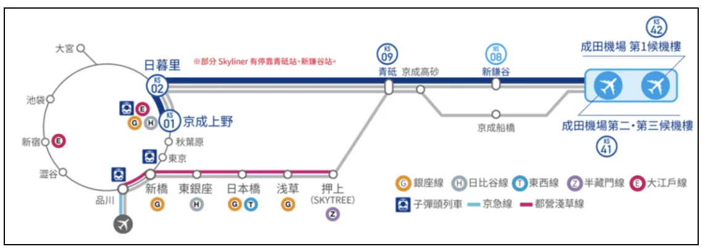
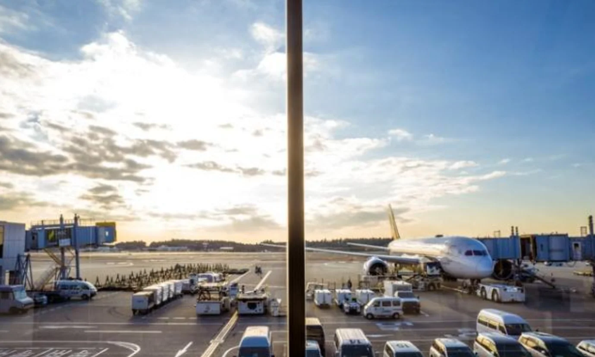

टोक्यो के दो हवाई अड्डे हैं। हानेदा केंद्र से 15 किमी दूर है, ट्रेन से 20 मिनट, और घरेलू उड़ानों से भरा रहता है। नारिता लगभग 60 किमी पूर्व में है और टोक्यो का सबसे व्यस्त अंतरराष्ट्रीय प्रवेश द्वार है: स्काईलाइनर 36 मिनट में शहर पहुँचती है, यह हवाई अड्डा 120 से ज़्यादा शहरों से जुड़ा है, और देर रात तथा सुबह जल्दी की ज़्यादातर किफ़ायती उड़ानें यहीं से हैं। लंबी दूरी की उड़ानें, सस्ते किराए और लेओवर के दौरान खरीदारी — आमतौर पर इसका मतलब नारिता ही है।

यह गाइड **टर्मिनल और एयरलाइंस**, **टोक्यो तक परिवहन**, **ड्यूटी-फ़्री और खरीदारी**, **ट्रांसफ़र और रात्रि-ठहराव** तथा **व्यावहारिक सवालों** को कवर करती है — पहली बार आने वालों और कनेक्शन लेने वालों, दोनों के लिए। किराए और समय-सारणी 2025 के आँकड़े हैं — यात्रा से पहले जाँच लें।

## 1. टर्मिनल और एयरलाइंस

नारिता अंतरराष्ट्रीय हवाई अड्डे (हवाई अड्डा कोड **NRT**) के तीन यात्री टर्मिनल हैं, और बँटवारा मोटे तौर पर एयरलाइन गठबंधनों के अनुसार है। T1 स्टार अलायंस का इलाक़ा है, जहाँ ANA, सिंगापुर एयरलाइंस और यूनाइटेड हैं। T2 मुख्यतः वनवर्ल्ड है — JAL, कैथे पैसिफ़िक और अमेरिकन — और अंतरराष्ट्रीय उड़ानों का सबसे घना कार्यक्रम यहीं है। T3 किफ़ायती टर्मिनल है: जेटस्टार जापान, पीच, स्प्रिंग जापान और जेजू एयर। चाइना एयरलाइंस अपनी उड़ानें T1 और T2 में बाँटती है, इसलिए हवाई अड्डे की वेबसाइट या अपनी एयरलाइन की सूचना में टर्मिनल की पुष्टि कर लें।

| टर्मिनल | गठबंधन / प्रकार | एयरलाइंस | टिप्पणियाँ |
| --- | --- | --- | --- |
| T1 | स्टार अलायंस | ANA, सिंगापुर एयरलाइंस, यूनाइटेड | चाइना एयरलाइंस की कुछ उड़ानें |
| T2 | वनवर्ल्ड | JAL, कैथे पैसिफ़िक, अमेरिकन | अंतरराष्ट्रीय उड़ानों के लिए सबसे व्यस्त; चाइना एयरलाइंस की कुछ उड़ानें |
| T3 | लो-कॉस्ट कैरियर | जेटस्टार जापान, पीच, स्प्रिंग जापान, जेजू एयर | T2 तक वॉकवे |

T1 में दक्षिणी विंग, उत्तरी विंग और एक केंद्रीय भवन है: विंगों में चेक-इन, एक फ़्लोर नीचे सुरक्षा और पासपोर्ट नियंत्रण, केंद्रीय भवन में ड्यूटी-फ़्री और खरीदारी, और दोनों विंगों के साथ गेट। T2 में एक इनडोर वॉकवे मुख्य भवन को सैटेलाइट से जोड़ता है, और वहाँ के गेट कुछ मिनट आगे हैं।

एयरलाइंस अलग-अलग तारीखों पर टर्मिनल बदलती हैं, खासकर कोड-शेयर वाली। अपना टर्मिनल एक दिन पहले एयरलाइन ऐप या नारिता की वेबसाइट पर देख लें।

एक निःशुल्क शटल तीनों टर्मिनलों को दस मिनट से कम में जोड़ती है: T1 से T2 तक लगभग 10 मिनट, और T2 से T3 तक लगभग 3 मिनट। T2 और T3 को 300 मीटर का ढका हुआ वॉकवे जोड़ता है, भवन से भवन तक लगभग 6 मिनट; T2 स्टेशन के टिकट गेट से T3 के प्रस्थान हॉल तक हवाई अड्डे का अपना अनुमान 13 मिनट है, इसलिए सामान के साथ 20 मिनट रखें।

फ़्लोर जानने से बहुत पैदल बचता है। T1 में चेक-इन 4F पर, पासपोर्ट नियंत्रण के आगे ड्यूटी-फ़्री 3F पर, आगमन 1F पर, B1 पर केइसेई और JR का नारिता एयरपोर्ट स्टेशन, और 5F पर रेस्टोरेंट, दुकानें और अवलोकन डेक हैं।

T2 भी इसी तरह बना है: चेक-इन, गेट और ड्यूटी-फ़्री 3F पर, रेस्टोरेंट, दुकानें और अवलोकन प्लेटफ़ॉर्म 4F पर, आगमन 1F पर, और नारिता एयरपोर्ट टर्मिनल 2·3 स्टेशन B1 पर। T3 से प्रस्थान 2F से और आगमन 1F पर होता है, चेक-इन, सुरक्षा और बोर्डिंग सब एक ही स्तर पर; यहाँ की एकमात्र ड्यूटी-फ़्री दुकान Fa-So-La का स्मृति-चिह्न आउटलेट है, इसलिए बड़े ब्रांडों के लिए शटल से T2 लौटें।

## 2. टोक्यो पहुँचना: ट्रेनें, बसें और टैक्सी

नारिता मध्य टोक्यो से लगभग 60 किमी दूर है, और उड़ान भरने से पहले इस हिस्से का फ़ैसला कर लेना बेहतर है। केइसेई स्काईलाइनर, एक्सेस एक्सप्रेस और केइसेई मेन लाइन चलाती है; JR नारिता एक्सप्रेस (N'EX) चलाती है। सड़क पर किफ़ायती हवाई अड्डा बसें और एयरपोर्ट लिमोज़ीन हैं, और टैक्सियाँ चौबीसों घंटे चलती हैं। नीचे दिए समय और अनुमानित किराए 2025 के आँकड़े हैं — उस दिन केइसेई, JR और हवाई अड्डे की साइटों पर जाँच लें।

| विकल्प | मुख्य स्टॉप / गंतव्य | यात्रा समय | अनुमानित किराया |
| --- | --- | --- | --- |
| केइसेई स्काईलाइनर | निप्पोरी, उएनो | 36–41 मिनट | लगभग ¥2,570 (ऑनलाइन अर्ली-बर्ड) |
| JR नारिता एक्सप्रेस (N'EX) | टोक्यो, शिंजुकु, शिबुया, योकोहामा | 53–80 मिनट | लगभग ¥3,070–3,250 |
| केइसेई मेन लाइन लिमिटेड एक्सप्रेस | केइसेई-उएनो, निप्पोरी | लगभग हर स्टॉप, सबसे धीमी | लगभग ¥1,050 |
| केइसेई एक्सेस एक्सप्रेस | ओशिआगे, असाकुसा, हिगाशी-गिन्ज़ा | 47–62 मिनट | केइसेई देखें |
| हवाई अड्डा बस TYO-NRT | टोक्यो स्टेशन, गिन्ज़ा | 65–90 मिनट | लगभग ¥1,500 (देर रात लगभग ¥3,000) |
| एयरपोर्ट लिमोज़ीन | शिंजुकु, इकेबुकुरो, असाकुसा, शिनागावा, ओदाइबा | 60–120 मिनट | लगभग ¥3,100–3,600 |
| टैक्सी | मध्य टोक्यो | यातायात पर निर्भर | मीटर, साथ में एक्सप्रेसवे टोल |

**स्काईलाइनर** सबसे तेज़ है: निप्पोरी 36 मिनट में, उएनो 41 मिनट में, और यामानोते तथा गिन्ज़ा लाइनों पर आसान बदलाव। एक तरफ़ का किराया ऑनलाइन अर्ली-बर्ड में लगभग ¥2,570 है; काउंटर पर ज़्यादा लगता है, इसलिए पहले से बुक करें।

**N'EX** टोक्यो स्टेशन लगभग 53 मिनट में, शिंजुकु या शिबुया 60–80 मिनट में पहुँचती है, एक तरफ़ का किराया लगभग ¥3,070–3,250, और सामान के साथ आरामदायक। पश्चिमी हिस्से के लिए यह तनाव-मुक्त विकल्प है।

**केइसेई मेन लाइन लिमिटेड एक्सप्रेस** का किराया लगभग ¥1,050 है और यह हर जगह रुकती है, इसलिए सबसे धीमी है — अगर जल्दी नहीं है और आप केइसेई-उएनो या निप्पोरी के पास ठहर रहे हैं तो ठीक है। **एक्सेस एक्सप्रेस** सीधे तोएई असाकुसा लाइन पर चली जाती है: ओशिआगे लगभग 47 मिनट में, असाकुसा 51 में, हिगाशी-गिन्ज़ा 62 में।

**बसें** दो तरह की हैं। TYO-NRT टोक्यो स्टेशन और गिन्ज़ा तक 65–90 मिनट में लगभग ¥1,500 में जाती है, देर रात लगभग ¥3,000 में। एयरपोर्ट लिमोज़ीन शिंजुकु, इकेबुकुरो, असाकुसा, शिनागावा और ओदाइबा तक सीधे 60–120 मिनट में लगभग ¥3,100–3,600 में जाती है, ऑनलाइन बुक की जा सकती है, और होटल के दरवाज़े पर उतारती है।

**टैक्सियाँ** T1 और T2 में 1F पर आगमन के बाहर मिलती हैं, हिगाशी-कांतो एक्सप्रेसवे से मेट्रोपॉलिटन एक्सप्रेसवे पर जाती हैं, और मीटर के साथ टोल लेती हैं; रात में या बारिश में पहले से बुक करें। आख़िरी ट्रेनों का ध्यान रखें: आख़िरी N'EX लगभग 21:30 और आख़िरी स्काईलाइनर लगभग 23:00 है। उसके बाद सिर्फ़ देर रात की बसें (आख़िरी लगभग 03:30), टैक्सी या पहले से बुक की गई कार है।

**क्या लें:** उएनो या निप्पोरी — स्काईलाइनर; टोक्यो, शिंजुकु, शिबुया या योकोहामा — N'EX; असाकुसा या गिन्ज़ा — एक्सेस एक्सप्रेस; भारी सामान और लिमोज़ीन मार्ग पर होटल — बस; सीमित बजट — केइसेई लिमिटेड एक्सप्रेस या TYO-NRT।

## 3. ड्यूटी-फ़्री और खरीदारी: 2025 में क्या नया है

नारिता की ड्यूटी-फ़्री श्रृंखला 2025 में बदली है। तीनों टर्मिनल लैंडसाइड (सुरक्षा से पहले) और एयरसाइड (सुरक्षा के बाद) में बँटे हैं; ब्रांड अलग-अलग हैं, और दिलचस्प वाले आमतौर पर एयरसाइड में होते हैं।

लैंडसाइड वह सार्वजनिक क्षेत्र है जहाँ चेक-इन होता है; एयरसाइड सुरक्षा और पासपोर्ट नियंत्रण के आगे है, सिर्फ़ यात्रियों के लिए। इलेक्ट्रॉनिक्स और कॉस्मेटिक्स लैंडसाइड पर खरीदें और चेक-इन बैग में रखें, और स्नैक्स, नामा चॉकलेट तथा सीमित स्मृति-चिह्न एयरसाइड के लिए, आख़िरी हिस्से के लिए बचाकर रखें।

- **T1:** लैंडसाइड पर यामादा डेंकी का YAMADA TAX FREE है, डायसन, निंटेंडो और ब्यूटी डिवाइस के लिए; एयरसाइड पर Fa-So-La ASAKUSA है, जहाँ सिर्फ़ नारिता में मिलने वाले ईल काबायाकी स्वाद वाले काकिनोताने और NEWYORK PERFECT CHEESE (प्रति व्यक्ति तीन) मिलते हैं।
- **T2:** लैंडसाइड पर Air BicCamera है, नवीनतम α कैमरों और ब्लूटूथ ईयरफ़ोन के लिए; एयरसाइड पर Fa-So-La AKIHABARA है, जहाँ अकिहाबारा मॉडल, Royce' नामा चॉकलेट और Sugar Butter Tree मिलते हैं।
- **T3:** एयरसाइड पर सिर्फ़ Fa-So-La SOUVENIR AKIHABARA है, ज़्यादातर स्नैक्स — बड़े ब्रांडों के लिए शटल से T2 जाएँ।

2025 में नारिता पर तीन नई शुरुआतें याद रखने योग्य हैं: टोक्यो बनाना का फ़्रोज़न बनाना चॉकलेट केक, जो कमरे के तापमान पर 11 घंटे तक मुलायम रहता है; BUTTER NO ITOKO के शकरकंद और दालचीनी बटर वेफ़र्स, सिर्फ़ T1 और T2 में; और कामेदा के ईल काबायाकी काकिनोताने, जो T2 के Fa-So-La में ही मिलते हैं। टैक्स रिफ़ंड और सुरक्षा के लिए समय छोड़ें — एयरसाइड की दुकानें गेटों की ओर हैं, और ज़रूरत से ज़्यादा खरीदारी हो जाना आसान है।

## 4. ट्रांसफ़र, रात्रि-ठहराव और समय बिताना

नारिता में दो घंटे और छह घंटे — अनुभव अलग-अलग हैं।

**दो घंटे:** T1 की 5F या T2 की 4F पर अवलोकन डेक, जहाँ से उड़ान भरते और उतरते विमान, और अच्छे दिन में सूर्यास्त दिखता है, साथ में एक स्टारबक्स भी। यह गेट पर बैठने से बेहतर है।

**चार घंटे:** T2 में Fa-So-La की सैर, गिन्ज़ा कागारी का चिकन पाइतान रामेन, और फिर सिर्फ़ हवाई अड्डे पर मिलने वाली स्टेशनरी के लिए Traveler's Factory। आप लैंडसाइड और एयरसाइड के बीच आ-जा नहीं सकते, इसलिए अपना समय देख लें। लैंडसाइड पर T1 में 24 घंटे खुला मैकडॉनल्ड्स और काइतेन सुशी मिसाकी, T2 में 24 घंटे खुला योशिनोया और शिन्शू SOJIBOU का हाथ से बना सोबा, T3 में 24 घंटे खुला मात्सुया और सेंदाई रिक्यू का चारकोल-ग्रिल्ड बीफ़ टंग। एयरसाइड पर T1 में इप्पुदो और सानपोतेई का तेप्पान हैमबर्ग स्टेक, T2 में गिन्ज़ा कागारी और दोतोनबोरी कुरिता का ओकोनोमियाकी, और T3 में बियर और पास्ता के लिए caffe LAT.25°।

**छह घंटे या ज़्यादा:** हवाई अड्डे से बाहर निकलें। नारितासान शिंशोजी एक आरामदायक आधे दिन की वापसी यात्रा है; टोक्यो में खाना खाकर 36 मिनट की स्काईलाइनर से लौटना संभव है, लेकिन सुरक्षा की दो कतारों के साथ छह घंटे में आपको एक ही जगह मिलती है।

**रात्रि-ठहराव:** T3 की 2F पर 24 घंटे बैठने की जगह और पावर पॉइंट हैं; T1 और T2 में ¥1,050 प्रति 30 मिनट पर शॉवर; T2 का कैप्सूल होटल, 9h nine hours, ¥4,900 से शुरू होता है और ऑनलाइन बुकिंग ज़रूरी है। 22:00 से 05:30 के बीच रेड-आई फ़्लाइट से उतरें तो देर रात की बस से टोक्यो जाएँ, कार पहले से बुक करें, या पहली ट्रेन तक हवाई अड्डे पर सोएँ।

**ट्रांसफ़र:** पुष्टि करें कि आगे की उड़ान किस टर्मिनल से है। एक ही भवन के अंदर ट्रांसफ़र के संकेतों का पालन करें; भवनों के बीच निःशुल्क शटल (लगभग 10 मिनट) और दूसरी सुरक्षा जाँच अपने समय में जोड़ें। उड़ानों के बीच तीन घंटे आरामदायक हैं। जापान में प्रवेश करना पड़ेगा या सामान दोबारा चेक कराना पड़ेगा, यह इस पर निर्भर है कि टिकट कैसे जारी हुए हैं, इसलिए एयरलाइन से पूछें।

## 5. रास्ते में: हवाई अड्डे के आसपास एक से चार घंटे

उड़ानों या बसों के बीच चार घंटे या ज़्यादा हों तो नारिता के आसपास का इलाक़ा घूमने लायक है। ये सभी चिबा प्रान्त में हैं और ट्रेन या बस से पहुँचे जा सकते हैं; समय एक तरफ़ के हैं, और वापसी मिलाकर आधा दिन लगेगा।

- **नारितासान शिंशोजी** (लगभग 30 मिनट): ओमोतेसांदो पथ पर ईल रेस्टोरेंट कावाफ़ुकु, और गली के अंत में मंदिर।
- **सावारा** (लगभग 45 मिनट): ओनोगावा में नौका यात्राएँ और सोया-सॉस के गोदामों वाली गलियाँ।
- **साकुरा** (लगभग 50 मिनट): चिबा प्रीफ़ेक्चुरल म्यूज़ियम ऑफ़ आर्ट और साइकिल चलाने के लिए बना किले का शहर।
- **चोशी इनुबोसाकी** (लगभग 90 मिनट): जापान का सबसे पूर्वी लाइटहाउस, प्रशांत महासागर पर सूर्योदय और INUBOH ट्रेन।

## 6. व्यावहारिक जानकारी और सवाल

**आगमन से स्टेशन तक:** रेलवे के संकेतों का पालन करें। केइसेई और JR हर टर्मिनल पर B1 का स्टेशन साझा करते हैं — T1 पर नारिता एयरपोर्ट स्टेशन, T2 पर नारिता एयरपोर्ट टर्मिनल 2·3 स्टेशन — आगमन से एक फ़्लोर नीचे, टिकट और प्लेटफ़ॉर्म दस मिनट के भीतर। T3 का अपना स्टेशन नहीं है: वॉकवे या शटल से T2 जाएँ।

**वाई-फ़ाई और सामान**

- वाई-फ़ाई: पूरे हवाई अड्डे पर FreeWiFi-NARITA, कोई पंजीकरण नहीं।
- SIM और eSIM: T1–T3 के आगमन हॉल में वेंडिंग मशीनें और सॉफ़्टबैंक काउंटर; eSIM कोड स्कैन करके, सात दिन और 20 GB लगभग ¥3,500 से।
- सिक्का लॉकर: T1–T3 के आगमन हॉल, ¥300–800 प्रति दिन, और व्यस्त मौसम में भरे रहते हैं।
- कर्मचारी वाला भंडारण: स्की और गत्ते के बक्से स्वीकार, ¥800–2,000 प्रति दिन।
- डिलीवरी: यामातो और JAL ABC बैग उसी या अगले दिन टोक्यो के होटलों तक भेजते हैं, 23 किग्रा के बक्से के लिए लगभग ¥1,900 से; क़ीमती सामान और बैटरी स्वीकार नहीं।

**आम सवाल**

- **शहर में सबसे तेज़?** स्काईलाइनर, निप्पोरी 36 मिनट में।
- **देर रात सार्वजनिक परिवहन?** देर रात की बसें लगभग 03:30 तक चलती हैं; आख़िरी N'EX लगभग 21:30 और आख़िरी स्काईलाइनर लगभग 23:00 है।
- **कुछ खो गया?** अपने टर्मिनल के खोया-पाया केंद्र पर कॉल करें: T1 0476-32-2105, T2 0476-34-5220, T3 0476-34-4195, चौबीसों घंटे कर्मचारी, चीनी बोलने वाली सहायता के साथ।
- **क्या मैं Alipay या WeChat से भुगतान कर सकता हूँ?** ज़्यादातर ड्यूटी-फ़्री ड्रगस्टोर और इलेक्ट्रॉनिक्स दुकानें इन्हें लेती हैं; बस काउंटर सिर्फ़ नकद या कार्ड लेते हैं।
- **कितनी जल्दी पहुँचना चाहिए?** अंतरराष्ट्रीय उड़ानों के लिए तीन घंटे, LCC के लिए 30 मिनट ज़्यादा; T3 में सुरक्षा की भीड़ 07:00–09:00 और 19:00–22:00 के बीच होती है।
- **T3 से T2?** 300 मीटर के वॉकवे पर लगभग 6 मिनट या निःशुल्क शटल पर 3 मिनट; T3 के प्रस्थान हॉल से T2 स्टेशन के टिकट गेट तक 13 मिनट रखें।
- **नारिता या हानेदा?** हानेदा शहर के ज़्यादा करीब है; नारिता में ज़्यादा अंतरराष्ट्रीय मार्ग, किफ़ायती एयरलाइंस और रेड-आई उड़ानें हैं। उड़ान के समय और किराए के आधार पर चुनें, वफ़ादारी के आधार पर नहीं।

## संबंधित लिंक

- **इस साइट पर**: [नारिता अंतरराष्ट्रीय हवाई अड्डा (NRT)](/airport/NRT), [जापान (JP)](/country/JP)
- **विकिपीडिया**: [नारिता अंतरराष्ट्रीय हवाई अड्डा](https://en.wikipedia.org/wiki/Narita_International_Airport)
- **बाइदू बाइके**: [नारिता हवाई अड्डा](https://baike.baidu.com/item/%E6%88%90%E7%94%B0%E6%9C%BA%E5%9C%BA)

चित्र स्रोत: Leyou Nihong। किराए, समय-सारणी और दुकानों का विवरण 2025 के आँकड़े हैं; यात्रा के दिन केइसेई, JR, नारिता हवाई अड्डे और ऑपरेटरों की अपनी साइटों पर जाँच लें।
