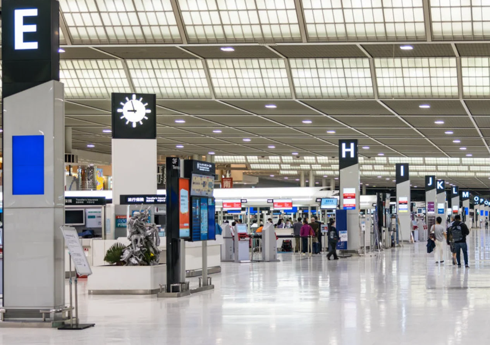

Tokyo memiliki dua bandara. Haneda berjarak 15 km dari pusat kota, 20 menit dengan kereta, dan padat penerbangan domestik. Narita berada sekitar 60 km ke timur, gerbang internasional tersibuk untuk Tokyo: Skyliner mencapai kota dalam 36 menit, bandara ini melayani lebih dari 120 kota, dan sebagian besar penerbangan bertarif murah larut malam serta dini hari ada di sini. Penerbangan jarak jauh, tarif murah, dan belanja saat transit biasanya berarti Narita.

Panduan ini mencakup **terminal dan maskapai**, **transportasi ke Tokyo**, **bebas bea dan belanja**, **transit dan menginap**, serta **pertanyaan praktis**, untuk kedatangan pertama atau penerbangan sambungan. Tarif dan jadwal adalah angka tahun 2025 — periksa kembali sebelum berangkat.

## 1. Terminal dan maskapai

Bandara Internasional Narita (kode bandara **NRT**) memiliki tiga terminal penumpang, dan pembagiannya secara garis besar mengikuti aliansi maskapai. T1 adalah wilayah Star Alliance, dengan ANA, Singapore Airlines, dan United. T2 sebagian besar oneworld — JAL, Cathay Pacific, dan American — dan membawa jadwal internasional terpadat. T3 adalah terminal maskapai bertarif murah: Jetstar Japan, Peach, Spring Japan, dan Jeju Air. China Airlines menyebar penerbangannya di T1 dan T2, jadi pastikan terminal Anda di situs bandara atau pemberitahuan maskapai.

| Terminal | Aliansi / jenis | Maskapai | Catatan |
| --- | --- | --- | --- |
| T1 | Star Alliance | ANA, Singapore Airlines, United | beberapa penerbangan China Airlines |
| T2 | oneworld | JAL, Cathay Pacific, American | terpadat untuk penerbangan internasional; beberapa penerbangan China Airlines |
| T3 | Maskapai bertarif murah | Jetstar Japan, Peach, Spring Japan, Jeju Air | jalur pejalan kaki ke T2 |

T1 memiliki sayap selatan, sayap utara, dan bangunan tengah: check-in di sayap, keamanan dan pemeriksaan paspor satu lantai di bawahnya, bebas bea dan belanja di bangunan tengah, gerbang di sepanjang kedua sayap. Di T2, jalur pejalan kaki dalam ruangan menghubungkan bangunan utama ke satelit, dan gerbang di sana beberapa menit lebih jauh.

Maskapai berpindah terminal pada tanggal yang berbeda, terutama untuk kerja sama kode. Periksa terminal Anda sehari sebelumnya, di aplikasi maskapai atau situs Narita.

Shuttle gratis menghubungkan ketiga terminal dalam waktu kurang dari sepuluh menit: sekitar 10 menit dari T1 ke T2, dan sekitar 3 menit dari T2 ke T3. Jalur pejalan kaki beratap sepanjang 300 meter menghubungkan T2 dan T3, kira-kira 6 menit dari bangunan ke bangunan; dari gerbang tiket di stasiun T2 ke aula keberangkatan T3, perkiraan bandara sendiri adalah 13 menit, jadi sediakan 20 menit dengan bagasi.

Mengetahui lantainya menghemat banyak langkah. Di T1, check-in di lantai 4, bebas bea setelah pemeriksaan paspor di lantai 3, kedatangan di lantai 1, B1 adalah Stasiun Bandara Narita Keisei dan JR, dan lantai 5 memiliki restoran, toko, serta dek observasi.

T2 tersusun serupa: check-in, gerbang, dan bebas bea di lantai 3, restoran, toko, dan platform observasi di lantai 4, kedatangan di lantai 1, dan Stasiun Bandara Narita Terminal 2·3 di B1. T3 berangkat di lantai 2 dan tiba di lantai 1, dengan check-in, keamanan, dan boarding semuanya di satu lantai; satu-satunya toko bebas bea adalah gerai suvenir Fa-So-La, jadi naik shuttle kembali ke T2 untuk merek besar.

## 2. Masuk ke Tokyo: kereta, bus, dan taksi

Narita berjarak sekitar 60 km dari pusat Tokyo, dan bagian perjalanan ini layak diputuskan sebelum terbang. Keisei mengoperasikan Skyliner, Access Express, dan Jalur Utama Keisei; JR mengoperasikan Narita Express (N'EX). Di jalan ada bus bandara bertarif murah dan Airport Limousine, serta taksi yang beroperasi sepanjang waktu. Waktu dan tarif indikatif di bawah adalah angka tahun 2025 — periksa situs Keisei, JR, dan bandara pada hari itu.

| Pilihan | Halte / tujuan utama | Waktu tempuh | Tarif indikatif |
| --- | --- | --- | --- |
| Keisei Skyliner | Nippori, Ueno | 36–41 menit | sekitar ¥2.570 (early-bird online) |
| JR Narita Express (N'EX) | Tokyo, Shinjuku, Shibuya, Yokohama | 53–80 menit | sekitar ¥3.070–3.250 |
| Keisei Main Line limited express | Keisei-Ueno, Nippori | hampir semua halte, paling lambat | sekitar ¥1.050 |
| Keisei Access Express | Oshiage, Asakusa, Higashi-Ginza | 47–62 menit | lihat Keisei |
| Bus bandara TYO-NRT | Stasiun Tokyo, Ginza | 65–90 menit | sekitar ¥1.500 (sekitar ¥3.000 larut malam) |
| Airport Limousine | Shinjuku, Ikebukuro, Asakusa, Shinagawa, Odaiba | 60–120 menit | sekitar ¥3.100–3.600 |
| Taksi | pusat Tokyo | tergantung lalu lintas | argo, ditambah tarif tol jalan tol |

**Skyliner** paling cepat: 36 menit ke Nippori, 41 menit ke Ueno, dengan pergantian mudah ke Jalur Yamanote dan Ginza. Tarif sekali jalan sekitar ¥2.570 early-bird online; meja tiket mengenakan biaya lebih tinggi, jadi pesan lebih awal.

**N'EX** mencapai Stasiun Tokyo dalam sekitar 53 menit, Shinjuku atau Shibuya dalam 60–80 menit, dengan tarif sekitar ¥3.070–3.250 sekali jalan, lapang dan mudah dengan bagasi. Ini pilihan santai untuk sisi barat.

**Keisei Main Line limited express** berbiaya sekitar ¥1.050 dan berhenti di semua tempat, jadi paling lambat — tidak masalah jika Anda tidak terburu-buru dan menginap di dekat Keisei-Ueno atau Nippori. **Access Express** berjalan langsung ke Jalur Toei Asakusa: sekitar 47 menit ke Oshiage, 51 menit ke Asakusa, 62 menit ke Higashi-Ginza.

**Bus** hadir dalam dua jenis. TYO-NRT berjalan ke Stasiun Tokyo dan Ginza dalam 65–90 menit seharga sekitar ¥1.500, atau sekitar ¥3.000 larut malam. Airport Limousine pergi langsung ke Shinjuku, Ikebukuro, Asakusa, Shinagawa, dan Odaiba dalam 60–120 menit seharga sekitar ¥3.100–3.600, dapat dipesan online, dengan pengantaran ke pintu hotel.

**Taksi** menunggu di luar kedatangan lantai 1 di T1 dan T2, melewati Higashi-Kanto Expressway ke Metropolitan Expressway, dan mengenakan argo ditambah tol; pesan lebih awal pada malam hari atau saat hujan. Perhatikan kereta terakhir: N'EX terakhir sekitar pukul 21:30 dan Skyliner terakhir sekitar pukul 23:00. Setelah itu, hanya bus larut malam (terakhir sekitar pukul 03:30), taksi, atau mobil yang dipesan sebelumnya.

**Mana yang dipilih:** Ueno atau Nippori, Skyliner; Tokyo, Shinjuku, Shibuya, atau Yokohama, N'EX; Asakusa atau Ginza, Access Express; bagasi berat dan hotel di rute Limousine, bus; anggaran ketat, Keisei limited express atau TYO-NRT.

## 3. Bebas bea dan belanja: apa yang baru pada 2025

Susunan bebas bea Narita berubah pada 2025. Ketiga terminal terbagi menjadi landside, sebelum keamanan, dan airside, sesudahnya; mereknya berbeda, dan yang menarik cenderung berada di airside.

Landside adalah area publik tempat check-in berlangsung; airside berada setelah keamanan dan pemeriksaan paspor, hanya untuk penumpang. Beli elektronik dan kosmetik di landside dan kemas di bagasi tercatat, serta simpan camilan, nama chocolate, dan suvenir terbatas untuk airside, di bagian terakhir.

- **T1:** landside memiliki YAMADA TAX FREE milik Yamada Denki, untuk Dyson, Nintendo, dan perangkat kecantikan; airside memiliki Fa-So-La ASAKUSA, rumah bagi kakinotane rasa kabayaki belut khas Narita dan NEWYORK PERFECT CHEESE (tiga per orang).
- **T2:** landside adalah Air BicCamera, untuk kamera α terbaru dan earphone Bluetooth; airside adalah Fa-So-La AKIHABARA, dengan model Akihabara, Royce' nama chocolate, dan Sugar Butter Tree.
- **T3:** airside hanya memiliki Fa-So-La SOUVENIR AKIHABARA, sebagian besar camilan — naik shuttle ke T2 untuk merek besar.

Tiga debut Narita 2025 layak diingat: kue cokelat pisang beku Tokyo Banana, yang tetap lembut selama 11 jam pada suhu ruang; wafer mentega ubi jalar dan kayu manis BUTTER NO ITOKO, hanya di T1 dan T2; dan kakinotane rasa kabayaki belut Kameda, eksklusif di Fa-So-La T2. Sisakan waktu untuk pengembalian pajak dan keamanan — toko airside berada ke arah gerbang, dan mudah kalap berbelanja.

## 4. Transit, menginap, dan mengisi waktu

Dua jam di Narita adalah pengalaman yang berbeda dari enam jam.

**Dua jam:** dek observasi di T1 lantai 5 atau T2 lantai 4, untuk melihat lepas landas dan mendarat serta, jika cuaca bagus, matahari terbenam, dengan Starbucks di sampingnya. Lebih baik daripada menunggu di gerbang.

**Empat jam:** melihat-lihat Fa-So-La di T2, semangkuk ramen paitan ayam Ginza Kagari, lalu Traveler's Factory untuk alat tulis khusus bandara. Anda tidak dapat berpindah antara landside dan airside, jadi periksa sisa waktu Anda. Di landside, T1 memiliki McDonald's 24 jam dan sushi kaiten Misaki, T2 memiliki Yoshinoya 24 jam dan soba buatan tangan Shinshu SOJIBOU, T3 memiliki Matsuya 24 jam dan lidah sapi panggang arang Sendai Rikyu. Di airside, T1 memiliki Ippudo dan teppan hamburg steak Sanpotei, T2 memiliki Ginza Kagari dan okonomiyaki Dotonbori Kurita, dan T3 memiliki caffe LAT.25° untuk bir dan pasta.

**Enam jam atau lebih:** tinggalkan bandara. Naritasan Shinshoji adalah perjalanan pulang-pergi setengah hari yang nyaman; makan di Tokyo dan kembali bisa dilakukan dengan Skyliner 36 menit, tetapi dengan dua antrean keamanan, enam jam hanya memberi Anda satu perhentian.

**Menginap:** T3 lantai 2 memiliki tempat duduk 24 jam dengan colokan listrik; T1 dan T2 memiliki pancuran seharga ¥1.050 per 30 menit; hotel kapsul di T2, 9h nine hours, mulai dari ¥4.900 dan perlu dipesan online. Jika mendarat dengan penerbangan larut malam antara pukul 22:00 dan 05:30, naik bus larut malam ke Tokyo, pesan mobil lebih awal, atau tidur di bandara sampai kereta pertama.

**Transit:** pastikan terminal mana yang dipakai penerbangan lanjutan Anda. Dalam satu bangunan, ikuti tanda Transfer; antarbangunan, tambahkan shuttle gratis (sekitar 10 menit) dan pemeriksaan keamanan kedua ke sisa waktu Anda. Tiga jam antarpenerbangan sudah nyaman. Apakah Anda perlu masuk Jepang atau check-in ulang bagasi bergantung pada cara tiket diterbitkan, jadi tanyakan kepada maskapai.

## 5. Dalam perjalanan: satu hingga empat jam di sekitar bandara

Dengan empat jam atau lebih antara penerbangan atau bus, daerah sekitar Narita layak dikunjungi. Semuanya berada di Prefektur Chiba dan dapat dijangkau dengan kereta atau bus; waktunya sekali jalan, dan dengan perjalanan pulang Anda memerlukan setengah hari.

- **Naritasan Shinshoji** (sekitar 30 menit): restoran belut Kawafuku di jalan pendekatan Omotesando, dan kuil di ujung jalan.
- **Sawara** (sekitar 45 menit): perjalanan perahu di Onogawa dan jalan-jalan gudang kecap.
- **Sakura** (sekitar 50 menit): Museum Seni Prefektur Chiba dan kota kastil yang cocok untuk bersepeda.
- **Choshi Inubosaki** (sekitar 90 menit): mercusuar paling timur Jepang, matahari terbit di atas Pasifik, dan kereta INUBOH.

## 6. Informasi praktis dan pertanyaan

**Dari kedatangan ke stasiun:** ikuti tanda Railway. Keisei dan JR berbagi stasiun B1 di setiap terminal — Stasiun Bandara Narita di T1, Stasiun Bandara Narita Terminal 2·3 di T2 — satu lantai di bawah kedatangan, dengan tiket dan peron dalam sepuluh menit. T3 tidak memiliki stasiun sendiri: naik jalur pejalan kaki atau shuttle ke T2.

**Wi-Fi dan bagasi**

- Wi-Fi: FreeWiFi-NARITA di seluruh area, tanpa registrasi.
- SIM dan eSIM: mesin penjual dan meja SoftBank di aula kedatangan T1–T3; eSIM dengan memindai kode, tujuh hari dan 20 GB mulai sekitar ¥3.500.
- Loker koin: aula kedatangan T1–T3, ¥300–800 sehari, dan penuh pada musim puncak.
- Penyimpanan berstaf: ski dan kardus diterima, ¥800–2.000 sehari.
- Pengiriman: Yamato dan JAL ABC mengirim bagasi ke hotel Tokyo pada hari yang sama atau hari berikutnya, mulai sekitar ¥1.900 untuk kotak 23 kg; barang berharga dan baterai tidak diterima.

**Pertanyaan umum**

- **Tercepat ke kota?** Skyliner, 36 menit ke Nippori.
- **Transportasi umum larut malam?** Bus larut malam berjalan sampai sekitar pukul 03:30; N'EX terakhir sekitar pukul 21:30 dan Skyliner terakhir sekitar pukul 23:00.
- **Kehilangan barang?** Hubungi pusat kehilangan barang untuk terminal Anda: T1 0476-32-2105, T2 0476-34-5220, T3 0476-34-4195, berstaf 24 jam, dengan bantuan berbahasa Mandarin.
- **Bisakah membayar dengan Alipay atau WeChat?** Sebagian besar toko obat bebas bea dan toko elektronik menerimanya; meja bus hanya menerima uang tunai atau kartu.
- **Seberapa awal harus tiba?** Tiga jam untuk penerbangan internasional, tambahan 30 menit untuk LCC; puncak keamanan T3 adalah pukul 07:00–09:00 dan 19:00–22:00.
- **T3 ke T2?** Sekitar 6 menit di jalur pejalan kaki 300 meter atau 3 menit dengan shuttle gratis; sediakan 13 menit dari aula keberangkatan T3 ke gerbang tiket di stasiun T2.
- **Narita atau Haneda?** Haneda lebih dekat ke kota; Narita memiliki lebih banyak rute internasional, maskapai bertarif murah, dan penerbangan larut malam. Pilih berdasarkan waktu penerbangan dan tarif, bukan loyalitas.

## Tautan terkait

- **Di situs ini**: [Bandara Internasional Narita (NRT)](/airport/NRT), [Jepang (JP)](/country/JP)
- **Wikipedia**: [Bandara Internasional Narita](https://en.wikipedia.org/wiki/Narita_International_Airport)
- **Baidu Baike**: [Bandara Narita](https://baike.baidu.com/item/%E6%88%90%E7%94%B0%E6%9C%BA%E5%9C%BA)

Sumber gambar: Leyou Nihong. Tarif, jadwal, dan detail toko adalah angka tahun 2025; periksa situs Keisei, JR, Bandara Narita, dan operator pada hari perjalanan Anda.
