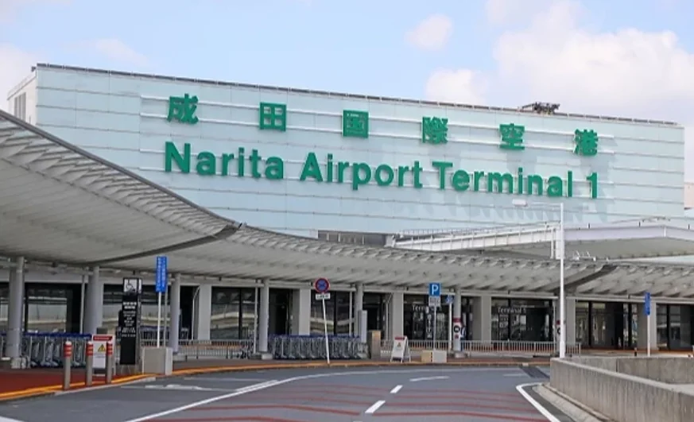
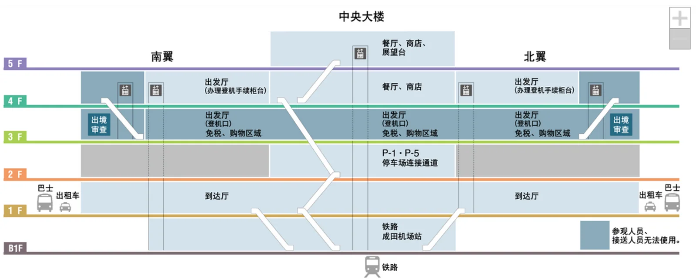

東京には空港が2つあります。羽田は都心から15 km、電車で20分で、国内線が充実しています。成田は東へ約60 kmに位置し、東京の国際線の玄関口として最も忙しい空港です。スカイライナーは36分で都心に着き、120以上の都市に就航し、深夜・早朝の格安便の多くがここを発着します。長距離線、安い運賃、乗り継ぎ中の買い物といえば、たいてい成田です。

このガイドでは、**ターミナルと航空会社**、**都心への交通**、**免税店とショッピング**、**乗り継ぎと宿泊**、**実用的な質問**を、初めての到着でも乗り継ぎでも役立つようにまとめます。運賃と時刻表は2025年の情報です。旅行前に確認してください。

## 1. ターミナルと航空会社

成田国際空港（空港コード**NRT**）には3つの旅客ターミナルがあり、おおむね航空会社のアライアンスごとに分かれています。T1はスターアライアンスの区域で、ANA、シンガポール航空、ユナイテッドが使用します。T2は主にワンワールドで、JAL、キャセイパシフィック、アメリカンが使用し、国際線の便が最も多いターミナルです。T3は格安航空会社用で、ジェットスター・ジャパン、ピーチ、スプリング・ジャパン、チェジュ航空が使用します。チャイナエアラインはT1とT2に便を分けているため、空港のウェブサイトか航空会社のお知らせでターミナルを確認してください。

| ターミナル | アライアンス / 種類 | 航空会社 | 備考 |
| --- | --- | --- | --- |
| T1 | スターアライアンス | ANA、シンガポール航空、ユナイテッド | チャイナエアラインの一部便 |
| T2 | ワンワールド | JAL、キャセイパシフィック、アメリカン | 国際線が最も多い。チャイナエアラインの一部便 |
| T3 | 格安航空会社 | ジェットスター・ジャパン、ピーチ、スプリング・ジャパン、チェジュ航空 | T2への連絡通路あり |

T1は南ウイング、北ウイング、中央ビルに分かれています。チェックインはウイング、保安検査と出国審査は1階下、免税店とショップは中央ビル、ゲートは両ウイングに沿って並んでいます。T2では屋内通路が本館とサテライトを結んでおり、サテライトのゲートはさらに数分歩きます。

航空会社は日によってターミナルが変わることがあり、とくにコードシェア便でよくあります。前日に航空会社のアプリか成田空港のウェブサイトでターミナルを確認してください。

無料シャトルが3つのターミナルを10分未満で結んでいます。T1からT2が約10分、T2からT3が約3分です。300 mの屋根付き連絡通路がT2とT3を結び、建物間で約6分です。T2駅の改札からT3出発ロビーまでは空港の想定で13分なので、荷物がある場合は20分見ておきましょう。

フロアを把握しておくと、歩く距離が大幅に減ります。T1ではチェックインが4階、出国審査後の免税店が3階、到着が1階、地下1階が京成・JR成田空港駅、5階にレストラン、ショップ、展望デッキがあります。

T2も似た構成です。3階がチェックイン、ゲート、免税店、4階がレストラン、ショップ、展望デッキ、1階が到着、地下1階が成田空港第2・3ターミナル駅です。T3は2階が出発、1階が到着で、チェックイン、保安検査、搭乗がすべて同じフロアにあります。免税店はFa-So-Laのお土産店1店だけなので、大手ブランドを買うならシャトルでT2へ戻りましょう。

## 2. 都心へのアクセス：電車、バス、タクシー

成田は東京中心部から約60 kmあり、この区間の移動方法は搭乗前に決めておく価値があります。京成はスカイライナー、アクセス特急、京成本線を運行し、JRは成田エクスプレス（N'EX）を運行しています。道路側には格安の空港バスとエアポートリムジンがあり、タクシーは24時間運行しています。以下の所要時間と運賃の目安は2025年の情報です。当日は京成、JR、空港の各ウェブサイトで確認してください。

| 選択肢 | 主な停車駅・行き先 | 所要時間 | 運賃の目安 |
| --- | --- | --- | --- |
| 京成スカイライナー | 日暮里、上野 | 36〜41分 | 約2,570円（オンライン早割） |
| JR成田エクスプレス（N'EX） | 東京、新宿、渋谷、横浜 | 53〜80分 | 約3,070〜3,250円 |
| 京成本線 特急 | 京成上野、日暮里 | ほぼ各駅停車、最も遅い | 約1,050円 |
| 京成アクセス特急 | 押上、浅草、東銀座 | 47〜62分 | 京成で確認 |
| 空港バス TYO-NRT | 東京駅、銀座 | 65〜90分 | 約1,500円（深夜約3,000円） |
| エアポートリムジン | 新宿、池袋、浅草、品川、お台場 | 60〜120分 | 約3,100〜3,600円 |
| タクシー | 東京都心 | 交通状況による | メーター制＋高速道路料金 |

**スカイライナー**は最速で、日暮里まで36分、上野まで41分です。山手線や銀座線への乗り換えも簡単です。片道運賃はオンライン早割で約2,570円、窓口ではより高いので、事前に予約しましょう。

**N'EX**は東京駅まで約53分、新宿・渋谷まで60〜80分で、片道約3,070〜3,250円です。車内は広く、荷物があっても楽で、西側へ向かうならゆったりした選択です。

**京成本線の特急**は約1,050円で、どこにでも停まるため最も遅いです。急いでおらず、京成上野や日暮里周辺に泊まるなら十分です。**アクセス特急**は都営浅草線に直通し、押上まで約47分、浅草まで51分、東銀座まで62分です。

**バス**は2種類あります。TYO-NRTは東京駅と銀座へ65〜90分で約1,500円、深夜は約3,000円です。エアポートリムジンは新宿、池袋、浅草、品川、お台場へ60〜120分で約3,100〜3,600円、オンライン予約ができ、ホテルの玄関前で降りられます。

**タクシー**はT1・T2の1階到着口の外で待機し、東関東自動車道から首都高速に入り、メーター制に加えて通行料がかかります。夜間や雨の日は事前予約をおすすめします。終電に注意してください。N'EXの最終は21:30頃、スカイライナーの最終は23:00頃です。それ以降は深夜バス（最終は03:30頃）、タクシー、事前予約した車だけになります。

**どれを選ぶか：** 上野・日暮里ならスカイライナー、東京・新宿・渋谷・横浜ならN'EX、浅草・銀座ならアクセス特急、重い荷物でホテルがリムジン路線上ならバス、予算重視なら京成特急かTYO-NRTです。

## 3. 免税店とショッピング：2025年の新情報

成田の免税店は2025年に変わりました。3つのターミナルはいずれも、保安検査前の一般区域（ランドサイド）と保安検査後の制限区域（エアサイド）に分かれています。ブランドは異なり、興味深い店はエアサイドに集まる傾向があります。

ランドサイドはチェックインを行う公共エリア、エアサイドは保安検査と出国審査を通過した先にある搭乗者専用エリアです。家電や化粧品はランドサイドで買って受託手荷物に入れ、菓子、生チョコレート、限定土産はエアサイドで最後に買うのがよいでしょう。

- **T1：** ランドサイドにはヤマダデンキのYAMADA TAX FREEがあり、ダイソン、任天堂、美容家電を扱っています。エアサイドにはFa-So-La ASAKUSAがあり、成田限定のうなぎ蒲焼味のかきのたねとNEWYORK PERFECT CHEESE（1人3個まで）が買えます。
- **T2：** ランドサイドはAir BicCameraで、最新のαシリーズのカメラやBluetoothイヤホンを扱っています。エアサイドはFa-So-La AKIHABARAで、秋葉原モデル、ロイズの生チョコレート、シュガーバターの木が買えます。
- **T3：** エアサイドにはFa-So-La SOUVENIR AKIHABARAしかなく、主に菓子類です。大手ブランドはシャトルでT2へ行きましょう。

2025年に成田で新発売された3つは覚えておく価値があります。東京ばな奈の冷凍バナナチョコレートケーキは常温で11時間やわらかさを保ちます。BUTTER NO ITOKOのさつまいもとシナモンのバターワッフルはT1とT2限定です。亀田製菓のうなぎ蒲焼かきのたねはT2のFa-So-La限定です。税金還付と保安検査の時間を確保してください。エアサイドの店はゲート方向にあり、買いすぎてしまいがちです。

## 4. 乗り継ぎ、宿泊、時間の過ごし方

成田での2時間と6時間では、過ごし方がまったく変わります。

**2時間：** T1の5階またはT2の4階の展望デッキで、離着陸を眺めます。天気がよければ夕日も見られ、そばにスターバックスもあります。ゲートで待つよりずっとよいです。

**4時間：** T2のFa-So-Laを見て回り、銀座篝の鶏白湯ラーメンを食べ、Traveler's Factoryで空港限定の文具を買います。ランドサイドとエアサイドは行き来できないので、時間に余裕があるか確認してください。ランドサイドでは、T1に24時間営業のマクドナルドと回転寿司の美咲、T2に24時間営業の吉野家と信州そば処 そじ坊の手打ちそば、T3に24時間営業の松屋と仙台利久の炭火焼牛たんがあります。エアサイドでは、T1に一風堂と三宝亭の鉄板ハンバーグ、T2に銀座篝と道頓堀くり田のお好み焼き、T3にcaffe LAT.25°（ビールとパスタ）があります。

**6時間以上：** 空港を出ましょう。成田山新勝寺は半日で無理なく往復できます。東京で食事をして戻ることも、36分のスカイライナーなら可能ですが、保安検査が2回あるため、6時間では1か所が精一杯です。

**宿泊：** T3の2階には電源付きの24時間席があります。T1とT2には30分1,050円のシャワーがあります。T2のカプセルホテル「9h nine hours」は4,900円からで、オンライン予約が必要です。22:00〜05:30の深夜便で到着した場合は、深夜バスで都心へ出るか、車を事前予約するか、始発まで空港で眠りましょう。

**乗り継ぎ：** 次の便がどのターミナルを使うか確認してください。同じ建物内なら乗り継ぎの看板に従います。建物間を移動する場合は、無料シャトル（約10分）と2回目の保安検査を時間に加えます。乗り継ぎに3時間あれば余裕です。日本に入国する必要があるか、荷物を預け直す必要があるかは航空券の発行方法によるので、航空会社に確認してください。

## 5. 途中下車：空港周辺で1〜4時間

フライトやバスの間に4時間以上あるなら、成田周辺の街を訪ねる価値があります。いずれも千葉県内で、電車かバスで行けます。所要時間は片道で、往復すると半日必要です。

- **成田山新勝寺**（約30分）：表参道のうなぎ料理店「川豊」と、参道の突き当たりにあるお寺。
- **佐原**（約45分）：小野川の舟めぐりと、醤油蔵が並ぶ街並み。
- **佐倉**（約50分）：千葉県立美術館と、自転車での散策に向いた城下町。
- **銚子・犬吠埼**（約90分）：日本最東端の灯台、太平洋から昇る日の出、そして「INUBOH」列車。

## 6. 実用情報とよくある質問

**到着ロビーから駅へ：** Railwayの看板に従ってください。京成とJRは各ターミナルの地下1階駅を共用しています（T1は成田空港駅、T2は成田空港第2・3ターミナル駅）。到着ロビーの1階下で、切符売り場もホームも10分以内にあります。T3には駅がないため、連絡通路かシャトルでT2へ向かいます。

**Wi-Fiと手荷物**

- Wi-Fi：館内全域でFreeWiFi-NARITAが使え、登録は不要です。
- SIMとeSIM：T1〜T3の到着ロビーに自動販売機とソフトバンクカウンターがあります。eSIMはコードを読み取る方式で、7日間20 GBが約3,500円からです。
- コインロッカー：T1〜T3の到着ロビーにあり、1日300〜800円です。繁忙期は満杯になります。
- 有人預かり：スキーや段ボール箱も預けられ、1日800〜2,000円です。
- 配送：ヤマト運輸とJAL ABCが東京のホテルへ当日または翌日に荷物を届けます。23 kgの箱で約1,900円からです。貴重品と電池は受け付けません。

**よくある質問**

- **都心へ最速の方法は？** スカイライナーで日暮里まで36分です。
- **深夜の公共交通は？** 深夜バスは03:30頃まで運行しています。N'EXの最終は21:30頃、スカイライナーの最終は23:00頃です。
- **忘れ物をしたら？** ターミナルごとの遺失物センターへ電話してください。T1 0476-32-2105、T2 0476-34-5220、T3 0476-34-4195。24時間対応で、中国語を話せるスタッフもいます。
- **AlipayやWeChat Payは使えますか？** 免税のドラッグストアや家電店の多くは対応しています。バスのカウンターは現金かカードのみです。
- **どのくらい早く到着すべきですか？** 国際線は3時間前、格安航空会社はさらに30分早く到着してください。T3の保安検査のピークは07:00〜09:00と19:00〜22:00です。
- **T3からT2へは？** 300 mの連絡通路で約6分、無料シャトルで3分です。T3出発ロビーからT2駅の改札までは13分見ておきましょう。
- **成田と羽田のどちら？** 羽田は都心に近く、成田は国際線、格安航空会社、深夜便が多いです。好き嫌いではなく、フライトの時間と運賃で選びましょう。

## 関連リンク

- **このサイト内**：[成田国際空港 (NRT)](/airport/NRT)、[日本 (JP)](/country/JP)
- **Wikipedia**：[成田国際空港](https://en.wikipedia.org/wiki/Narita_International_Airport)
- **百度百科**：[成田空港](https://baike.baidu.com/item/%E6%88%90%E7%94%B0%E6%9C%BA%E5%9C%BA)

画像出典：Leyou Nihong。運賃、時刻表、店舗情報は2025年の情報です。旅行当日は京成、JR、成田空港、各運行会社のウェブサイトで確認してください。
