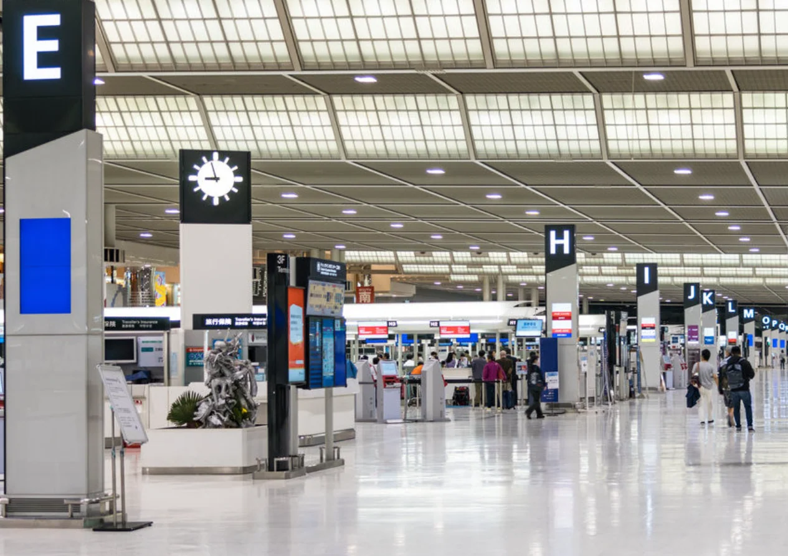
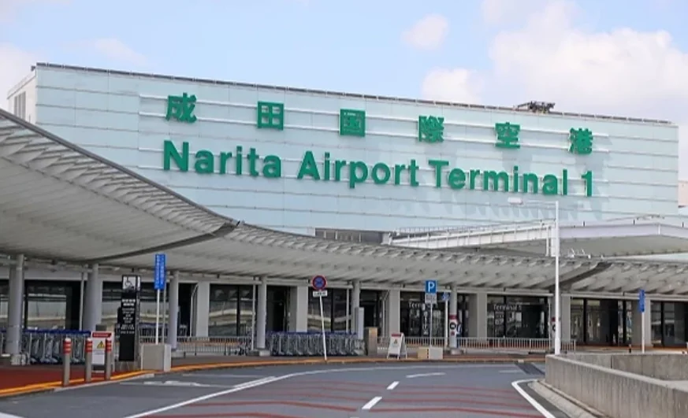
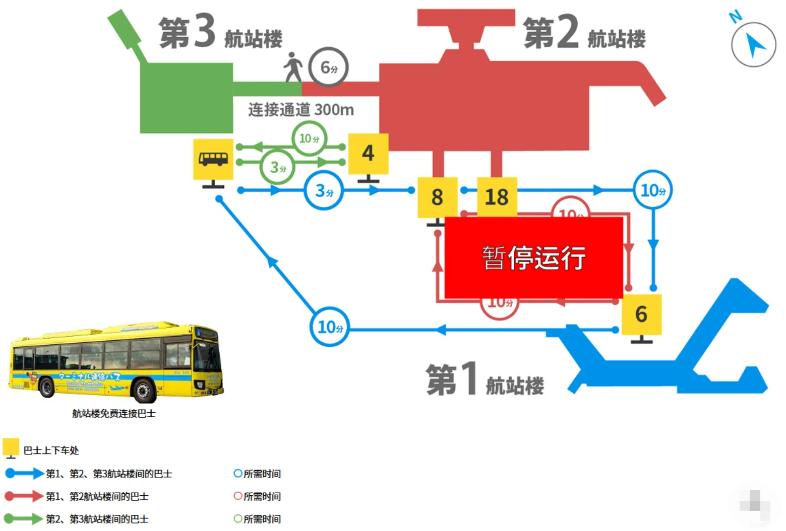
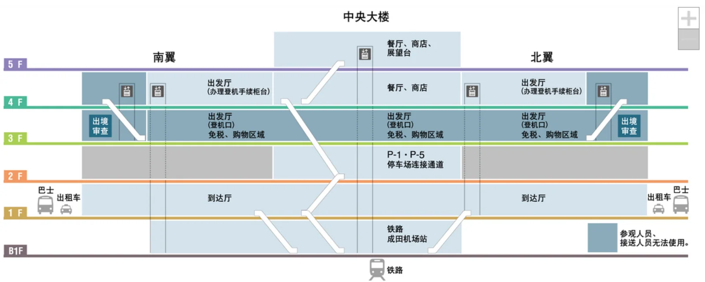
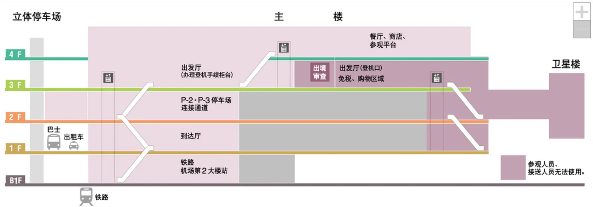
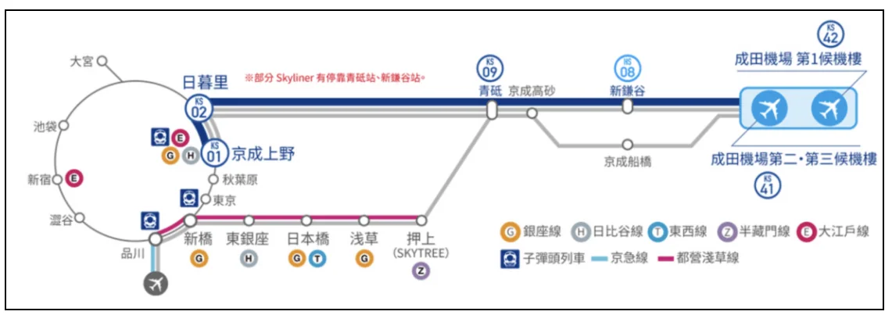
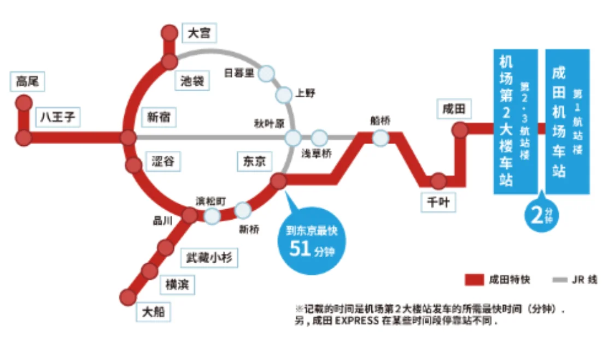
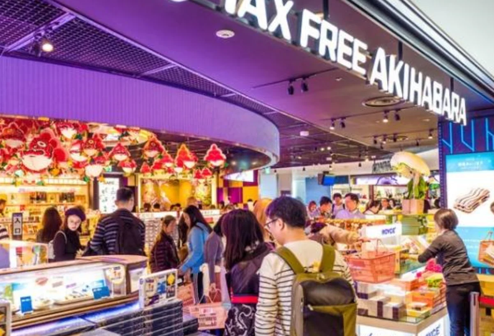
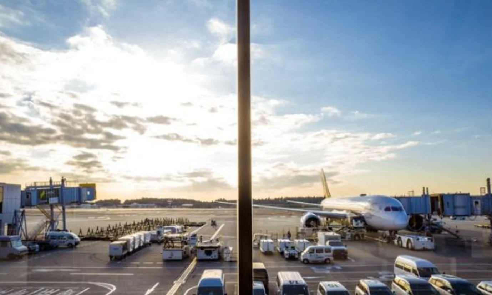

东京有两个机场。羽田距市中心 15 公里，电车 20 分钟直达，国内线密集；成田在东京以东约 60 公里，是首都圈国际航班最密集的枢纽，Skyliner 36 分钟进城，国际航线覆盖全球 120 多个城市，深夜与清晨的廉价航班也多。长途国际航班、特价票、转机顺路购物，多半落在成田。

这份攻略按**航站楼与航空公司**、**进城交通**、**免税与购物**、**转机与过夜**、**实用信息与常见问题**整理，给第一次从成田进出、或者要在成田转机的人用。文中的票价与时刻是 2025 年的资料，出行前请再核对一次。

## 一、三座航站楼与航空公司

成田国际机场（Narita International Airport，机场代码 **NRT**）有三座客运航站楼，航站楼的分配基本跟着航空联盟走：T1 是星空联盟的主场，ANA、新加坡航空、美联航都在这里；T2 以寰宇一家的日本航空、国泰、美国航空为主，国际航班最密；T3 专供廉价航空，捷星日本、乐桃、春秋航空日本、济州航空从这座楼进出。中华航空的航班分在 T1 与 T2 两座楼，出发前请按航站楼官网或航司通知确认。

| 航站楼 | 主要联盟／类型 | 代表航空公司 | 备注 |
| --- | --- | --- | --- |
| T1 | 星空联盟 | ANA、新加坡航空、美联航 | 华航部分航班 |
| T2 | 寰宇一家 | 日本航空、国泰、美国航空 | 国际航班最多，华航部分航班 |
| T3 | 廉价航空（LCC） | 捷星日本、乐桃、春秋航空日本、济州航空 | 与 T2 有步行通道相连 |

T1 由南翼、北翼与中央大楼组成：值机柜台分在南翼与北翼，办完手续下楼过安检与出境审查，中央大楼就是免税与购物区，登机口沿两翼排开。T2 的主楼与卫星楼之间也有一条楼内通道。

同一家航空公司在不同日期也可能换楼，代码共享与包机尤其常见。出发前一天在航司 App 或成田官网上查一次航站楼，比落地后拖着箱子看大屏更从容。

三座楼之间有一条免费接驳巴士，楼到楼 10 分钟以内：T1 到 T2 约 10 分钟，T2 到 T3 只隔一站，约 3 分钟。T2 与 T3 之间另有一条 300 米的步行连络通道，楼到楼走 6 分钟左右；不过从 T2 的车站检票口或到达大厅走到 T3 的出发大厅，官方给的预估是 13 分钟，拖着箱子最好按 20 分钟算。

弄清楼层能省不少来回。T1 的值机在 4 楼，出境审查之后的免税与购物区在 3 楼，到达大厅在 1 楼，B1 是京成与 JR 共用的成田机场站，5 楼是餐厅、商店和展望台。

T2 的结构相近：值机、登机口与免税区都在 3 楼，4 楼是餐厅、商店与参观平台，1 楼到达，B1 是「机场第 2 大楼站」。T2 还有一座卫星楼，登机口在卫星楼的旅客要留出走过去的时间。T3 出发层在 2 楼、到达层在 1 楼，值机、安检、登机都在同一层里解决；楼内只有 Fa-So-La 的零食免税店，想逛大牌得坐接驳回 T2。

## 二、从成田进城：铁路、巴士与出租车

成田离东京都心约 60 公里，进城这一段是全程最值得提前决定的部分。铁路由京成与 JR 两家经营：京成的 Skyliner、Access 特急与京成本线，JR 的成田特快 N'EX。公路有平价机场巴士与利木津巴士，出租车 24 小时都有，只是费用随路况和时段浮动。下面的时间与参考票价是 2025 年的资料，以京成、JR 与机场官网当日信息为准。

| 方式 | 主要停靠／目的地 | 单程时间 | 参考票价 |
| --- | --- | --- | --- |
| 京成 Skyliner | 日暮里、上野 | 36–41 分钟 | 约 ¥2,570（线上早鸟） |
| JR 成田特快 N'EX | 东京、新宿、涩谷、横滨 | 53–80 分钟 | 约 ¥3,070–3,250 |
| 京成本线特急 | 京成上野、日暮里 | 停站多，用时最长 | 约 ¥1,050 |
| 京成 Access 特急 | 押上、浅草、东银座 | 47–62 分钟 | 以京成官网为准 |
| 机场巴士 TYO-NRT | 东京站、银座 | 65–90 分钟 | 约 ¥1,500（深夜约 ¥3,000） |
| 利木津巴士 | 新宿、池袋、浅草、品川、台场 | 60–120 分钟 | 约 ¥3,100–3,600 |
| 出租车 | 东京都心各点 | 视路况而定 | 按表计价，另加高速费 |

**Skyliner** 是进城最快的一条：36 分钟到日暮里、41 分钟到上野，从这两站换山手线、银座线都方便，单程参考票价约 ¥2,570，这是线上早鸟价，窗口购买会贵一些。车票在京成官网、自动售票机与柜台都能买，提前一天在网上订好更省。

**N'EX** 直达东京站约 53 分钟，新宿、涩谷方向 60–80 分钟，座位宽敞、行李好放，单程参考票价约 ¥3,070–3,250；它串起东京站、涩谷、新宿再往横滨，住在西侧的人坐它比换乘省心。

**京成本线特急**约 ¥1,050，是最省的一档，代价是停站多、用时最长，适合不赶时间、又住在京成上野或日暮里一带的人。京成的 **Access 特急**走都营浅草线直通，到押上约 47 分钟、浅草约 51 分钟、东银座约 62 分钟，住在浅草、银座方向的可以选它。

**巴士**分两种。Tokyo Shuttle（TYO-NRT）到东京站、银座 65–90 分钟，参考票价约 ¥1,500，深夜班次约 ¥3,000；利木津巴士直达新宿、池袋、浅草、品川、台场，60–120 分钟，参考票价约 ¥3,100–3,600，可以官网预约、在饭店门口下车，行李多又不熟悉地铁时最省事。

**出租车**在一楼的到达大厅外排队候客，T1 与 T2 都有乘车点，走东关东自动车道接首都高速，按表计价另加高速费，深夜与雨天建议提前叫车。末班时间要记一下：N'EX 与 Skyliner 的末班分别在约 21:30 与 23:00，赶不上就只剩深夜巴士（最晚到约 03:30）、出租车或包车。

**怎么选**：住上野、日暮里一带，Skyliner 最顺；住东京站、新宿、涩谷、横滨，N'EX 免换乘；住浅草、押上、东银座，Access 特急直通都营浅草线；行李多、饭店又正好在利木津沿线，选利木津巴士；预算优先，京成本线特急与 TYO-NRT 最便宜，代价是时间和舒适度。

## 三、免税与购物：2025 年的新店与限定

2025 年成田的免税店换了一批新面孔。三座楼都分「关前（公共区）」与「关后（禁区）」两段，过关前后都逛得到，但品牌不一样，值得逛的往往在关后。

关前是办理值机、送机的人也能进的公共区，关后要过安检与出境审查，只有旅客能进。所以电器、药妆这类大件适合在关前买，买完塞进托运行李；零食、生巧、限定伴手礼留在关后，最后一段路再买，不用一路提着。

- **T1**：关前有山田电机 YAMADA TAX FREE，Dyson、任天堂、美容仪都能看；关后有 Fa-So-La ASAKUSA，成田限定的鳗鱼蒲烧风味柿种、NEWYORK PERFECT CHEESE 都在这里，后者每人限购 3 份。
- **T2**：关前是 Air BicCamera，最新 α 相机与蓝牙耳机；关后是 Fa-So-La AKIHABARA，秋叶原模型、Royce' 生巧、Sugar Butter Tree 都在这家。
- **T3**：关后只有 Fa-So-La SOUVENIR AKIHABARA，以零食为主，想逛大牌请坐接驳去 T2。

2025 年成田首发的伴手礼里，有三样值得记一下：东京芭娜娜的冷冻「香蕉巧克力蛋糕」，常温放 11 小时不软化；BUTTER NO ITOKO 的「地瓜肉桂奶油威化」，T1 与 T2 限定；龟田柿种的「鳗鱼蒲烧风味」，是 T2 Fa-So-La 的独家。买完记得给退税和安检留出时间——关后的店在登机口方向，逛过头容易赶不上登机。

## 四、转机、过夜与候机时间

在成田等 2 小时和等 6 小时，过法完全不一样。

**2 小时**：去 T1 5 楼或 T2 4 楼的展望台看飞机起降，天气好时能看到夕阳，旁边就有星巴克，点一杯坐着看，比在登机口干等舒服。

**4 小时**：T2 的 Fa-So-La 逛一圈，吃一碗银座篝的鸡白汤拉面，再去 Traveler's Factory 买机场限定文具。关前关后不能随意往返，先确认自己的时间够不够：T1 关前有 24 小时麦当劳与回转寿司三崎，T2 关前有 24 小时吉野家与信州 SOJIBOU 手打荞麦，T3 关前有 24 小时松屋与仙台利久炭烤牛舌；过关之后，T1 是一风堂拉面与三本亭铁板汉堡肉，T2 是银座篝鸡白汤拉面与道顿堀栗田大阪烧，T3 是 caffe LAT.25° 的啤酒与意面。

**6 小时以上**：可以出机场。成田山新胜寺来回半天刚好；想进东京吃一顿再回来，Skyliner 单程 36 分钟，来回加上两次安检，6 小时只够去一个点，别再临时加行程。

**过夜**：T3 2 楼有 24 小时座椅，带充电；T1 与 T2 的淋浴间 ¥1,050／30 分钟，登机前冲个澡再上飞机，比在椅子上硬扛舒服；T2 的胶囊旅馆「9h nine hours」¥4,900 起，需要官网预约。红眼航班 22:00–05:30 落地的话，可以选深夜巴士进东京、提前订出租车或包车，也可以在机场睡到次日首班车再走。

**转机**：先确认续程航班在哪座航站楼。同一座楼里跟着「Transfer」标识走；跨楼要坐免费接驳（约 10 分钟），把这段路和再次安检的时间算进去。两段航班之间留 3 小时以上比较稳，需要不需要入境、要不要重新托运行李，取决于两张机票的关系，出发前向航司问清楚。

## 五、顺路：机场周边的 1–4 小时

如果转机或等车有 4 小时以上，成田周边其实值得出去一趟。这几处都在千叶县内，从机场坐电车或巴士过去，能把一段长转机变成一次半日小旅行。下面都是单程车程，来回加游览至少半天，时间紧就别勉强。

- **成田山新胜寺**（约 30 分钟）：仲见世表参道的鳗鱼饭老店「川丰」，参道走完就是寺院。
- **佐原水乡**（约 45 分钟）：小野川游船与酱油仓库老街。
- **佐仓武家屋敷**（约 50 分钟）：千叶县立美术馆，城下町适合骑车。
- **铫子犬吠埼**（约 90 分钟）：日本最东端的灯塔、太平洋日出，可搭「INUBOH」号电车。

## 六、实用信息与常见问题

**落地之后怎么走**

跟着「Railway」的标识走就行：T1 的京成与 JR 车站在 B1，T2 在 B1 的「机场第 2 大楼站」，都在到达大厅下一层，买票进站十分钟以内。T3 没有独立车站，先走连络通道或坐接驳到 T2，再下楼坐车。

**网络与行李**

- Wi-Fi：全馆「FreeWiFi-NARITA」，免注册。
- SIM／eSIM：T1–T3 到达层的自动贩卖机与 Softbank 柜台有实体卡，eSIM 线上扫码即开，7 日 20 GB 参考价约 ¥3,500。
- 投币储物柜：T1–T3 到达层，¥300–800／天，旺季容易满。
- 人工寄存：大件滑雪板、纸箱也收，¥800–2,000／天。
- 宅配：Yamato 与 JAL ABC 可当日或次日把行李寄到东京的饭店，23 kg 箱约 ¥1,900 起，贵重物品与电池禁运。

**常见问题**

- **最快进市区？** Skyliner，36 分钟到日暮里。
- **深夜还有公共交通吗？** 有深夜巴士，最晚到约 03:30；N'EX 与 Skyliner 的末班分别在约 21:30 与 23:00。
- **行李丢了去哪找？** 按航站楼打失物中心：T1 0476-32-2105、T2 0476-34-5220、T3 0476-34-4195，24 小时有人接，中文也能通。
- **能刷支付宝、微信吗？** 免税药妆与电器店大多可以；巴士柜台只收现金与信用卡。
- **要提前多久到？** 国际航班 3 小时，LCC 再加 30 分钟；T3 的安检高峰在 07:00–09:00 与 19:00–22:00。
- **T3 怎么去 T2？** 走 300 米连络通道约 6 分钟，或坐免费接驳约 3 分钟；从 T3 出发大厅走到 T2 车站检票口，按 13 分钟估。
- **成田还是羽田？** 羽田离市区近、国内线密；成田国际航线多、LCC 与红眼航班多。按航班时间与票价决定就好，不必执着。

## 相关链接

- **本站页面**：[成田国际机场（NRT）](/zh/airport/NRT)、[日本（JP）](/zh/country/JP)
- **维基百科**：[成田国际机场](https://zh.wikipedia.org/wiki/%E6%88%90%E7%94%B0%E5%9B%BD%E9%99%85%E6%9C%BA%E5%9C%BA)
- **百度百科**：[成田机场](https://baike.baidu.com/item/%E6%88%90%E7%94%B0%E6%9C%BA%E5%9C%BA)

图片来源：乐游霓虹。文中票价、时刻与店铺信息为 2025 年的资料，出行前请以京成、JR、成田机场及各运营方官网当日信息为准。
