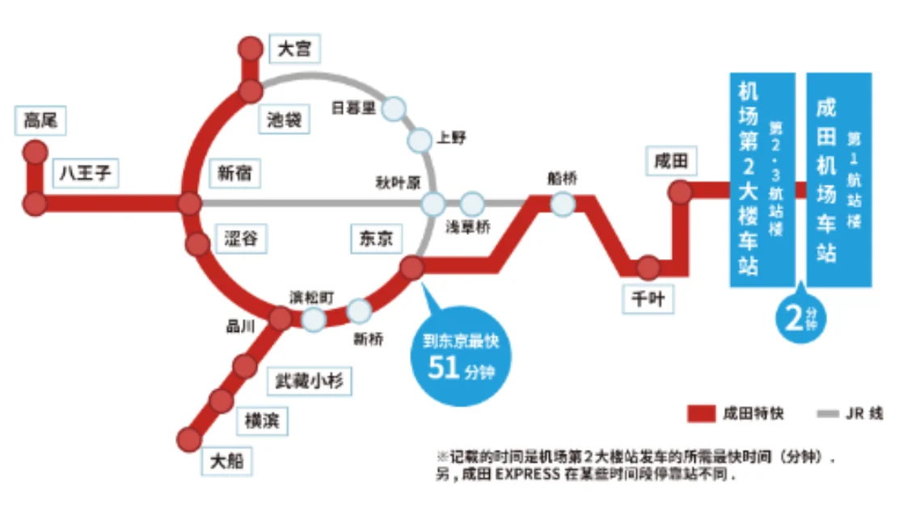

В Токио два аэропорта. Ханэда находится в 15 км от центра, в 20 минутах на поезде, и там много внутренних рейсов. Нарита расположена примерно в 60 км к востоку и является самым загруженным международным входом в Токио: Skyliner доходит до города за 36 минут, аэропорт обслуживает более 120 городов, и здесь же большинство ночных и ранних утренних рейсов лоукостеров. Дальнемагистральные рейсы, дешёвые билеты и шопинг во время пересадки обычно означают Нариту.

Этот гид охватывает **терминалы и авиакомпании**, **транспорт до Токио**, **duty-free и шопинг**, **пересадки и ночёвки**, а также **практические вопросы** — для первого прилёта или стыковки. Тарифы и расписание — данные 2025 года, проверьте их перед поездкой.

## 1. Терминалы и авиакомпании

В международном аэропорту Нарита (код аэропорта **NRT**) три пассажирских терминала, и разделение в целом следует за авиаальянсами. T1 — территория Star Alliance с ANA, Singapore Airlines и United. T2 принадлежит в основном oneworld — JAL, Cathay Pacific и American — и имеет самый плотный международный график. T3 — терминал лоукостеров: Jetstar Japan, Peach, Spring Japan и Jeju Air. China Airlines распределяет рейсы между T1 и T2, поэтому уточните свой терминал на сайте аэропорта или в уведомлении авиакомпании.

| Терминал | Альянс / тип | Авиакомпании | Примечания |
| --- | --- | --- | --- |
| T1 | Star Alliance | ANA, Singapore Airlines, United | некоторые рейсы China Airlines |
| T2 | oneworld | JAL, Cathay Pacific, American | самый загруженный по международным рейсам; некоторые рейсы China Airlines |
| T3 | Лоукостеры | Jetstar Japan, Peach, Spring Japan, Jeju Air | пешеходный переход к T2 |

T1 состоит из южного и северного крыльев и центрального здания: регистрация в крыльях, досмотр и паспортный контроль на этаж ниже, duty-free и магазины в центральном здании, выходы вдоль обоих крыльев. В T2 крытый переход соединяет главное здание со спутником, и выходы там в нескольких минутах ходьбы дальше.

Авиакомпании переходят между терминалами в разные даты, особенно при код-шеринге. Проверьте свой терминал накануне — в приложении авиакомпании или на сайте Нариты.

Бесплатный шаттл связывает все три терминала менее чем за десять минут: около 10 минут от T1 до T2 и около 3 минут от T2 до T3. Крытый переход длиной 300 метров соединяет T2 и T3, примерно 6 минут от здания до здания; от турникетов станции T2 до зала вылета T3 сам аэропорт оценивает путь в 13 минут, поэтому с багажом закладывайте 20.

Знание этажей экономит много ходьбы. В T1 регистрация находится на 4-м этаже, duty-free за паспортным контролем — на 3-м, прилёт — на 1-м, на B1 расположена станция Narita Airport компании Keisei и JR, а на 5-м — рестораны, магазины и смотровая площадка.

T2 устроен похоже: регистрация, выходы и duty-free на 3-м этаже, рестораны, магазины и смотровая площадка на 4-м, прилёт на 1-м, а станция Narita Airport Terminal 2·3 — на B1. В T3 вылет со 2-го этажа, прилёт на 1-й, причём регистрация, досмотр и посадка находятся на одном уровне; единственный магазин duty-free там — сувенирная точка Fa-So-La, поэтому за крупными брендами возвращайтесь на шаттле в T2.

## 2. Как добраться до Токио: поезда, автобусы и такси

Нарита находится примерно в 60 км от центра Токио, и этот отрезок пути стоит продумать до вылета. Keisei обслуживает Skyliner, Access Express и главную линию Keisei; JR — Narita Express (N'EX). По дороге ходят бюджетные аэропортовые автобусы и Airport Limousine, а такси работает круглосуточно. Время и ориентировочные тарифы ниже — данные 2025 года; в день поездки проверяйте сайты Keisei, JR и самого аэропорта.

| Вариант | Основные остановки / направление | Время в пути | Ориентировочный тариф |
| --- | --- | --- | --- |
| Keisei Skyliner | Ниппори, Уэно | 36–41 мин | около ¥2 570 (онлайн, раннее бронирование) |
| JR Narita Express (N'EX) | Токио, Синдзюку, Сибуя, Йокогама | 53–80 мин | около ¥3 070–3 250 |
| Keisei Main Line limited express | Кэйсэй-Уэно, Ниппори | почти все остановки, самый медленный | около ¥1 050 |
| Keisei Access Express | Осиагэ, Асакуса, Хигаси-Гиндза | 47–62 мин | см. Keisei |
| Аэропортовый автобус TYO-NRT | Станция Токио, Гиндза | 65–90 мин | около ¥1 500 (около ¥3 000 поздно ночью) |
| Airport Limousine | Синдзюку, Икэбукуро, Асакуса, Синагава, Одайба | 60–120 мин | около ¥3 100–3 600 |
| Такси | центр Токио | зависит от дорожной обстановки | по счётчику плюс плата за скоростную дорогу |

**Skyliner** — самый быстрый: 36 минут до Ниппори, 41 до Уэно, с удобной пересадкой на линии Яманотэ и Гиндза. Тариф в одну сторону — около ¥2 570 при онлайн-покупке с ранним бронированием; на стойке дороже, поэтому бронируйте заранее.

**N'EX** доходит до станции Токио примерно за 53 минуты, до Синдзюку или Сибуи — за 60–80, при тарифе около ¥3 070–3 250 в одну сторону; в нём просторно и удобно с багажом. Это спокойный выбор для западной части города.

**Экспресс главной линии Keisei** стоит около ¥1 050 и останавливается везде, поэтому он самый медленный — подходит, если вы не спешите и остановились рядом с Кэйсэй-Уэно или Ниппори. **Access Express** идёт напрямую на линию Тоэй Асакуса: около 47 минут до Осиагэ, 51 до Асакусы, 62 до Хигаси-Гиндзы.

**Автобусы** бывают двух видов. TYO-NRT идёт до станции Токио и Гиндзы за 65–90 минут примерно за ¥1 500, поздно ночью — около ¥3 000. Airport Limousine едет напрямую до Синдзюку, Икэбукуро, Асакусы, Синагавы и Одайбы за 60–120 минут примерно за ¥3 100–3 600, бронируется онлайн и высаживает у дверей отеля.

**Такси** ждут снаружи у прилёта на 1-м этаже в T1 и T2, едут по скоростной дороге Хигаси-Канто до столичной скоростной магистрали и берут по счётчику плюс плату за проезд; ночью или в дождь заказывайте заранее. Следите за последними поездами: последний N'EX — около 21:30, последний Skyliner — около 23:00. После этого остаются только ночные автобусы (последний около 03:30), такси или заранее заказанная машина.

**Что выбрать:** Уэно или Ниппори — Skyliner; Токио, Синдзюку, Сибуя или Йокогама — N'EX; Асакуса или Гиндза — Access Express; тяжёлый багаж и отель на маршруте Limousine — автобус; ограниченный бюджет — экспресс Keisei или TYO-NRT.

## 3. Duty-free и шопинг: что нового в 2025 году

Ассортимент duty-free в Нарите изменился в 2025 году. Все три терминала делятся на «до зоны досмотра» (landside) и «после неё» (airside); бренды различаются, и самое интересное обычно находится в airside.

Landside — общедоступная зона, где проходит регистрация; airside — за досмотром и паспортным контролем, только для пассажиров. Электронику и косметику покупайте в landside и укладывайте в зарегистрированный багаж, а снеки, шоколад нама и лимитированные сувениры оставьте на airside, на последний отрезок.

- **T1:** в landside находится YAMADA TAX FREE от Yamada Denki — Dyson, Nintendo и приборы для красоты; в airside — Fa-So-La ASAKUSA, где продаются эксклюзивные для Нариты какинотане со вкусом угря кабаяки и NEWYORK PERFECT CHEESE (по три на человека).
- **T2:** в landside — Air BicCamera с новейшими камерами α и Bluetooth-наушниками; в airside — Fa-So-La AKIHABARA с моделями из Акихабары, шоколадом нама от Royce' и Sugar Butter Tree.
- **T3:** в airside только Fa-So-La SOUVENIR AKIHABARA, в основном снеки, — за крупными брендами езжайте на шаттле в T2.

Три новинки Нариты 2025 года стоит запомнить: замороженный банановый шоколадный торт Tokyo Banana, который остаётся мягким 11 часов при комнатной температуре; вафли с маслом, бататом и корицей от BUTTER NO ITOKO — только в T1 и T2; и какинотане со вкусом угря кабаяки от Kameda, эксклюзивно для Fa-So-La в T2. Оставьте время на возврат налога и досмотр: магазины airside находятся ближе к выходам, и легко увлечься покупками.

## 4. Пересадки, ночёвки и как провести время

Два часа в Нарите — совсем не то же самое, что шесть.

**Два часа:** смотровые площадки на 5-м этаже T1 или 4-м этаже T2 — посмотреть на взлёты и посадки, а в хороший день и на закат; рядом есть Starbucks. Это лучше, чем сидеть у выхода.

**Четыре часа:** пройтись по Fa-So-La в T2, съесть тарелку куриного рамена пайтан в Ginza Kagari, затем зайти в Traveler's Factory за канцелярией, которая продаётся только в аэропорту. Перемещаться между landside и airside нельзя, поэтому проверьте запас времени. В landside: в T1 круглосуточный McDonald's и суши-конвейер Misaki, в T2 круглосуточная Yoshinoya и домашняя соба Шинсю SOJIBOU, в T3 круглосуточная Matsuya и говяжий язык на углях Sendai Rikyu. В airside: в T1 Ippudo и тэппан-гамбургер Sanpotei, в T2 Ginza Kagari и окономияки Dotonbori Kurita, в T3 caffe LAT.25° с пивом и пастой.

**Шесть часов и больше:** уезжайте из аэропорта. Наритасан Синсёдзи — удобная поездка на полдня туда и обратно; пообедать в Токио и вернуться можно на Skyliner за 36 минут, но с двумя очередями на досмотр шесть часов дадут вам только одну остановку.

**С ночёвкой:** на 2-м этаже T3 есть круглосуточные сиденья с розетками; в T1 и T2 — душевые за ¥1 050 за 30 минут; капсульный отель 9h nine hours в T2 стоит от ¥4 900 и требует бронирования онлайн. Если вы прилетаете ночным рейсом между 22:00 и 05:30, поезжайте ночным автобусом в Токио, закажите машину заранее или поспите в аэропорту до первого поезда.

**Пересадки:** уточните, из какого терминала уходит ваш следующий рейс. В пределах одного здания идите по указателям Transfer; между зданиями добавьте к запасу времени бесплатный шаттл (около 10 минут) и повторный досмотр. Трёх часов между рейсами достаточно. Нужно ли входить в Японию и заново сдавать багаж, зависит от того, как оформлены билеты, поэтому спросите авиакомпанию.

## 5. По пути: от часа до четырёх вокруг аэропорта

Если между рейсами или автобусами четыре часа и больше, окрестности Нариты стоят поездки. Все места находятся в префектуре Тиба и достижимы на поезде или автобусе; время указано в одну сторону, а с обратной дорогой понадобится полдня.

- **Наритасан Синсёдзи** (около 30 минут): ресторан угря Kawafuku на подходе Омотэсандо и храм в конце улицы.
- **Савара** (около 45 минут): прогулки на лодке по Оногаке и улицы складов соевого соуса.
- **Сакура** (около 50 минут): художественный музей префектуры Тиба и городок у замка, созданный для велосипедных прогулок.
- **Тёси Инубосаки** (около 90 минут): самый восточный маяк Японии, рассвет над Тихим океаном и поезд INUBOH.

## 6. Практическая информация и вопросы

**От прилёта до станции:** идите по указателям Railway. Keisei и JR делят станцию на B1 в каждом терминале — Narita Airport Station в T1 и Narita Airport Terminal 2·3 Station в T2, — которая находится на этаж ниже прилёта; билеты и платформы в пределах десяти минут. В T3 своей станции нет: идите по переходу или ехайте на шаттле в T2.

**Wi-Fi и багаж**

- Wi-Fi: FreeWiFi-NARITA по всему аэропорту, без регистрации.
- SIM и eSIM: автоматы и стойка SoftBank в залах прилёта T1–T3; eSIM по QR-коду — семь дней и 20 ГБ от ¥3 500.
- Камеры хранения с монетами: в залах прилёта T1–T3, ¥300–800 в день, в высокий сезон заполнены.
- Хранение с персоналом: принимают лыжи и картонные коробки, ¥800–2 000 в день.
- Доставка: Yamato и JAL ABC отправляют багаж в отели Токио в тот же или следующий день, от ¥1 900 за коробку весом 23 кг; ценности и батарейки не принимаются.

**Частые вопросы**

- **Что быстрее всего до города?** Skyliner — 36 минут до Ниппори.
- **Общественный транспорт поздно ночью?** Ночные автобусы ходят примерно до 03:30; последний N'EX — около 21:30, последний Skyliner — около 23:00.
- **Что-то потеряли?** Позвоните в бюро находок вашего терминала: T1 0476-32-2105, T2 0476-34-5220, T3 0476-34-4195; работают круглосуточно, есть помощь на китайском.
- **Можно ли платить Alipay или WeChat?** Большинство аптек duty-free и магазинов электроники их принимают; автобусные стойки принимают только наличные или карты.
- **За сколько приезжать?** За три часа до международного рейса, для лоукостеров — ещё на 30 минут раньше; пики досмотра в T3 — 07:00–09:00 и 19:00–22:00.
- **Из T3 в T2?** Около 6 минут по переходу длиной 300 метров или 3 минуты на бесплатном шаттле; закладывайте 13 минут от зала вылета T3 до турникетов станции T2.
- **Нарита или Ханэда?** Ханэда ближе к городу; в Нарите больше международных маршрутов, лоукостеров и ночных рейсов. Выбирайте по времени рейса и тарифу, а не по привычке.

## Связанные ссылки

- **На этом сайте**: [Международный аэропорт Нарита (NRT)](/airport/NRT), [Япония (JP)](/country/JP)
- **Википедия**: [Международный аэропорт Нарита](https://en.wikipedia.org/wiki/Narita_International_Airport)
- **Байду Байкэ**: [Аэропорт Нарита](https://baike.baidu.com/item/%E6%88%90%E7%94%B0%E6%9C%BA%E5%9C%BA)

Источник изображений: Leyou Nihong. Тарифы, расписание и сведения о магазинах — данные 2025 года; в день поездки проверяйте сайты Keisei, JR, аэропорта Нарита и самих операторов.
