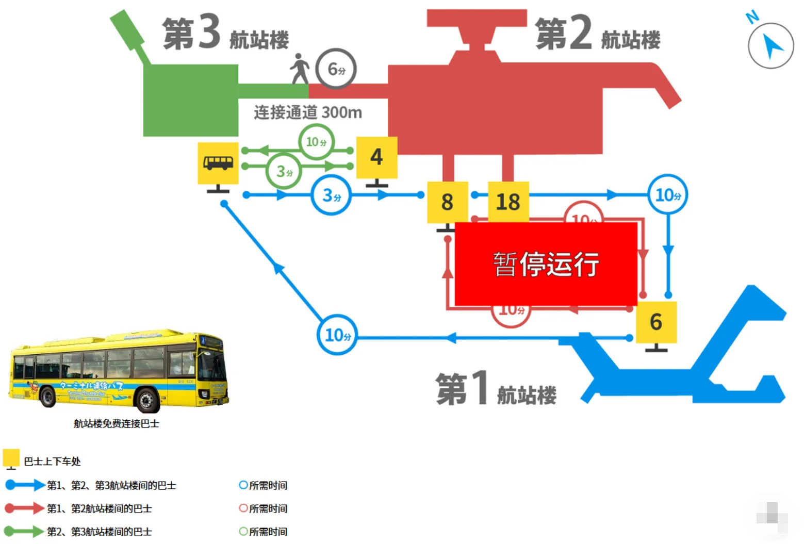
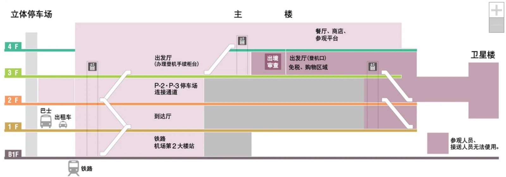
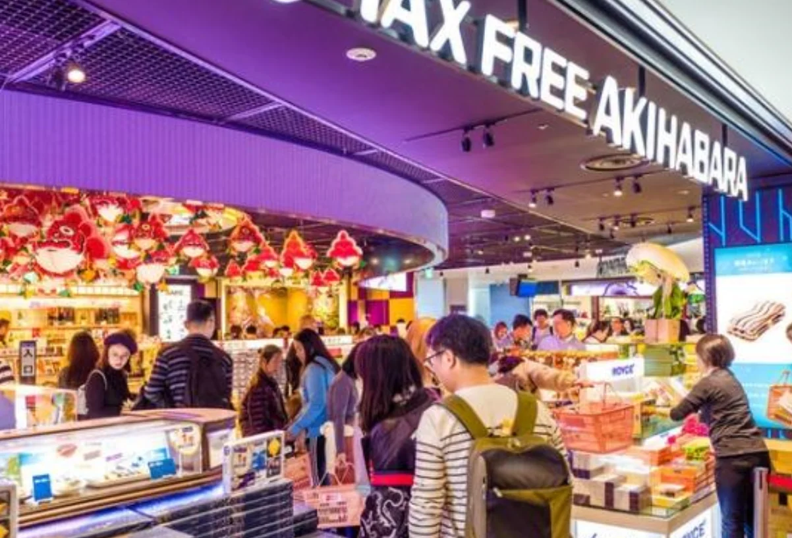

Tokyo có hai sân bay. Haneda cách trung tâm 15 km, 20 phút bằng tàu và dày đặc chuyến nội địa. Narita nằm cách khoảng 60 km về phía đông, cửa ngõ quốc tế bận rộn nhất của Tokyo: Skyliner vào thành phố trong 36 phút, sân bay phục vụ hơn 120 thành phố, và phần lớn chuyến bay giá rẻ đêm muộn và sáng sớm ở đây. Chuyến bay đường dài, giá vé rẻ và mua sắm khi quá cảnh thường có nghĩa là Narita.

Hướng dẫn này đề cập **nhà ga và hãng hàng không**, **giao thông vào Tokyo**, **miễn thuế và mua sắm**, **trung chuyển và lưu trú qua đêm**, và **các câu hỏi thực tế**, cho lần đầu đến hoặc chuyến nối tiếp. Giá vé và lịch chạy là số liệu năm 2025 — hãy kiểm tra trước khi đi.

## 1. Nhà ga và hãng hàng không

Sân bay Quốc tế Narita (mã sân bay **NRT**) có ba nhà ga hành khách, và cách phân chia nhìn chung theo liên minh hàng không. T1 là lãnh địa của Star Alliance, với ANA, Singapore Airlines và United. T2 chủ yếu là oneworld — JAL, Cathay Pacific và American — và có lịch quốc tế dày nhất. T3 là nhà ga giá rẻ: Jetstar Japan, Peach, Spring Japan và Jeju Air. China Airlines phân bổ chuyến giữa T1 và T2, nên hãy xác nhận nhà ga trên trang web sân bay hoặc trong thông báo của hãng.

| Nhà ga | Liên minh / loại | Hãng hàng không | Ghi chú |
| --- | --- | --- | --- |
| T1 | Star Alliance | ANA, Singapore Airlines, United | một số chuyến của China Airlines |
| T2 | oneworld | JAL, Cathay Pacific, American | bận rộn nhất với chuyến quốc tế; một số chuyến của China Airlines |
| T3 | Hãng giá rẻ | Jetstar Japan, Peach, Spring Japan, Jeju Air | hành lang đi bộ đến T2 |

T1 có cánh nam, cánh bắc và tòa nhà trung tâm: làm thủ tục ở các cánh, an ninh và kiểm soát hộ chiếu ở tầng dưới một tầng, miễn thuế và mua sắm ở tòa nhà trung tâm, cổng dọc hai cánh. Tại T2, hành lang trong nhà nối tòa nhà chính với một vệ tinh, và các cổng ở đó xa thêm vài phút.

Các hãng chuyển nhà ga vào những ngày khác nhau, đặc biệt là chuyến liên danh. Hãy tra nhà ga từ hôm trước, trên ứng dụng hãng hoặc trang web Narita.

Xe trung chuyển miễn phí nối cả ba nhà ga trong dưới mười phút: khoảng 10 phút từ T1 đến T2, và khoảng 3 phút từ T2 đến T3. Hành lang có mái dài 300 mét nối T2 và T3, khoảng 6 phút từ tòa nhà này sang tòa nhà kia; từ cổng soát vé ở ga T2 đến sảnh khởi hành T3, ước tính của sân bay là 13 phút, nên hãy dành 20 phút nếu có hành lý.

Biết các tầng sẽ tiết kiệm rất nhiều việc đi bộ. Tại T1, làm thủ tục ở tầng 4, miễn thuế sau kiểm soát hộ chiếu ở tầng 3, khu đến ở tầng 1, B1 là Ga Sân bay Narita của Keisei và JR, tầng 5 có nhà hàng, cửa hàng và đài quan sát.

T2 bố trí tương tự: làm thủ tục, cổng và miễn thuế ở tầng 3, nhà hàng, cửa hàng và sân quan sát ở tầng 4, khu đến ở tầng 1, và Ga Nhà ga 2·3 Sân bay Narita ở B1. T3 khởi hành ở tầng 2 và đến ở tầng 1, với làm thủ tục, an ninh và lên máy bay cùng một tầng; cửa hàng miễn thuế duy nhất là một điểm bán quà lưu niệm Fa-So-La, nên hãy đi xe trung chuyển về T2 cho các thương hiệu lớn.

## 2. Vào Tokyo: tàu, xe buýt và taxi

Narita cách trung tâm Tokyo khoảng 60 km, và chặng này đáng để quyết định trước khi bay. Keisei vận hành Skyliner, Access Express và tuyến chính Keisei; JR vận hành Narita Express (N'EX). Trên đường bộ có xe buýt sân bay giá rẻ và Airport Limousine, taxi chạy suốt ngày đêm. Thời gian và giá vé tham khảo dưới đây là số liệu năm 2025 — hãy kiểm tra Keisei, JR và trang web của sân bay vào ngày đi.

| Lựa chọn | Điểm dừng chính / điểm đến | Thời gian | Giá vé tham khảo |
| --- | --- | --- | --- |
| Keisei Skyliner | Nippori, Ueno | 36–41 phút | khoảng ¥2.570 (đặt trực tuyến giá sớm) |
| JR Narita Express (N'EX) | Tokyo, Shinjuku, Shibuya, Yokohama | 53–80 phút | khoảng ¥3.070–3.250 |
| Tàu tốc hành giới hạn tuyến chính Keisei | Keisei-Ueno, Nippori | dừng nhiều nhất, chậm nhất | khoảng ¥1.050 |
| Keisei Access Express | Oshiage, Asakusa, Higashi-Ginza | 47–62 phút | xem Keisei |
| Xe buýt sân bay TYO-NRT | Ga Tokyo, Ginza | 65–90 phút | khoảng ¥1.500 (khoảng ¥3.000 vào đêm muộn) |
| Airport Limousine | Shinjuku, Ikebukuro, Asakusa, Shinagawa, Odaiba | 60–120 phút | khoảng ¥3.100–3.600 |
| Taxi | trung tâm Tokyo | tùy giao thông | đồng hồ, cộng phí đường cao tốc |

**Skyliner** là nhanh nhất: 36 phút đến Nippori, 41 phút đến Ueno, đổi tàu dễ dàng sang tuyến Yamanote và Ginza. Giá một chiều khoảng ¥2.570 khi đặt trực tuyến giá sớm; quầy tính cao hơn, nên hãy đặt trước.

**N'EX** đến Ga Tokyo trong khoảng 53 phút, Shinjuku hoặc Shibuya trong 60–80 phút, giá khoảng ¥3.070–3.250 một chiều, rộng rãi và dễ chịu với hành lý. Đây là lựa chọn thư giãn cho phía tây.

**Tàu tốc hành giới hạn tuyến chính Keisei** giá khoảng ¥1.050 và dừng ở mọi nơi, nên chậm nhất — phù hợp nếu bạn không vội và ở gần Keisei-Ueno hoặc Nippori. **Access Express** chạy thẳng sang tuyến Toei Asakusa: khoảng 47 phút đến Oshiage, 51 phút đến Asakusa, 62 phút đến Higashi-Ginza.

**Xe buýt** có hai loại. TYO-NRT chạy đến Ga Tokyo và Ginza trong 65–90 phút với giá khoảng ¥1.500, hoặc khoảng ¥3.000 vào đêm muộn. Airport Limousine đi thẳng đến Shinjuku, Ikebukuro, Asakusa, Shinagawa và Odaiba trong 60–120 phút với giá khoảng ¥3.100–3.600, có thể đặt trực tuyến, và trả khách tận cửa khách sạn.

**Taxi** chờ bên ngoài khu đến ở tầng 1 tại T1 và T2, đi đường cao tốc Higashi-Kanto vào đường cao tốc Metropolitan, và tính đồng hồ cộng phí đường. Hãy đặt trước vào ban đêm hoặc khi mưa. Hãy chú ý chuyến tàu cuối: N'EX cuối khoảng 21:30 và Skyliner cuối khoảng 23:00. Sau đó chỉ còn xe buýt đêm (chuyến cuối khoảng 03:30), taxi hoặc xe đặt trước.

**Nên chọn gì:** Ueno hoặc Nippori, Skyliner; Tokyo, Shinjuku, Shibuya hoặc Yokohama, N'EX; Asakusa hoặc Ginza, Access Express; hành lý nặng và khách sạn trên tuyến Limousine, xe buýt; ngân sách chặt, tàu tốc hành Keisei hoặc TYO-NRT.

## 3. Miễn thuế và mua sắm: có gì mới năm 2025

Danh mục miễn thuế của Narita thay đổi trong năm 2025. Cả ba nhà ga chia thành khu công cộng trước an ninh và khu cách ly sau an ninh; các thương hiệu khác nhau, và những thứ thú vị thường ở khu cách ly.

Khu công cộng là khu vực ai cũng vào được, nơi làm thủ tục; khu cách ly nằm sau an ninh và kiểm soát hộ chiếu, chỉ dành cho hành khách. Hãy mua đồ điện tử và mỹ phẩm ở khu công cộng rồi đóng vào hành lý ký gửi, và để đồ ăn vặt, nama chocolate và quà lưu niệm giới hạn cho khu cách ly, ở chặng cuối.

- **T1:** khu công cộng có YAMADA TAX FREE của Yamada Denki, cho Dyson, Nintendo và thiết bị làm đẹp; khu cách ly có Fa-So-La ASAKUSA, nơi có kakinotane vị lươn kabayaki độc quyền Narita và NEWYORK PERFECT CHEESE (ba cái mỗi người).
- **T2:** khu công cộng là Air BicCamera, cho máy ảnh α mới nhất và tai nghe Bluetooth; khu cách ly là Fa-So-La AKIHABARA, với các mẫu Akihabara, nama chocolate Royce' và Sugar Butter Tree.
- **T3:** khu cách ly chỉ có Fa-So-La SOUVENIR AKIHABARA, chủ yếu đồ ăn vặt — hãy đi xe trung chuyển đến T2 cho các thương hiệu lớn.

Ba sản phẩm ra mắt tại Narita năm 2025 đáng nhớ: bánh kem chuối chocolate đông lạnh của Tokyo Banana, vẫn mềm trong 11 giờ ở nhiệt độ phòng; bánh quế bơ vị khoai lang và quế của BUTTER NO ITOKO, chỉ có ở T1 và T2; và kakinotane vị lươn kabayaki của Kameda, độc quyền tại Fa-So-La ở T2. Hãy dành thời gian cho hoàn thuế và an ninh — các cửa hàng khu cách ly nằm về phía cổng, và rất dễ mua quá nhiều.

## 4. Trung chuyển, lưu trú qua đêm và giết thời gian

Hai giờ tại Narita là một trải nghiệm khác sáu giờ.

**Hai giờ:** đài quan sát ở T1 tầng 5 hoặc T2 tầng 4, để xem máy bay cất cánh và hạ cánh và, nếu may mắn, ngắm hoàng hôn, có Starbucks bên cạnh. Thú vị hơn ngồi ở cổng.

**Bốn giờ:** dạo qua Fa-So-La ở T2, ăn một bát ramen paitan gà của Ginza Kagari, rồi đến Traveler's Factory mua văn phòng phẩm chỉ có ở sân bay. Bạn không thể qua lại giữa khu công cộng và khu cách ly, nên hãy tính toán thời gian. Ở khu công cộng, T1 có McDonald's 24 giờ và quán sushi kaiten Misaki, T2 có Yoshinoya 24 giờ và soba thủ công của Shinshu SOJIBOU, T3 có Matsuya 24 giờ và lưỡi bò nướng than của Sendai Rikyu. Ở khu cách ly, T1 có Ippudo và bít tết hamburg teppan của Sanpotei, T2 có Ginza Kagari và okonomiyaki Dotonbori Kurita, và T3 có caffe LAT.25° cho bia và mì Ý.

**Sáu giờ trở lên:** hãy rời sân bay. Naritasan Shinshoji là chuyến đi nửa ngày thoải mái; ăn một bữa ở Tokyo rồi quay lại là khả thi với Skyliner 36 phút, nhưng với hai hàng chờ an ninh, sáu giờ chỉ đủ cho một điểm dừng.

**Qua đêm:** T3 tầng 2 có chỗ ngồi 24 giờ với ổ điện; T1 và T2 có phòng tắm với giá ¥1.050 mỗi 30 phút; khách sạn capsule 9h nine hours của T2 khởi giá từ ¥4.900 và cần đặt trực tuyến. Nếu hạ cánh chuyến đêm muộn từ 22:00 đến 05:30, hãy đi xe buýt đêm vào Tokyo, đặt xe trước, hoặc ngủ tại sân bay đến chuyến tàu đầu tiên.

**Trung chuyển:** hãy xác nhận chuyến tiếp theo dùng nhà ga nào. Trong cùng một tòa nhà, đi theo biển Transfer; giữa các tòa nhà, cộng thêm xe trung chuyển miễn phí (khoảng 10 phút) và một lần kiểm tra an ninh nữa vào thời gian dự phòng. Ba giờ giữa các chuyến bay là thoải mái. Việc bạn có cần nhập cảnh Nhật hay ký gửi lại hành lý phụ thuộc vé được xuất thế nào, nên hãy hỏi hãng hàng không.

## 5. Trên đường: một đến bốn giờ quanh sân bay

Với bốn giờ trở lên giữa các chuyến bay hoặc xe buýt, vùng quê quanh Narita đáng đi một chuyến. Tất cả đều ở tỉnh Chiba và đến được bằng tàu hoặc xe buýt; thời gian là một chiều, và tính cả chiều về bạn cần nửa ngày.

- **Naritasan Shinshoji** (khoảng 30 phút): quán lươn Kawafuku trên đại lộ Omotesando, và ngôi chùa ở cuối phố.
- **Sawara** (khoảng 45 phút): thuyền trên sông Onogawa và những phố nhà kho nước tương.
- **Sakura** (khoảng 50 phút): Bảo tàng Nghệ thuật tỉnh Chiba và thị trấn lâu đài rất hợp để đạp xe.
- **Choshi Inubosaki** (khoảng 90 phút): ngọn hải đăng cực đông Nhật Bản, bình minh trên Thái Bình Dương và tàu INUBOH.

## 6. Thông tin thực tế và câu hỏi

**Từ khu đến ra ga:** đi theo biển Railway. Keisei và JR dùng chung ga B1 ở mỗi nhà ga — Ga Sân bay Narita ở T1, Ga Nhà ga 2·3 Sân bay Narita ở T2 — cách khu đến một tầng, vé và sân ga trong vòng mười phút. T3 không có ga riêng: hãy đi hành lang hoặc xe trung chuyển đến T2.

**Wi-Fi và hành lý**

- Wi-Fi: FreeWiFi-NARITA khắp nơi, không cần đăng ký.
- SIM và eSIM: máy bán hàng tự động và quầy SoftBank trong sảnh đến T1–T3; eSIM bằng cách quét mã, bảy ngày và 20 GB từ khoảng ¥3.500.
- Tủ khóa xu: sảnh đến T1–T3, ¥300–800 một ngày, và đầy vào mùa cao điểm.
- Gửi hành lý có nhân viên: nhận ván trượt và thùng carton, ¥800–2.000 một ngày.
- Chuyển phát: Yamato và JAL ABC gửi hành lý đến khách sạn Tokyo trong cùng ngày hoặc hôm sau, từ khoảng ¥1.900 cho thùng 23 kg; không nhận đồ có giá trị và pin.

**Câu hỏi thường gặp**

- **Nhanh nhất vào thành phố?** Skyliner, 36 phút đến Nippori.
- **Giao thông công cộng đêm muộn?** Xe buýt đêm chạy đến khoảng 03:30; N'EX cuối khoảng 21:30 và Skyliner cuối khoảng 23:00.
- **Mất đồ?** Gọi trung tâm thất lạc hành lý của nhà ga bạn dùng: T1 0476-32-2105, T2 0476-34-5220, T3 0476-34-4195, có nhân viên 24 giờ, hỗ trợ tiếng Trung.
- **Có thể trả bằng Alipay hoặc WeChat?** Hầu hết hiệu thuốc miễn thuế và cửa hàng điện tử nhận; quầy xe buýt chỉ nhận tiền mặt hoặc thẻ.
- **Nên đến sớm bao lâu?** Ba giờ cho chuyến quốc tế, thêm 30 phút cho hãng giá rẻ; giờ cao điểm an ninh T3 là 07:00–09:00 và 19:00–22:00.
- **T3 đến T2?** Khoảng 6 phút trên hành lang 300 mét hoặc 3 phút trên xe trung chuyển miễn phí; dành 13 phút từ sảnh khởi hành T3 đến cổng soát vé ở ga T2.
- **Narita hay Haneda?** Haneda gần thành phố hơn; Narita có nhiều tuyến quốc tế, hãng giá rẻ và chuyến đêm hơn. Hãy chọn theo giờ bay và giá vé, không theo lòng trung thành.

## Liên kết liên quan

- **Trên trang này**: [Sân bay Quốc tế Narita (NRT)](/airport/NRT), [Nhật Bản (JP)](/country/JP)
- **Wikipedia**: [Sân bay Quốc tế Narita](https://en.wikipedia.org/wiki/Narita_International_Airport)
- **Baidu Baike**: [Sân bay Narita](https://baike.baidu.com/item/%E6%88%90%E7%94%B0%E6%9C%BA%E5%9C%BA)

Nguồn ảnh: Leyou Nihong. Giá vé, lịch chạy và thông tin cửa hàng là số liệu năm 2025; hãy kiểm tra Keisei, JR, Sân bay Narita và trang web của nhà vận hành vào ngày bạn đi.
