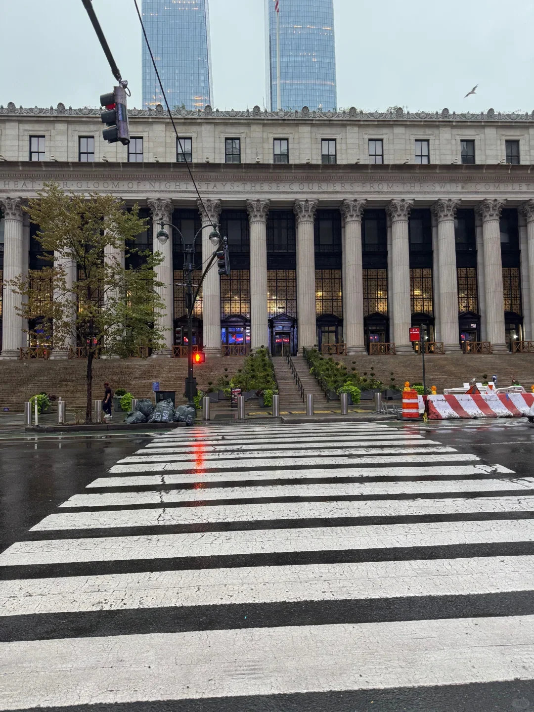
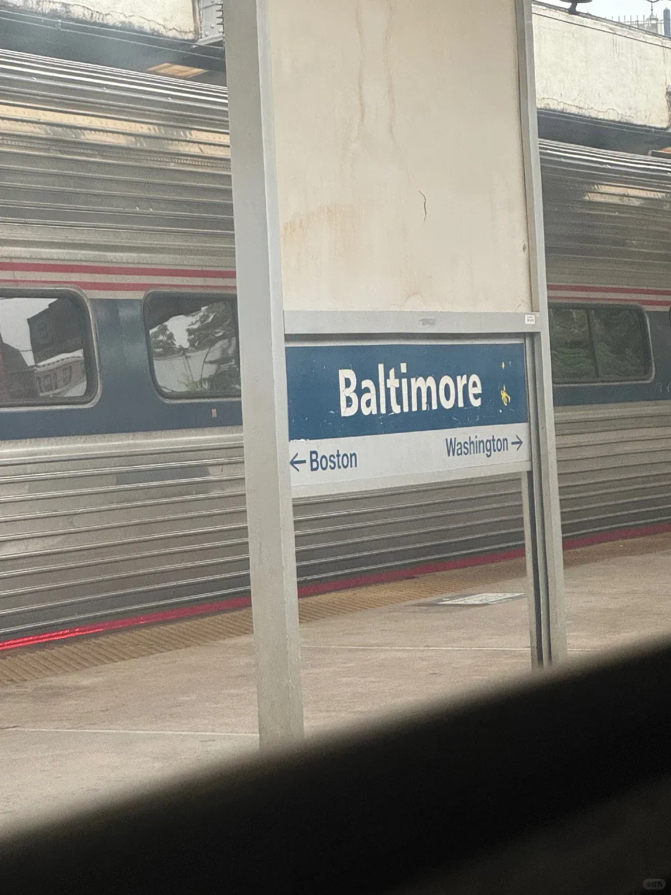

De Nueva York a Washington hay poco más de 300 kilómetros, y el tren es la forma menos engorrosa de hacerlo: de centro a centro, sin dos horas de margen de aeropuerto ni cola de seguridad. Amtrak opera dos servicios en el corredor noreste: el Northeast Regional, con muchas paradas, y el Acela, más rápido, y ambos tardan alrededor de tres horas.

Lo que sigue es el orden en que te lo encuentras todo: elegir el tren, comprar el billete, entrar en la estación, embarcar y llegar. Las tarifas cambian con la fecha y las plazas restantes, así que toma las cifras como referencias y consulta Amtrak el mismo día.

## 1. Elegir el tren: Acela o Northeast Regional

El Acela es el servicio rápido: tarda unas 2 horas y 45 minutos a 3 horas de Nueva York a Washington, con solo un puñado de paradas, todos los asientos reservados y clases business y primera. El Northeast Regional para más a menudo y tarda unas 3 horas y 20 minutos a 3 horas y 40 minutos, con clase turista sin reserva y una business con reserva, normalmente a una tarifa mucho más baja.

Ambos salen del Moynihan Train Hall de la estación Penn y ambos llegan a la Union Station de Washington. Durante el día hay aproximadamente una salida cada hora de cada uno, con el Acela algo menos frecuente. Si el tiempo importa o paga otro, toma el Acela; con presupuesto ajustado, el Regional solo es media hora o una hora más lento y ofrece mucho mejor valor. Los fines de semana y las vacaciones se llenan, así que reservar antes da más opciones.

## 2. Comprar el billete: Amtrak, la app u Omio

Los canales oficiales son la web y la app de Amtrak: elige un tren, una clase y una preferencia de asiento, y el billete electrónico queda en tu cuenta. Los precios de Amtrak son dinámicos: el mismo tren puede costar treinta o cuarenta dólares con dos meses de antelación y varias veces eso el día anterior. Las familias de tarifas Saver, Value y Flex se diferencian en la facilidad para cambiar o cancelar: Saver es la más barata y normalmente ni reembolsable ni modificable, Value se puede cambiar pagando una comisión, y Flex es la más flexible y la más cara. Si tus fechas no están fijas, no persigas la tarifa más barata.

La web y la app de Amtrak pueden fallar desde dentro de China, y plataformas de terceros como Omio emiten el mismo billete: introduce origen, destino y fecha, elige un tren, paga con tarjeta y el correo de confirmación lleva el billete electrónico. Hay una pequeña comisión de servicio, pero la interfaz es sencilla y funciona en chino, lo que ayuda para una reserva de última hora.

No hace falta imprimir el billete electrónico; llévalo en el móvil. El revisor recorre el tren y escanea el código.

## 3. Salir de Nueva York: Penn Station y Moynihan

La sala de salidas de Amtrak en Nueva York es el Moynihan Train Hall, dentro del antiguo edificio de Correos Farley, en el lado oeste de la Octava Avenida, frente a la estación Penn. Desde el metro 34 St–Penn Station, sigue los carteles “Amtrak / Moynihan Train Hall” por el pasillo o sube a la calle y cruza. Si llegas a Penn en el Long Island Rail Road o en NJ Transit, los mismos carteles te llevan allí en unos cinco minutos.

La sala tiene zonas de espera, comida y aseos, y llegar 30–40 minutos antes de la salida es suficiente. No hay control de seguridad ni mostrador de facturación; nadie pide identificación en la puerta ni pesa las maletas.

El andén suele anunciarse solo 10–15 minutos antes de la salida, en los paneles y por megafonía al mismo tiempo, a veces con personal que lo grita. Cuando aparezca tu tren, sigue a la multitud hasta la puerta y baja al andén.

## 4. A bordo: asientos, maletas y el vagón silencioso

La clase turista del Northeast Regional es sin reserva: ocupa cualquier asiento libre. Los portaequipajes superiores admiten una maleta de 26 pulgadas, y las maletas más grandes van en los soportes de los extremos del vagón. Cada pasajero puede llevar normalmente dos maletas grandes y dos pequeñas sin cargo, y rara vez las pesan. La clase business tiene reserva; en el Acela todos los asientos están reservados, y business y primera son más anchos. Hay enchufes en los asientos.

Cada vagón tiene un aseo, y el revisor pasa tras la salida para escanear los billetes. Normalmente un vagón es el vagón silencioso: no se permiten llamadas ni audio audible, y las llamadas se atienden en el vestíbulo. Para dormir o trabajar, es el vagón que hay que elegir. El embarque es concurrido, así que guarda primero la maleta y luego busca asiento, en lugar de bloquear el pasillo.

No hay servicio de comida más allá del vagón cafetería: el Regional tiene un vagón que vende café, sándwiches y aperitivos, mientras que la primera clase del Acela sirve en el asiento. Lleva tu propia agua: comprarla en la estación sale más barato.

## 5. Tres horas y media sobre raíles

Al salir de Penn Station, el tren se sumerge bajo el Hudson, cruza Nueva Jersey por Newark y Trenton, para en Filadelfia y Wilmington, en Pensilvania y Delaware, y luego entra en Maryland por Baltimore y el aeropuerto BWI antes de Washington. Por el camino aparecen el río Delaware y la parte alta del Chesapeake, así que un asiento junto a la ventana se gana el sitio.

La mayoría de los vagones del Northeast Regional no tienen pantalla que muestre la próxima parada, así que escucha los anuncios o sigue la ruta en el mapa del móvil. El wifi es gratis pero flojo: los mensajes llegan, el vídeo no. Los retrasos no son raros, sobre todo por la tarde; si tienes un vuelo o un espectáculo después, deja margen. La información en tiempo real de la app está más al día que los paneles y los anuncios del andén.

## 6. Llegar a Union Station y al metro

La Union Station de Washington es un monumento Beaux-Arts: bajas a un gran vestíbulo, con comida, tiendas y un punto de información. Amtrak, los trenes de cercanías MARC y VRE la usan, y la estación de metro de la línea Red queda debajo: sigue los carteles de “Metro”.

El Capitolio está a 10–15 minutos a pie; para el National Mall y la zona de la Casa Blanca, toma la línea Red hasta Metro Center o Gallery Place y cambia. Las tarifas del metro se calculan por distancia y hora, unos 2–4 $, y se pagan con una tarjeta SmarTrip o una tarjeta bancaria contactless en el torno. Ambas direcciones de la línea Red pasan por el centro, así que comprueba el destino en la pantalla del andén antes de subir.

Los taxis y los VTC recogen fuera de la estación. Con varias maletas, calcula diez minutos del andén al metro, porque el paseo es más largo de lo que parece.

## Enlaces relacionados

- **En este sitio**: [Estados Unidos (US)](/country/US)
- **Wikipedia**: [Amtrak](https://en.wikipedia.org/wiki/Amtrak), [Penn Station](https://en.wikipedia.org/wiki/Pennsylvania_Station_(New_York_City)), [Washington Union Station](https://en.wikipedia.org/wiki/Washington_Union_Station)
- **Baidu Baike**: [Amtrak](https://baike.baidu.com/item/%E7%BE%8E%E5%9B%BD%E5%9B%BD%E9%93%81)

Las tarifas, los horarios y las clases siguen la información publicada por Amtrak; prevalece la web del operador y los avisos de la estación el mismo día. Fuente: una guía de viaje de WeChat.
