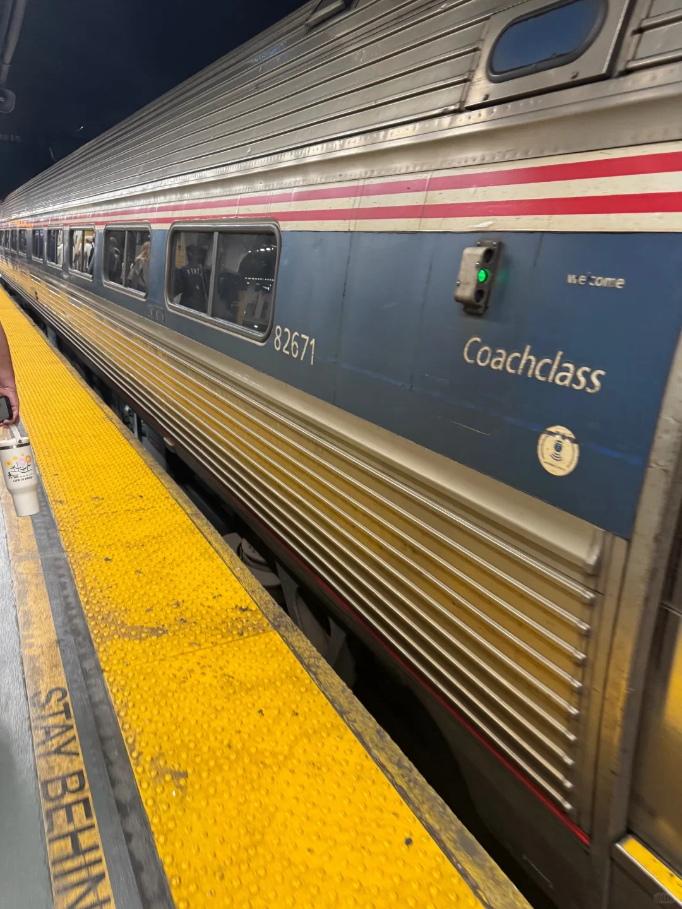

New York ke Washington sedikit lebih dari 300 kilometer, dan kereta adalah cara paling tidak melelahkan: pusat kota ke pusat kota, tanpa cadangan dua jam di bandara, tanpa antrean keamanan. Amtrak menjalankan dua layanan di Koridor Northeast — Northeast Regional yang banyak berhenti dan Acela yang lebih cepat — dan keduanya memakan waktu sekitar tiga jam.

Uraian berikut mengikuti urutan yang akan Anda temui: memilih kereta, membeli tiket, memasuki stasiun, naik, dan tiba. Tarif bergerak sesuai tanggal dan sisa kursi, jadi anggap angka-angka ini sebagai referensi dan periksa Amtrak pada hari itu.

## 1. Memilih kereta: Acela atau Northeast Regional

Acela adalah layanan cepat, memakan waktu sekitar 2 jam 45 menit hingga 3 jam dari New York ke Washington dengan hanya beberapa perhentian, semua kursi dipesan, di kelas bisnis dan first. Northeast Regional lebih sering berhenti dan memakan waktu sekitar 3 jam 20 menit hingga 3 jam 40 menit, dengan coach tanpa nomor kursi dan kelas bisnis yang dipesan, biasanya dengan tarif jauh lebih murah.

Keduanya berangkat dari Moynihan Train Hall di Penn Station dan tiba di Washington Union Station. Pada siang hari ada sekitar satu keberangkatan per jam untuk masing-masing, dengan Acela sedikit lebih jarang. Jika waktu penting atau orang lain yang membayar, naiklah Acela; jika anggaran terbatas, Regional hanya setengah jam hingga satu jam lebih lambat dan jauh lebih bernilai. Akhir pekan dan hari libur cepat penuh, jadi pemesanan lebih awal memberi lebih banyak pilihan.

## 2. Membeli tiket: Amtrak, aplikasi, atau Omio

Saluran resminya adalah situs dan aplikasi Amtrak: pilih kereta, kelas, dan preferensi tempat duduk, dan e-tiket tersimpan di akun Anda. Harga Amtrak bersifat dinamis — kereta yang sama bisa berbiaya tiga puluh atau empat puluh dolar dua bulan sebelumnya dan beberapa kali lipat sehari sebelumnya. Keluarga tarif Saver, Value, dan Flex berbeda dalam kemudahan mengubah atau membatalkan: Saver paling murah dan biasanya tidak dapat dikembalikan maupun diubah, Value dapat diubah dengan biaya, dan Flex paling fleksibel serta paling mahal. Jika tanggal Anda belum pasti, jangan mengejar tarif termurah.

Situs dan aplikasi Amtrak bisa tidak andal dari dalam Tiongkok, dan platform pihak ketiga seperti Omio akan menerbitkan tiket yang sama: masukkan asal, tujuan, dan tanggal, pilih kereta, bayar dengan kartu, dan email konfirmasi membawa e-tiket. Ada biaya layanan kecil, tetapi antarmukanya sederhana dan berfungsi dalam bahasa Mandarin, yang membantu untuk pemesanan mendadak.

Anda tidak perlu mencetak e-tiket; simpan di ponsel. Kondektur berkeliling kereta dan memindai kodenya.

## 3. Meninggalkan New York: Penn Station dan Moynihan

Aula keberangkatan Amtrak di New York adalah Moynihan Train Hall, di dalam gedung Farley Post Office lama di sisi barat Eighth Avenue, di seberang jalan dari Penn Station. Dari stasiun bawah tanah 34 St–Penn Station, ikuti tanda "Amtrak / Moynihan Train Hall" melalui lorong atau naik ke permukaan jalan dan menyeberang. Jika Anda tiba dengan Long Island Rail Road atau NJ Transit di Penn, tanda yang sama mengantar ke sana dalam sekitar lima menit.

Aula ini memiliki area tunggu, makanan, dan toilet, dan tiba 30–40 menit sebelum keberangkatan sudah cukup. Tidak ada pemeriksaan keamanan dan tidak ada meja check-in; tidak ada yang meminta identitas di gerbang, dan tidak ada yang menimbang bagasi Anda.

Peron biasanya baru diumumkan 10–15 menit sebelum keberangkatan, di papan dan melalui pengeras suara pada saat bersamaan, kadang dengan staf yang menyerukan. Saat kereta Anda muncul, ikuti kerumunan ke gerbang dan turun ke peron.

## 4. Di dalam kereta: kursi, bagasi, dan gerbong tenang

Coach Northeast Regional tanpa nomor kursi: ambil kursi kosong mana pun. Rak di atas dapat menampung koper 26 inci, dan bagasi lebih besar masuk ke rak di ujung gerbong. Setiap penumpang biasanya dapat membawa dua tas besar dan dua tas kecil tanpa biaya, dan jarang ditimbang. Kelas bisnis dipesan; di Acela setiap kursi dipesan, dan kelas bisnis serta first lebih lebar. Ada colokan listrik di kursi.

Setiap gerbong memiliki toilet, dan kondektur datang setelah keberangkatan untuk memindai tiket. Satu gerbong biasanya adalah Gerbong Tenang: tidak boleh menelepon dan tidak boleh ada audio yang terdengar, dengan panggilan dilakukan di ruang penghubung. Untuk tidur atau bekerja, itulah gerbong yang dipilih. Proses naik sibuk, jadi simpan koper lebih dulu lalu cari kursi daripada menghalangi lorong.

Tidak ada layanan makanan selain gerbong kafe: Regional memiliki satu gerbong yang menjual kopi, sandwich, dan camilan, sedangkan kelas first Acela melayani di kursi Anda. Bawalah air sendiri — membelinya di stasiun lebih murah.

## 5. Tiga setengah jam di rel

Keluar dari Penn Station, kereta menyelam di bawah Hudson, melintasi New Jersey melalui Newark dan Trenton, berhenti di Philadelphia dan Wilmington di Pennsylvania dan Delaware, lalu masuk Maryland untuk Baltimore dan BWI Airport sebelum Washington. Sungai Delaware dan bagian atas Chesapeake muncul di sepanjang jalan, jadi kursi dekat jendela sepadan.

Sebagian besar gerbong Northeast Regional tidak memiliki layar yang menampilkan perhentian berikutnya, jadi dengarkan pengumuman atau ikuti rute di peta ponsel Anda. Wi-Fi gratis tetapi lemah — pesan terkirim, video tidak. Keterlambatan tidak jarang, terutama sore hari; jika ada penerbangan atau pertunjukan setelahnya, sisakan waktu cadangan. Informasi waktu nyata di aplikasi lebih mutakhir daripada papan dan pengumuman di peron.

## 6. Tiba di Union Station dan Metro

Washington Union Station adalah landmark Beaux-Arts: Anda turun ke aula besar, dengan makanan, toko, dan meja informasi. Amtrak, kereta komuter MARC, dan VRE semuanya menggunakan stasiun ini, dan stasiun metro Red Line berada di bawahnya — ikuti tanda "Metro".

Capitol berjarak 10–15 menit berjalan kaki; untuk National Mall dan area Gedung Putih, naik Red Line ke Metro Center atau Gallery Place lalu berganti. Tarif Metro dihitung berdasarkan jarak dan waktu, sekitar $2–4, dibayar dengan kartu SmarTrip atau kartu bank nirsentuh di gerbang. Kedua arah Red Line melewati pusat kota, jadi periksa tujuan di layar peron sebelum naik.

Taksi dan taksi daring menjemput di luar stasiun. Dengan beberapa koper, sediakan sepuluh menit dari peron ke Metro, karena jalannya lebih jauh dari yang terlihat.

## Tautan terkait

- **Di situs ini**: [Amerika Serikat (US)](/country/US)
- **Wikipedia**: [Amtrak](https://en.wikipedia.org/wiki/Amtrak), [Penn Station](https://en.wikipedia.org/wiki/Pennsylvania_Station_(New_York_City)), [Washington Union Station](https://en.wikipedia.org/wiki/Washington_Union_Station)
- **Baidu Baike**: [Amtrak](https://baike.baidu.com/item/%E7%BE%8E%E5%9B%BD%E5%9B%BD%E9%93%81)

Tarif, jadwal, dan kelas mengikuti informasi yang diterbitkan Amtrak; situs operator dan pemberitahuan stasiun pada hari itu yang berlaku. Sumber: panduan perjalanan WeChat.
