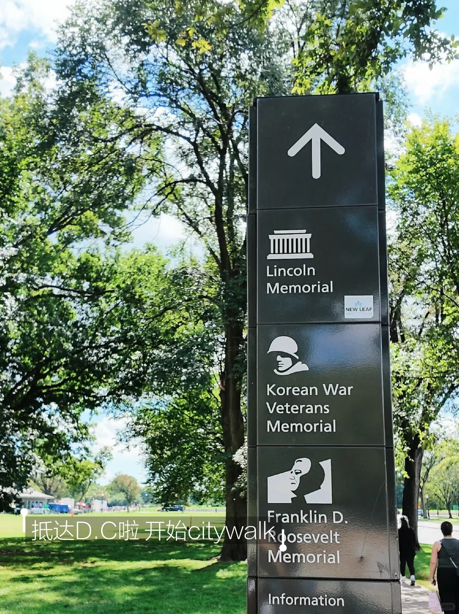

New York hadi Washington ni kilomita 300 na kidogo, na treni ndio njia isiyo na wasiwasi zaidi: katikati ya mji hadi katikati ya mji, hakuna muda wa ziada wa saa mbili wa uwanja wa ndege, hakuna foleni ya usalama. Amtrak inaendesha huduma mbili kwenye Northeast Corridor — Northeast Regional yenye vituo vingi na Acela ya haraka zaidi — na zote zinachukua takriban saa tatu.

Kinachofuata ni mpangilio wa mambo kama unavyokutana nayo: kuchagua treni, kununua tikiti, kuingia kituoni, kupanda, na kuwasili. Nauli hubadilika kulingana na tarehe na viti vilivyobaki, hivyo chukua takwimu kama marejeo na uangalie Amtrak siku hiyo.

## 1. Kuchagua treni: Acela au Northeast Regional

Acela ni huduma ya haraka, inachukua takriban saa 2 dakika 45 hadi saa 3 kutoka New York hadi Washington ikiwa na vituo vichache tu, viti vyote vimehifadhiwa, katika daraja la biashara na la kwanza. Northeast Regional inasimama mara nyingi zaidi na inachukua takriban saa 3 dakika 20 hadi saa 3 dakika 40, ikiwa na behewa la kawaida lisilo na uhifadhi wa kiti na daraja la biashara lenye uhifadhi, kwa kawaida kwa nauli ya chini zaidi.

Zote zinaondoka Moynihan Train Hall kwenye Penn Station na zote zinawasili Washington Union Station. Wakati wa mchana kuna takriban safari moja kwa saa kwa kila huduma, Acela ikiwa na safari chache kidogo. Ikiwa muda ni muhimu au mtu mwingine analipa, chukua Acela; ukiwa na bajeti finyu, Regional ni ya polepole kwa nusu saa hadi saa moja tu na ina thamani bora zaidi. Wikendi na sikukuu hujaa, hivyo kuweka nafasi mapema kunamaanisha chaguo zaidi.

## 2. Kununua tikiti: Amtrak, programu, au Omio

Njia rasmi ni tovuti na programu ya Amtrak: chagua treni, daraja na upendeleo wa kiti, na tikiti ya kielektroniki inabaki kwenye akaunti yako. Bei za Amtrak zinabadilika — treni hiyo hiyo inaweza kugharimu dola thelathini au arobaini miezi miwili kabla na mara kadhaa zaidi siku moja kabla. Familia za nauli za Saver, Value na Flex zinatofautiana kwa urahisi wa kubadilisha au kughairi: Saver ni ya bei nafuu zaidi na kwa kawaida haiwezi kurudishwa wala kubadilishwa, Value inaweza kubadilishwa kwa ada, na Flex ni rahisi kubadilika zaidi na ghali zaidi. Ikiwa tarehe zako hazijafungwa, usifukuze nauli ya bei nafuu zaidi.

Tovuti na programu ya Amtrak zinaweza kukosa utulivu ukiwa ndani ya China, na majukwaa ya wahusika wengine kama Omio yatatoa tikiti hiyo hiyo: weka mahali pa kuanzia, unakoenda na tarehe, chagua treni, lipa kwa kadi, na barua pepe ya uthibitisho ina tikiti ya kielektroniki. Kuna ada ndogo ya huduma, lakini kiolesura ni rahisi na kinafanya kazi kwa Kichina, jambo linalosaidia kwa kuweka nafasi dakika za mwisho.

Huhitaji kuchapisha tikiti ya kielektroniki; iweke kwenye simu yako. Kondakta anapita treni na kuchanganua msimbo.

## 3. Kuondoka New York: Penn Station na Moynihan

Ukumbi wa kuondokea wa Amtrak huko New York ni Moynihan Train Hall, ndani ya jengo la zamani la Farley Post Office upande wa magharibi wa Eighth Avenue, mkabala na Penn Station. Kutoka stesheni ya chini ya ardhi ya 34 St–Penn Station, fuata alama za "Amtrak / Moynihan Train Hall" kupitia njia ya kupita au hadi ngazi ya barabara na kuvuka. Ukiwasili kwa Long Island Rail Road au NJ Transit kwenye Penn, alama hizo hizo zinakuongoza huko kwa takriban dakika tano.

Ukumbi una maeneo ya kusubiri, chakula na vyoo, na kuwasili dakika 30–40 kabla ya kuondoka kunatosha. Hakuna ukaguzi wa usalama wala kaunta ya kujiandikisha; hakuna anayeuliza kitambulisho langoni, na hakuna anayepima uzito wa mizigo yako.

Jukwaa kwa kawaida hutangazwa dakika 10–15 tu kabla ya kuondoka, kwenye mbao za taarifa na kwa mfumo wa matangazo kwa wakati mmoja, wakati mwingine wafanyakazi wakitangaza kwa sauti. Treni yako inapotokea, fuata umati hadi langoni na kushuka hadi jukwaani.

## 4. Ndani ya treni: viti, mizigo na behewa la utulivu

Behewa la Northeast Regional halina uhifadhi: kaa kiti chochote kilicho huru. Rafu za juu zinachukua sanduku la inchi 26, na mizigo mikubwa zaidi huwekwa kwenye rafu mwisho wa behewa. Kila abiria kwa kawaida anaweza kuleta mizigo mikubwa miwili na midogo miwili bila malipo, na mara chache hupimwa uzito. Daraja la biashara lina uhifadhi; kwenye Acela kila kiti kina uhifadhi, na daraja la biashara na la kwanza zina upana zaidi. Kuna soketi za umeme kwenye viti.

Kila behewa lina choo, na kondakta hupita baada ya kuondoka kuchanganua tikiti. Behewa moja kwa kawaida ni Behewa la Utulivu: hakuna simu wala sauti inayosikika, na simu hupokelewa kwenye kibanda cha kuingilia. Kwa kulala au kufanya kazi, hilo ndilo behewa la kuchagua. Kupanda kuna shughuli nyingi, hivyo weka sanduku kwanza kisha tafuta kiti badala ya kuzuia njia ya kupita.

Hakuna huduma ya chakula zaidi ya behewa la mkahawa: Regional ina behewa moja linalouza kahawa, sandwichi na vitafunio, wakati daraja la kwanza la Acela linahudumia kwenye kiti chako. Leta maji yako mwenyewe — kununua kituoni ni nafuu zaidi.

## 5. Saa tatu na nusu kwenye reli

Kutoka Penn Station treni inapita chini ya mto Hudson, inavuka New Jersey kupitia Newark na Trenton, inasimama Philadelphia na Wilmington katika Pennsylvania na Delaware, kisha inaingia Maryland kwa Baltimore na BWI Airport kabla ya Washington. Mto Delaware na sehemu ya juu ya Chesapeake vinaonekana njiani, hivyo kiti cha dirishani kinastahili.

Mabehewa mengi ya Northeast Regional hayana skrini inayoonyesha kituo kinachofuata, hivyo sikiliza matangazo au fuata njia kwenye ramani ya simu yako. Wi-Fi ni bure lakini dhaifu — ujumbe hupita, video haipiti. Ucheleweshaji si nadra, hasa mchana; ikiwa unafuata ndege au onyesho, acha muda wa ziada. Taarifa za wakati halisi za programu ni za hivi karibuni zaidi kuliko mbao za taarifa na matangazo ya jukwaa.

## 6. Kuwasili Union Station na Metro

Washington Union Station ni jengo maarufu la mtindo wa Beaux-Arts: unashuka moja kwa moja kwenye ukumbi mkubwa, ukiwa na chakula, maduka na dawati la taarifa. Amtrak, treni za wasafiri wa kila siku za MARC na VRE zote zinatumia kituo hiki, na stesheni ya chini ya ardhi ya Red Line iko chini yake — fuata alama za "Metro".

Capitol iko dakika 10–15 kwa kutembea; kwa National Mall na eneo la White House, chukua Red Line hadi Metro Center au Gallery Place na ubadilishe. Nauli za Metro zinapangwa kwa umbali na muda, takriban $2–4, zinalipwa kwa kadi ya SmarTrip au kadi ya benki isiyogusa kwenye lango. Mielekeo yote miwili ya Red Line inapita katikati ya mji, hivyo angalia unakoenda kwenye skrini ya jukwaa kabla ya kupanda.

Teksi na huduma za gari kwa simu huchukua abiria nje ya kituo. Ukiwa na masanduku kadhaa, toa dakika kumi kutoka jukwaa hadi Metro, kwa sababu matembezi ni marefu kuliko yanavyoonekana.

## Viungo vinavyohusiana

- **Kwenye tovuti hii**: [Marekani (US)](/country/US)
- **Wikipedia**: [Amtrak](https://en.wikipedia.org/wiki/Amtrak), [Penn Station](https://en.wikipedia.org/wiki/Pennsylvania_Station_(New_York_City)), [Washington Union Station](https://en.wikipedia.org/wiki/Washington_Union_Station)
- **Baidu Baike**: [Amtrak](https://baike.baidu.com/item/%E7%BE%8E%E5%9B%BD%E5%9B%BD%E9%93%81)

Nauli, ratiba na madaraja hufuata taarifa zilizochapishwa na Amtrak; tovuti ya mwendeshaji na ilani za kituo za siku hiyo ndizo zitakazotumika. Chanzo: mwongozo wa safari wa WeChat.
