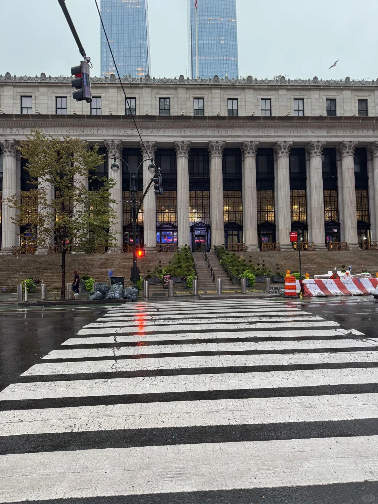
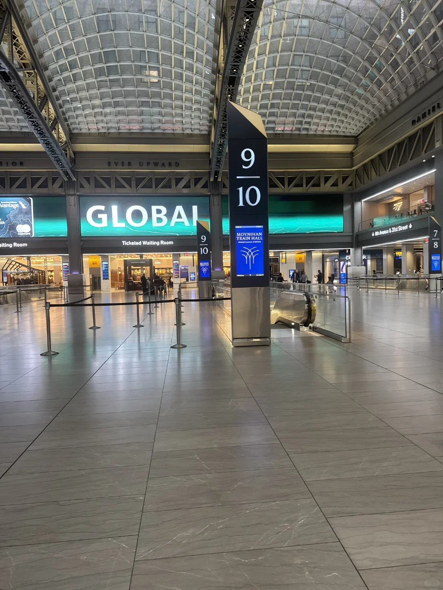
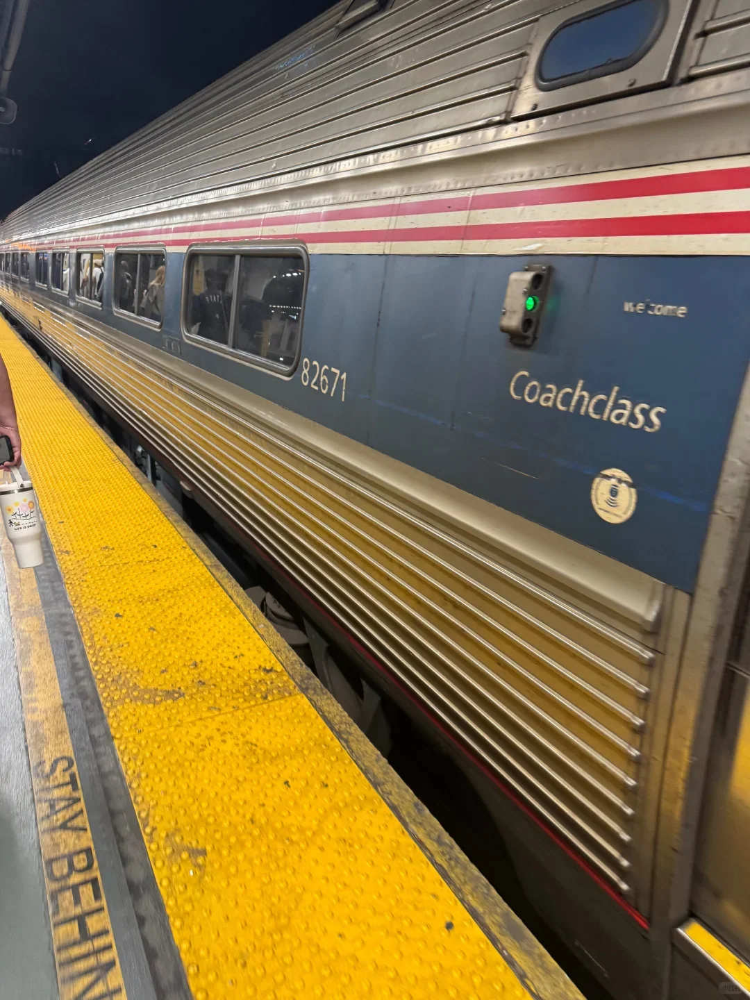
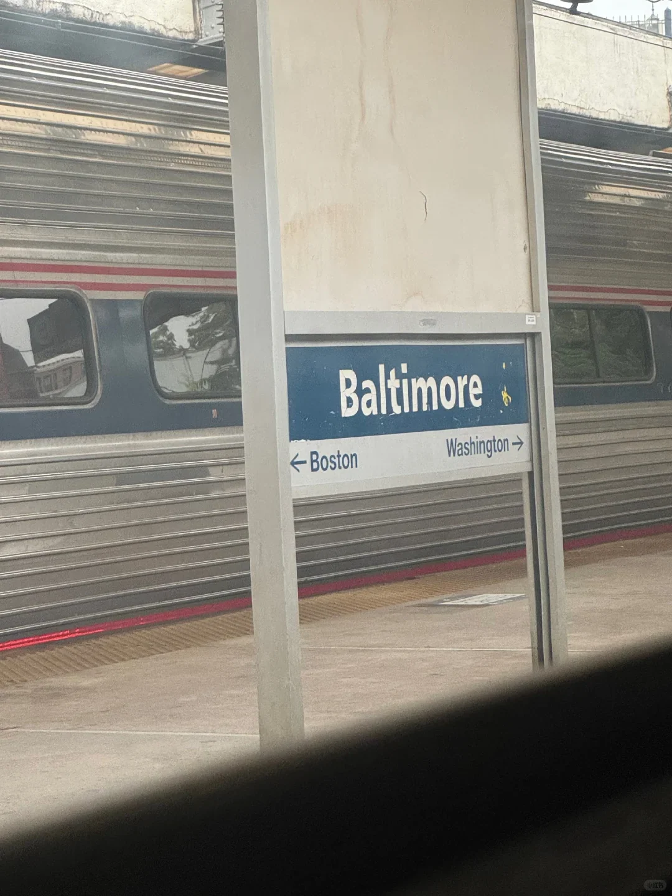
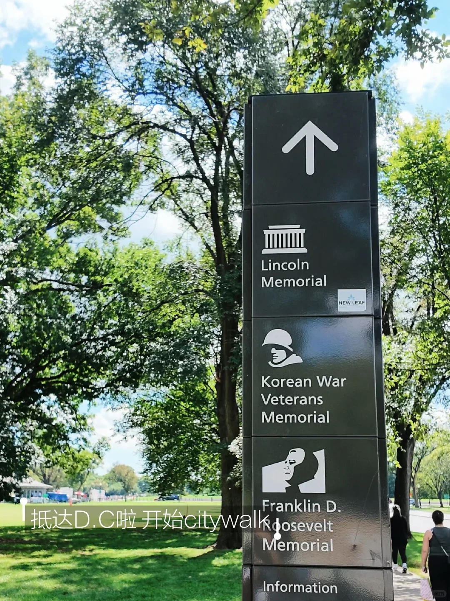

紐約到華盛頓三百多公里，坐火車是最省心的一段：市中心到市中心，不用提前兩小時到機場，也沒有安檢。Amtrak 在這條東北走廊上跑兩種車——停站多的東北區域號（Northeast Regional）和更快的 Acela，全程三小時上下。

下面按選車、買票、進站、上車、到站的順序整理。票價隨日期和餘票浮動，文中數字只作參考，以 Amtrak 當日公佈為準。

## 一、先選車：Acela 還是東北區域號

Acela 是這條線上的高速列車，紐約到華盛頓約 2 小時 45 分到 3 小時，全程只停少數大站，全車對號入座，分商務艙和頭等艙。東北區域號停站多，約 3 小時 20 分到 3 小時 40 分，座位分經濟艙和商務艙，價格通常低不少。

兩種車都從賓州車站的莫伊尼漢大廳發車，到站都是華盛頓聯合車站。白天兩種車基本每小時都有班次，Acela 稍少一些。趕時間、公司報銷，選 Acela；預算有限、時間寬鬆，東北區域號只慢半小時到一小時，價效比更高。週末和節假日兩種車都容易滿，越早訂選擇越多。

## 二、買票：官網、App 與 Omio

官方渠道是 Amtrak 官網和 App，註冊賬號後可以直接選車次、席別和座位偏好，電子票存在賬戶裡。Amtrak 的票價是浮動的：同一班車，提前一兩個月買可能只要三四十美元，臨出發前買可能翻幾倍。Saver、Value、Flex 幾檔票價的區別在於改簽和退票的靈活度：Saver 最便宜，通常不退不改；Value 可以付手續費改簽；Flex 最靈活也最貴。行程沒定下來，別急著買最便宜的那檔。

在國內訪問 Amtrak 官網或 App 可能不穩定，第三方平臺（例如 Omio）也能出票：輸入出發地、目的地和日期，選好車次用信用卡付款，確認郵件裡帶電子票。第三方會收一點服務費，但介面簡單、支援中文，適合出發前臨時補票。

電子票不用列印，存在手機裡即可。上車後列車員會逐個檢票，把二維碼調出來給他掃一下就行。

## 三、紐約出發：賓州車站與莫伊尼漢大廳

Amtrak 在紐約的出發大廳是莫伊尼漢車站大廳（Moynihan Train Hall），在第八大道西側、老郵政大樓裡，與賓州車站隔街相對。坐地鐵到 34 St–Penn Station 後，跟著「Amtrak / Moynihan Train Hall」的標識走，穿過通道或上到地面過馬路，都能到。如果坐長島鐵路或紐澤西交通到賓州車站，出站後按同樣的標識走，大約五分鐘。

大廳裡有候車區、餐飲和洗手間，出發前 30–40 分鐘到就夠了。這裡沒有安檢，也沒有值機櫃臺，進站不需要出示證件；行李自己拿，沒有人會稱重。

車次的站臺（track）通常只在發車前 10–15 分鐘公佈，大屏和廣播會同時通知，有時工作人員會拿著喇叭喊。看到自己的車次後跟著人流到對應的閘口，下到站臺上車。

## 四、上車：座位、行李與靜音車廂

東北區域號的經濟艙不對號，上車後找空位坐，行李架在頭頂，26 寸的箱子放得下，更大的箱子放車廂兩端的行李區。每人通常可以帶兩件大行李和兩件隨身小包，不額外收費，也很少有人來稱重。商務艙對號入座；Acela 全車對號，商務艙和頭等艙的座位更寬。座位旁有插座，可以充電。

每節車廂有洗手間，列車開動後列車員會來檢票。車廂裡通常有一節是靜音車廂（Quiet Car），不能打電話、不能外放聲音，需要通話要到車廂連接處。想睡覺或辦公，選這一節最清淨。上車時人多，先把箱子放好再找座位，別堵在過道里。

車上的餐飲只有咖啡車廂：東北區域號賣咖啡、三明治和零食；Acela 的頭等艙提供送餐到座。水可以自己帶，車站裡買好再上車更便宜。

## 五、三個半小時在路上

列車出賓州車站後先向西穿過哈德遜河底隧道，經紐澤西的紐瓦克、特倫頓進入賓夕法尼亞，停費城；再經德拉瓦停威爾明頓，進馬裡蘭停巴爾的摩、BWI 機場，最後到華盛頓。沿途能看到德拉瓦河、切薩皮克灣一帶的水面和工業區，靠窗的座位值得選。

東北區域號多數車廂沒有顯示下一站的螢幕，到站前靠廣播，注意聽或者看手機上的地圖。車上 Wi-Fi 免費但訊號一般，發訊息可以，看影片會卡。列車晚點並不少見，尤其是下午的班次；如果後面接飛機或演出，把時間留寬一點。

到站時間以 App 上的即時資訊為準，比車站大屏和站臺廣播更新得快。

## 六、抵達聯合車站與換地鐵

華盛頓聯合車站（Union Station）是座布雜藝術風格的老車站，出站就是大廳，餐飲和商店不少，主大廳有資訊臺。Amtrak、MARC 通勤鐵路和 VRE 都在這裡，地鐵紅線（Red Line）的車站在車站地下，跟著「Metro」的標識走就能到。

去國會大廈步行約 10–15 分鐘，去國家廣場、白宮一帶可以坐紅線到 Metro Center 或 Gallery Place 換乘。地鐵票價按里程和時間計算，約 2–4 美元，用 SmarTrip 卡或感應式銀行卡進站。紅線兩個方向都經過市中心，上車前看清站臺螢幕上的終點站。

計程車和網約車在車站外的指定區域上車；拖行李多的話，從站臺到地鐵站有一段路，留出十分鐘。

## 相關連結

- **本站頁面**：[美國（US）](/tw/country/US)
- **維基百科**：[美鐵](https://zh.wikipedia.org/wiki/%E7%BE%8E%E9%93%81)、[賓夕法尼亞車站](https://zh.wikipedia.org/wiki/%E5%AE%BE%E5%A4%95%E6%B3%95%E5%B0%BC%E4%BA%9A%E8%BD%A6%E7%AB%99)、[華盛頓聯合車站](https://zh.wikipedia.org/wiki/%E5%8D%8E%E7%9B%9B%E9%A1%BF%E8%81%94%E5%90%88%E8%BD%A6%E7%AB%99)

票價、時刻與席別參考 Amtrak 公開資訊，實際以 Amtrak 官網與車站當日公佈為準。資料來源：微信旅行攻略。
