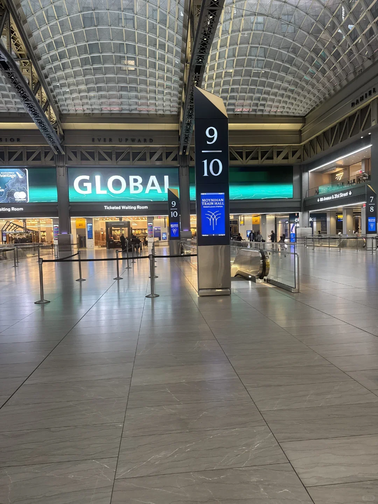

New York đến Washington chỉ hơn 300 km, và tàu là cách ít phiền toái nhất: từ trung tâm này đến trung tâm kia, không cần đệm hai giờ ở sân bay, không có hàng chờ an ninh. Amtrak chạy hai dịch vụ trên Hành lang Đông Bắc — Northeast Regional dừng nhiều và Acela nhanh hơn — và cả hai đều mất khoảng ba giờ.

Phần dưới đây theo đúng thứ tự bạn sẽ gặp: chọn tàu, mua vé, vào ga, lên tàu và đến nơi. Giá vé thay đổi theo ngày và số ghế còn lại, nên hãy coi các con số là tham khảo và kiểm tra Amtrak vào ngày đi.

## 1. Chọn tàu: Acela hay Northeast Regional

Acela là dịch vụ nhanh, mất khoảng 2 giờ 45 phút đến 3 giờ từ New York đến Washington với chỉ vài điểm dừng, mọi ghế đều đặt trước, hạng thương gia và hạng nhất. Northeast Regional dừng nhiều hơn và mất khoảng 3 giờ 20 phút đến 3 giờ 40 phút, với toa phổ thông không đặt trước và hạng thương gia đặt trước, thường có giá thấp hơn nhiều.

Cả hai đều khởi hành từ Moynihan Train Hall tại Ga Penn và đều đến Ga Union Washington. Ban ngày có khoảng một chuyến mỗi giờ cho mỗi dịch vụ, Acela thưa hơn một chút. Nếu thời gian quan trọng hoặc người khác trả tiền, hãy chọn Acela; nếu tiết kiệm, Regional chỉ chậm hơn nửa giờ đến một giờ và đáng giá hơn nhiều. Cuối tuần và ngày lễ đầy chỗ, nên đặt sớm sẽ có nhiều lựa chọn hơn.

## 2. Mua vé: Amtrak, ứng dụng hoặc Omio

Kênh chính thức là trang web và ứng dụng Amtrak: chọn tàu, hạng và ưu tiên chỗ ngồi, vé điện tử sẽ nằm trong tài khoản của bạn. Giá Amtrak thay đổi linh hoạt — cùng một chuyến có thể giá ba bốn mươi đô la khi mua trước hai tháng và cao gấp nhiều lần vào ngày hôm trước. Các nhóm giá Saver, Value và Flex khác nhau ở mức dễ đổi hoặc hủy: Saver rẻ nhất và thường không hoàn tiền, không đổi được; Value đổi được với phí; Flex linh hoạt nhất và đắt nhất. Nếu ngày đi chưa cố định, đừng chạy theo giá rẻ nhất.

Trang web và ứng dụng Amtrak có thể không ổn định từ trong Trung Quốc, và các nền tảng bên thứ ba như Omio sẽ xuất cùng loại vé: nhập điểm đi, điểm đến và ngày, chọn tàu, trả bằng thẻ, và email xác nhận chứa vé điện tử. Có một khoản phí dịch vụ nhỏ, nhưng giao diện đơn giản và dùng được tiếng Trung, hữu ích cho lần đặt vé phút cuối.

Bạn không cần in vé điện tử; hãy giữ nó trên điện thoại. Nhân viên soát vé đi dọc tàu và quét mã.

## 3. Rời New York: Ga Penn và Moynihan

Sảnh khởi hành của Amtrak ở New York là Moynihan Train Hall, bên trong tòa nhà Bưu điện Farley cũ ở phía tây Đại lộ Số Tám, đối diện Ga Penn. Từ tàu điện ngầm 34 St–Penn Station, hãy đi theo biển “Amtrak / Moynihan Train Hall” qua hành lang hoặc lên mặt đất rồi băng qua đường. Nếu bạn đến Ga Penn bằng Long Island Rail Road hoặc NJ Transit, cũng những biển đó dẫn đến đó trong khoảng năm phút.

Sảnh có khu chờ, đồ ăn và nhà vệ sinh, và đến trước giờ khởi hành 30–40 phút là đủ. Không có kiểm tra an ninh và không có quầy làm thủ tục; không ai hỏi giấy tờ ở cổng, và không ai cân hành lý của bạn.

Đường ray thường chỉ được thông báo trước giờ khởi hành 10–15 phút, trên bảng và qua loa cùng lúc, đôi khi có nhân viên gọi. Khi tàu của bạn xuất hiện, hãy theo đám đông đến cổng và xuống sân ga.

## 4. Trên tàu: chỗ ngồi, hành lý và toa yên tĩnh

Toa phổ thông Northeast Regional không đặt trước: bạn có thể ngồi bất kỳ ghế trống. Giá để hành lý phía trên chứa được vali 26 inch, và túi lớn hơn để ở giá cuối toa. Mỗi hành khách thường được mang hai túi lớn và hai túi nhỏ miễn phí, và hành lý hiếm khi bị cân. Hạng thương gia đặt trước; trên Acela mọi ghế đều đặt trước, và hạng thương gia, hạng nhất rộng hơn. Có ổ cắm điện tại chỗ ngồi.

Mỗi toa có nhà vệ sinh, và nhân viên soát vé đi qua sau khi tàu chạy để quét vé. Một toa thường là toa yên tĩnh: không gọi điện và không bật âm thanh, các cuộc gọi được thực hiện ở khu vestibule. Nếu muốn ngủ hoặc làm việc, đây là toa nên chọn. Lên tàu rất đông, nên hãy cất vali trước rồi tìm chỗ ngồi thay vì chặn lối đi.

Không có dịch vụ ăn uống ngoài toa quán cà phê: Regional có một toa bán cà phê, bánh sandwich và đồ ăn vặt, còn hạng nhất Acela phục vụ tại chỗ. Hãy mang theo nước — mua trong ga rẻ hơn.

## 5. Ba tiếng rưỡi trên đường ray

Rời Ga Penn, tàu chui xuống dưới sông Hudson, băng qua New Jersey qua Newark và Trenton, dừng ở Philadelphia và Wilmington thuộc Pennsylvania và Delaware, rồi chạy vào Maryland đến Baltimore và Sân bay BWI trước khi đến Washington. Sông Delaware và vùng thượng lưu Chesapeake xuất hiện dọc đường, nên ghế cạnh cửa sổ rất đáng chọn.

Phần lớn toa Northeast Regional không có màn hình hiển thị điểm dừng kế tiếp, nên hãy nghe thông báo hoặc theo dõi lộ trình trên bản đồ điện thoại. Wi-Fi miễn phí nhưng yếu — tin nhắn gửi được, video thì không. Trễ chuyến không hiếm, đặc biệt vào buổi chiều; nếu sau đó có chuyến bay hoặc buổi biểu diễn, hãy dành thời gian dự phòng. Thông tin thời gian thực trên ứng dụng cập nhật hơn bảng và loa tại sân ga.

## 6. Đến Ga Union và tàu điện ngầm

Ga Union Washington là một công trình Beaux-Arts: bạn bước xuống sảnh lớn, có đồ ăn, cửa hàng và quầy thông tin. Amtrak, tàu đi làm MARC và VRE đều dùng ga này, và ga tàu điện ngầm Red Line nằm bên dưới — hãy đi theo biển “Metro”.

Điện Capitol cách đó 10–15 phút đi bộ; đến National Mall và khu Nhà Trắng, hãy đi Red Line đến Metro Center hoặc Gallery Place rồi đổi tuyến. Giá vé metro tính theo khoảng cách và thời gian, khoảng $2–4, trả bằng thẻ SmarTrip hoặc thẻ ngân hàng không tiếp xúc tại cổng. Cả hai hướng Red Line đều đi qua trung tâm, nên hãy kiểm tra điểm đến trên màn hình sân ga trước khi lên tàu.

Taxi và dịch vụ gọi xe đón bên ngoài ga. Với vài chiếc vali, hãy dành mười phút từ sân ga đến metro, vì quãng đi bộ dài hơn vẻ ngoài.

## Liên kết liên quan

- **Trên trang này**: [Hoa Kỳ (US)](/country/US)
- **Wikipedia**: [Amtrak](https://en.wikipedia.org/wiki/Amtrak), [Ga Penn](https://en.wikipedia.org/wiki/Pennsylvania_Station_(New_York_City)), [Ga Union Washington](https://en.wikipedia.org/wiki/Washington_Union_Station)
- **Baidu Baike**: [Amtrak](https://baike.baidu.com/item/%E7%BE%8E%E5%9B%BD%E5%9B%BD%E9%93%81)

Giá vé, lịch chạy và hạng dịch vụ theo thông tin công bố của Amtrak; trang web nhà vận hành và thông báo tại ga trong ngày là căn cứ. Nguồn: hướng dẫn du lịch WeChat.
