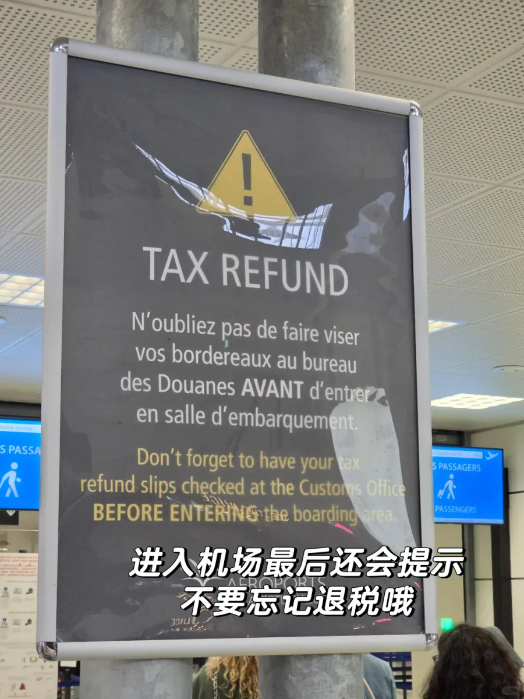

Der Flughafen Nizza Côte d’Azur (NCE) ist der wichtigste Zugang zur französischen Riviera, und Terminal 1 (T1) wickelt einen guten Teil der Flüge ab. Die meisten Reisenden kaufen in der Altstadt von Nizza, in Èze oder in Monaco ein und denken erst auf dem Rückweg an die Steuererstattung — dabei ist sie der Teil der Reise, bei dem die Reihenfolge am meisten zählt: erst validieren, dann das Gepäck aufgeben. Wer die Reihenfolge vertauscht, sieht das Geld nicht wieder.

Die französische Steuererstattung (détaxe) wird oft als ein Schalter am Flughafen verstanden, an dem Geld ausgezahlt wird. Tatsächlich sind es zwei getrennte Schritte: Der Zoll bestätigt, dass die Ware die EU mit Ihnen verlassen hat, und ein Erstattungsdienstleister zahlt auf Grundlage dieser Bestätigung aus. Den Zollschritt erledigt heute meist ein Selbstbedienungsgerät mit der Aufschrift DETAXE, und in Nizza steht es in der **Ankunftshalle von Terminal 1, neben dem französischen Zollbüro**. Viele schleppen ihren Koffer auf der Abflugebene hin und her und sehen das Schild, das sie zum Zoll verweist, erst auf dem Weg zum Gate — dann ist Umkehren keine Option mehr.

Dieser Leitfaden behandelt fünf Punkte: was Sie vorab bereithalten sollten, wie Sie die Geräte in T1 finden, was grünes und rotes Licht bedeuten, ob Karte oder Bargeld sinnvoller ist und wie viel Zeit Sie einplanen sollten.

## 1. Was vor der Rückerstattung vorbereitet sein muss

Frankreich stellt ein paar harte Bedingungen, und wenn eine davon fehlt, darf der Zoll das Formular nicht validieren: Sie müssen außerhalb der EU wohnen, mindestens 16 Jahre alt sein und **mehr als 100 € inklusive Mehrwertsteuer in einem Geschäft an einem Tag** ausgegeben haben. Diese Schwelle gilt seit dem 1. Januar 2021, und mit verstreuten kleinen Einkäufen erreichen Sie sie selten — bündeln Sie die Waren, für die Sie die Erstattung wollen, also möglichst in einem einzigen Einkauf. Zwei Filialen derselben Marke gelten als zwei verschiedene Geschäfte.

Die Frist ist die Bedingung, die gern vergessen wird. Das Formular muss bis zum Ende des dritten Monats nach dem Kaufmonat validiert sein: Wer im Oktober kauft, muss die Ware also bis Ende Januar ausgeführt und validiert haben. Danach ist das Formular ungültig, und es gibt kein Rechtsmittel. Die andere Regel lautet, dass die Ware mitreist. Der Zoll darf sie sehen wollen, deshalb gehört nichts, was erstattet werden soll, vor der Validierung ins Aufgabegepäck — und Sie können das Gepäck gewiss nicht zuerst aufgeben und später für den Stempel zurückkommen. Keine Ware, keine Validierung.

Die Liste ist kurz, aber ein fehlendes Teil kann Sie einen Platz in der Schlange kosten:

- **Reisepass** — der Name muss mit dem auf dem Erstattungsformular übereinstimmen;
- **Das Erstattungsformular (bordereau)** — vom Geschäft über das PABLO-System ausgestellt, mit PABLO-Logo und einem Barcode, vom Geschäft und von Ihnen unterschrieben;
- **Kassenbons** — sie gehören zu den Formularen, und Beträge und Daten müssen zueinander passen;
- **Die Ware selbst** — im Handgepäck oder in einem noch nicht aufgegebenen Koffer, jederzeit zu öffnen;
- **Bordkarte oder Reiseverlauf** — wird gelegentlich verlangt.

Ein Detail sollten Sie noch im Geschäft klären statt erst am Flughafen: die Art der Auszahlung. Wenn Sie die Karte wählen, müssen Kartennummer, Gültigkeitsdatum und Name des Karteninhabers stimmen — eine falsche Kartennummer ist der häufigste Grund, aus dem eine Erstattung scheitert. Wenn Sie Bargeld wählen, prüfen Sie, ob auf dem Formular tatsächlich Bargeld angekreuzt ist. Ein Tippfehler fällt erst am Automaten auf — dann ist es zu spät; der Flughafen kann ihn nicht korrigieren, und Sie schreiben stattdessen dem Geschäft oder dem Erstattungsdienstleister.

## 2. DETAXE und PABLO im Terminal 1 finden

Der Validierungspunkt liegt nicht in der Check-in-Halle der Abflugebene, sondern in der **Ankunftshalle neben dem französischen Zollbüro (Douanes françaises)**: in Terminal 1 gegenüber dem Informationsschalter, in Terminal 2 gegenüber dem Gate A3. Wer zum ersten Mal da ist, kreist gern auf der Abflugebene. Suchen Sie stattdessen das blaue Schild mit der Aufschrift „Douanes françaises / French Customs“ — die Geräte stehen direkt an seiner Tür.

Das Säulenschild ist auf Französisch, Englisch, Chinesisch, Russisch und Arabisch beschriftet, die Pfeile zeigen zum Zollschalter. Die weißen Geräte darunter sind die Selbstbedienungsgeräte: oben **DETAXE**, vorn **TAX REFUND**, in der Mitte ein Touchscreen, darunter ein dunkelblauer Scankopf mit einem roten Leseschlitz, und am Gehäuse eine Gerätenummer (auf dem Foto die Nummer 86). Die Geräte stehen direkt neben dem besetzten Schalter, die elektronische und die manuelle Route teilen sich also dieselbe Stelle: Gerät bestanden, weitergehen; Gerät nicht bestanden, umdrehen zum Schalter.

Das Gerät ist einfach zu bedienen. Der erste Bildschirm fragt nach der Sprache, und über die Flaggen-Symbole lässt sich die Anzeige direkt auf Chinesisch umstellen; danach erscheinen alle Hinweise in dieser Sprache, auch die sehr konkrete Aufforderung, die Erstattungsformulare einzeln zu scannen. Für alle, die kein Französisch lesen, zählt das vor allem dann, wenn etwas schiefgeht: Bei einem roten Ergebnis sagt Ihnen der Bildschirm in der gewählten Sprache, wohin Sie als Nächstes gehen.

Und merken Sie sich, wo dieser Bereich liegt: im öffentlichen Teil des Terminals, vor der Sicherheitskontrolle. Der Flughafen Nizza verlangt ausdrücklich, dass die Formulare **vor der Sicherheitskontrolle validiert werden**; wer einmal im Sicherheitsbereich ist, kann nicht zurück. Auch die Wechselstuben hinter der Kontrolle zahlen nicht auf unvalidierte Formulare aus. Die richtige Reihenfolge lautet also: am Flughafen ankommen, die DETAXE-Geräte finden, validieren, dann einchecken und das Gepäck aufgeben.

## 3. Grünes Licht und rotes Licht

Das Scannen ist eine einzige Bewegung: Formular so drehen, dass der Barcode in den roten Schlitz zeigt, und hineinschieben. Das Gerät piept, sobald es den Code gelesen hat, und der Bildschirm zählt in drei Spalten: **gescannte Formulare**, **validierte Formulare** (grüner Haken) und **nicht validierte Formulare** (rotes Minus). Die Aufteilung ist praktisch: Sie sehen auf einen Blick, ob die gerade eingeführten Formulare durchgekommen sind, statt sie einzeln im Kopf durchzugehen.

Beim Einführen muss der Barcode zur roten Lichtleiste zeigen und das Papier flach liegen, nicht gefaltet. Zuerst zählt der Scan-Zähler hoch, dann folgt die grüne oder die rote Spalte. Ein kleiner Hinweis an der Seite des Geräts ergänzt einen Punkt, den man kennen sollte: **Formulare mit Ziel Genf oder Basel werden bei der Ankunft in der Schweiz validiert**. Wer über Zürich nach Hause fliegt, bekommt diese Formulare an diesem Gerät nicht durch — sie müssen bis zur Landung in der Schweiz warten.

**Grün bedeutet erledigt.** Der Bildschirm meldet, dass die Erstattung validiert ist, und eine Zeile darunter besagt, dass Sie den Erstattungsbereich verlassen dürfen und nicht mehr zum Zollschalter müssen. Nach den Regeln des französischen Zolls hat die elektronische Meldung eines PABLO-Terminals dieselbe Wirkung wie ein Stempel, und das Ergebnis geht noch am selben Tag an den Erstattungsdienstleister; Sie müssen nichts an das Geschäft zurückschicken. Das dauert Sekunden pro Formular, und der Bildschirm verabschiedet Sie freundlich.

**Rot bedeutet: Ein Mensch entscheidet.** Der Bildschirm schickt Sie zum Zollbüro nebenan, wo ein Beamter die Papiere prüft und stempelt oder unterschreibt. Die Gründe dafür sind meist banal: Das Formular wurde nicht ordentlich über PABLO ausgestellt (in einem anderen EU-Land gekauft, oder ein alter handgeschriebener Beleg), der Barcode ist geknickt oder verschmutzt und lässt sich nicht lesen, der Name stimmt nicht mit dem Reisepass überein, die Drei-Monats-Frist ist abgelaufen, oder eine Stichprobe will die Ware sehen. Die ersten drei bedeuten in jedem Fall den manuellen Weg; ein abgelaufenes Formular ist nicht mehr zu retten; und bei einer Stichprobe kommt es darauf an, ob die Ware noch bei Ihnen ist.

Eine Meldung unterscheidet sich von einem einfachen roten Licht: Der Bildschirm kann besagen, dass das Formular vom französischen Zoll nicht validiert werden kann, weil es von Ihrem Erstattungsdienstleister nicht ordentlich ausgestellt wurde. Das ist keine Einladung, für einen Stempel anzustehen — das Formular selbst ist fehlerhaft, und der Zoll kann das nicht heilen. Wenden Sie sich an den Dienstleister, dessen Angaben auf dem Formular stehen.

Vor dem Schalter steht meist eine mit Absperrbändern gezogene Schlange, die in der Hochsaison bis in die Mitte der Halle reicht. Wenn Sie an der Reihe sind, reichen Sie Reisepass, Formulare und Ware zusammen durch; der Beamte wirft vielleicht nur einen Blick darauf oder bittet Sie, einen Koffer zu öffnen und ein bestimmtes Stück zu zeigen. Erst der Stempel schließt das Verfahren ab — erst danach stellt sich die Frage nach dem Geld.

## 4. Karte oder Bargeld

Viele glauben, nach dem grünen Licht komme das Geld automatisch. Die Validierung bedeutet nur, dass der Dienstleister nun zahlen darf; wohin und wann er zahlt, hängt davon ab, was Sie im Geschäft gewählt haben. In Nizza läuft die Bargeldauszahlung über Wechselstuben wie Global Exchange — eine im öffentlichen Bereich neben dem Zoll, eine im Sicherheitsbereich. Kartenauszahlungen bearbeiten dagegen die Dienstleister (Global Blue, Planet und andere), sobald ihnen die Zolldaten vorliegen.

**Karte** ist die verlässlichste Variante. Sie tragen keinen Stapel Euro mit sich herum, der Betrag wird zum Kurs des Kartensystems umgerechnet, und wenn die Papiere verloren gehen oder die Summe strittig ist, haben Sie eine Kartennummer, mit der sich argumentieren lässt. Der Preis ist die Zeit: Wochen bis Monate sind normal, über die Hochsaison hinweg länger. Sie passt zu größeren Beträgen, bei denen Sie nicht unter Zeitdruck stehen. Prüfen Sie aber Nummer und Gültigkeitsdatum, denn eine Erstattung auf eine abgelaufene Karte zurückzuholen ist mühsam.

**Bargeld** zahlt sofort. Sie reichen das validierte Formular an der Wechselstube durch, nehmen die Euro und geben sie außerhalb des Terminals aus. Der Preis ist der Kurs: Die Stube kauft deutlich unter dem Marktkurs, Sie tauschen also einen Teil der Erstattung gegen sofortiges Geld und keinen weiteren Aufwand. Bei kleinen Beträgen, knapper Zeit oder wenn Sie nicht monatelang einer Zahlung nachlaufen möchten, ist Bargeld die entspanntere Wahl.

Praktisch entscheiden Sie nach der Höhe und danach, was als Nächstes kommt. Ein großer einzelner Betrag gehört auf die Karte, wo der Kursverlust anteilig klein ist und Warten vertretbar. Ein paar Formulare mit zusammen ein paar Dutzend Euro wickeln Sie besser in Bargeld ab — der gesparte Aufwand ist mehr wert als der Kursunterschied. Und wenn Sie schon im Sicherheitsbereich sind: Nur validierte Formulare werden an der Wechselstube dort ausgezahlt. Genau deshalb lässt sich die Reihenfolge — erst validieren, dann durch die Sicherheitskontrolle — nicht umdrehen.

## 5. Zeit und typische Fallen

Die Saison an der Côte d’Azur ist lang, und im Juli und August überlappen sich Urlauber, Kreuzfahrtgäste und Wochenendbesucher, sodass in T1 die Schlangen bei der Erstattung und vor der Sicherheitskontrolle zugleich länger werden. **Planen Sie mindestens 3 Stunden am Flughafen ein** — die Erfahrung von Reisenden, die diese Strecke regelmäßig fliegen. Das Gerät selbst erledigt ein Formular in wenigen Sekunden, aber Anstehen, das Zusammensuchen der Papiere, ein geöffneter Koffer für die Prüfung und der Weg von der Ankunftsebene zurück zum Check-in kosten Zeit. Mittags in der Hochsaison reicht die Schlange am Zollschalter bis in die Mitte der Halle, und sie bewegt sich langsam, auch wenn sie kurz aussieht.

Im Korridor Richtung Abflugbereich steht eine graue Hinweistafel: ein gelbes Warndreieck, die Worte **TAX REFUND** und ein Absatz auf Französisch und Englisch, der daran erinnert, die Erstattungsformulare vor dem Betreten des Abflugbereichs beim Zollbüro prüfen zu lassen. Die Position der Tafel sagt alles — sie taucht auf, wenn Sie schon fast an der Sicherheitskontrolle sind. Wer sie erst dann als Erinnerung bemerkt, muss meist umkehren, und in Nizza ist Umkehren nicht immer erlaubt.

Der ganze Ablauf als Checkliste für den Abflugtag:

1. **3 Stunden früher da sein**, in der Hochsaison mit etwas mehr Reserve.
2. **Erst erstatten, dann Gepäck aufgeben** — nichts, was erstattet werden soll, kommt vor der Validierung ins Aufgabegepäck.
3. **Nach der Validierung umpacken**, nicht vor dem Zollschalter.
4. **Ein Formular nach dem anderen scannen** und darauf achten, dass der Zähler für validierte Formulare jedes Mal um eins steigt.
5. **Ein rotes Formular nicht erneut scannen** — gehen Sie stattdessen zum Zollschalter; wiederholte Versuche halten nur die Schlange auf.
6. **Jeden Kassenbon und jedes Formular bis zur Auszahlung aufbewahren**, besonders bei Kartenauszahlungen, wo sie der einzige Beleg sind, wenn die Zahlung scheitert.
7. **Ein Foto machen** — vom gestempelten Formular oder vom Bildschirm mit der Bestätigung, für die spätere Abstimmung.
8. **Kartennummer zweimal prüfen** — Nummer, Gültigkeit und Name des Karteninhabers.

Zum Schluss ein Hinweis: Schwellen, Standorte der Geräte und Öffnungszeiten der Schalter können sich ändern. Dieser Artikel beschreibt den Stand von Oktober 2026; maßgeblich sind am Reisetag die Websites des Flughafens Nizza und des französischen Zolls, und vor Ort können Sie auch das Personal fragen.

## Weiterführende Links

- **Auf dieser Website**: [Frankreich (FR)](/country/FR)
- **Wikipedia**: [Flughafen Nizza Côte d’Azur](https://en.wikipedia.org/wiki/Nice_C%C3%B4te_d%27Azur_Airport)
- **Baidu Baike**: [Flughafen Nizza Côte d’Azur](https://baike.baidu.com/item/%E5%B0%BC%E6%96%AF%E8%93%9D%E8%89%B2%E6%B5%B7%E5%B2%B8%E6%9C%BA%E5%9C%BA)
