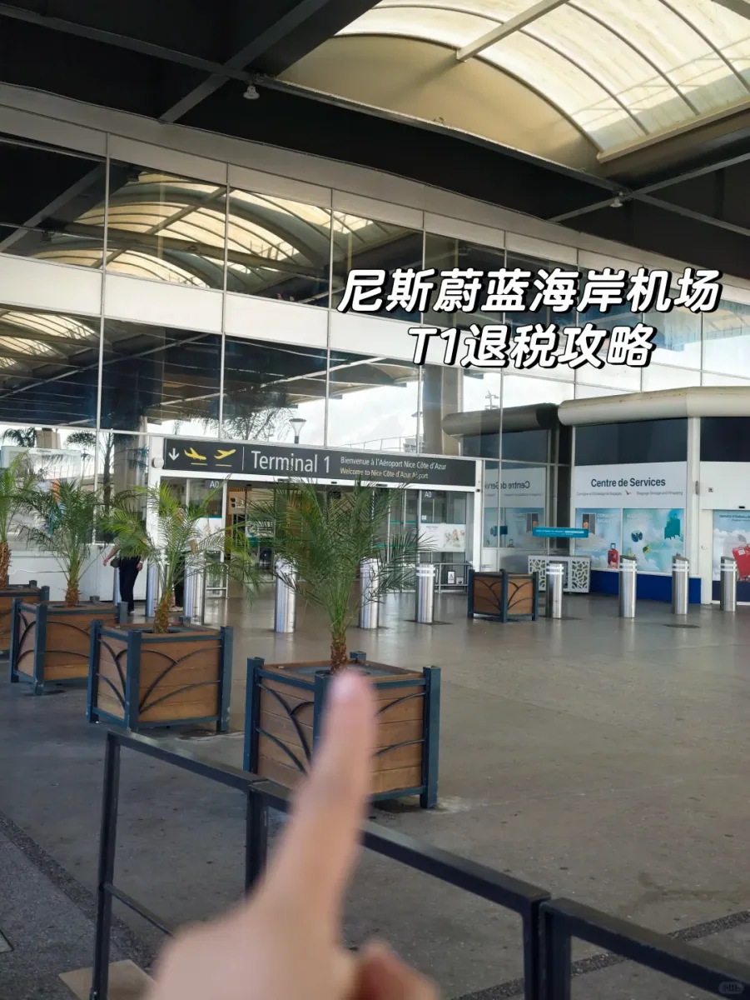
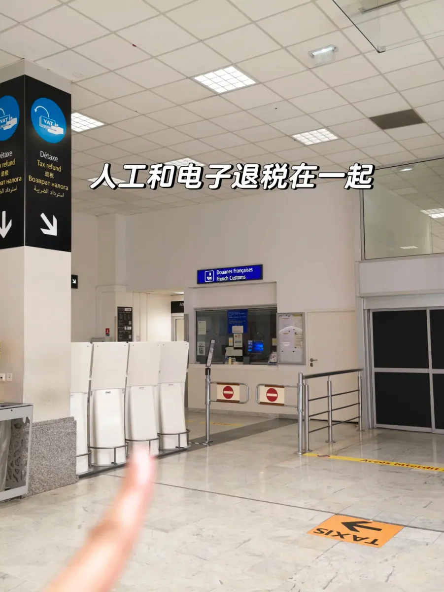
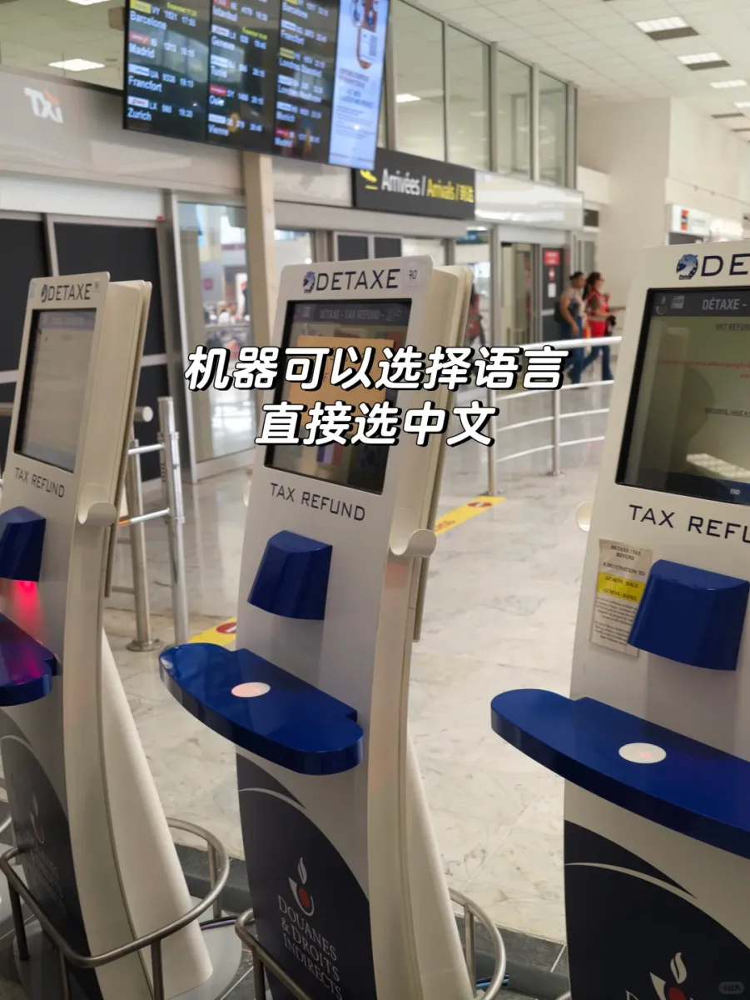
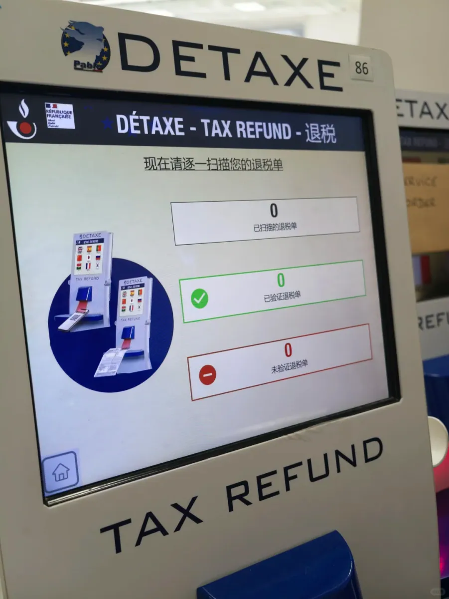
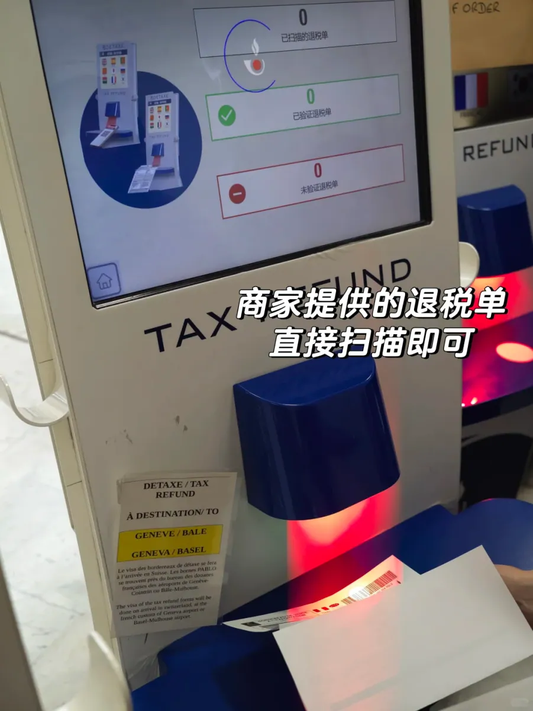
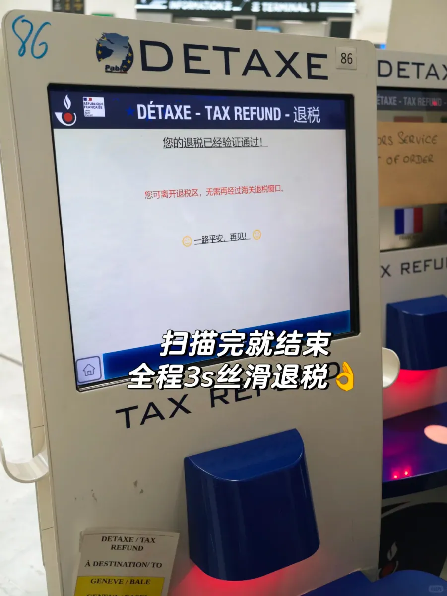
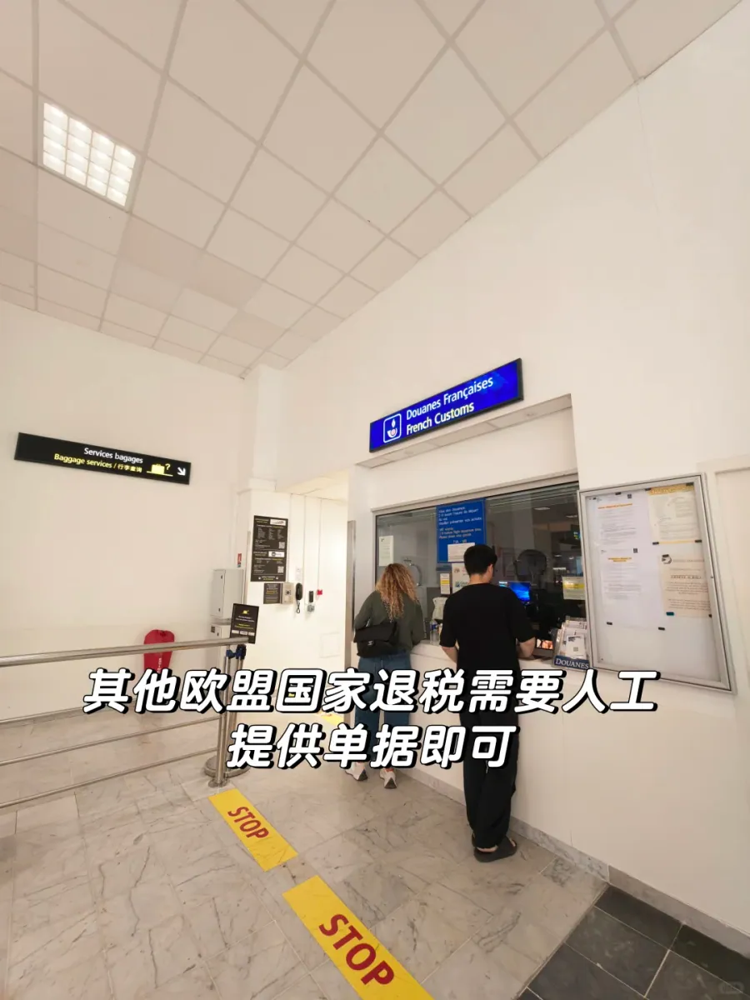

L'aéroport de Nice Côte d'Azur (NCE) est la principale porte d'entrée de la Côte d'Azur, et le terminal 1 traite une bonne part de ses vols. La plupart des voyageurs passent les derniers jours du séjour à faire les boutiques dans le vieux Nice, à Èze ou à Monaco, et ne pensent à la détaxe qu'en revenant à l'aéroport. La détaxe est la partie du voyage où l'ordre des choses compte plus que tout : valider d'abord, enregistrer les bagages ensuite. Se tromper d'ordre et l'argent est perdu.

La détaxe française — la détaxe — est souvent imaginée comme un guichet à l'aéroport qui tend des espèces. En pratique, elle se fait en deux étapes distinctes : la douane confirme que les marchandises ont bien quitté l'UE avec vous, puis un opérateur de remboursement paie sur la foi de cette confirmation. L'étape douanière se fait désormais surtout par une machine libre-service marquée DETAXE, et à Nice cette machine se trouve dans le **hall des arrivées du terminal 1, à côté du bureau des douanes françaises**. Beaucoup de gens traînent leurs valises dans le hall des départs à sa recherche et ne repèrent l'avertissement leur indiquant de voir la douane avant d'aller en salle d'embarquement qu'à un moment où faire demi-tour n'est plus possible.

Ce guide aborde cinq points : ce qu'il faut préparer, comment trouver les bornes au T1, ce que signifient les résultats vert et rouge, faut-il choisir un remboursement par carte ou en espèces, et combien de temps prévoir.

## 1. Ce qu'il faut préparer avant de partir

La France impose quelques conditions strictes, et il suffit d'en manquer une pour que la douane refuse de valider le formulaire. Il faut résider hors de l'UE, avoir au moins 16 ans et dépenser **plus de 100 € TVA comprise dans une même boutique et une même journée**. Ce seuil s'applique depuis le 1er janvier 2021, et de petits achats dispersés l'atteignent rarement : regroupez donc les articles à détaxer dans une seule transaction — deux succursales de la même marque comptent comme deux boutiques différentes.

Le délai est la condition que l'on oublie. Le formulaire doit être validé avant la fin du troisième mois suivant celui de l'achat : un article acheté en octobre doit avoir quitté l'UE et être validé avant la fin janvier. Passé ce délai, il est nul, sans procédure de recours. L'autre règle est que les marchandises voyagent avec vous. La douane peut demander à les voir : rien de ce qui est détaxé ne doit aller en soute avant la validation, et vous ne pouvez évidemment pas enregistrer le bagage puis revenir chercher le cachet. Pas de marchandises, pas de validation.

La liste elle-même est courte, mais un seul élément manquant peut vous coûter une place dans la file :

- **Passeport** — le nom doit correspondre à celui du formulaire de détaxe ;
- **Le formulaire de détaxe (bordereau)** — délivré par la boutique via le système PABLO, portant le logo PABLO et un code-barres, signé par la boutique et par vous ;
- **Les reçus** — ils accompagnent les formulaires, et les montants et dates doivent concorder ;
- **Les marchandises elles-mêmes** — dans un bagage cabine ou une valise non enregistrée, prêtes à être ouvertes ;
- **La carte d'embarquement ou l'itinéraire** — demandés à l'occasion.

Un détail vaut mieux réglé en boutique qu'à l'aéroport : le mode de remboursement. Si vous choisissez la carte, le numéro, la date d'expiration et le nom du titulaire doivent être exacts — un numéro de carte erroné est la première cause d'échec d'un remboursement. Si vous choisissez les espèces, vérifiez que le formulaire est bien coché pour les espèces. Découvrir une faute de frappe à la borne est trop tard : l'aéroport ne peut pas la corriger, et vous devrez écrire à la boutique ou à l'opérateur de remboursement.

## 2. Trouver DETAXE et PABLO au terminal 1

Le point de validation ne se trouve pas dans le hall d'enregistrement des départs. Il est dans le **hall des arrivées, à côté du bureau des douanes françaises (Douanes françaises)** : au terminal 1, face au comptoir d'information ; au terminal 2, face à la porte A3. Les visiteurs de première fois tournent en général dans le hall des départs. Cherchez plutôt le panneau bleu « Douanes françaises / French Customs » — les bornes se dressent à sa porte.

Le panneau sur pilier est en français, anglais, chinois, russe et arabe, avec des flèches vers le guichet des douanes. La rangée de meubles blancs en dessous constitue l'équipement libre-service : **DETAXE** en haut, **TAX REFUND** sur la face avant, un écran tactile au milieu, une visière de scanner bleu foncé en dessous avec une fente de lecture rouge à l'intérieur, et un numéro d'appareil sur le corps (86 sur la machine de la photo). Les bornes sont juste à côté du comptoir avec personnel : la voie électronique et la voie manuelle se séparent au même endroit — réussissez à la machine et passez, échouez et retournez au guichet.

La machine est simple. Le premier écran demande la langue, et les icônes de drapeaux permettent de passer au chinois, après quoi toutes les instructions — y compris le très précis « scan your refund forms one at a time » — s'affichent en chinois. Pour qui ne lit pas le français, cela compte surtout quand quelque chose se passe mal : un résultat rouge vous indiquera, en chinois, où aller ensuite.

Retenez où cela se trouve : dans la zone publique, avant la sécurité. L'aéroport de Nice exige que les formulaires soient **validés avant de passer le poste de contrôle de sécurité**, et une fois côté piste, impossible de revenir. Les bureaux de change de la zone réservée ne paieront pas non plus un formulaire non validé. L'ordre correct est : arriver, trouver les bornes DETAXE, valider, puis enregistrer et déposer les bagages.

## 3. Feu vert et feu rouge : les deux issues

La lecture ne demande qu'un geste : tournez le formulaire pour que le code-barres fasse face à la fente rouge et engagez-le. La machine bipe quand elle lit le code, et l'écran commence à compter en trois colonnes — **formulaires scannés**, **formulaires validés** (coche verte) et **formulaires non validés** (moins rouge). La disposition est utile : on voit d'un coup d'œil si les formulaires qu'on vient d'insérer sont bien passés, au lieu d'essayer de s'en souvenir un par un.

Quand vous insérez un formulaire, le code-barres doit faire face à la bande de lumière rouge et le papier doit être bien à plat, non plié. Le compteur des scannés s'incrémente d'abord, puis la colonne verte ou rouge suit. Une petite notice collée sur le côté de la machine ajoute une réserve à connaître : **les formulaires marqués pour Genève ou Bâle sont validés à l'arrivée en Suisse**. Si votre trajet retour passe par Nice-Zurich et au-delà, ces formulaires ne seront pas validés à cette borne — ils devront attendre l'atterrissage en Suisse.

**Vert, c'est fait.** L'écran annonce que le remboursement a été validé, et une ligne en dessous précise que vous pouvez quitter la zone de détaxe sans passer au guichet des remboursements des douanes. Selon les règles douanières françaises, le message électronique d'un terminal PABLO a la même valeur qu'un cachet physique, et le résultat est transmis à l'opérateur de remboursement le jour même ; rien n'est à renvoyer à la boutique. Cela prend quelques secondes par formulaire, et l'écran se termine par un message d'au revoir joyeux.

**Rouge signifie qu'il faut voir un agent.** L'écran vous envoie au bureau des douanes voisin, où un agent vérifie les documents et appose un cachet ou une signature. Les raisons habituelles sont banales : le formulaire n'a pas été correctement émis via PABLO (acheté dans un autre pays de l'UE, ou vieux bordereau manuscrit), le code-barres est froissé ou sale et illisible, le nom ne correspond pas au passeport, le délai de trois mois est dépassé, ou un contrôle ponctuel veut voir les marchandises. Les trois premières imposent de toute façon la voie manuelle ; un formulaire expiré ne peut pas être sauvé ; et un contrôle ponctuel dépend simplement de la présence des marchandises avec vous.

Un message diffère d'un simple feu rouge : l'écran peut indiquer que le formulaire ne peut pas être validé par les douanes françaises parce qu'il n'a pas été correctement émis par votre opérateur de remboursement. Ce n'est pas une invitation à faire la queue pour un cachet — le formulaire lui-même est défectueux, et la douane ne peut pas le réparer. Contactez l'opérateur dont les coordonnées sont imprimées sur le formulaire.

Une file se forme généralement derrière un ruban devant le guichet, atteignant le milieu du hall en haute saison. Quand vient votre tour, vous présentez ensemble passeport, formulaires et marchandises ; l'agent peut à peine y jeter un œil, ou vous demander d'ouvrir une valise et de montrer un article précis. Le cachet termine les formalités — c'est seulement ensuite que la question du paiement se pose.

## 4. Carte ou espèces

Beaucoup de gens croient que l'argent arrive automatiquement après un feu vert. La validation signifie seulement que l'opérateur est désormais autorisé à payer ; où et quand il paie dépend de ce que vous avez choisi en boutique. À Nice, les remboursements en espèces sont traités par des bureaux de change comme Global Exchange — un dans la zone publique à côté des douanes, un côté piste — tandis que les remboursements par carte sont traités par les opérateurs (Global Blue, Planet et d'autres) une fois qu'ils ont reçu les données douanières.

**Le remboursement par carte** est l'option la plus fiable. Vous ne transportez pas une liasse d'euros, le montant est converti au taux du réseau de la carte, et si les documents se perdent ou que la somme est contestée, vous avez un numéro de carte pour réclamer. Le coût, c'est le temps : quelques semaines à quelques mois est normal, et davantage en pleine saison. Cela convient aux remboursements importants quand vous n'êtes pas pressé. Vérifiez bien le numéro et la date d'expiration, car un remboursement envoyé sur une carte morte est pénible à récupérer.

**Les espèces** paient immédiatement. Remettez le formulaire validé au comptoir de change, prenez les euros et dépensez-les hors du terminal. Le coût, c'est le taux : le comptoir achète la devise bien en dessous du taux du marché, vous échangez donc une partie du remboursement contre de l'argent immédiat et aucun suivi. Pour de petits montants, un emploi du temps serré ou qui ne veut pas courir après un paiement pendant des mois, les espèces sont le choix le plus tranquille.

Une façon pratique de décider est de regarder le montant et la suite. Un gros remboursement unique mérite une carte, où la perte de change est proportionnellement faible et l'attente acceptable. Quelques formulaires valant quelques dizaines d'euros se règlent mieux en espèces — l'effort épargné vaut plus que la différence de taux. Et si vous êtes déjà côté piste, souvenez-vous que seuls les formulaires validés peuvent être payés au bureau de change intérieur ; c'est exactement pourquoi la validation avant la sécurité ne peut pas être inversée.

## 5. Timing et liste de contrôle

La saison de la Côte d'Azur est longue, et en juillet et août vacanciers, croisiéristes et visiteurs de week-end se chevauchent : la file de détaxe et celle de la sécurité au T1 s'allongent. **Prévoyez au moins 3 heures à l'aéroport** — le conseil de voyageurs qui empruntent régulièrement cet itinéraire. La machine traite un formulaire en quelques secondes, mais faire la queue, sortir les documents, faire ouvrir une valise pour inspection et remonter des arrivées à l'enregistrement prennent du temps. À midi en haute saison, la file du guichet des douanes peut s'étendre jusqu'au milieu du hall, et elle avance lentement même quand elle paraît courte.

Un panneau gris se dresse dans le couloir vers la zone d'embarquement : un triangle d'avertissement jaune, les mots **TAX REFUND**, et un paragraphe en français et en anglais rappelant aux voyageurs de faire vérifier leurs formulaires de détaxe au bureau des douanes avant d'entrer dans la zone d'embarquement. Sa position dit tout — il apparaît quand vous êtes proche de la sécurité. Le repérer comme un rappel signifie généralement faire demi-tour, et à Nice faire demi-tour n'est pas toujours permis.

Le processus complet, sous forme de liste pour le jour du départ :

1. **Arrivez 3 heures avant**, et un peu plus tôt en haute saison.
2. **La détaxe d'abord, les bagages ensuite** — rien de ce qui est détaxé ne va en soute avant validation.
3. **Refaites les bagages après validation**, pas devant le guichet des douanes.
4. **Scannez un formulaire à la fois** et regardez le compteur des validés augmenter de un à chaque fois.
5. **Ne rescannez pas un formulaire rouge** — allez au guichet des douanes ; les tentatives répétées ne font que bloquer la file.
6. **Conservez chaque reçu et formulaire jusqu'à l'arrivée de l'argent**, surtout pour les remboursements par carte, où ils sont votre seule preuve en cas d'échec du paiement.
7. **Photographiez le formulaire tamponné**, ou l'écran validé, pour un rapprochement ultérieur.
8. **Vérifiez deux fois le numéro de carte** — numéro, date d'expiration et nom du titulaire.

Une dernière remarque : les seuils, l'emplacement des bornes et les horaires des comptoirs peuvent tous changer. Ce guide reflète la situation d'octobre 2026 ; consultez les sites de l'aéroport de Nice et des douanes françaises le jour même, et demandez au personnel sur place en cas de doute.

## Liens utiles

- **Sur ce site :** [France (FR)](/country/FR)
- **Wikipédia :** [Aéroport de Nice Côte d'Azur](https://en.wikipedia.org/wiki/Nice_C%C3%B4te_d%27Azur_Airport)
- **Baidu Baike :** [Aéroport de Nice Côte d'Azur](https://baike.baidu.com/item/%E5%B0%BC%E6%96%AF%E8%93%9D%E8%89%B2%E6%B5%B7%E5%B2%B8%E6%9C%BA%E5%9C%BA)
